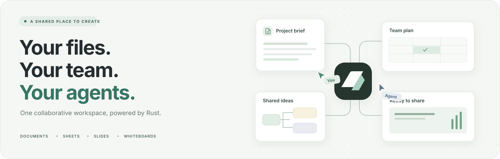
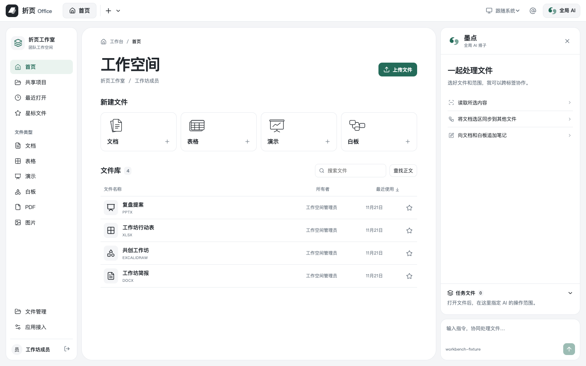
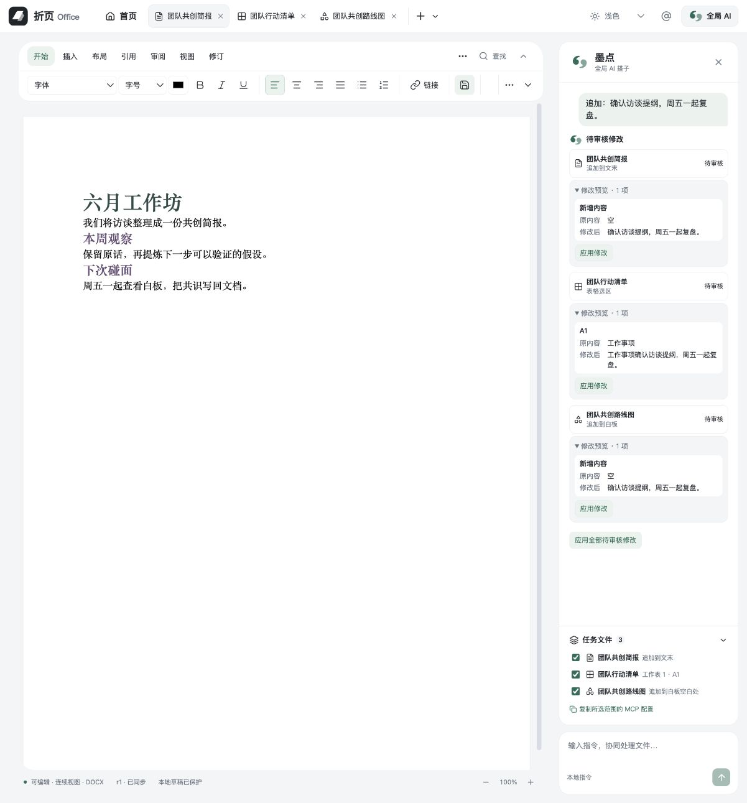
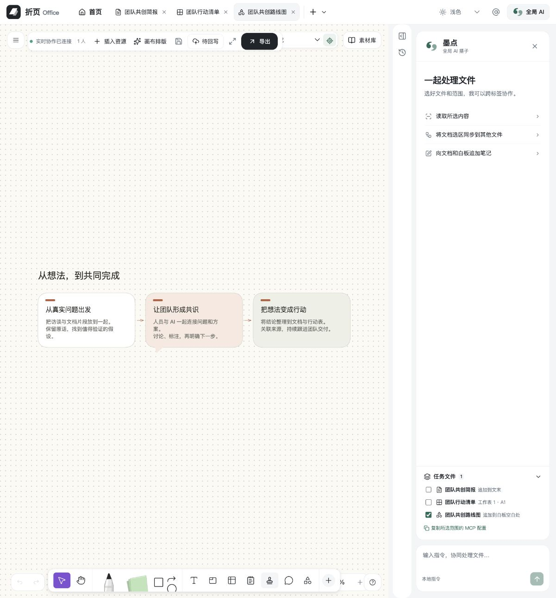
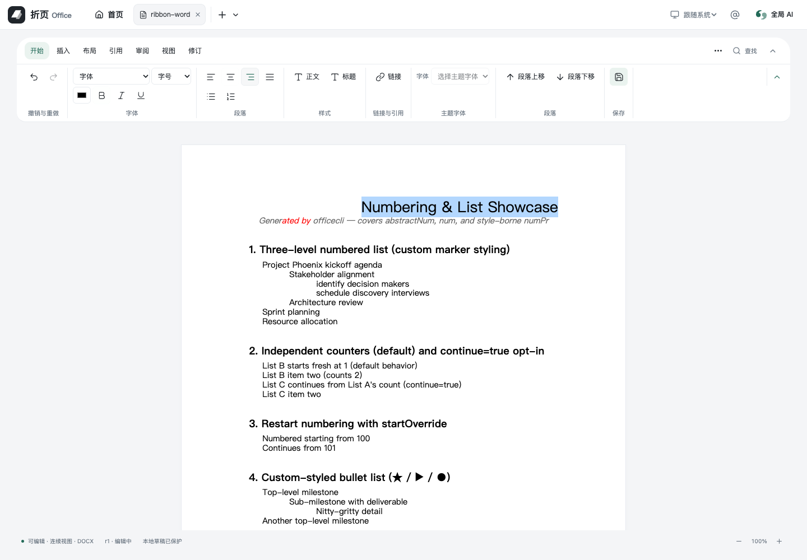
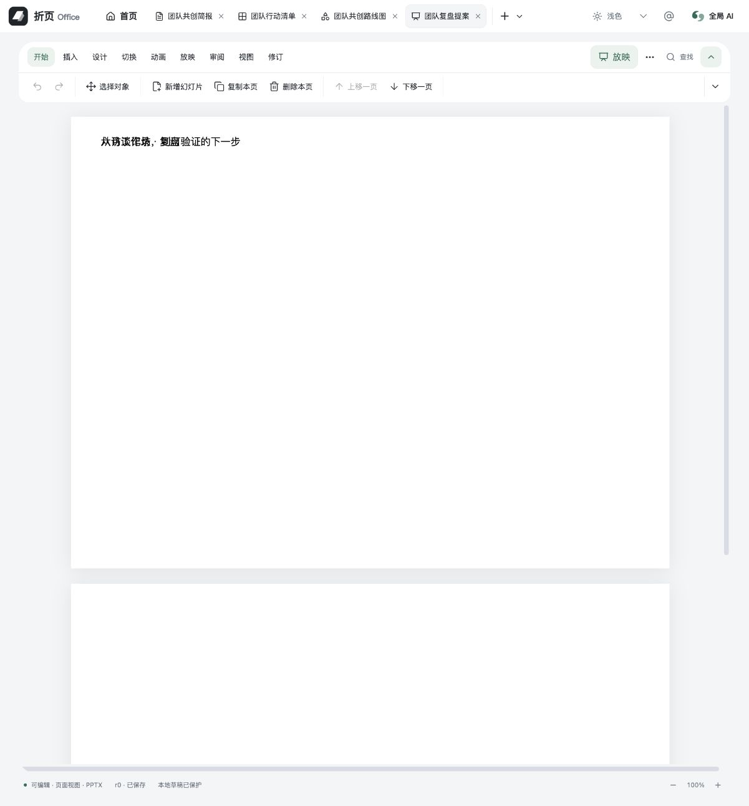
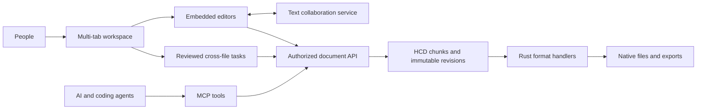

<p align="center">
  
</p>

<h1 align="center">Documents for teams. Tools for agents.</h1>

<p align="center">A collaborative workspace and Rust document engine for people, AI assistants and coding agents.</p>

<p align="center">
  <a href="LICENSE"></a>
  
  
</p>

<p align="center"><b>English</b> · <a href="README_zh.md">中文</a> · <a href="README_ja.md">日本語</a> · <a href="README_ko.md">한국어</a></p>



**Foldly brings documents, spreadsheets, presentations and whiteboards into one workspace.** Open several files, work with teammates, and let a global AI assistant operate on the files and selections you choose. Embed an editor in your own product, or connect an external agent through MCP without showing a chat panel.

Its Rust document engine is exposed through the `officecli` command for reading, creating, editing and exporting files from scripts, developer tools and agent workflows.

[Try the workspace](#run-the-workspace) · [Deploy with Docker Compose](#deploy-with-docker-compose) · [Administration console](#administration-console) · [Downloads](docs/workspace-distribution.zh.md#下载-0134) · [Connect an agent](#connect-ai-and-coding-agents) · [Embed an editor](#embed-in-your-product) · [Documentation](#documentation)

## One workspace, several ways to collaborate

- **Keep work together.** A file library, shared projects and multiple tabs for documents, sheets, slides, whiteboards, PDFs and images. Reorder or group tabs, reopen closed files, and recover each tab's selection, viewport and unsent AI draft.
- **Work with people and agents.** Collaborative text editing, named presence and selections, visible agent activity, anchored comments and reviewable revisions. Whiteboard Spec text supports simultaneous human and AI edits in the same passage.
- **Give AI a precise target.** Select a paragraph, cell range or canvas object. Review proposed cross-file changes, apply them, and follow the saved revision back to its file. Supported AI edits can be undone individually while retaining distinguishable later input.
- **Move between formats.** Reference document passages and worksheet ranges on a whiteboard, open the original source, and organize selected board content back into an editable document with a backlink.
- **Keep your own application.** Use the full workspace, an individual embedded editor, a selection-scoped MCP connection, or the local CLI. The chat UI is optional.



## AI collaboration across files

A task can read one file and edit another, or coordinate several files with explicit dependencies:

> Read the selected interview notes, record the actions in the worksheet, and append the confirmed next steps to the whiteboard.

The workspace tracks the target file and range for each step. Proposed writes have a review step; successful writes return revision receipts. Dependent steps use saved results, and a changed target requires a new check rather than silently overwriting newer work. Files have independent commits; a cross-file workflow is not a single distributed transaction.

External agents use the same document APIs and permission checks. Each agent can carry its own identity and visible editing activity. For the built-in natural-language planner, configure a supported model endpoint; local read/write commands also work without a model.

For larger tasks, the editor's AI team supports 1–4 workers with a shared plan, scoped work leases and peer findings. Supported full-deck PPTX rebuilds draft slides in parallel and validate the results before live replacement. This requires the configured AI backend; see [agent-team verification and limits](docs/acceptance/hcd-agent-team-rebuild.zh.md).



## Documents, data and an infinite canvas

| Surface | Current capabilities |
| --- | --- |
| **Word · DOCX** | Rich text, paragraph formatting, inline tables and merge/split, pictures, anchored margin comments, tracked-change review, page margins, linked table of contents and footnotes. |
| **Spreadsheets · XLSX, CSV, TSV** | A virtualized grid, formulas, rich cell text, ranges, charts, filtering, sorting, conditional formats, pivot features and XLSX print settings. CSV/TSV upload opens an editable workbook. |
| **Slides · PPTX** | Inline text and objects, pictures and shapes, alignment and grouping, thumbnail reordering, notes, inherited layout/master text styles, supported animations and slide transitions. |
| **Whiteboards · Excalidraw** | Native editable shapes, sticky notes, connectors, mind maps, flowcharts, architecture and teaching diagrams, rich-text Specs, resource references, comments, mentions, stamps and animated materials. AI layouts append into free space. |
| **PDF** | Fixed-page viewing, mapped text editing, page operations and OCR workflows. Capabilities depend on the source content and the available mapping. |
| **Text and images** | Markdown, HTML and TXT editing; PNG, JPEG and WebP image workflows with selection and image controls. |

Native Office settings and supported edits are verified through editing, export and reopening of the same original. Export fidelity is format- and operation-specific; see [current boundaries](#current-boundaries).



<details>
<summary><b>More real editor views: Word, Excel and PowerPoint</b></summary>

| Word · rich text and formatting | Excel · cells and formulas |
| --- | --- |
|  |  |



These are screenshots of running editors with example documents, not design mockups. [Capture sources and verification](docs/assets/readme/screenshots.json).

</details>

## Run the workspace

The **Rust CLI is a native binary**. The **web workspace additionally runs Node.js services** for the application and collaboration. Building the workspace requires a Rust toolchain and Node.js **24.13+**.

From a checkout of this source tree:

```bash
npm ci --prefix examples/hdoc/admin-app
npm ci --prefix examples/hdoc/editor
npm ci --prefix examples/hdoc/xlsx-univer-viewer
npm ci --prefix examples/hdoc/embed-host
npm ci --prefix apps/workspace
cargo build --release -p officecli --bin officecli
npm run build --prefix apps/workspace
npm run demo --prefix examples/hdoc/embed-host
```

Open **http://fold.localhost:4417/workbench/**. The local demo creates an isolated temporary workspace with example files and signs in a restricted demo member. Restarting the demo creates new demo data.

For a persistent workspace with your own accounts, initialize and start it with [`apps/workspace/cli.mjs`](apps/workspace/README.zh.md#构建与启动). That guide also covers permissions, sharing, tenant isolation, deployment, backups and business-file publication. Published standalone CLI binaries do not by themselves contain the built web workspace.

### Deploy with Docker Compose

The root Compose file starts PostgreSQL, Caddy, the workspace and a separate Yjs/Hocuspocus service. Scale collaboration replicas by document and keep the same authenticated WebSocket entry point. The workspace hosts the OfficeCLI document engine, editor and admin console. Compose overlays support MySQL, SQLite and managed databases. The offline macOS desktop app uses local SQLite. [docker-compose.yaml](docker-compose.yaml) · [Deployment, scaling and recovery](docs/workspace-distribution.zh.md#docker-compose-云端工作台)

### Administration console

Open `/admin` on your workspace domain, or [http://localhost:7400/admin](http://localhost:7400/admin) with the default local Compose configuration. Sign in with the workspace administrator account. On the first Compose startup, `FOLDLY_ADMIN` sets its username and `FOLDLY_ADMIN_PASSWORD_FILE` points to its password file.

Administrators can manage members and roles, grant access to individual files, configure fonts and themes, and review write-back jobs and audit records. The console currently uses a Chinese interface. [Console screenshots](README_zh.md#管理后台) · [Administration guide](apps/workspace/README.zh.md#使用流程)

## Connect AI and coding agents

### 1. Give a local coding agent document tools

Start the stdio MCP server:

```bash
./target/release/officecli mcp
```

For clients accepting a `mcpServers` configuration, register the **absolute path** to the binary:

```json
{
  "mcpServers": {
    "officecli": {
      "command": "/absolute/path/to/officecli",
      "args": ["mcp"]
    }
  }
}
```

Use your client's equivalent stdio registration if its configuration format differs. The server exposes local document commands and HCD tools. For HCD, set `HCD_API_URL` to the document service origin and inject a document-scoped token as `HCD_MCP_TOKEN`; `token_env` can select a separate credential variable for another file. Start with `hcd_help` and discover the connected server's capabilities rather than hardcoding a protocol version.

Give your coding agent the repository's [agent instructions](SKILL.md) and [format skills](skills/). A useful task is:

> Read the current file and its capabilities. Locate the requested content using real paths or stable IDs, change only that content, read back the saved result, then export and reopen it. On a revision conflict, reread and replan.

The CLI is also available directly to an agent's shell:

```bash
./target/release/officecli create brief.docx
./target/release/officecli add brief.docx /body --type paragraph --prop text="Workshop decisions"
./target/release/officecli extract-text brief.docx --with-offsets --json
./target/release/officecli view brief.docx --mode annotated
./target/release/officecli help docx paragraph
```

### 2. Connect to a user's current file and selection

Enable selection MCP when initializing the workspace (`--selection-mcp`); the local demo already enables it. Select content, choose the task files under **Global AI**, then use **Copy MCP configuration for the selected range**. These short-lived Streamable HTTP connections are scoped to their file and selected target. Their tools include `read_selection` and the authorized edit operation, such as `replace_selected_text`, `edit_selected_cells`, `edit_canvas_selection` or `append_to_file`.

An external Node.js agent can read and replace **one selected document passage** as follows. Install `@modelcontextprotocol/sdk` in your agent project; set `OFFICECLI_MCP_ENDPOINT` and `OFFICECLI_SELECTION_TOKEN` from the authorized connection. The replacement can come from your own model or application code.

```js
import { randomUUID } from 'node:crypto'
import { Client } from '@modelcontextprotocol/sdk/client/index.js'
import { StreamableHTTPClientTransport } from '@modelcontextprotocol/sdk/client/streamableHttp.js'

const client = new Client({ name: 'editor-agent', version: '1.0.0' })
await client.connect(new StreamableHTTPClientTransport(
  new URL(process.env.OFFICECLI_MCP_ENDPOINT),
  { requestInit: { headers: {
    Authorization: `Bearer ${process.env.OFFICECLI_SELECTION_TOKEN}`,
  } } },
))
async function call(name, args = {}) {
  const result = await client.callTool({ name, arguments: args })
  if (result.isError) throw new Error(JSON.stringify(result.content))
  return result.structuredContent ?? JSON.parse(result.content[0].text)
}
try {
  const selection = await call('read_selection')
  if (selection.kind !== 'document' || selection.spans.length !== 1) {
    throw new Error('Select one document passage before running this example.')
  }
  const receipt = await call('replace_selected_text', {
    requestId: randomUUID(),
    replacements: ['Confirm the interview outline together on Friday.'],
  })
  console.log(receipt) // Saved revision, file identity and change count.
} finally {
  await client.close()
}
```

The backend rechecks the member, file permission, revision, collaboration epoch and grant. Changing the selection or closing its editor revokes the old grant; expired or stale targets require a fresh authorization. See the [working client](examples/hdoc/embed-host/agent.mjs) and [host integration guide](examples/hdoc/embed-host/README.md#外部-agent-的授权与实际调用).

### 3. Coordinate richer document operations

For service-backed HCD agents, `hcd_read` supplies stable nodes, paragraph IDs, cell addresses and precondition hashes. `hcd_patch` commits guarded edits; `hcd_activity` exposes agent focus; `hcd_canvas_plan` creates an append-only editable board layout; `hcd_office_features` handles supported page, print and transition settings. The server negotiates capabilities and records author identity and revisions.

This supports an agent's **read → plan → edit → verify → export** loop without requiring screen-coordinate automation. Multi-agent work uses independent identities and guarded writes. Overlapping incompatible edits are rejected for replanning; it does not mean arbitrary simultaneous writes always merge.

## Embed in your product

Mount a document, sheet, slide deck or whiteboard with the same React component. Your backend supplies an authorized, renewable editor session; your product owns authentication and business-file permissions.

```tsx
import { EmbeddedHcdEditor } from '@officecli/hcd-reference-editor/react'
import '@officecli/hcd-reference-editor/style.css'

<EmbeddedHcdEditor
  documentId={session.documentId}
  token={session.token}
  apiUrl="/v1/documents"
  collabUrl={collaborationWebSocketUrl}
  chatPanel={false}
  onSelectionChange={handleSelectionChange}
/>
```

Hide chat, provide your own chat component, or connect external agents independently. The component is built from [`examples/hdoc/editor`](examples/hdoc/editor/README.md); the import above is its package export, not a claim that it is published to a public registry. [Runnable host example, session renewal and proxy routes](examples/hdoc/embed-host/README.md#宿主接入).

## How it fits together



HCD is the editable document layer: bounded HTML chunks, stable source mappings, content-addressed assets and immutable revisions. Human text collaboration uses Yjs; saved structural and native-format operations pass through revision and hash checks. Whiteboards use native editable Excalidraw objects. The web application, collaboration service and Rust engine are distinct runtime components.

## Current boundaries

- Format support is not a promise of complete Office feature coverage or pixel-identical rendering. Check capabilities and export warnings for the actual file. Some exports need installed fonts or a browser layout engine.
- Word's linked table of contents currently provides heading navigation; automatic physical page-number generation is not implemented. Complex master graphics, advanced animations and unsupported Office structures have format-specific limits.
- Selection-scoped spreadsheet MCP tools edit literal cells; formula and richer native edits use the appropriate document APIs and their own permissions. Not every engine operation is exposed by the selection grant.
- AI undo preserves distinguishable later edits in supported operations and rejects ambiguous or changed targets. A multi-file workflow retains independent per-file receipts and history.
- The local demo and deterministic test planner are not a bundled production model. Natural-language AI requires a configured model service; external agents can use their own model.

## Documentation

| Start here | Details |
| --- | --- |
| [Workspace application](apps/workspace/README.zh.md) | Accounts, projects, permissions, sharing, tenancy, deployment and backups. |
| [Workspace deployment and desktop packaging](docs/workspace-distribution.zh.md) | Linux deployment, the offline macOS Electron package, and release verification. |
| [Embedding and external agents](examples/hdoc/embed-host/README.md) | React integration, selection authorization, MCP and a runnable host. |
| [Editor development](examples/hdoc/editor/README.md) | Editor and collaboration development workflows. |
| [HCD examples](examples/hdoc/README.md) | Import, chunks, patches, source mapping and export. |
| [Office features verification](docs/design/officecli-office-ribbon/implementation/office-features/validation.json) | Word, Excel and PPT edits, native export and reopening. |
| [Canvas interaction verification](docs/design/officecli-office-ribbon/implementation/canvas-input/validation.json) | DOM overlays, zoom, pan and editor input. |
| [Editable UI designs](docs/design/officecli-office-ribbon/README.zh.md) | Pen source, previews and implementation captures. |

For a local check:

```bash
cargo test -p hcd-core -p hcd-docx -p hcd-formats -p oxml
npm run build --prefix examples/hdoc/editor
npm run build --prefix examples/hdoc/embed-host
npm run test:workbench --prefix apps/workspace
```

See [CONTRIBUTING.md](CONTRIBUTING.md) for changes and validation requirements. The repository keeps reproducible acceptance evidence alongside its code.

## License and acknowledgements

[Apache License 2.0](LICENSE). The `officecli` command model originated in [iOfficeAI/OfficeCLI](https://github.com/iOfficeAI/OfficeCLI). This repository develops a Rust engine and collaborative workspace, using projects including Excalidraw, Yjs, Tiptap and Univer under their respective licenses.
