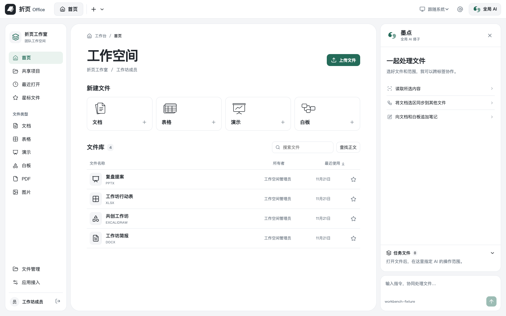
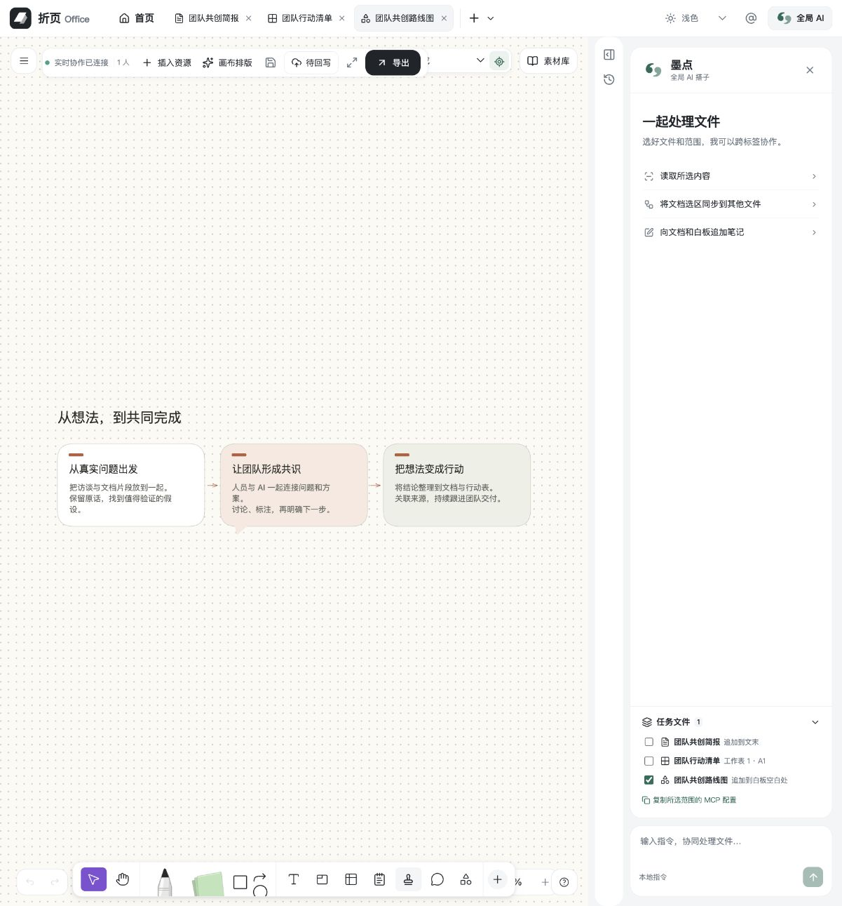
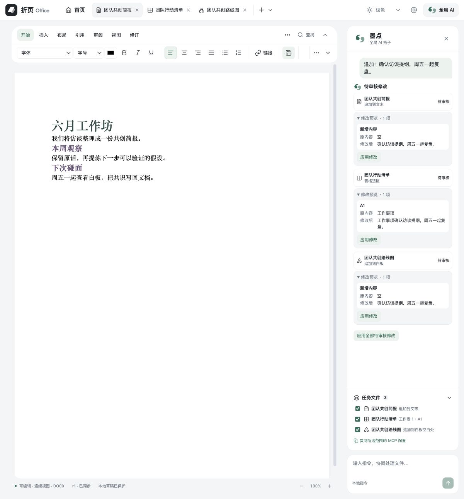

<p align="center"></p>

<h1 align="center">人と AI が、同じファイルで共同作業。</h1>

<p align="center"><a href="README.md">English</a> · <a href="README_zh.md">中文</a> · <b>日本語</b> · <a href="README_ko.md">한국어</a></p>


**OfficeCLI は、文書、表計算、プレゼンテーション、ホワイトボードを一つにまとめた共同編集ワークスペースです。** 複数のファイルをタブで開き、人と AI が指定されたファイルや選択範囲を編集できます。Rust 製 CLI、MCP ツール、React 埋め込みコンポーネントも提供します。

このページは概要です。起動手順、コード例、対応範囲は [English](README.md) または [中文](README_zh.md) の完全版をご覧ください。

## 主な機能

- **複数ファイルの管理：** ファイルライブラリ、共有プロジェクト、タブの並べ替え・グループ化・再開。選択範囲、表示位置、未送信 AI 下書きをファイルごとに保持します。
- **人とエージェントの共同作業：** テキスト共同編集、名前付きカーソル、エージェントの操作状態、コメントと履歴。ホワイトボード内の Spec は人と AI が同じ文章を共同編集できます。
- **ファイルをまたぐ AI：** 文章、セル範囲、図形を指定し、変更案を確認して適用。保存済みリビジョンの結果を次のステップに渡します。
- **コンテンツの連携：** 文書や表の範囲をボードに参照として配置し、元ファイルを開くことや、ボードの内容を文書へ整理することができます。
- **任意の UI：** チャットを非表示にして個別エディターを埋め込み、外部エージェントを MCP で接続できます。



## 対応する編集画面

| 種類 | 機能の例 |
| --- | --- |
| Word / DOCX | リッチテキスト、表、画像、コメント、変更履歴の確認、余白、見出しにリンクする目次、脚注。 |
| XLSX / CSV / TSV | 仮想化グリッド、数式、セル書式、グラフ、並べ替え・フィルター、XLSX 印刷設定。 |
| PowerPoint / PPTX | テキストと図形の編集、配置・グループ化、スライド並べ替え、ノート、対応するアニメーションと画面切り替え。 |
| ホワイトボード | 付箋、コネクター、マインドマップ、フローチャート、Spec、参照、コメント、メンション、スタンプ。 |
| PDF・テキスト・画像 | PDF の対応する文字・ページ操作と OCR、Markdown / HTML / TXT、PNG / JPEG / WebP の編集フロー。 |



## 起動と AI 接続

CLI はネイティブ Rust バイナリです。Web ワークスペースには Node.js 24.13+ とアプリケーション・共同編集サービスも必要です。[ソースからの起動手順](README.md#run-the-workspace)を参照してください。

```bash
cargo build --release -p officecli --bin officecli
./target/release/officecli mcp
```

MCP クライアントで、実際のバイナリの絶対パスと `mcp` 引数を登録します。クライアントごとに設定書式は異なります。文書サービスへの接続には別途サービス設定と権限が必要です。

ワークスペースで選択範囲を指定して MCP 設定をコピーすると、外部エージェントは短期の Streamable HTTP 接続を使えます。`read_selection` と許可された編集ツールだけを利用し、バックエンドがファイル権限、選択範囲、リビジョンを確認します。[実行可能なコード例](README.md#connect-ai-and-coding-agents)。



## 開発資料

- [ワークスペースの設定・権限・共有・デプロイ](apps/workspace/README.zh.md)
- [埋め込み・外部エージェント・実行例](examples/hdoc/embed-host/README.md)
- [HCD のインポート・変更・エクスポート](examples/hdoc/README.md)
- [エージェント向けガイド](SKILL.md) · [形式別スキル](skills/)
- [実際のスクリーンショットと出典](docs/assets/readme/screenshots.json)
- [貢献方法](CONTRIBUTING.md)

対応機能は形式とファイルにより異なります。すべての Office 機能やピクセル単位の一致を保証するものではありません。複数ファイルは個別にコミットされ、互いに矛盾する編集は再計画が必要です。詳細は [現在の制限](README.md#current-boundaries)をご確認ください。

## ライセンス

[Apache License 2.0](LICENSE)。コマンドモデルの原点は [iOfficeAI/OfficeCLI](https://github.com/iOfficeAI/OfficeCLI) です。Excalidraw、Yjs、Tiptap、Univer などの各ライセンスを尊重します。
