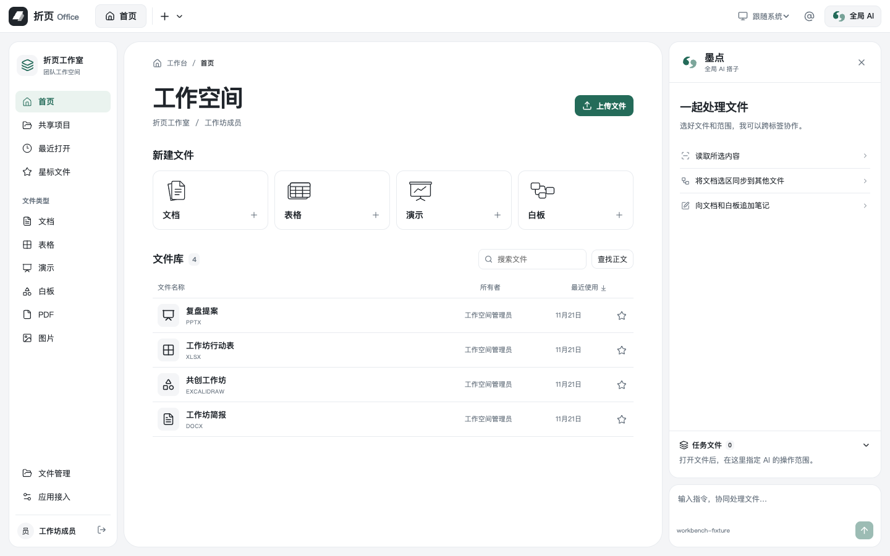
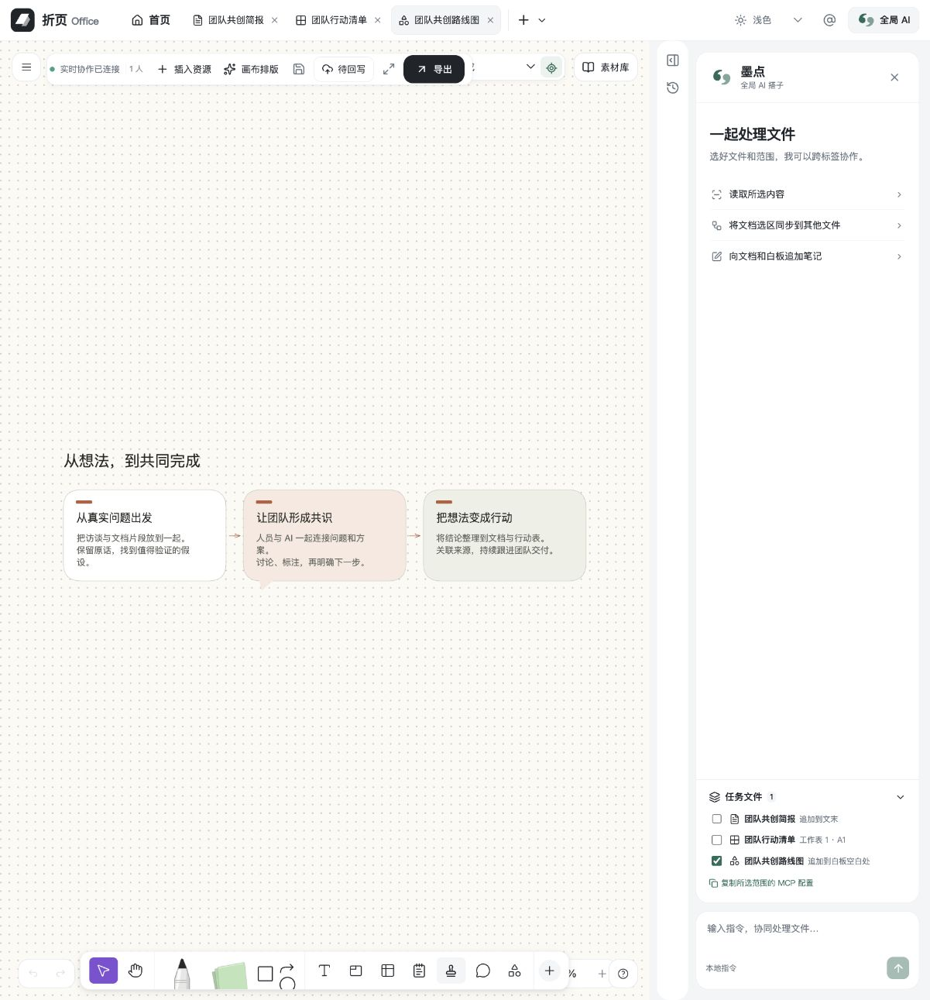
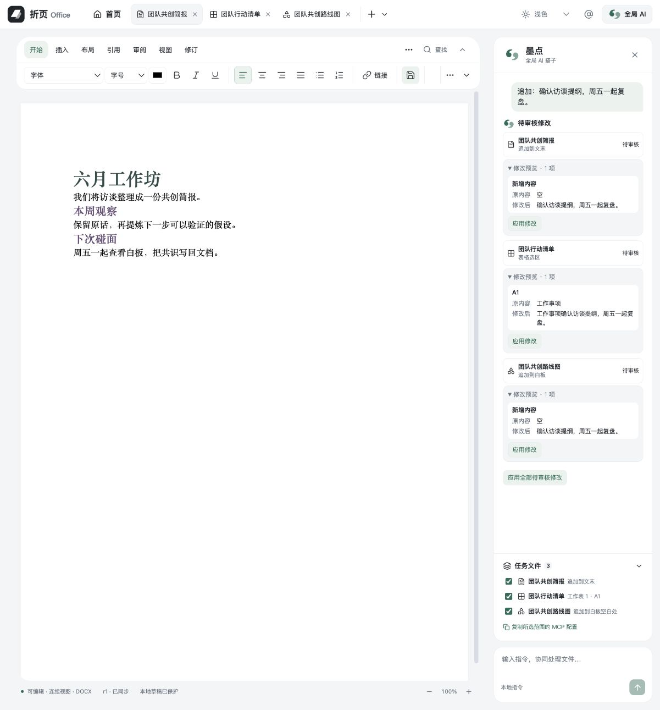

<p align="center"></p>

<h1 align="center">사람과 AI가 같은 파일에서 함께 작업합니다.</h1>

<p align="center"><a href="README.md">English</a> · <a href="README_zh.md">中文</a> · <a href="README_ja.md">日本語</a> · <b>한국어</b></p>


**OfficeCLI는 문서, 스프레드시트, 프레젠테이션과 화이트보드를 하나로 연결하는 협업 작업 공간입니다.** 여러 파일을 탭으로 열고, 사람과 AI가 지정된 파일 및 선택 영역을 편집할 수 있습니다. Rust CLI, MCP 도구와 React 임베드 컴포넌트도 제공합니다.

이 페이지는 개요입니다. 전체 실행 방법, 코드 예제와 지원 범위는 [English](README.md) 또는 [中文](README_zh.md) 문서를 확인하세요.

## 주요 기능

- **여러 파일 관리:** 파일 라이브러리, 공유 프로젝트, 탭 정렬·그룹화·다시 열기를 지원합니다. 파일마다 선택 영역, 화면 위치와 전송하지 않은 AI 초안을 유지합니다.
- **사람과 에이전트의 협업:** 텍스트 공동 편집, 이름이 표시되는 커서, 에이전트 작업 상태, 댓글과 수정 이력을 제공합니다. 화이트보드 Spec에서는 사람과 AI가 같은 문장을 공동 편집할 수 있습니다.
- **파일 간 AI 작업:** 문단, 셀 범위 또는 도형을 지정하고 변경안을 검토한 뒤 적용합니다. 저장된 결과를 후속 단계로 전달할 수 있습니다.
- **콘텐츠 연결:** 문서 및 표 영역을 화이트보드에서 참조하고 원본을 열거나, 보드 내용을 편집 가능한 문서로 정리할 수 있습니다.
- **선택적인 채팅 UI:** 개별 편집기를 임베드하고 채팅을 숨긴 채 외부 에이전트를 MCP로 연결할 수 있습니다.



## 지원하는 편집 화면

| 유형 | 주요 기능 |
| --- | --- |
| Word / DOCX | 서식 있는 텍스트, 표, 이미지, 여백 댓글, 변경 내용 검토, 페이지 여백, 제목 링크 목차와 각주. |
| XLSX / CSV / TSV | 가상화 그리드, 수식, 셀 서식, 차트, 정렬·필터와 XLSX 인쇄 설정. |
| PowerPoint / PPTX | 텍스트·도형 편집, 정렬·그룹화, 슬라이드 순서 변경, 노트, 지원되는 애니메이션과 전환. |
| 화이트보드 | 메모, 연결선, 마인드맵, 순서도, Spec, 파일 참조, 댓글, 멘션과 스탬프. |
| PDF·텍스트·이미지 | 지원되는 PDF 텍스트·페이지 작업과 OCR, Markdown / HTML / TXT, PNG / JPEG / WebP 편집 흐름. |



## 실행과 AI 연결

CLI는 네이티브 Rust 바이너리입니다. 웹 작업 공간은 Node.js 24.13+와 애플리케이션·협업 서비스도 사용합니다. [소스에서 실행하는 방법](README.md#run-the-workspace)을 참고하세요.

```bash
cargo build --release -p officecli --bin officecli
./target/release/officecli mcp
```

MCP 클라이언트에 실제 바이너리의 절대 경로와 `mcp` 인수를 등록합니다. 클라이언트별 설정 형식은 다를 수 있습니다. 문서 서비스 연결에는 별도의 서비스 설정과 권한이 필요합니다.

작업 공간에서 영역을 선택하고 MCP 설정을 복사하면 외부 에이전트가 단기 Streamable HTTP 연결을 사용할 수 있습니다. `read_selection` 및 허용된 편집 도구를 사용하며, 백엔드가 파일 권한, 선택 영역과 리비전을 확인합니다. [실행 가능한 코드 예제](README.md#connect-ai-and-coding-agents).



## 개발 문서

- [작업 공간 설정·권한·공유·배포](apps/workspace/README.zh.md)
- [임베드·외부 에이전트·실행 예제](examples/hdoc/embed-host/README.md)
- [HCD 가져오기·수정·내보내기](examples/hdoc/README.md)
- [에이전트 가이드](SKILL.md) · [형식별 스킬](skills/)
- [실제 스크린샷과 출처](docs/assets/readme/screenshots.json)
- [기여 방법](CONTRIBUTING.md)

지원 기능은 파일 형식과 내용에 따라 다릅니다. Office의 모든 기능이나 픽셀 단위의 동일한 렌더링을 보장하지 않습니다. 파일은 각각 독립적으로 커밋되며, 충돌하는 편집은 다시 계획해야 합니다. [현재 한계](README.md#current-boundaries)를 확인하세요.

## 라이선스

[Apache License 2.0](LICENSE). 명령 모델은 [iOfficeAI/OfficeCLI](https://github.com/iOfficeAI/OfficeCLI)에서 시작되었습니다. Excalidraw, Yjs, Tiptap, Univer 등 각 프로젝트의 라이선스를 따릅니다.
