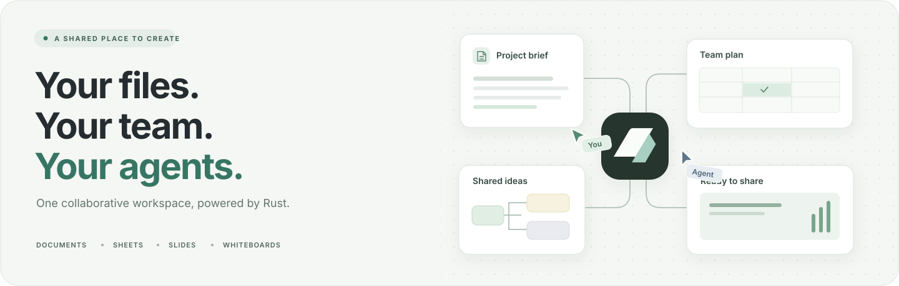
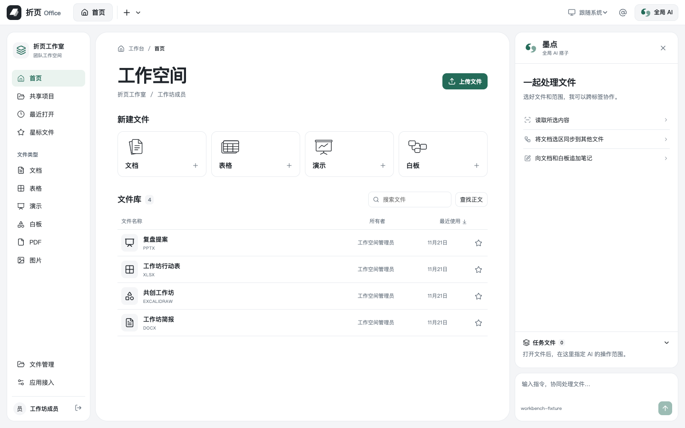
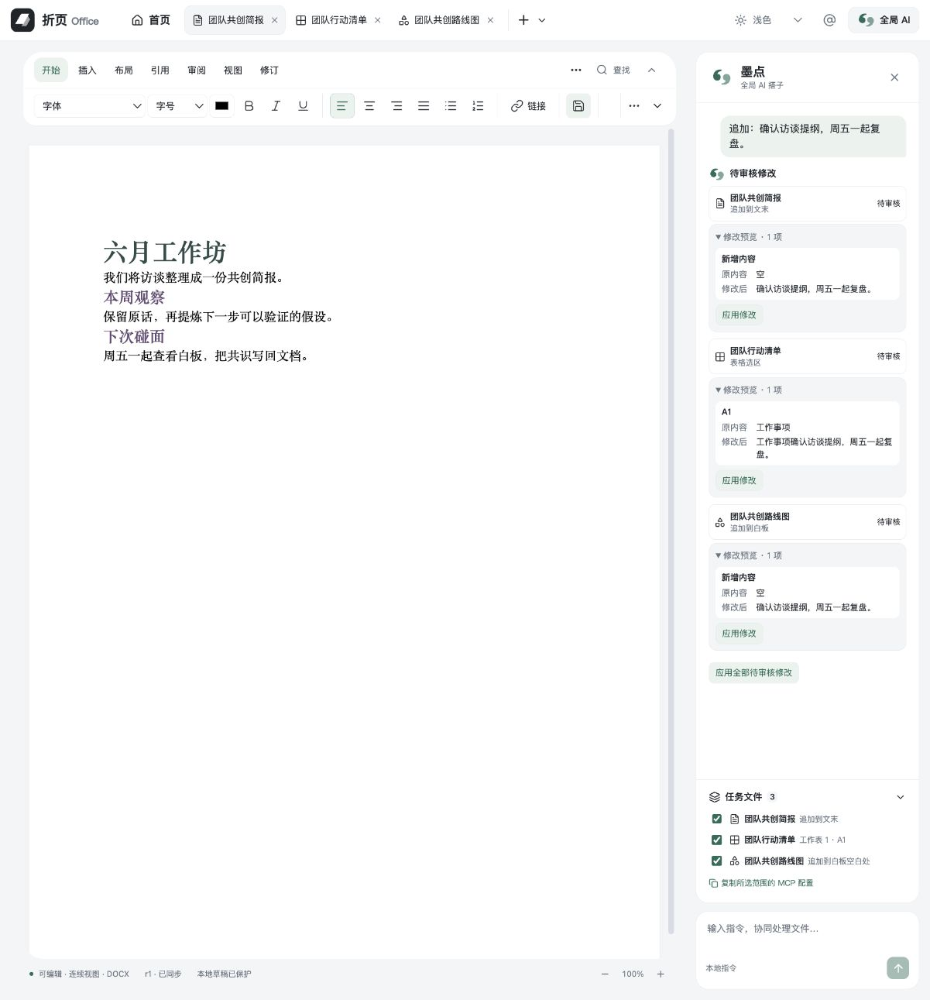
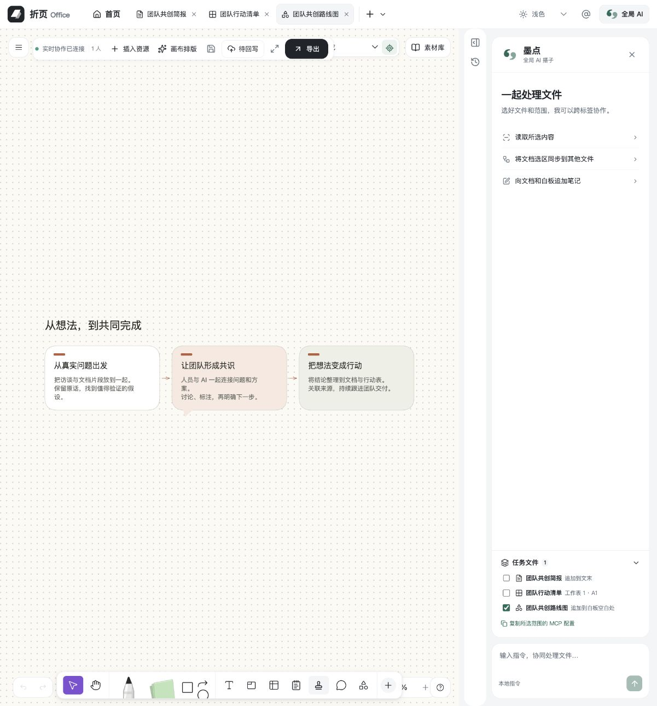
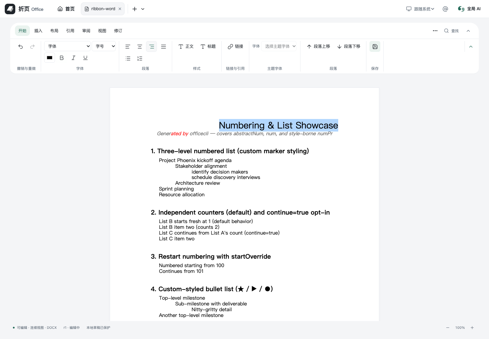
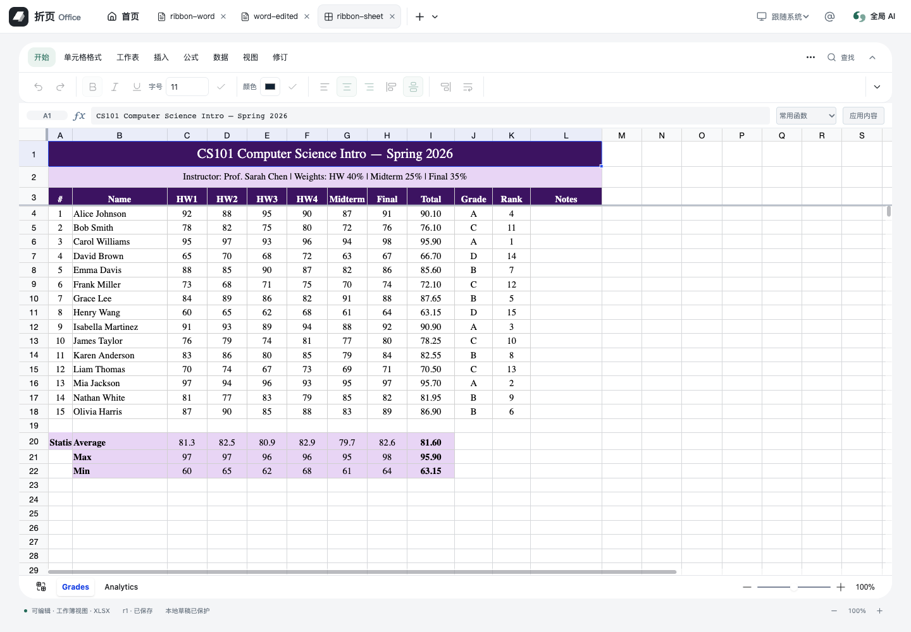
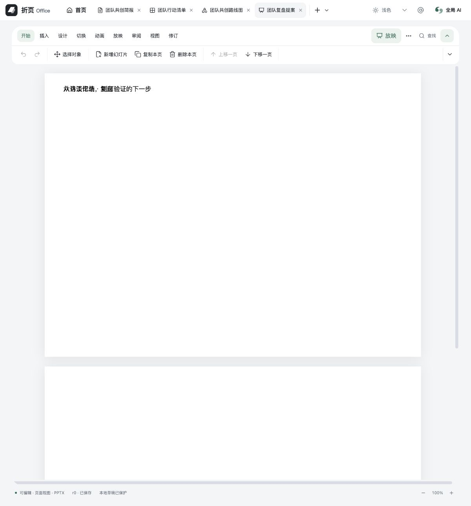
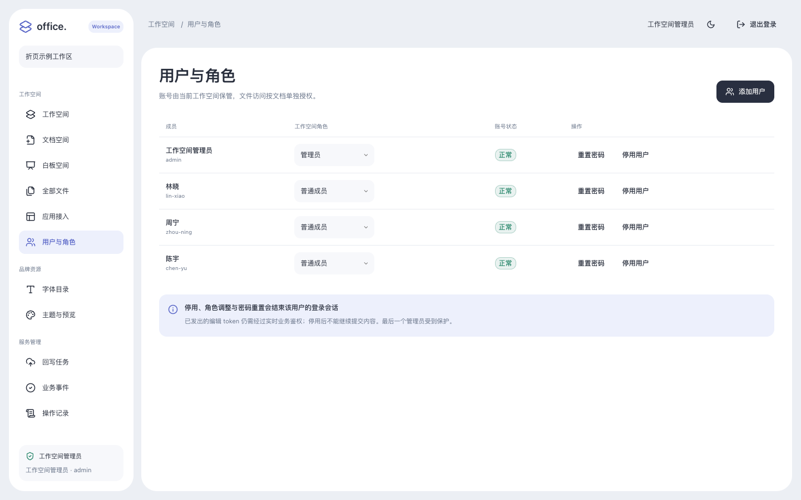
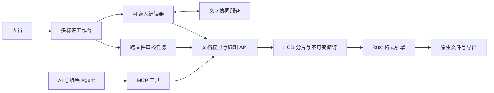

<p align="center">
  
</p>

<h1 align="center">让团队与 AI，在同一份文件上协作。</h1>

<p align="center">集文档、表格、演示与白板于一体的协同工作台，以及面向 AI 与代码的 Rust 文档引擎。</p>

<p align="center">
  <a href="LICENSE"></a>
  
  
</p>

<p align="center"><a href="README.md">English</a> · <b>中文</b> · <a href="README_ja.md">日本語</a> · <a href="README_ko.md">한국어</a></p>



**Foldly（折页）把多种文件、团队协作和 AI 操作放到同一个工作空间。** 在多个标签间处理 Word、Excel、PPT 和白板，让全局 AI 按指定的文件与选区协同编辑；也可以将单个编辑器嵌入自己的业务系统，由外部 Agent 通过 MCP 操作，聊天面板按需显示。

底层 Rust 文档引擎通过 `officecli` 命令提供，供脚本、开发工具和 AI 编程助手读取、创建、修改、渲染与导出文件。

[启动工作台](#启动工作台) · [Docker Compose 部署](#用-docker-compose-部署) · [管理后台](#管理后台) · [工作台和桌面包下载](docs/workspace-distribution.zh.md#下载-0134) · [AI 与编程 Agent 接入](#接入-ai-与编程-agent) · [嵌入业务系统](#嵌入业务系统) · [开发文档](#开发文档)

## 一个工作空间，连接团队与文件

- **多文件连续工作。** 首页文件库、共享项目和多标签工作台统一承载文档、表格、演示、白板、PDF 与图片。标签支持拖拽排序、分组、批量关闭、最近关闭恢复；各自保留选区、视口和未发送的 AI 草稿。
- **人和 AI 一起编辑。** 协同文字、带名字的光标与选区、可见的 Agent 操作状态、锚定原文的批注和可追踪修订。白板 Spec 支持多人和 AI 同时编辑同一段文字。
- **让 AI 知道改哪里。** 指定正文段落、表格区域或白板对象，先检查跨文件修改预览，再应用并通过回执定位结果。已支持的 AI 修改可以单独撤销，同时保留后来可区分的人工输入。
- **内容可以流转。** 将文档段落与表格区域引用到白板，定位并进入源文件；将选中的白板内容整理回可编辑文档，保留来源链接。
- **按自己的产品接入。** 可以使用完整工作台、单个嵌入编辑器、按选区授权的 MCP，或本地 CLI。AI 聊天框是可选界面。



## 全局 AI，跨文件协同

一条任务可以读取一个文件，修改另一个文件，也可以安排有依赖的连续步骤：

> 读取选中的访谈记录，先把行动项写入表格，再把确认后的下一步补充到白板。

工作台为每一步保留目标文件与范围。修改先进入审核，成功写入后返回修订回执；后续步骤读取已经保存的结果。目标被协作者修改时，需要重新核对，避免覆盖新内容。**各文件独立提交，跨文件流程不等同于一次分布式事务。**

外部 Agent 使用同一套文档 API 与权限校验，可以有独立身份和可见的操作状态。内置自然语言规划需要配置支持的模型服务；不配置模型时，也可以使用本地读取、写入和追加指令。

更大的任务可以交给编辑器内的 AI 团队：1–4 个 worker 共享计划，通过限定范围的工作租约与同伴发现协作。已支持的整份 PPTX 重做会并行起草幻灯片，验证后再替换当前内容。该流程需要配置 AI 后端，见[Agent 团队验收与边界](docs/acceptance/hcd-agent-team-rebuild.zh.md)。



## 不止文档，也有数据与无限画布

| 编辑界面 | 当前已支持的能力 |
| --- | --- |
| **Word · DOCX** | 富文本、段落格式、原位表格与合并拆分、图片、页边批注、修订审阅、页边距、可跳转目录与脚注。 |
| **表格 · XLSX、CSV、TSV** | 虚拟化网格、公式、单元格富文本、区域选择、图表、筛选排序、条件格式、透视表功能与 XLSX 打印布局。CSV / TSV 上传后可在工作表中编辑。 |
| **演示 · PPTX** | 文字与对象原位编辑、图片和形状、对齐分组、缩略图排序、备注、版式与母版文字继承、已支持的动画和幻灯片转场。 |
| **白板 · Excalidraw** | 可编辑图形、便签、连线、思维导图、流程图、架构图、课程图解、富文本 Spec、资源引用、评论与 @ 提及、盖章及动态素材。AI 自动排版追加到空闲区域。 |
| **PDF** | 固定页面查看、具有映射的文字编辑、页面操作与 OCR 工作流；具体能力取决于原文件与可用映射。 |
| **文本与图片** | Markdown、HTML、TXT 编辑，以及 PNG、JPEG、WebP 的图片选区和编辑工具。 |

原生 Office 设置与已支持的修改经过“同一原件编辑 → 导出 → 重新打开”验证。保真能力依格式和操作而异，见[当前边界](#当前边界)。



<details>
<summary><b>更多真实界面：Word、Excel 与 PowerPoint</b></summary>

| Word · 富文本与格式 | Excel · 单元格与公式 |
| --- | --- |
|  |  |



图片均来自实际运行的编辑器，使用示例文件，未使用设计稿冒充产品截图。[截图来源与验证记录](docs/assets/readme/screenshots.json)。

</details>

## 启动工作台

**Rust CLI 是原生二进制；Web 工作台还需要 Node.js 应用与协同服务。** 从源码构建需要 Rust 工具链和 **Node.js 24.13+**。

在当前源码的仓库根目录执行：

```bash
npm ci --prefix examples/hdoc/admin-app
npm ci --prefix examples/hdoc/editor
npm ci --prefix examples/hdoc/xlsx-univer-viewer
npm ci --prefix examples/hdoc/embed-host
npm ci --prefix apps/workspace
cargo build --release -p officecli --bin officecli
npm run build --prefix apps/workspace
npm run demo --prefix examples/hdoc/embed-host
```

打开 **http://fold.localhost:4417/workbench/**。本地演示会创建独立临时工作区和示例文件，并自动登录受限的演示成员；重新启动会创建新的演示数据。

需要自己的账号和持久文件时，按照[应用构建与初始化说明](apps/workspace/README.zh.md#构建与启动)初始化并启动工作区。该文档同时介绍权限、分享、多租户、部署、备份和业务回写。单独下载的 CLI 发行二进制不包含已经构建的 Web 工作台。

### 用 Docker Compose 部署

根目录的 Compose 默认启动 PostgreSQL、Caddy、工作台和独立的 Yjs/Hocuspocus 协作服务。协作实例按文档分流，统一从原有的 WebSocket 入口鉴权。工作台提供文档引擎、编辑器和管理后台，附加配置支持 MySQL、SQLite 和已有数据库。macOS 离线版使用本机 SQLite。[docker-compose.yaml](docker-compose.yaml) · [部署、扩容与恢复](docs/workspace-distribution.zh.md#docker-compose-云端工作台)

### 管理后台

在工作台的部署域名下访问 `/admin`。本机使用默认 Compose 配置时，打开 [http://localhost:7400/admin](http://localhost:7400/admin)，用工作区管理员账号登录。Compose 首次启动时，`FOLDLY_ADMIN` 指定管理员账号，`FOLDLY_ADMIN_PASSWORD_FILE` 指向密码文件。

管理员可以管理成员与角色、逐文件授权、配置字体与主题，并查看回写任务和操作记录。[管理操作说明](apps/workspace/README.zh.md#使用流程)



## 接入 AI 与编程 Agent

### 1. 给本地编程助手提供文档工具

启动 stdio MCP 服务：

```bash
./target/release/officecli mcp
```

对于接受 `mcpServers` 配置的客户端，登记二进制的**绝对路径**：

```json
{
  "mcpServers": {
    "officecli": {
      "command": "/absolute/path/to/officecli",
      "args": ["mcp"]
    }
  }
}
```

其他客户端使用其对应的 stdio 登记格式。服务同时提供本地文件命令和 HCD 工具。连接 HCD 时，将 `HCD_API_URL` 设为文档服务的 origin，通过 `HCD_MCP_TOKEN` 注入文档级令牌；`token_env` 可以为另一份文件指定不同的凭据变量。先调用 `hcd_help` 并读取连接服务的实际能力，避免猜测操作名和协议版本。

将仓库的 [Agent 使用说明](SKILL.md)和[分格式技能](skills/)提供给编程助手，即可按下面的流程处理文件：

> 读取当前文件与能力，使用真实路径或稳定 ID 定位内容，只修改指定范围，回读保存结果，再导出并重新打开。遇到版本冲突先重新读取，再重新规划。

也可以由 AI 直接通过终端调用：

```bash
./target/release/officecli create brief.docx
./target/release/officecli add brief.docx /body --type paragraph --prop text="工作坊决策"
./target/release/officecli extract-text brief.docx --with-offsets --json
./target/release/officecli view brief.docx --mode annotated
./target/release/officecli help docx paragraph
```

### 2. 接到用户正在编辑的文件和选区

初始化工作区时通过 `--selection-mcp` 开启选区 MCP，本地演示已开启。在工作台选中内容，在「全局 AI → 任务文件」指定目标，再点击「复制所选范围的 MCP 配置」。工作台提供短期 Streamable HTTP 连接，绑定文件与当前选区。工具包括 `read_selection` 以及该授权允许的修改操作，例如 `replace_selected_text`、`edit_selected_cells`、`edit_canvas_selection` 或 `append_to_file`。

下面示例在独立 Node.js Agent 中读取并改写**一个已选中的文档片段**。先在自己的 Agent 项目安装 `@modelcontextprotocol/sdk`，将授权连接中的地址和凭据分别注入 `OFFICECLI_MCP_ENDPOINT` 与 `OFFICECLI_SELECTION_TOKEN`。替换文字可以来自自己的模型，也可以来自业务代码。

```js
import { randomUUID } from 'node:crypto'
import { Client } from '@modelcontextprotocol/sdk/client/index.js'
import { StreamableHTTPClientTransport } from '@modelcontextprotocol/sdk/client/streamableHttp.js'

const client = new Client({ name: 'editor-agent', version: '1.0.0' })
await client.connect(new StreamableHTTPClientTransport(
  new URL(process.env.OFFICECLI_MCP_ENDPOINT),
  { requestInit: { headers: {
    Authorization: `Bearer ${process.env.OFFICECLI_SELECTION_TOKEN}`,
  } } },
))
async function call(name, args = {}) {
  const result = await client.callTool({ name, arguments: args })
  if (result.isError) throw new Error(JSON.stringify(result.content))
  return result.structuredContent ?? JSON.parse(result.content[0].text)
}
try {
  const selection = await call('read_selection')
  if (selection.kind !== 'document' || selection.spans.length !== 1) {
    throw new Error('请先选中一个文档片段。')
  }
  const receipt = await call('replace_selected_text', {
    requestId: randomUUID(),
    replacements: ['周五一起确认访谈提纲。'],
  })
  console.log(receipt) // 实际保存修订、文件标识与修改处数。
} finally {
  await client.close()
}
```

后端会重新校验成员、文件权限、修订、协作代次和授权。选区变化或编辑器关闭会撤销旧授权；过期或失效的目标需要重新授权。完整实现见[可运行的独立客户端](examples/hdoc/embed-host/agent.mjs)和[宿主授权说明](examples/hdoc/embed-host/README.md#外部-agent-的授权与实际调用)。

### 3. 支持更丰富的 AI 文档操作

面向 HCD 服务的 Agent 可通过 `hcd_read` 获取稳定节点、段落 ID、单元格地址与前置哈希，用 `hcd_patch` 提交受保护的修改，使用 `hcd_activity` 展示操作位置；通过 `hcd_canvas_plan` 规划追加式白板内容，或用 `hcd_office_features` 修改已支持的页面、打印和转场设置。服务会协商能力并记录身份与修订。

因此，AI 可以执行**读取 → 规划 → 编辑 → 验证 → 导出**，无需依赖屏幕坐标模拟点击。多 Agent 使用独立身份和受保护的写入；互不兼容的重叠修改会被拒绝并要求重新规划，并不表示任意并行写入都能自动合并。

## 嵌入业务系统

文档、表格、演示和白板使用同一 React 嵌入组件，具体编辑器由文件类型决定。后端提供已授权、可续期的编辑会话，业务系统继续管理身份和文件权限。

```tsx
import { EmbeddedHcdEditor } from '@officecli/hcd-reference-editor/react'
import '@officecli/hcd-reference-editor/style.css'

<EmbeddedHcdEditor
  documentId={session.documentId}
  token={session.token}
  apiUrl="/v1/documents"
  collabUrl={collaborationWebSocketUrl}
  chatPanel={false}
  onSelectionChange={handleSelectionChange}
/>
```

可以隐藏聊天、传入自己的聊天组件，或独立对接外部 Agent。该组件由 [`examples/hdoc/editor`](examples/hdoc/editor/README.md)构建，上述导入对应其包导出，不表示已发布到公开包仓库。[可直接运行的宿主示例、续期和代理路由](examples/hdoc/embed-host/README.md#宿主接入)。

## 技术结构



HCD 是可编辑文档层，提供有界 HTML 分片、稳定源映射、内容寻址素材和不可变修订。文字协同使用 Yjs，保存结构与原生格式操作时校验修订和哈希；白板使用原生可编辑的 Excalidraw 对象。Web 应用、协同服务和 Rust 引擎是不同的运行组件。

## 当前边界

- 支持某种格式不代表覆盖该格式的全部 Office 能力或实现像素级一致。按实际文件检查能力与导出警告；部分导出需要系统字体或浏览器排版引擎。
- Word 目录当前支持标题导航，尚未实现自动生成物理页码。复杂母版图形、高级动画和未覆盖的 Office 结构仍有格式边界。
- 选区 MCP 的表格工具修改字面值；公式与更丰富的原生修改使用对应文档 API 和权限。选区授权不开放引擎的所有操作。
- AI 单次撤销在已支持的操作中保留可区分的后续编辑，目标不明确或已被改变时会拒绝撤销。跨文件任务保留各文件独立的回执与历史。
- 本地演示与确定性测试规划器不等同于内置生产模型。自然语言任务需要配置模型服务，外部 Agent 可以使用自己的模型。

## 开发文档

| 入口 | 内容 |
| --- | --- |
| [工作台应用](apps/workspace/README.zh.md) | 账号、项目、权限、分享、多租户、部署和备份。 |
| [工作台部署与桌面打包](docs/workspace-distribution.zh.md) | Linux 上线、macOS Electron 离线包和同版本验收。 |
| [嵌入与外部 Agent](examples/hdoc/embed-host/README.md) | React 接入、选区授权、MCP 与可运行宿主。 |
| [编辑器开发](examples/hdoc/editor/README.md) | 编辑器与协同服务开发。 |
| [HCD 示例](examples/hdoc/README.md) | 导入、分片、补丁、源映射与导出。 |
| [原生 Office 验证](docs/design/officecli-office-ribbon/implementation/office-features/validation.json) | Word、Excel、PPT 的编辑、原格式导出与重开。 |
| [画布交互验证](docs/design/officecli-office-ribbon/implementation/canvas-input/validation.json) | DOM 覆盖层、缩放、平移与文字输入。 |
| [可编辑设计稿](docs/design/officecli-office-ribbon/README.zh.md) | Pen 源文件、设计预览与实现截图。 |

本地验证：

```bash
cargo test -p hcd-core -p hcd-docx -p hcd-formats -p oxml
npm run build --prefix examples/hdoc/editor
npm run build --prefix examples/hdoc/embed-host
npm run test:workbench --prefix apps/workspace
```

贡献方式见 [CONTRIBUTING.md](CONTRIBUTING.md)。仓库在代码旁保留可复现的验收记录。

## 开源协议与致谢

采用 [Apache License 2.0](LICENSE)。`officecli` 的命令模型源自 [iOfficeAI/OfficeCLI](https://github.com/iOfficeAI/OfficeCLI)。本仓库发展 Rust 文档引擎与协同工作台，并使用 Excalidraw、Yjs、Tiptap、Univer 等开源项目，遵循各自许可证。
