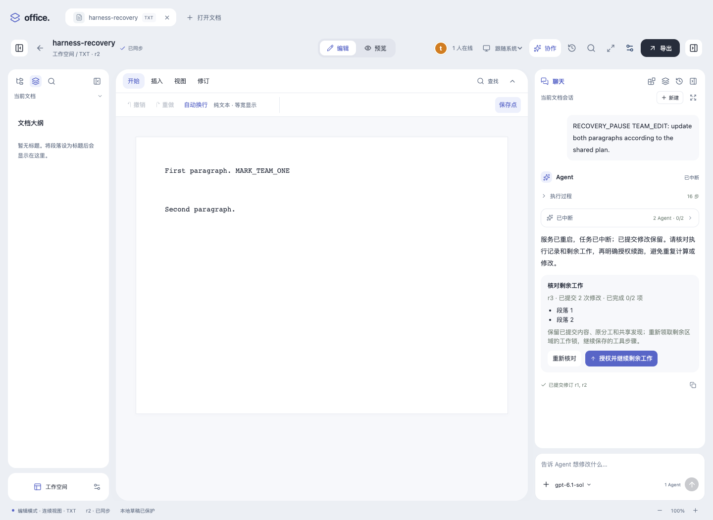
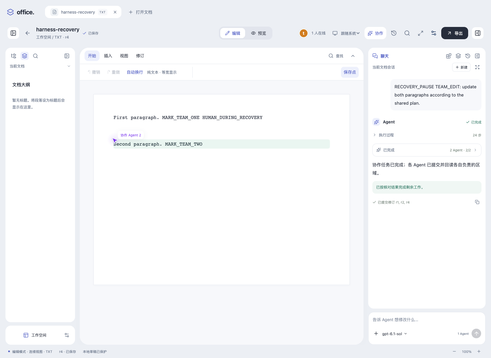

# Agent 授权续跑与提交核对 · 2026-11-15

范围：`feature/hcd-font-format-integration`、HEAD `ccb5fd5` 的未提交工作区。本阶段补单文档 Harness 的中断续跑；后续显式跨文档依赖与补偿见[跨文档工作流](hcd-cross-document-workflow.zh.md)。完整五项建设目标仍未完成，Office/WPS 同源保真等仍需建设。

当前状态：实现、本地整树检查、组合回归、最终位置/状态复验及图片相邻回归均已通过，具体结果见本文末尾。测试使用独立临时服务目录、随机密钥、自有 API/sidecar/Chrome 进程和本地确定性模型，不重启日常演示服务，不把测试供应商替身视作真实模型质量认证。

## 用户可见流程

1. 已中断、失败或停止的任务显示「核对并继续」，仅在服务声明 `hcd-agent-continuation/1` 时出现。
2. 点击先刷新/保存当前本地输入，再显示当前修订、已提交回执、原分工中完成与剩余部分，以及已验收 PPT 队列的应用位置。
3. 点击「授权并继续剩余工作」，重新鉴权并核对完整指纹；文档、epoch、任务、服务进程、模型或协议发生变化时返回 409，必须重新核对。
4. 原 run ID、成员身份、共享发现、完成单元与已制作页面保留；未完成部分重新领取租约。不会自动重新发送整条原任务。

只读身份不能续跑，其他用户不能核对或续跑此任务。委派 worker 不能为自己授权。双击或并发提交同一核对结果只会接受一次；续跑与新任务共用同一进程最多 4 位 Agent 的预算。每个任务最多 16 次明确授权的续跑。

## 执行检查点与保护

- 服务端保存每个工作单元的工具对话、完整模型输出、工具位置、待核验目标和确切修改回执。模型输出在工具执行前落盘，工具结果及下一位置在下一次模型调用前同一检查点落盘。
- 对于提交已成功但响应未保存的 `hcd_patch`，按实际类型反序列化后计算 canonical patch hash，核对 document ID、patch ID、base revision、实际修订与作者。只恢复该步回执，不重新计算或提交“+1”“×2”。新工具调用不能借用其他分工的旧回执冒充修改。
- 续跑先处理保存的待决工具，再强制重新读取当前鉴权及内容。所有已修改目标必须回读后才能完成。原有冲突恢复仍要求针对未提交工作重新计算。
- XLSX 在任务开始后发生行列移动或工作表增删/改名时，禁止沿用旧位置继续计算，要求依据当前表格重新规划；包括任务自身已提交的结构变化。单纯更新单元格数值仍可继续。任务开始后超过 10,000 个修订时保守停止自动位置核对。
- 任务和成员委派凭证绑定服务进程以及本次执行标识；终止后撤销该标识。续跑更换执行标识和取消对象，旧 leader/member 凭证不能进入新一轮执行。
- 单任务私有原子检查点上限 32 MiB，最多 40 个工作单元执行位置。完成的单元清理对话正文，仅保留结果和回执。目录权限 0700，检查点 0600；服务端密钥和 Bearer 凭证不进入模型对话或检查点。公共任务 API/管理 API 不返回私有对话和租约令牌。
- 保存失败立即停止后续 worker 写入；损坏检查点保留并拒绝静默重置。事件显示保留最近 512 条；剩余执行位置与提交核对独立保存。
- 请求已声明串行工具调用时，模型若返回多个工具调用，会在执行本轮工具前停止，避免不完整工具响应穿插对话。

## PPT 和图片

PPT 继续采用「规划 → 制作 → 内容审核 → 临时副本原生导出回读 → 实际提交」。第一笔实际提交前，额外保存已验收的确切 patch 队列、页面 hash、导出核验修订及队列位置。重启后直接续用该队列，跳过已有回执；不再重做已有页面，也不重新调用整稿规划/制作模型。实际页面必须与已验收页面 hash 一致。

队列保持原 expected revision；部分替换期间有人工/其他操作介入时，核对页禁止继续应用旧队列，不把它重基准后覆盖人工内容。已经提交的部分仍保留，需依据现状规划剩余工作；这不是整稿替换的跨修订原子事务或自动回滚。

文档插图生成按可信 Harness 工具调用身份和请求内容去重。返回结果丢失后，同一请求复用 queued/generating/ready 任务；ready 候选在重启后继续复用原 job ID 和资源。只有新一轮明确授权，才允许重发 interrupted/failed/cancelled 请求。旧生成 worker 的延迟返回不能覆盖新轮次。共享发现也按成员和工具调用 ID 去重，同一 ID 不允许更换消息内容。文档插图仍最多保留 128 条热任务记录，终态记录在后续创建时可清理一小时前的条目；超过一小时的旧 run 找不到可核对记录时，即使是新的图片请求也保守阻止，应检查已有候选并为剩余图片建立新任务。仍有可核对记录时可复用或明确授权重试。

供应商若已经计费但尚未写入本地 ready 检查点，系统无法承诺供应商侧恰好一次生成；重新授权摘要会在涉及图片时提示可能重新请求。独立图片工作台 `hcd_image_edit` 的不确定写入仍没有全部接入这一工具回执协议，此类保存位置会阻止自动重放。原有候选保存和候选应用回执不受影响。

## API 与 MCP

- `GET /v1/documents/{id}/agent-runs/{run_id}/continuation`：核对摘要，含 `protocolVersion`、`canContinue`、`reason`、`fingerprint`、`revision`、`collaborationEpoch`、`committedRevisions`、`units` 和 `deck`。
- 同路径 `POST`：`{ fingerprint, expectedRevision, collaborationEpoch, authorizeRemaining: true }`，成功 202；身份/权限、旧核对结果、容量超限分别返回对应状态。
- `hcd_agent_run action=review` 与 `action=resume` 同时用于 HTTP MCP 和 stdio MCP。resume 使用 `run_id`、`fingerprint`、`expected_revision`、`collaboration_epoch` 和 `authorize_remaining=true`。工具描述要求先向发起用户展示核对结果并获得明确授权；模型不能递归调用 Harness 管理工具。聊天摘要按最新授权轮次显示，先前拒绝保留在过程历史中；用户授权续跑不会标为“自动恢复”。
- CLI/API/MCP 的 capabilities 增加相同的 `agentContinuation` 契约并参与协议指纹；任务列表返回协议版本，旧服务不会显示无法使用的续跑按钮。

旧检查点缺少完整执行数据时只显示不可安全续跑的原因，不把重发原任务冒充续跑。任务列表仍加载最近 128 项；旧文件保留在磁盘，历史分页和保留策略仍待建设。该协议依赖同一服务根目录的 OS 进程锁，不提供多主机分布式租约。

## 验证方法与证据

```bash
cargo +1.90.0 test --workspace --quiet
cargo +1.90.0 clippy --all-targets -- -D warnings
cargo +1.90.0 fmt --all -- --check
cd examples/hdoc/editor
npm run build
npx tsx --test src/*.test.ts
HCD_BROWSER_PATH='/Applications/Google Chrome.app/Contents/MacOS/Google Chrome' \
  npx playwright test e2e/agent-harness.spec.ts \
  --grep 'API SIGKILL|Agent continuation|PPT continuation|two model agents preserve|HTTP and stdio MCP|full PPT rebuild uses|four-worker spreadsheet team|production pipeline repairs|OpenAI harness edits' \
  --reporter=line
```

数值回归分别构造写入前、提交成功但结果尚未入检查点、结果已入检查点三个位置。实际执行数值/公式修改、SIGKILL 并重启 API；其中前两个窗口以捕获的完整工具输出构造确定的磁盘检查点，写入前窗口恢复固定的原始文档副本。此方法明确模拟指定持久化窗口，不声称在每个 CPU 指令边界随机杀进程。各窗口均核对实际单元格和公式、唯一新修订、双击续跑只接受一次。

PPT 回归从本地确定性模型替身制作且原生导出回读通过的队列，重建只提交前两笔、第二笔回执丢失的位置；核对后继续原队列，验证无新增模型请求、页数和原生导出。另覆盖人工修改介入后拒绝旧队列。图片回归在生成资源已实际保存、工具响应丢失的位置恢复，核对同一候选及替身供应商请求次数不增加。

本地最终结果：

| 检查 | 结果与范围 |
| --- | --- |
| Rust 整树 | 1,041 项通过，含 doctests，Rust 1.90.0 |
| Clippy / 格式 | `--all-targets -- -D warnings`、`fmt --all -- --check` 与 `git diff --check` 通过 |
| 编辑器 | standalone/embed 构建通过，前端单元检查 10/10 |
| 原生公式探针 | 5/5，差异 0 |
| 组合浏览器回归 | 19/19，2.3 分钟；涵盖三种算术窗口、PPT 队列与人工写入保护、七格式 Agent 编辑/回读/导出、四 Agent 分工及 HTTP/stdio MCP |
| 最终位置/状态专项 | 13/13，50.7 秒；补验 XLSX 地址变化守卫、API 强杀、图片复用、MCP 和授权后摘要 |
| 最终图片相邻回归 | 10/10，1.1 分钟；图片工作区全部 9 项及 Agent ready 插图复用，用于最终保留期代码的验证 |

三组浏览器检查存在重复用例，不能相加作为独立检查总数。最终专项和相邻回归覆盖组合检查后增加的位置守卫、状态文案与图片保留期修改；没有把较早快照的全部用例重新执行一遍。工作流已配置相关回归，但尚无干净检出或远端 CI 成功认证，代码未提交。





续跑不是通用规划修复：例如已结束但没有实际修改的分工，仍可能再次因缺少实际提交而失败，需要重新规划。旧记录、位置变化及图片不确定写入等限制仍按上文处理。跨文档计划层复用此协议，但需要完整工作流的核对与授权，不能只对其中一个子任务单独续跑。
