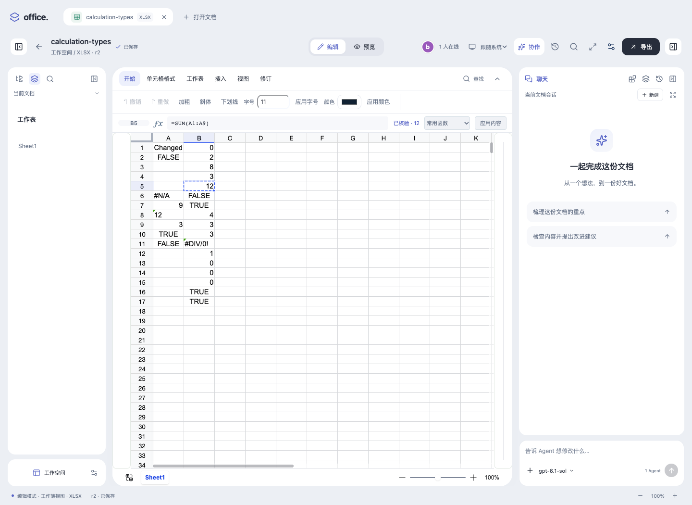

# XLSX 字面值类型与计算一致性 · 2026-11-15

本次补齐[整体核查](hcd-capability-status-2026-11-15.zh.md)中的一个计算缺口，不代表全部格式或 Excel 语义完成。此前 HCD 导入没有完整保留字面值类型：布尔值可能成为文本，错误值可能被 SUM 忽略，空的 inline 字符串可能被整个丢弃。显示相同不能保证计算语义相同。

## 修改后的行为

- 当前导入为每个映射单元格保留类型；空字符串也保留节点。真正的空白/只有样式的格子仍按空白计算。
- 原生 CLI 与服务端使用相同的字面值转换。数字文本不会被当作数值，布尔值支持 OOXML 的 `1/0` 和 `true/false`。
- 源错误与公式产生的普通 Excel 错误按函数语义处理：SUM 传播错误，COUNT 忽略错误，COUNTA 计入错误，COUNTBLANK 不把错误算空白。循环、未知依赖函数、资源上限等仍使核验失败，不能被计数函数吞掉。
- 已知标准错误同步到实际网格，覆盖旧数字缓存。只更新计算结果，不提交修改、不更换 canvas；未支持的函数仍属于兼容预览。
- 计算结果恢复正常后，移除仍悬停在该格上的旧公式错误提示；不用移动鼠标触发刷新，也不移除其他类别提示。
- 文字修改、数字修改、公式转值和新建单元格更新对应类型；拒绝文字修改时恢复原布尔类型。
- 每个新导入窗口及新建工作表带完整类型标记。旧导入没有该标记时，计算返回 `literal_type_metadata_missing`；编辑器提示重新导入原始 XLSX。旧版已丢失的空字符串不能通过猜测恢复，本文不承诺原地迁移。

## 可复现样本

[样本生成器](../../examples/hdoc/editor/e2e/fixtures/create_typed_workbook.py)只使用 Python 标准库，在新建 XLSX 中写入以下 A1:A9。B 列公式的源缓存故意都设为 777。

| 位置 | 原生内容 |
| --- | --- |
| A1 / A2 | TRUE / FALSE，原生布尔 |
| A3 / A4 | 空的 inline string / shared string |
| A5 | 只有样式的空白格 |
| A6 | 文本 `#N/A` |
| A7 | 错误 `#N/A` |
| A8 | 文本 `12` |
| A9 | 数值 3 |

预期 `SUM(A1:A5)=0`、`COUNT(A1:A9)=1`、`COUNTA(A1:A9)=8`、`COUNTBLANK(A1:A9)=3`、`SUM(A1:A9)` 返回 `#N/A`。另外验证布尔比较、错误公式被计数、OOXML 布尔的文字编码，以及字符串与错误的区别。

```bash
cargo +1.90.0 build -p officecli
target/debug/officecli create /tmp/officecli-literal-types.xlsx
python3 examples/hdoc/editor/e2e/fixtures/create_typed_workbook.py /tmp/officecli-literal-types.xlsx
target/debug/officecli get /tmp/officecli-literal-types.xlsx '/Sheet1/B3' --json
```

```bash
cargo +1.90.0 test --workspace --quiet
cargo +1.90.0 clippy --all-targets -- -D warnings
cargo +1.90.0 fmt --all -- --check
cd examples/hdoc/editor
npm run build
npx tsx --test src/*.test.ts
HCD_BROWSER_PATH='/Applications/Google Chrome.app/Contents/MacOS/Google Chrome' \
  npx playwright test e2e/workspace.spec.ts e2e/agent-harness.spec.ts \
  --grep 'calculation contract|verified grid caches|native literal types|protocol preflight|protocol fingerprint|workbook preview keeps|four-worker spreadsheet team|two model agents preserve' \
  --reporter=line
```

浏览器回归使用真实隔离服务、MCP 与原生 CLI：核对实际单元格复制；拒绝一次修改后恢复类型；把布尔格改成文字、通过远端协作者把错误格改成数值后核对依赖；确认画布实例保留，导出源 XLSX 后分别经 CLI 和重新导入的 MCP 回读，再刷新原页面。多 Agent 回归的模型响应由确定性本地脚本提供，不代表真实供应商质量认证。

## 本地验证结果

本阶段曾通过完整 Rust **1,026 项**、Clippy、格式检查、前端 8 项单元检查和五个原生公式探针。编辑器独立及嵌入构建通过。扩展浏览器首轮 **7/8**，发现拒绝布尔文字编辑后，组件的延迟确认把恢复值 `1` 再提交为文字；已修复原生值未变时的重复提交，并重跑 **8/8（1.0 分钟）**。

截图复核随后发现计算已恢复为 12 时，鼠标未移动仍显示旧 `#N/A` 提示。已在实际计算结果 mutation 后检查并清理失效的公式提示。加入“鼠标保持原位、远端修改修复依赖后旧错误提示消失”的验收，最终该专项 **1/1（27.1 秒）**，独立/嵌入构建再次通过。重复运行不累加为新功能数量。



**共享工作区状态需要单独判断：** 验证后期出现并行新增的 `hdoc_server/integration/` 及对应 Claims/ServerState 字段。本次未覆盖这些并行改动。随后的全量复查曾因模块/字段未补齐失败，之后的检查发现 `integration::provider::Decision` 可见性问题；并行修正补齐后，最终 `cargo +1.90.0 check -p officecli` 已通过（4.75 秒）。**此前 1,026 项完整测试不等于这个包含新增集成模块的最新工作区已经通过全部门禁**，该快照仍需整树测试、Clippy 和格式重新验收。本次浏览器使用该组并行改动前、已构建的本地二进制；最新前端代码经过真实浏览器和构建验证。此处记录 2026-11-15 此次核查的具体快照，新增集成模块的完整验证由其变更继续处理。

仍需继续验收更多函数、日期和数值精度、数组及专用类型创建操作。固定/网格/图片未提交输入的持久恢复、任务续跑与跨文档工作流、Office/WPS 同源复杂排版基准也仍未完成。
