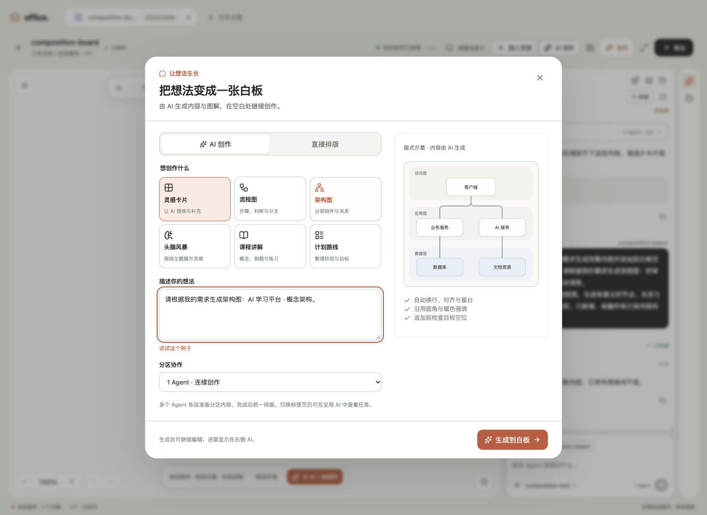
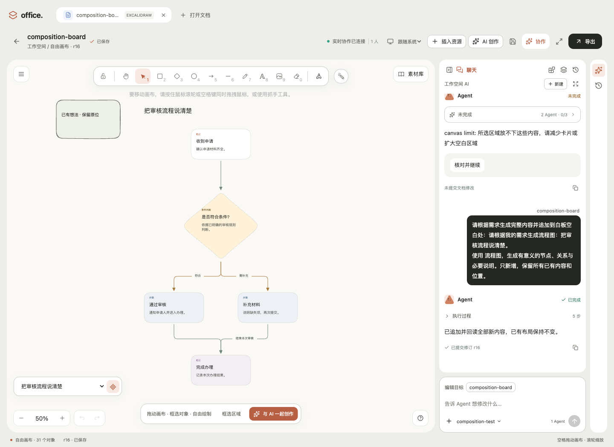
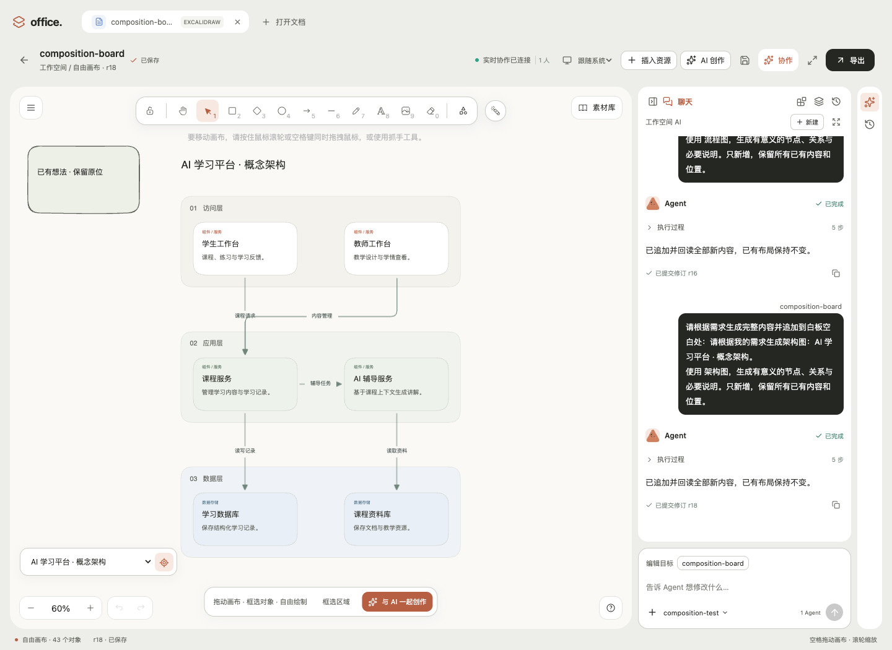
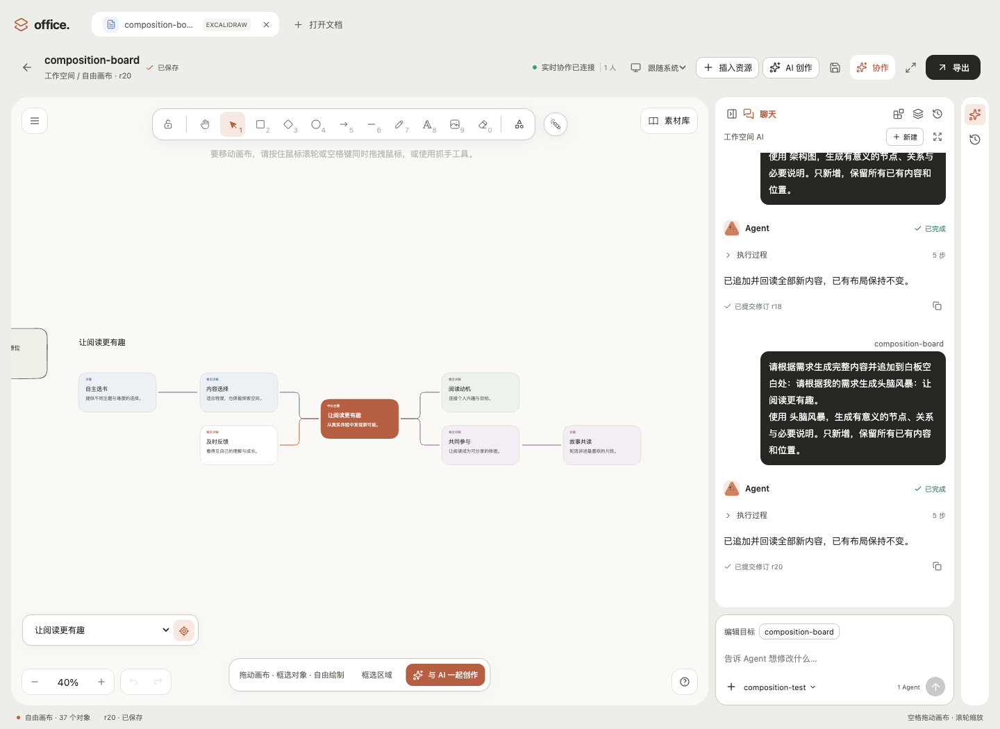
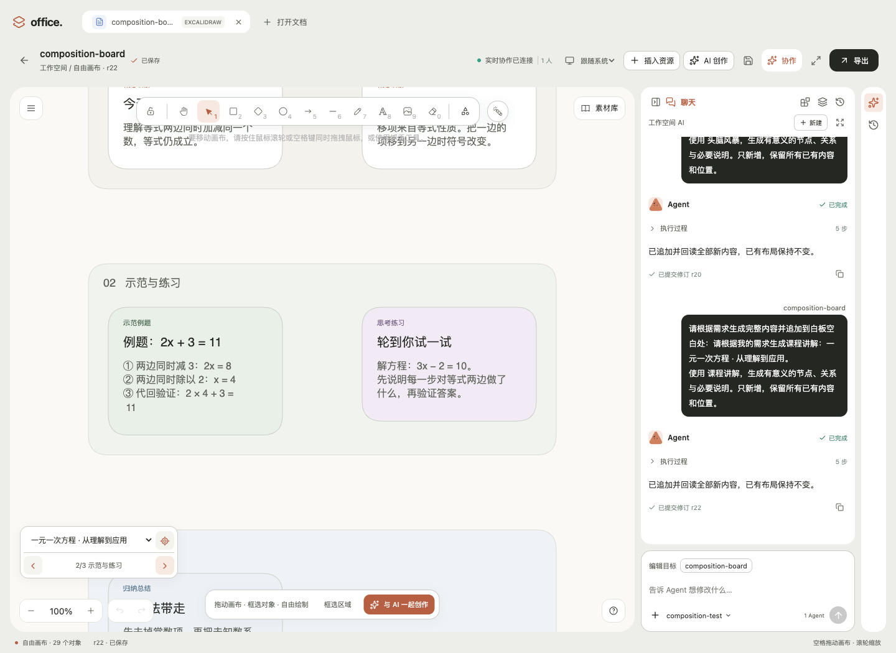
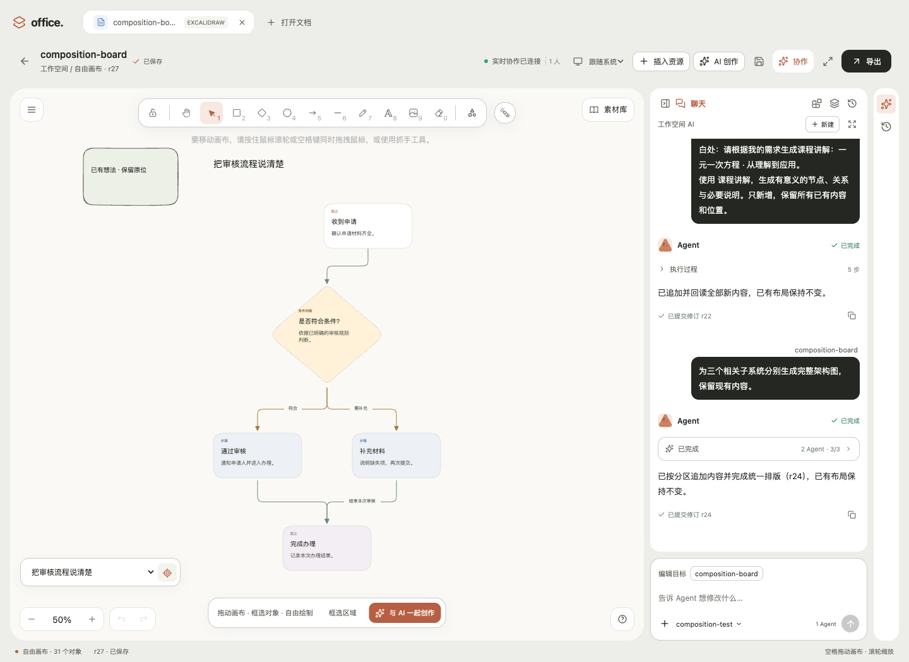

# AI 白板图解与圆角连线验收

日期：2026-11-17。沿用 Excalidraw 原生场景、HCD 修订、资源引用和右侧全局 AI。

AI 入口后续已升级为只描述需求，由 AI 自行选择布局与视觉搭配，见 [AI 手账视觉验收](hcd-canvas-journal-v1.zh.md)。本页保留图解初版的选择式入口记录和截图。

## 交付行为

白板顶部进入 **AI 创作**，选择类型、描述需求、点击 **生成到白板** 即提交全局 AI 任务。卡片内容、节点、关系和讲解内容由模型生成，不要求用户逐条填写；预览中的文字明确标为版式示意。需要使用自己的文案时，可切换到 **直接排版**。

| 类型 | 生成内容与展现 |
| --- | --- |
| 灵感卡片 | AI 生成气泡、卡片或便签，自动网格排版 |
| 流程图 | 起止、步骤、判断菱形、分支说明和有向连线；支持反馈路径 |
| 架构图 | 组件、服务、存储、分层分组和关系说明 |
| 头脑风暴 | 一个中心主题、左右平衡的树状分支、对应分支色 |
| 课程讲解 | 概念、示范例题、思考练习和总结；可逐步定位讲解分区 |
| 计划路线 | AI 生成内容，按纵向路线编排 |

所有文字、卡片和连接器均为原生可编辑对象。新增内容使用空白区域，已有对象保持原位；作品导览提供整图定位，课程讲解提供上一／下一步骤。多 Agent 继续使用独立分区并行草稿和一次原子追加。

## 连线调整

- 使用原生 `elbowed` 连接器，小圆角只作用于转折点，消除普通曲线穿过折线拐点产生的回环和过度弯曲。
- 优先经过卡片间的居中通道；遇到障碍时使用有界正交路径搜索，生成阶段避开无关节点。
- 统一实线、细箭杆和实心箭头，关系线可不带箭头；头脑风暴按分支配色。
- 标签使用更清晰的字号、居中排版和留白，不再因浮点字宽把短中文说明的末字挤到下一行。
- 端点使用原生固定锚点绑定，说明文字绑定到连线。拖动卡片后由编辑器更新连接器，保存并刷新后继续保留绑定。
- 修复原生元素拖动时原地变更导致差异检测漏记的问题：比较独立的值快照，按元素版本复用未变对象，避免每帧复制全部内容。
- 前端选区与后端区域校验均计算真实路径点范围，包含向左／向上延伸的负坐标段。

生成阶段的避障不等于任意人工拖动后全图最优布线。后续拖动使用 Excalidraw 自身的端点跟随能力；密集多交叉图仍可能需要人工调整。既有文档不会在打开时被静默迁移，新的样式应用于本次生成器的输出。

## 真实界面截图














## 协议与模块

`Composition` 新增 `flowchart`、`architecture`、`mindmap`、`lesson` 四个布局枚举和可选 `diagram`。图解模式提交空 `items`，使用 `diagram.nodes / edges / groups`；原有三种卡片布局继续使用 `items`，模型严格 Schema 中对应 `diagram: null`。已有 HTTP 客户端省略 `diagram` 仍兼容。

模型只提交内容和局部语义 ID，不提交节点坐标、可执行 SVG/HTML 或任意样式。排版、节点尺寸和布线由 `canvas-core` 计算。节点与分组引用、重复边、树状关系、教学内容结构在生成计划前校验；用户明确选择的布局在工具入口再次核对。

| 模块 | 责任 |
| --- | --- |
| `crates/canvas-core/src/diagram.rs` | 语义图 Schema、内容校验、原生对象生成与绑定 |
| `diagram_layout.rs` | 流程层次、架构分层、树状分支、课程分区布局 |
| `diagram_routing.rs` | 正交通道、避障、标签留白 |
| `crates/officecli/src/hdoc_server/canvas.rs` | AI 指令、布局目标约束、计划 API |
| `canvas_team.rs` | 分区协调与各工作 Agent 的完整图解草稿 |
| `CanvasComposePanel.tsx`、`DiagramPreview.tsx` | AI 优先入口与清楚标注的版式示意 |
| `CanvasCreationNavigator.tsx` | 生成作品定位与课程步骤 |
| `changes.ts`、`CanvasWorkspace.tsx` | 原生编辑差异、拖动保存与准确选区 |

外部集成继续调用 `POST /v1/documents/:id/canvas/layout` 或 MCP `hcd_canvas_plan`，再经已有写权限、epoch 与修订校验提交 `hcd_patch(mode="canvas")`。布局工具本身不写文档。追加仍使用 `vacantRegions` 在最终写入锁内检查空位；多 Agent 不会直接争抢已有对象。

单个图解最多 24 节点、40 条边、8 分组，头脑风暴最多 6 层分支；多 Agent 最多 4 并发、8 工作分区。每个工作分区必须包含其连线引用的完整节点。布局或标签没有空间时返回明确错误，不通过移动旧对象强行容纳。

## 复现与验证

```bash
cargo test -p canvas-core
cargo clippy -p canvas-core --all-targets -- -D warnings
cargo test -p officecli canvas --bin officecli
cargo build -p officecli

cd examples/hdoc/editor
npm run build
HCD_BROWSER_PATH='/Applications/Google Chrome.app/Contents/MacOS/Google Chrome' \
  npx playwright test e2e/canvas-composition.spec.ts e2e/canvas.spec.ts e2e/resources.spec.ts
```

测试使用临时 HCD 文件、实际 Rust HTTP 服务、Chrome 和本地 Responses 模拟服务。`crates/canvas-core/fixtures/diagrams.json` 仅为可重复测试用的模型输出，不用于产品内替代 AI 内容。

验证结果：核心 14 项、服务端 4 项、浏览器端到端 28 项全部通过；核心 Clippy、Rust 构建和前端类型检查／生产构建通过。构建仍有现存的 macOS unwind 链接器提示、依赖指令和大包体提示，未阻断构建。

核心测试覆盖四类图解、非法引用与循环、反馈连线避障、实际路径边界、混合多 Agent 图解、原有追加空位保护和序列化保真。28 项浏览器用例包含 13 项组合创作／图解测试、10 项既有白板回归和 5 项文档／表格资源引用回归，覆盖 AI 请求到落盘／刷新、课程导航、多 Agent 图解、原生拖动及绑定保存、多人同步、撤销重做、离线草稿和跨标签页 AI 目标归属。

尚未用真实外部模型评估内容创作质量、复杂架构表达质量或教学准确性。当前提供可编辑的结构化图解能力，不代表任意复杂设计都能自动获得最优排版。
