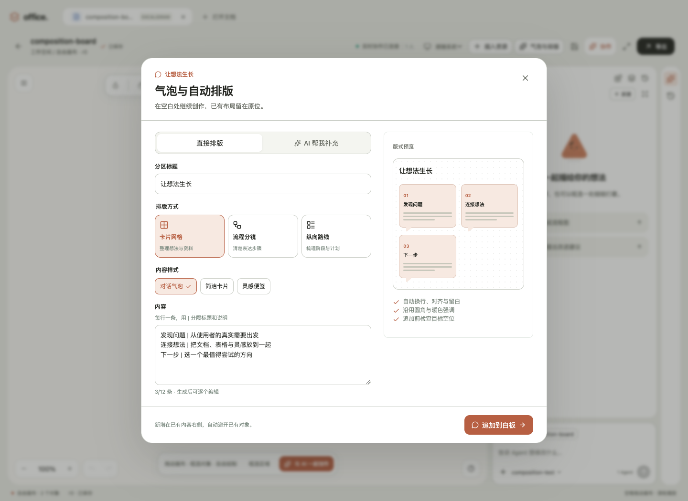
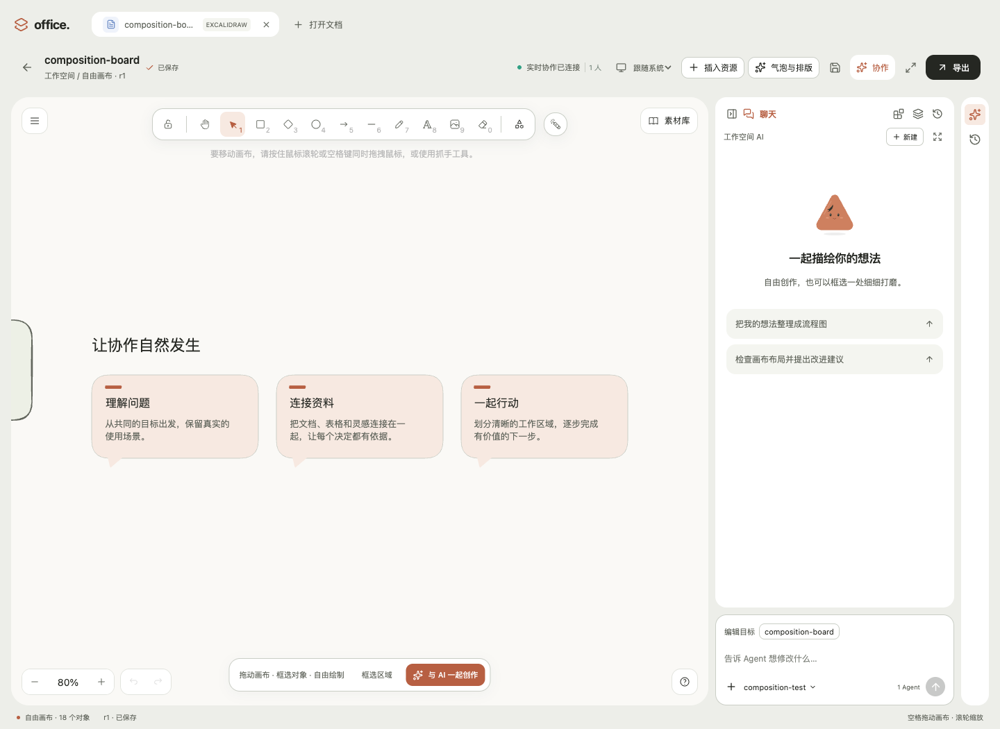
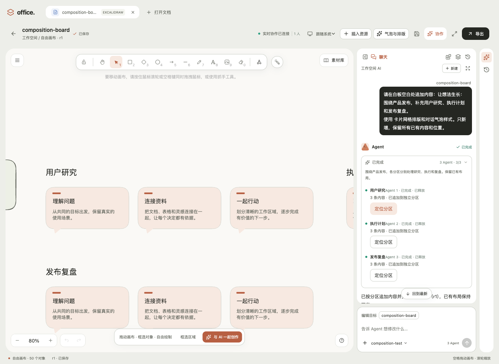

# 白板气泡、自动追加与多 Agent 分区协作验收

日期：2026-11-17。基于当前 Excalidraw 原生场景和 HCD 修订体系实现，沿用工作空间、文档标签页和右侧全局 AI。

后续已升级为 AI 优先创作，并支持四类图解及圆角连线，最新界面和验证见 [AI 图解验收](hcd-canvas-ai-diagrams-v1.zh.md)。本页截图和数量保留首次卡片版验收记录。

## 已交付

- 白板顶部 **AI 创作**：描述需求即可生成内容；切换 **直接排版** 后可填写自己的分区标题和逐条内容，选择对话气泡／简洁卡片／灵感便签。
- 三种自动排版：卡片网格、流程分镜、纵向路线。统一圆角、墨色正文、暖色强调、字号和留白，支持中文标点避头、英文单词换行。
- 内容以原生可编辑对象追加，保留文字、分组和连线端点绑定。新增内容自动定位；已有对象的位置、内容、样式和自定义数据保持原样。
- **生成到白板**：把要求与排版选项直接提交给全局 AI。追加模式在服务端限制为带空位保护的新增操作，不能修改旧对象。切换上下文不会取消追加约束。
- 选择 2–4 Agent：协调者划分 1–8 个内容分区，工作 Agent 并行生成各自草稿，界面显示认领、准备完成和已应用。所有分区完成后统一排版、一次原子追加，每个已完成分区可点击定位。
- 草稿使用独占工作租约及现有持久化任务记录。停止任务不写入尚未提交的草稿；显式续跑复用已完成草稿，不重复生成。丢失提交响应时按原批次、作者和回执恢复。

## 截图







## 不打乱已有布局的实现

排版由 `canvas-core` 确定性计算，模型仅提交内容。默认沿现有内容右侧寻找新空间；指定区域时只能使用区域内的空位，空间不足直接返回错误。布局计划不写入文档。

计划返回的 `Batch.vacantRegions` 会在最终写入锁内重新校验：批次只能包含新增对象，每个对象必须位于指定空位内；任何现存对象进入该区域都会使整批提交失败。服务端不通过移动、缩小、删除旧对象来容纳新内容。多 Agent 会读取最新场景，遇到空位冲突有界重新规划；版本恢复、身份和任务授权继续经过原有校验。

人工追加通过现有 `CanvasConnection` 及本地草稿日志保存，失败时保留原批次供重试或恢复。读取协作版本会丢弃待提交草稿，界面保留已有的下载草稿入口。

原生坐标和提交回执需要精确 JSON 往返；`canvas-core` 启用 `serde_json/float_roundtrip`，覆盖了小数坐标保存后回读和跨修订幂等识别。

## 模块与对外接口

| 能力 | 位置 |
|---|---|
| 内容模型、文字换行、三种排版、分区布局 | `crates/canvas-core/src/composition.rs` |
| 空位与新增操作校验 | `crates/canvas-core/src/transaction.rs` |
| 授权范围内生成布局计划 | `crates/officecli/src/hdoc_server/canvas.rs` |
| 分区规划、并行草稿、租约、原子提交和恢复 | `crates/officecli/src/hdoc_server/canvas_team.rs` |
| MCP 工具 | `crates/officecli/src/mcp_hcd.rs`，`hcd_canvas_plan` |
| 创建入口、预览及全局 AI 任务准备 | `examples/hdoc/editor/src/canvas/CanvasComposePanel.tsx` |
| 保存、定位、全局 AI 分区状态 | `CanvasConnection.ts`、`CanvasWorkspace.tsx`、`AgentTasks.tsx` |

HTTP：`POST /v1/documents/:id/canvas/layout`，只读计算，返回 `batch`、`appendOnly`、`collaborationEpoch`。请求示例：

```json
{
  "expectedRevision": 3,
  "patchId": "layout-unique-request-id",
  "composition": {
    "title": "产品发布计划",
    "layout": "flow",
    "items": [
      { "title": "理解用户", "body": "收集真实使用场景。", "kind": "bubble" },
      { "title": "验证方案", "body": "通过小范围试用确认方向。", "kind": "bubble" }
    ]
  }
}
```

把返回的 `batch` 原样提交到已有 `POST /canvas/patch`，携带写权限与当前 `X-HCD-Collaboration-Epoch`。发生空位冲突后重新读取，使用新 `patchId` 规划，不能删除空位约束。单独规划只要求读取权限，不授予写权限。

MCP 使用 `hcd_canvas_plan(document_id, expected_revision, patch_id, composition, region?)`，再使用 `hcd_patch(mode="canvas", ...)` 提交。外部客户端通过 `/v1/capabilities` 的 canvas 能力发现读取内容 Schema、追加约束和分区协作上限。现有原生对象编辑协议继续可用。

## 验证

真实本地 Rust HTTP 服务、临时 HCD 文档、Chrome、Vite；模型替换为本地模拟 Responses 服务，不使用真实模型密钥或生产数据。

```bash
cargo test -p canvas-core
cargo test -p officecli canvas --bin officecli
cargo clippy -p canvas-core --all-targets -- -D warnings
cargo build -p officecli

cd examples/hdoc/editor
npm run build
HCD_BROWSER_PATH='/Applications/Google Chrome.app/Contents/MacOS/Google Chrome' \
  npx playwright test e2e/canvas-composition.spec.ts e2e/canvas.spec.ts e2e/resources.spec.ts
```

- 核心单元测试 10 项通过；服务端相关测试 4 项通过。
- 端到端 22 项通过，其中新增 7 项覆盖：手动排版和刷新、空位冲突及重复回执、三 Agent 真实并行请求、单 Agent 排版工具与越权修改拒绝、停止与续跑草稿复用、只读及手机界面、人工同时修改与分区越界拒绝。
- 原有 10 项白板测试和 5 项资源引用测试通过，覆盖自由绘制、多人同步、选区 AI、撤销重做、离线草稿、双主题面板、文档和表格引用导航、全局 AI 目标归属。
- `cargo build` 有当前 macOS 链接器 unwind 大小提示；前端构建保留现有依赖指令和大包体提示。均未阻断构建。

## 本次范围

每个分区最多 12 条内容；多人排版最多 8 个分区、4 个并发工作 Agent，统一采用最多两列的分区布局。流程分镜使用横向连续连线，较大内容可缩放或定位单个分区。

多 Agent 当前执行“分区并行准备内容 → 统一排版 → 原子追加”。没有放开多个 Agent 任意同时重排已有白板，也没有新增跨文档／表格的原子写入事务。表格、文档仍通过既有资源引用和各自的编辑授权进入源文件处理。

验收确认了生成协议、权限、保存、并发和界面行为；真实模型的文案质量、复杂版式创作质量需在实际配置的模型上另行评估。
