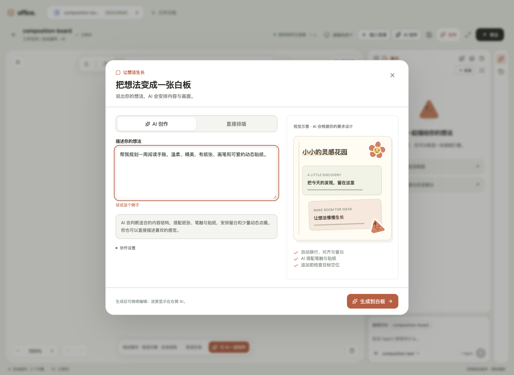
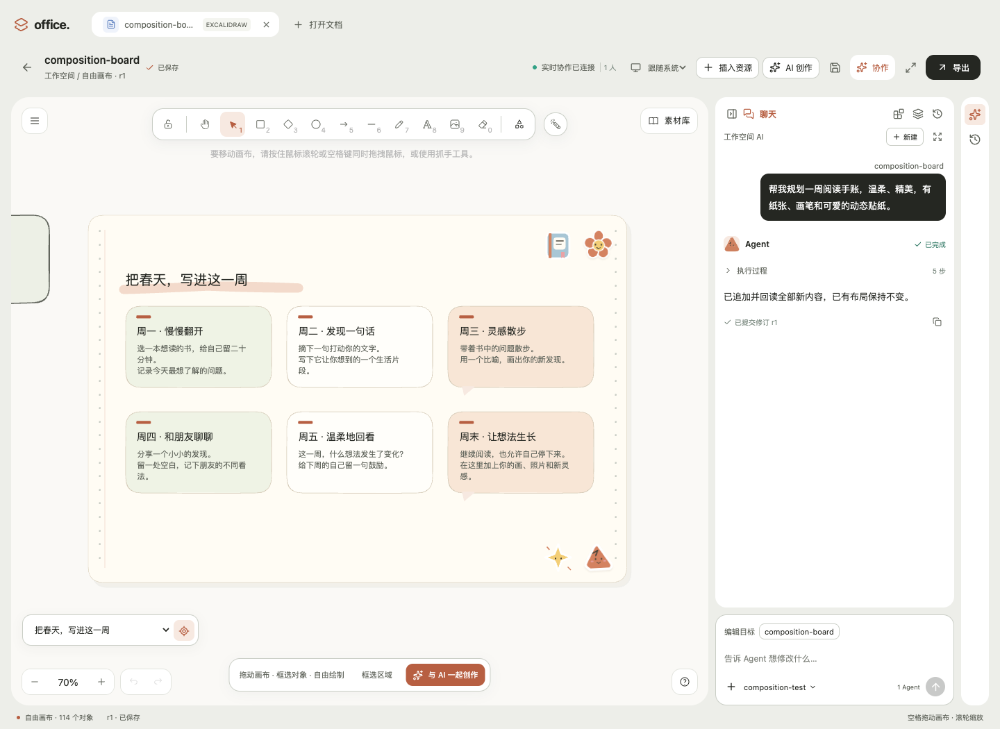
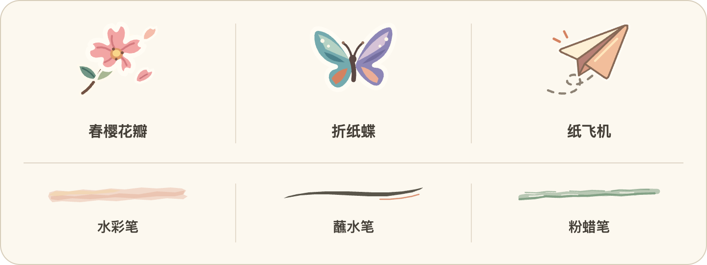
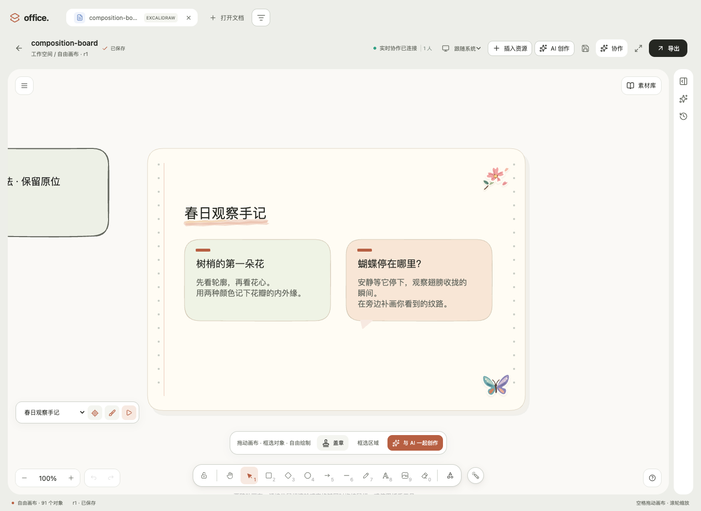
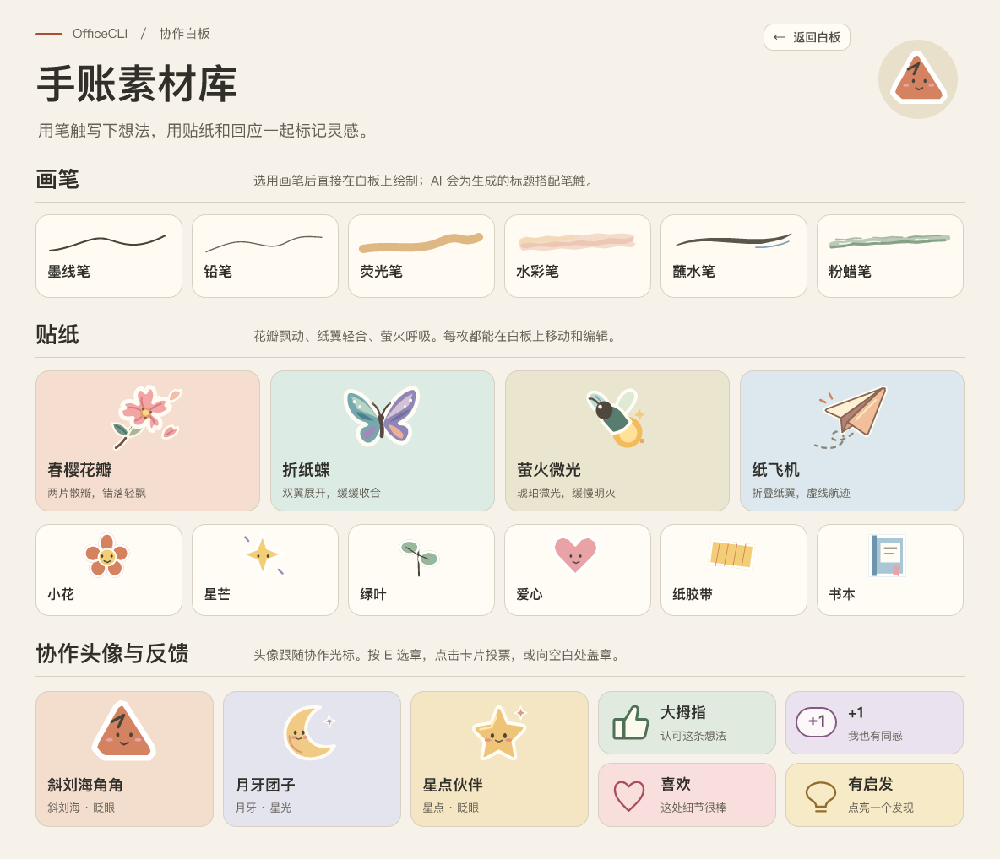
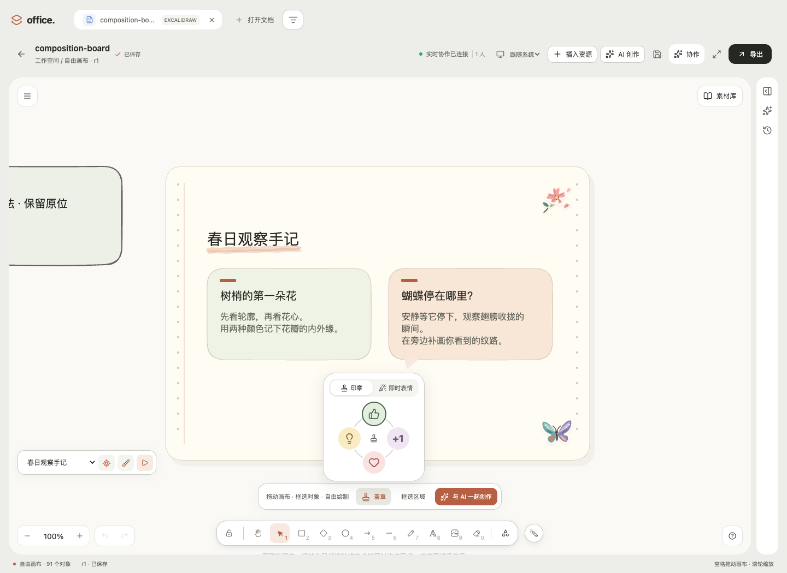

# AI 自动规划手账视觉验收

日期：2026-11-17。基于现有原生白板、追加事务和全局 AI 实现。

## 用户体验

进入 **AI 创作** 后只描述需求，例如“帮我规划一周阅读手账，温柔、有趣，留一些继续书写的空间”。AI 自行决定内容结构、卡片类型、图解布局、视觉风格、配色、纸张、笔触和贴纸。AI 模式已移除布局和内容样式选择器；协作人数收在折叠设置里。用户仍可用自然语言指定喜欢的感觉或明确要求流程图／架构图。

AI 可以选用手账风格，也可以为正式技术图解保留克制的工作室风格。**直接排版** 仍供用户使用自己的文案。侧边预览明确标注为视觉示意，不作为生成结果。





独立 SVG 素材可直接复用：[三角小伙伴](../design/officecli-canvas-journal-v1/stickers/mascot.svg)、[小花](../design/officecli-canvas-journal-v1/stickers/flower.svg)、[书本](../design/officecli-canvas-journal-v1/stickers/book.svg)、[星芒](../design/officecli-canvas-journal-v1/stickers/spark.svg)、[绿叶](../design/officecli-canvas-journal-v1/stickers/leaf.svg)、[爱心](../design/officecli-canvas-journal-v1/stickers/heart.svg)、[胶带](../design/officecli-canvas-journal-v1/stickers/tape.svg)。这些文件带有轻微动画，并遵循减少动态效果的系统设置；浏览器以图像方式嵌入 SVG 时可能只显示静态帧。

## 视觉能力

| 能力 | 当前实现 |
| --- | --- |
| 纸张 | 暖白纸页、细边框、轻投影、页边线，支持素纸、横线和页边点阵 |
| 配色 | 杏桃、草木、淡紫、海蓝四套协调色，纸张与正文保持清晰对比 |
| 笔触 | 墨线、铅笔、荧光笔，以及半透明叠色的水彩、两端收尖的蘸水笔、带断纹的粉蜡笔 |
| 贴纸 | 小花、三角小伙伴、星芒、绿叶、爱心、胶带、书本、春樱花瓣、折纸蝶、纸飞机 |
| 动态 | 整体浮动、摇摆、呼吸，以及散瓣飘动、蝶翼收展和纸飞机滑行 |
| 内容 | AI 生成文案和语义关系，复用网格、路线、流程图、架构图、头脑风暴和课程讲解布局 |

单作品最多四张贴纸，其中动态贴纸最多两张。模型根据语义选择素材，例如阅读搭配书本，成长搭配花叶，灵感搭配星芒。装饰使用独立的标题／页脚留白，不占正文和连线区域。

这是可扩展的符号素材库及受控笔触语法，尚未实现任意新贴纸的实时图像生成，也不是完整的专业绘画引擎。AI 负责选择和规划，原生布局编译器负责尺寸、间距、边界和编辑器兼容性。

## 可编辑、协作与导出

贴纸由原生矩形、椭圆和矢量线组成，按贴纸分组；用户可以移动、删除和修改颜色。纸张、内容、笔触和静态贴纸随 HCD 修订保存。动态贴纸同样具有完整原生静态底稿，`customData` 保存素材版本与动画意图。

屏幕动画由本地 SVG 展示层绘制，按原生对象的当前几何和颜色更新，捕获点击／选择／拖动仍交给原生画布。动画不向协作服务逐帧写入，不产生新修订；其余用户读取同一持久化意图，各自在本地播放。系统要求减少动态效果时显示静态图形。

导出 `.excalidraw` 保留所有原生对象和动画元数据。PNG 导出静态底稿。通用 Excalidraw 查看器显示静态贴纸，OfficeCLI 白板会播放动效。选中单张贴纸后，打开「导出」并点击「所选贴纸 SVG」，即可保存带有当前几何、配色和动效的独立文件。

原有 `vacantRegions` 保护覆盖纸张、贴纸与全部内容：先预留完整区域，提交时重新检查。多 Agent 各自生成完整内容与视觉草稿，协调者给出共享风格方向，全部完成后统一分区并原子追加。当前共享风格依赖模型遵循协调指令，未强制所有分区使用同一套配色。

## 对外协议

`Composition.visual` 为可选字段；旧调用省略时行为兼容。严格模型 Schema 要求该字段，旧式内容可返回 `null`。示例：

```json
{
  "title": "阅读灵感手账",
  "layout": "grid",
  "items": [
    { "title": "今天的发现", "body": "记下一句打动你的话。", "kind": "note" }
  ],
  "diagram": null,
  "visual": {
    "style": "journal",
    "palette": "apricot",
    "paper": "dot",
    "brush": "marker",
    "stickers": [
      { "motif": "book", "motion": "float", "position": "heading" },
      { "motif": "mascot", "motion": "wiggle", "position": "footer" }
    ]
  }
}
```

HTTP 继续使用 `POST /v1/documents/:id/canvas/layout` 生成只读计划，再通过原来的 `/canvas/patch` 提交；MCP 继续使用 `hcd_canvas_plan` 和 `hcd_patch(mode="canvas")`。能力发现提供视觉规划、贴纸数量与静态导出标记。

AI 创作入口的任务目标仅包含 `composition: { appendOnly: true, visualPlanning: true }`，没有预设 `layout` 或 `kind`。服务端要求此类任务提交视觉规划；缺失规划时返回错误，允许模型修正。所有样式、素材和动画名称均为受控枚举，不执行模型提供的任意 SVG／脚本／外部资源。

| 位置 | 责任 |
| --- | --- |
| `crates/canvas-core/src/journal.rs` | 视觉 Schema、纸张与笔触、贴纸、完整空位预留 |
| `crates/canvas-core/assets/stickers.json` | Rust 与 React 共用的符号矢量素材 |
| `CanvasComposePanel.tsx` | 只描述需求的 AI 创作入口 |
| `CanvasStickers.tsx`、`journal.css` | 跟随原生编辑的 SVG 动态层、减少动态效果 |
| `CanvasWorkspace.tsx` | 本地动画投影、原生编辑、静态导出 |
| `hdoc_server/canvas.rs`、`canvas_team.rs` | 单 Agent 和分区团队的自主视觉规划指令与约束 |

## 验证方式

```bash
cargo test -p canvas-core
cargo clippy -p canvas-core --all-targets -- -D warnings
cargo build -p officecli
cargo test -p officecli canvas --bin officecli

cd examples/hdoc/editor
npm run build
HCD_BROWSER_PATH='/Applications/Google Chrome.app/Contents/MacOS/Google Chrome' \
  npx playwright test e2e/canvas-composition.spec.ts e2e/canvas.spec.ts e2e/resources.spec.ts
```

使用真实 Rust HTTP 服务、临时 HCD、Chrome 和本地模拟 Responses 服务。测试中的阅读文案和视觉决策仅为可重复的模型输出样本，不是产品自动插入的默认内容。真实外部模型的选材、审美和内容质量尚未评估。

核心 16 项、服务端 4 项通过，Clippy、Rust 构建与前端类型检查／生产构建通过。浏览器分组运行共 30 个不同用例验证通过：15 项白板创作／图解／手账用例，以及 10 项原有白板和 5 项资源引用回归。修复了测试暴露的线段原点归一化偏移，并将模拟模型回读补齐到多页；最终拖动／删除用例等待保存完成后再检查持久化结果。

新增验证包括：AI 入口不预选布局／卡片样式、自然语言请求生成手账、动态样式与减少动态效果、动画不产生修订、修改颜色同步到 SVG、导出可见静态底稿、原生贴纸整体拖动与删除、刷新后不出现残影。原有图解、多人同步、选区授权、离线草稿与文档／表格标签页导航回归通过。

构建仍有既有的 macOS unwind、大包体及依赖模块指令提示，未阻断验证。

2026-11-18 更新。先框选区域再使用 AI 创作时，手账会在框选范围内寻找空位。作品导览中的播放键可暂停或恢复动态贴纸，每张白板独立记住播放偏好。新增浏览器验证覆盖选区追加、原对象保留和刷新后恢复暂停偏好。

## 春日笔触与动态贴纸

在白板点击「AI 创作」里的「试试这个例子」，即可发起一页春日观察手账。AI 决定笔触、配色、贴纸和位置。作品使用新笔触时，可点击作品导览中的画笔按钮，沿用笔色、粗细和透明度自由书写。标题的水彩叠色、蘸水笔收尖和蜡笔断纹由可编辑的原生线条绘制。



春樱的两片散瓣各自飘动，折纸蝶的双翼朝蝶身收拢，纸飞机沿虚线轻轻滑行。画板和导出的 SVG 都遵循系统的减少动态效果设置。[播放整套 SVG](../design/officecli-canvas-journal-v1/brushes-and-stickers.svg) · [春樱花瓣](../design/officecli-canvas-journal-v1/stickers/petals.svg) · [折纸蝶](../design/officecli-canvas-journal-v1/stickers/butterfly.svg) · [纸飞机](../design/officecli-canvas-journal-v1/stickers/paperPlane.svg)



春日素材随第二版目录加入，当前目录版本为 3。HTTP 和 MCP 使用同一套视觉参数。`visual.brush` 增加 `watercolor`、`fountain`、`pastel`，`motif` 增加 `petals`、`butterfly`、`paperPlane`。`motion: "auto"` 让贴纸播放自身的动作。旧作品继续使用原来的笔触和动作。

可用下面的命令验证单人 AI 选材、分区协作、原生手绘、静态图片导出和 SVG 独立播放。浏览器用例启动临时 Rust 服务和本地模拟模型。

```bash
cargo test -p canvas-core
cargo build -p officecli --bin officecli
cd examples/hdoc/editor
HCD_CANVAS_TEST_HOST='::1' HCD_BROWSER_PATH='/Applications/Google Chrome.app/Contents/MacOS/Google Chrome' \
  npx playwright test e2e/canvas-composition.spec.ts e2e/canvas.spec.ts
```

## 素材库、印章与即时表情

桌面白板把绘图工具放在画布底部。右上角的「素材库」可以搜索 6 支画笔、10 枚贴纸、3 个协作头像和 4 种反馈。点开一项可预览笔触或动画，展开「素材参数」可查标识、关键词和静态表现。普通插入和 AI 创作都会寻找空白位置。打开「头像」后可以把斜刘海角角、月牙团子或星点伙伴设为目前浏览器会话的协作头像。同一工作区、同一账号的文件共用这个选择，刷新后可恢复。



萤火虫腹部缓缓明灭，月牙会眨眼，星星会闪。白板支持暂停贴纸，独立 SVG 支持系统的减少动态效果偏好。[萤火微光](../design/officecli-canvas-journal-v1/stickers/firefly.svg) · [月牙团子](../design/officecli-canvas-journal-v1/stickers/moonPal.svg) · [星点伙伴](../design/officecli-canvas-journal-v1/stickers/starPal.svg)

### 白板操作

| 操作 | 结果 |
| --- | --- |
| 选中卡片、原生图形或一组贴纸，点选区工具条上的大拇指或 +1 | 在对应元素上显示人数。再次点击可撤回自己的反馈 |
| 点「盖章」或按 E，选择喜欢、有启发、大拇指或 +1，再点元素 | 附着在目标上。同一人可以回应多张卡片，每种反馈对同一目标只计一次 |
| 选好印章后点空白处 | 在点击的位置生成可移动的原生印章，作为白板内容保存 |
| 在轮盘中切到「即时表情」并点画布，或在印章模式中按住 Shift 点画布 | 在线参与者会在该位置看到短暂的表情。同一个事件保留约 1.45 秒，只读协作者也可参与 |
| 按 Esc | 退出轮盘或盖章模式，继续使用白板 |
| 键盘操作 | 轮盘内可用方向键或 Tab 选择，用 Enter 确认。在印章模式按 Enter 可直接给已有选区盖章 |

反馈按文档、协作版本、元素标识、反馈类型和已认证账号区分。大拇指、+1、喜欢、有启发分别计数。读取结果仅包含人数与本人是否已回应。恢复历史版本会切换协作版本。元素反馈持久化在本地或配置的 PostgreSQL 中，画布内容修订独立保存。即时表情通过在线协作通道广播。



设计稿包含可编辑的 23 项素材组件以及一张组合了手账便签、印章轮盘、底部画具与全局 AI 的工作台画板。原型中的「素材库」与「返回白板」可在两个画板间切换。[FigCraft 源文件](../design/officecli-canvas-journal-v1/officecli-canvas-materials.figcraft) · [工作台设计预览](hcd-canvas-journal-v1/figjam-workspace.png) · [真实素材库](hcd-canvas-journal-v1/material-library.png) · [双人反馈截图](hcd-canvas-journal-v1/element-feedback.png)

本轮参考了 FigJam 公开的印章、临时表情、按 E 选章以及印章附着在对象上的操作说明。用户提供的 Untitled 白板链接在本轮访问时返回 HTTP 403。[FigJam 官方操作说明](https://help.figma.com/hc/en-us/articles/1500004290981-Stamps-emotes-and-high-fives)

### AI 选材

`hcd_read` 的 `canvas_materials` 资源和 HTTP 白板素材接口共用同一份元数据。无筛选时仅返回分类和数量，加分类或关键词后返回候选名称与摘要，最后按标识获取用途、适合与避开的场景、建议配色、动效及静态表现。渲染几何由应用持有。新生成的笔触标题和贴纸锚点携带稳定的素材标识。分区 Agent 和文档生成白板的工具可按主题获得少量相关候选，真实用户的意见只通过协作反馈记录。

```json
{"document_id":"board","resource":"canvas_materials"}
{"document_id":"board","resource":"canvas_materials","query":"会闪"}
{"document_id":"board","resource":"canvas_materials","material_id":"firefly"}
```

### 本地验证

运行本页上方两组白板 Playwright 测试可以覆盖 AI 分级选材、头像、鼠标与键盘盖章、双人反馈及撤回、只读参与者发送即时表情、手机操作和 SVG 独立播放。使用实际 Chrome、Rust 服务、临时文档和可重复的本地模型响应。额外通过 stdio MCP 读取三级素材，以及在临时 PostgreSQL 上并发写入反馈、重启服务再读取。测试数据和账号均为本地临时数据。

本轮最终通过 32 项白板 Chrome 用例和 3 项白板与文档流转用例。Rust 画布核心 19 项、服务端二进制 157 项测试通过，编辑器独立版与嵌入版均完成生产构建。
