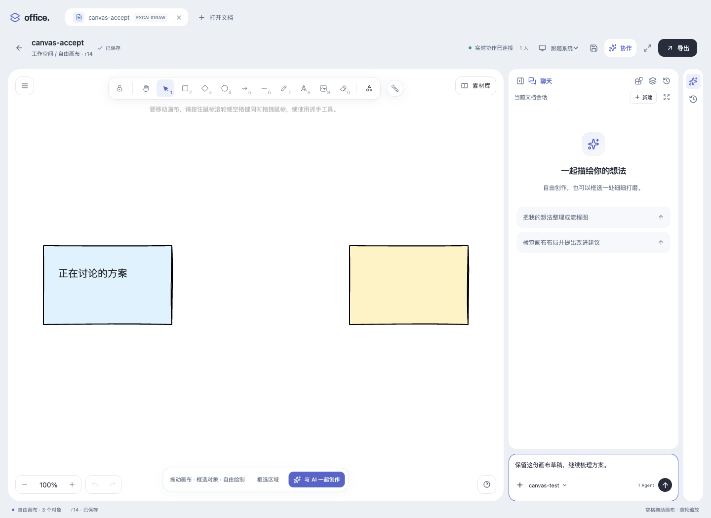
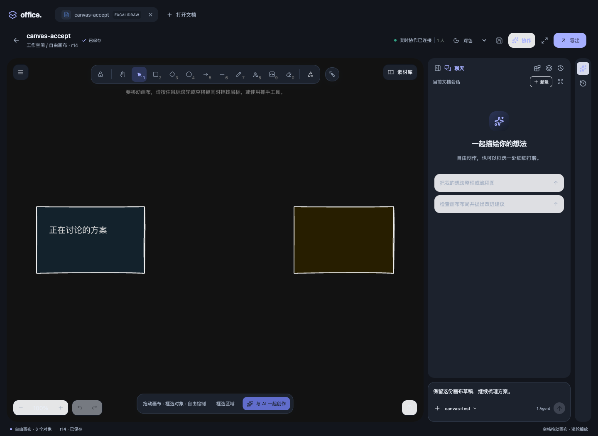
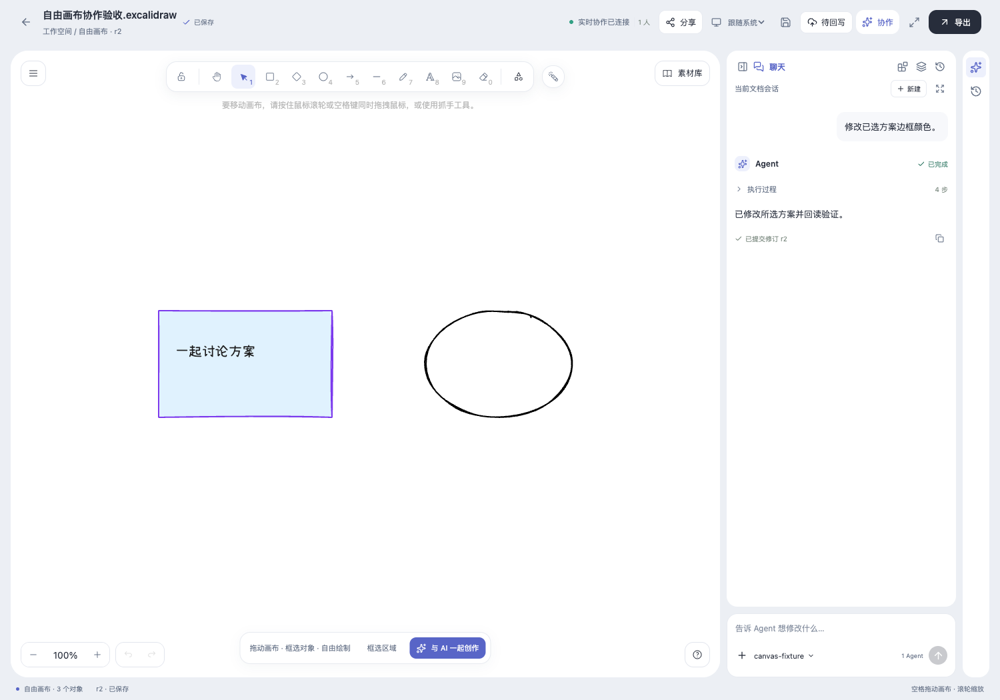
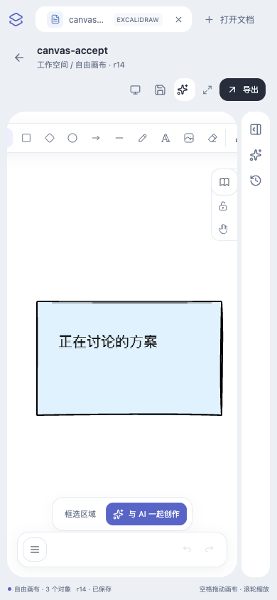
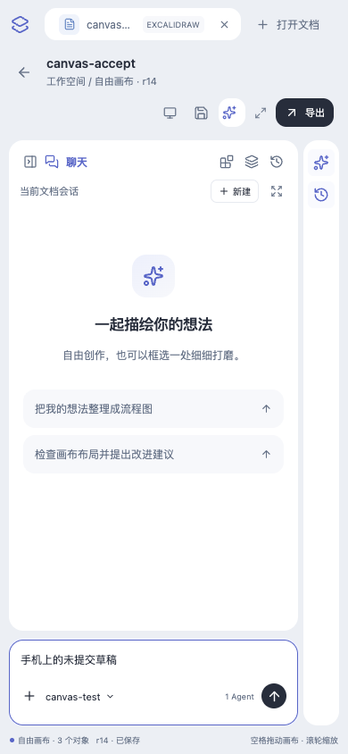

# 自由画布样式 V2 验收

日期：2026-11-17。设计约束与 Pen 原稿状态见[设计说明](../design/officecli-canvas-v2/README.zh.md)。本轮未修改 Rust。

## 已验证

- 10 项画布浏览器检查通过，包括已有的绘图、多人协作、局部 AI、范围限制、撤销与断网恢复，以及新增的深浅主题、圆角、停靠、聊天草稿保留和手机布局检查。
- 4 项共享聊天回归通过，包括 Markdown、Enter/Shift+Enter/IME、历史阅读、停止任务，以及面板收起、展开与专注模式下的草稿保留。
- 12 项 Workspace 单测通过。
- TypeScript、独立应用与嵌入包构建通过。
- 打包后的宿主工作流通过：创建画布、局部 AI、原生 PNG、业务回写、匿名协作和权限降级。现有本地 Workspace 的 `/editor/` 返回内容与当前打包 UI 一致。

几何检查直接针对浏览器：画布圆角 26px；AI 主面板和输入区均为 16px；默认 AI 宽度 344px，展开 480px；停靠与输入区间距均为 10px；面板不覆盖画布。手机无横向溢出，面板为正常内容布局，开关后保留同一原生画布 DOM。

[完整结果](hcd-canvas-style-v2/validation.json) · [画布检查](hcd-canvas-style-v2/canvas-browser.log) · [聊天回归](hcd-canvas-style-v2/chat-regression.log) · [打包工作流](hcd-canvas-style-v2/packaged-workflow.log)

## 复验

在 `examples/hdoc/editor` 运行：

```bash
npm run build
HCD_CANVAS_TEST_HOST='::1' \
HCD_BROWSER_PATH='/Applications/Google Chrome.app/Contents/MacOS/Google Chrome' \
  npx playwright test e2e/canvas.spec.ts --output=test-results/canvas-style-v2
HCD_BROWSER_PATH='/Applications/Google Chrome.app/Contents/MacOS/Google Chrome' \
  npx playwright test e2e/agent-harness.spec.ts \
  --grep 'Pen chat drawer|chat composer handles|chat preserves history|Codex-style chat' \
  --output=test-results/canvas-chat-regression
```

默认仍可使用 IPv4；本次浏览器验收使用 IPv6 loopback，因为主机观察到 16,246 个 TCP TIME_WAIT，而临时端口范围为 49,152–65,535，IPv4 导航出现 `ERR_ADDRESS_INVALID`。测试中的 Vite 上游使用 `localhost`，避免代理将 `[::1]` 当作 DNS 名称。没有修改主机网络参数或其他进程。

构建、打包和宿主工作流沿用 Workspace 的构建脚本及 `apps/workspace/scripts/verify-canvas.mjs`。AI 功能验证使用本地脚本模型，不调用真实外部模型。

仓库根目录运行打包工作流验收；`OFFICECLI_CANVAS_TEST_HOST` 只调整临时测试实例的地址：

```bash
OFFICECLI_BIN="$PWD/target/debug/officecli" OFFICECLI_SKIP_UI_BUILD=1 \
  node apps/workspace/scripts/build.mjs
OFFICECLI_CANVAS_TEST_HOST='::1' \
HCD_BROWSER_PATH='/Applications/Google Chrome.app/Contents/MacOS/Google Chrome' \
  node apps/workspace/scripts/verify-canvas.mjs
```

## 实际页面







| 手机画布 | 手机 AI 内容列 |
| --- | --- |
|  |  |
