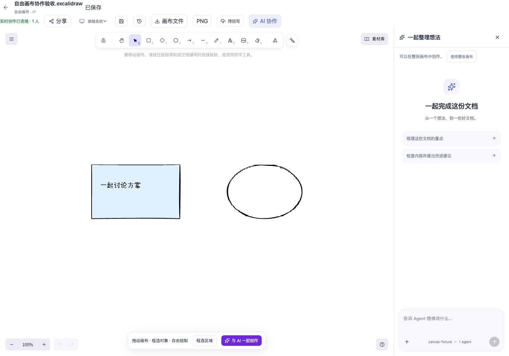
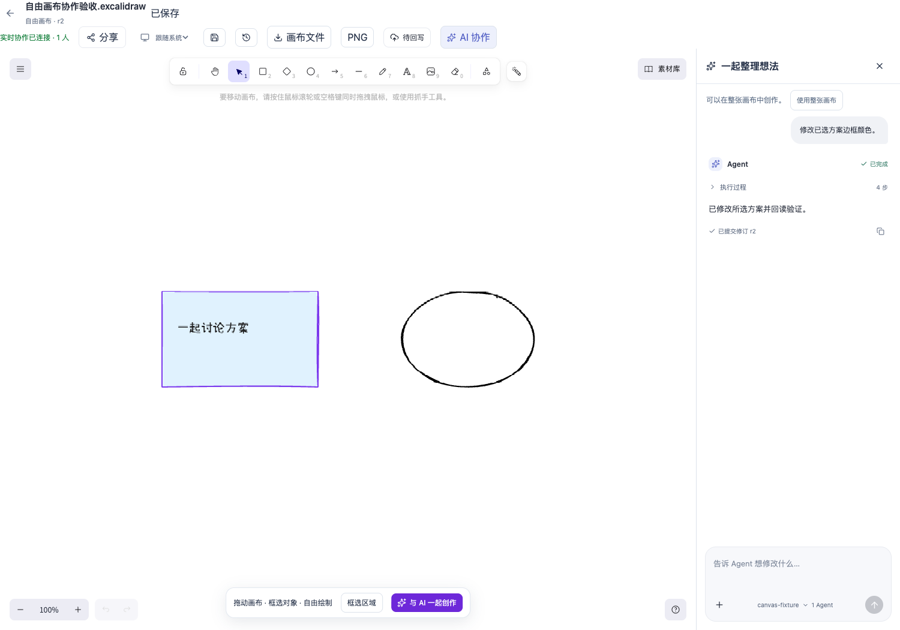
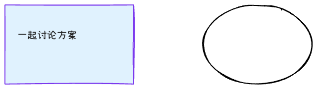

# 自由画布 v1 验收

实现说明见 [模块与协议](../hcd-canvas-v1.zh.md)。本次验收运行真实 Rust 引擎、打包后的 Workspace、SQLite Provider 和两个独立浏览器身份；模型服务使用本地脚本返回工具调用，不调用外部模型。

## 已验证

- 原生笔迹、压感与图片资产经过导入、对象修改、历史读取、恢复、导出及归档解包后保留。
- 不同对象/字段的并发修改可合并；同一字段旧值失效时整批拒绝；重复请求返回原回执。
- 双人浏览器同步自由绘制；AI 改颜色时另一人移动同一对象，移动与颜色都保留。
- 实际鼠标框选后启动局部任务；空白区域允许增加对象；AI 越界修改会被服务端拒绝。
- 原生撤销/重做不回滚另一人的提交；断网编辑保留本地草稿，重试不重复创建对象。
- 打包应用完成登录、新建画布、AI 工具链、PNG 导出和原生文件业务回写。
- 非 loopback HTTP 请求被拦截时，画布字体及 PNG 导出仍然正常。
- 匿名访客可以按分享权限绘图；无 AI 权限；分享降为只读后，已打开的画布切换到只读。
- Provider 模型名单为空或未列出当前模型时拒绝调用；显式授权的部署模型可运行画布任务。

命令与统计在 [validation.json](hcd-canvas-v1/validation.json)，CLI 实际序列在 [cli-validation.json](hcd-canvas-v1/cli-validation.json)。复验入口为 `examples/hdoc/editor/e2e/canvas.spec.ts` 与 `apps/workspace/scripts/verify-canvas.mjs`。

## 验收边界

未验证外部模型的绘图质量、多节点事件分发、大房间负载或新机器完整断网部署。当前不包含可运行网页组件、代码沙盒及画布截图视觉理解。HTML/语义 Office/PDF 导出仅使用文字预览，不等同于原生画布视觉导出。
