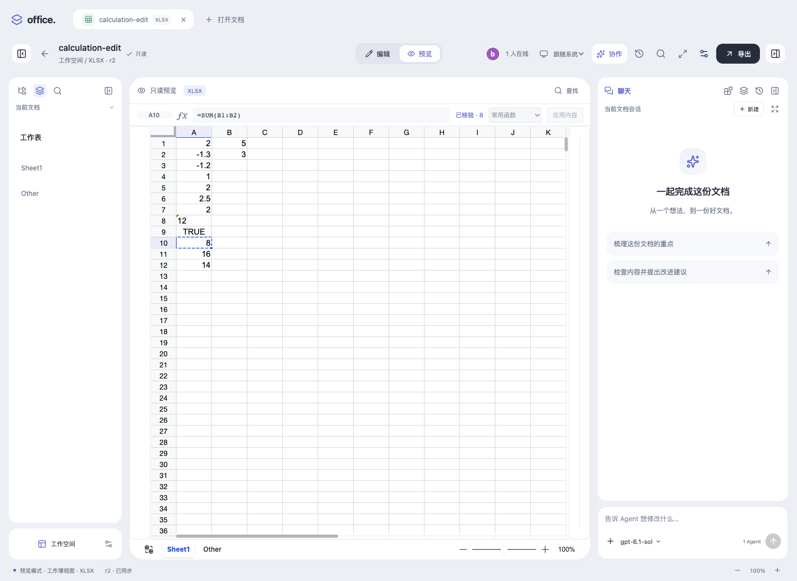

# 当前整体功能状态 · 2026-11-16 更新

结论：尚未完成“所有文档格式、复杂对象、预览与编辑一致、无损转换、人工与多 Agent 完整协同”。当前已形成多格式工作区和可用的基础闭环，但格式接入、对象可编辑、计算正确、转换保真和故障恢复是不同层次，不能互相替代，也不能按测试数量估计整体完成百分比。

最新追加复核：编辑器独立/嵌入构建、**24 项前端单元**及代理连接探针通过；最终组合浏览器 **40/40（3.0 分钟）**通过。此前 37/39 的导航失败已定位为外部工具栏操作前后误累计画布双击，并加入浏览器点击次数守卫；真实双击与导航均有回归。连接失败的后续现场记录到本机 `EADDRNOTAVAIL` 和大量主要为非 loopback 的 TIME_WAIT，开发代理已复用连接，但其他进程造成地址资源不足仍可能影响连接。Rust 后端本次未修改，整树 **1,074 项**及 Clippy/格式/debug 构建沿用前一阶段的验证结果。详见[追加复核](hcd-editor-pointer-proxy-recovery.zh.md)和[机器汇总](hcd-grid-batch-recovery/verification-results.json)。这不是完整全格式验收；无远端 CI 或干净检出认证。

评估对象为 `feature/hcd-font-format-integration`、HEAD `ccb5fd5` 的当前工作区，包含大量未提交及未跟踪改动；不等于 main 或已发布二进制具备以下全部能力。[初始核查](hcd-capability-audit-2026-11-15.zh.md)保留修复前发现及原始失败记录；本文结合[第一阶段建设](hcd-reliability-phase1.zh.md)给出更新状态。

此前混合粘贴阶段核验：Rust 整树 **1,073 项**（含 doctests）、Clippy、全量格式与 debug 构建通过；编辑器独立/嵌入构建及 **21 项前端单元**通过。最终组合浏览器 **31/31（2.6 分钟）**，覆盖 XLSX 富文本混合粘贴、新空白格输入恢复、选区/MCP/撤销/同步/原生导出，以及 HTML、Word、七格式 Harness、公式与类型、表格悬停/插入/20 步历史、导出菜单和协议检查。本轮新增 schema 50 的原子混合内容提交、空白格富文本创建和可写数值/公式转富文本；修复新建格原生导出丢格式与 schema 错误要求数字操作的问题，加入标准 schema 校验。4 种原生创建路径的 CLI 回读及 5 项原生公式探针复验通过，见[混合粘贴验收与截图](hcd-xlsx-rich-paste.zh.md)。任意外部剪贴板的完整格式、多格/跨设备草稿、主题颜色解析和完整 CSS/Office 排版往返仍未完成。这仍是本地共享工作区的限定证据，尚无干净检出或远端 CI 成功认证。

此前选区编辑阶段为 Rust **1,072 项**、前端单元 **19 项**及浏览器 **29/29（2.5 分钟）**，见[历史阶段验收](hcd-xlsx-rich-edit.zh.md)。本轮补齐其中的空白格富文本和混合批次限制；历史结果与本轮有重叠，不相加。

此前富文本保留阶段为 Rust **1,071 项**、前端单元 **15 项**和浏览器 **24/24（2.2 分钟）**，见[阶段验收](hcd-xlsx-rich-text.zh.md)，其中本地确认被协同回声清空撤销栈的问题已修。该阶段 HTML CLI 也曾复验通过；本轮没有重复完整 HTML CLI 探针。历史结果与本轮有重叠，不相加。

此前 HTML 阶段为 Rust 1,068 项、组合浏览器 19/19（1.9 分钟），保留于[HTML 全链路验收](hcd-html-inline-fidelity.zh.md)；更早的无源行内转换见[语义转换验收](hcd-semantic-inline-fidelity.zh.md)。各阶段结果有重复，不相加；无源转换继续标为 SEMANTIC。

之前的工作流 UI 阶段通过 39/39 项组合及最终 15/15 项复验，两组有重复，不相加；见[面板验收](hcd-cross-document-workflow-ui.zh.md)及[后端工作流验收](hcd-cross-document-workflow.zh.md)。后续源 DOCX 行内保真阶段重跑了工作流 UI 和后端专项；本轮 XLSX 混合粘贴阶段的浏览器范围以上述 31 项为准，未重复完整工作流、完整故障恢复、独立图片套件或管理端构建。

之前的单文档授权续跑阶段已有 19 项组合、13 项位置/状态专项及 10 项图片相邻回归，见[续跑验收](hcd-agent-continuation.zh.md)；该阶段的 5 项原生公式探针通过。后续源 DOCX 行内保真阶段修改了编辑器并重跑构建、单元及相关浏览器回归；这些属于历史阶段结果。图片恢复和固定/表格输入的历史记录分别见[图片恢复](hcd-image-recovery.zh.md)与[输入恢复](hcd-uncommitted-input-recovery.zh.md)。各阶段有重复用例，不能相加或视为完整功能覆盖比例；较早的失败记录不代表最新状态。

本轮新增 XLSX 整批输入的严格本地持久化与确切提交回执核对：请求失败时保留整批内容，已提交但响应丢失时不重复写入；未提交恢复仍需明确确认，过期/损坏输入保留下载。增加实时待处理面板和新 epoch 输入，修复拒绝粘贴后公式缓存暂时空白、远端在途刷新覆盖新选区的问题。原生重试后撤销的极短方向键时序曾间歇失败，完整失败与诊断记录独立保留，不能把诊断通过当作该边界已修复。验收与本轮最终结果见[整批输入恢复](hcd-grid-batch-recovery.zh.md)。

## 格式与编辑

| 范围 | 已有能力 | 还不能认定完成的部分 |
| --- | --- | --- |
| DOCX | 正文与基本样式、分页预览、映射表格直接输入、插入表格、增删行列、插图、协同与导出 | 复杂浮动绕排、多栏、完整域/公式/审阅；表格合并拆分、复杂单元格格式、分片长表结构修改；已映射正文的文字及粗斜体修改现保留原段落/run 呈现与源导出；段落类型/层级/字体/链接关系及复杂结构变化仍可能语义重建，不能保证原 Word/WPS 排版保持不变，旧版已丢失的样式不会自动修复 |
| XLSX | 单元格与公式表达式、基础格式、行列/工作表、合并拆分与冻结、Agent 按列分工、源格式导出；已核验标量同步画布，保留布尔/错误/空字符串类型；inline/shared 片段保留、选区格式、人工/MCP 修改、整格/选区撤销和源导出回读；新空白格富文本、支持的 HTML 文字片段粘贴，与数字/公式原子混合提交；已有/新建单格格式与多格内容的本地恢复及回执核对 | 任意剪贴板的整格样式/背景/对象/链接、跨设备草稿和任意结构离线队列、主题颜色解析；所有公式、数组与共享公式任意改写、图表/透视表、完整条件格式和外部数据；旧版缺失类型/片段需重新导入 |
| PPTX | 映射文字、部分形状/图片、页面增删复制排序、图文整稿重做、多 Agent 分工 | 完整母版与布局继承、组合变换、SmartArt、原生复杂图表、动画/媒体；目前有限图文版式不能等同于任意复杂演示稿设计 |
| PDF | 页面视觉预览、映射文字修改、新增文本与图片、部分新增对象几何操作、导出 | 扫描件 OCR、任意源矢量对象、通用文本重流；视觉 PDF 导出可能把文字/矢量栅格化，不能同时保证外观、可搜索性和对象结构无损 |
| Markdown / HTML | 基础语义与表格编辑、协同、Agent、插图和导出；HTML 基本粗斜体及其继承/显式 normal、允许的链接导入；未改变格式/链接/块类型时保留源文字锚点 | 任意 Markdown AST、HTML 样式表/字体字号颜色及完整 CSS 往返、复杂对象；复杂标题在所有编辑入口中的显式 normal 尚未专项验收。代码块/任务列表等能预览不代表结构编辑完整。活动 HTML 会过滤，远程图片不自动加载；相对/本地链接未支持 |
| TXT | 纯文本输入、搜索、历史、协同、Agent 和转换 | 本身没有富文本/表格语义；转换为 Office 格式不代表能恢复原本不存在的版式 |
| PNG / JPEG / WebP | 静态预览、裁剪/旋转/翻转/缩放/调色、格式转换、蒙版重绘、候选对比与提交守卫 | 动画、图层编辑、像素级 CRDT 协同、SVG/HEIC/TIFF/PSD 等不在这条独立图片链路中；已有本地输入与任务/候选重启恢复；跨设备草稿、未下载转换结果和中断任务续跑仍未完成 |
| 其他格式 | 部分旧 Office 格式转换及 CSV/TSV 导入有独立 CLI 路径 | DOC/XLS/PPT、宏格式、ODF、RTF、CSV 等不能标记为统一工作区内同等级预览/编辑/协同支持 |

规范 HTML → 原生 Office/Markdown 的混合粗斜体导出与 HTML 直接导入已分别验证，但旧 bundle 上游已丢失的样式无法靠导出器恢复。HTML/DOCX/Markdown 样本的回读粗斜体、表格与图片已用浏览器检查；此前修复图片外层包装尺寸丢失及 Markdown 独立内嵌栅格的代码块背景，样本均为 64×64 CSS px。XLSX 已验证选区加粗、双页绘制/撤销、MCP 局部改色和混合剪贴板内容的原生回读；完整外部剪贴板样式、主题颜色和所有选区命令仍未认证，见[混合粘贴验收](hcd-xlsx-rich-paste.zh.md)及[选区编辑验收](hcd-xlsx-rich-edit.zh.md)。PPTX 的原生检查不等于任意母版与对象回读完成。Markdown 任意嵌套 HTML 图片、未格式化文字的通用转义和部分换行仍需完善。

DOCX/Markdown/HTML 的新增插图目前限定在正文末尾。现有复杂表格中的合并可保留，不代表已经开放合并/拆分编辑。源格式保留导出、语义重建和视觉导出需要分别验收。

依据：[格式入口](../../crates/hcd-formats/src/lib.rs)、[图片格式限制](../../crates/hcd-formats/src/images.rs:14)、[分片表格限制](../../crates/hcd-core/src/structure/table.rs:541)、[制作与插图边界](hcd-document-production.zh.md)、[表格结构与撤销](hcd-table-structure-undo.zh.md)。

## 计算正确性：已修复的范围与边界

此前计算修复及授权续跑阶段重跑原生 CLI 探针，原始 5 个错误均已修复：`LEN("中文")=2`、`COUNTBLANK(A1:A3)=1`、`COUNTA(A1:A3)=2`、`ROUNDUP(-1.21,1)=-1.3`、`ROUNDDOWN(-1.21,1)=-1.2`，其中 A1=1、A2=2、A3 为空。本轮 XLSX 混合粘贴阶段再次运行，探针退出 0、5/5 通过、差异数为 0，见[最新结果](hcd-xlsx-rich-paste/formula-results.json)。

`officecli-calculation/1` 目前公开 15 个核验函数：SUM、AVERAGE、MIN、MAX、COUNT、COUNTA、COUNTBLANK、ABS、ROUND、ROUNDUP、ROUNDDOWN、LEN、RANK、RANK_EQ、RANK_AVG。CLI、HCD 工作表读取/MCP 和浏览器公式栏使用同一核验契约；其余引擎函数保留为兼容预览，不能将未核验缓存当作可靠重算结果。现有跨表、循环引用、过大范围和文本/空白边界有回归，但仍不能据此认证全部公式、参数组合及单元格类型。

第一阶段已修复无缓存公式在画布中为空白、源文件旧缓存未替换的问题：适配器按当前修订读取受核验的标量结果，保留数字/字符串/布尔类型，通过 Univer 的计算结果 mutation 更新画布缓存。不会为显示缓存发送文档修改，也不重建 canvas、选区或撤销栈；不支持的函数继续明确标为兼容预览。

回归从实际单元格复制结果，核对旧缓存 777→2、无缓存取整、文本 `"12"`、TRUE、本地与远端依赖更新、跨表依赖、原生导出回读及刷新；同时确认画布实例保留，只有真实编辑产生修订。TRUE 在画布显示为 TRUE，Univer 的原始剪贴板标量为 1；两者按其接口语义分别验收。[原始缺口截图](hcd-reliability-phase1/calculation-preview-gap.png)保留为修复前证据。

后续修复补齐了导入字面值类型：保留布尔值、错误、数字文本、空的 inline/shared 字符串，并与真正空白分开处理。CLI 和 HCD 使用同一字面值转换；`SUM` 传播错误，`COUNT`/`COUNTA`/`COUNTBLANK` 保留各自的错误计数规则。实际画布同步标准 Excel 错误，避免继续显示源文件的旧数字缓存；文字或数值修改同时更新类型元数据。

旧版导入可能已丢失空字符串，不能在读取时安全猜回。工作表缺少完整类型标记时返回 `literal_type_metadata_missing`，UI 提示重新导入原始 XLSX；读取和兼容预览仍可用。仍不能认证全部 Excel 语义：目前只有 15 个核验函数，日期/数值精度、动态数组、更多参数边界及布尔/错误类型的专用创建操作尚未全面验收。详见[字面值类型补充验收](hcd-calculation-literal-types.zh.md)。

依据：[核验函数集合](../../crates/xlsx-handler/src/formula/capabilities.rs)、[工作表重算](../../crates/officecli/src/hdoc_server/spreadsheet.rs)、[画布结果同步](../../examples/hdoc/xlsx-univer-viewer/src/adapter.ts)、[修订计算缓存](../../examples/hdoc/editor/src/ServiceGridClient.ts)。

## 协同、AI 与恢复

| 能力 | 当前状态与边界 |
| --- | --- |
| 多标签 | 保留各文档的编辑器/界面状态并恢复标签，重开逐文档鉴权；语义正文另外提供 IndexedDB 草稿日志 |
| 人工协同 | DOCX/HTML/MD/TXT 正文及映射表格文字用 Yjs；PDF/PPTX/XLSX 主要同步已提交修订，未提交按键不做同等级字符合并；图片采用候选、区域锁及整图提交 |
| 多 Agent | Harness 负责共享计划/发现、范围认领、租约、续租、释放及 revision/hash/epoch 守卫；全进程最多 4 位 Agent，单个子任务绑定一个文档；跨文档计划层可调度就绪步骤，共享预算 |
| Agent 可视过程 | 已有待操作/操作中区域、指向节点的移动轨迹和名称、工具事件、制作占位及生成效果；已覆盖用例中的节点与滚动保留通过，不等于任意对象、任意长文档均已完成性能验收 |
| AI 生产 | 默认文本模型 `gpt-6.1-sol`、图片模型 `gpt-image-2`；已有真实 10 页图文 PPT 样例。整稿规划→并行制作→核验→替换主要针对 PPTX，其他格式仍按支持工具局部修改 |
| MCP | 已有 stdio 与文档级 Streamable HTTP、日期协议协商、鉴权和版本化读写；两种传输均支持 Harness 核对/授权续跑与 `hcd_workflow` 跨文档计划；JSON-RPC 2.0 不代表存在一项名为 MCP 2.0 的全能力认证。可选 GET SSE、sampling、elicitation、tasks、重放未实现 |
| 本地撤销 | 默认最多 20 步；受版本/hash/epoch 约束，关闭重开不保留撤销栈，不能用旧历史覆盖协作者的后续编辑 |
| 服务崩溃 | 已持久化房间初始 CRDT 身份及保存点；实测 API/sidecar 强杀并重启后，存活浏览器的离线输入只合并一次，编辑器实例保留 |
| 浏览器关闭/崩溃 | DOCX/HTML/MD/TXT 语义正文使用 IndexedDB 增量 CRDT 日志；显式断开 WebSocket 后输入，关闭页面或 SIGKILL 自有浏览器进程，重开可恢复一次；跨用户/服务隔离，旧 epoch 或 generation 草稿保留供下载对照 |
| 任务与租约恢复 | 私有原子检查点保存任务、共享分工、工具对话及执行位置；实测 API SIGKILL 后保留回执并释放原租约。新增「核对并继续」：新鲜鉴权、当前修订/epoch/指纹与明确授权后，只继续未完成步骤；核对确切 patch hash 避免重复算术。原生验收后的 PPT 队列可继续，ready 插图复用。旧轮次 worker 凭证失效，已完成单元保留 |
| 固定/表格输入恢复 | PDF/PPTX 文字和新文本框位置、XLSX 公式栏与原生未确认输入使用独立 IndexedDB 流；重新鉴权并检查 epoch/修订/目标后手动恢复，仅找回输入，不自动提交；此前通过关闭/强杀、过期版本、写入失败、活跃窗口隔离等回归。XLSX 已有/新格格式及多格内容批次有本地日志；新批次恢复先核对确切回执，已保存的修改不重放，未提交的修改等待确认 |
| 图片恢复 | 调整/裁剪/蒙版/提示词及转换参数有独立本地日志；两类图片任务落盘，重启保留候选、标中断并释放旧区域锁；按确切 patch ID 核对应用回执。转换结果 Blob、跨设备草稿和任意设备的一键重新生成交互不在此范围 |
| 尚未完成的恢复 | XLSX 内容批次已补本地恢复与确切回执核对；跨设备恢复、任意结构操作离线队列未完成。单文档续跑已有协议和 UI，但缺少执行对话的旧任务、独立图片的不确定写入、已改变的表格地址或被人工修改打断的 PPT 队列不能直接继续；多主机/多根目录的共享存储仍需分布式 fencing |
| 跨文档任务 | API/HTTP MCP/stdio MCP 显式依赖计划：逐文档授权，服务端读取共享事实并记录来源修订/hash；就绪步骤并行，依赖完成并回读后继续；失败保留提交，授权后复用原子任务检查点；逆依赖补偿追加新修订并拒绝人工介入。已新增工作流抽屉：选文档/实际内容、配置步骤与人数、计划核对、执行/停止/续跑/补偿、刷新找回及子任务导航；共享选择新增稳定段落/单元格身份校验。通用自然语言自动规划、变更后地址重映射及保留人工修改的对象级逆向补丁仍未完成；不是跨文档原子事务 |

依据：[跨文档工作流](hcd-cross-document-workflow.zh.md)、[任务授权续跑](hcd-agent-continuation.zh.md)、[真实模型制作](hcd-document-production.zh.md)、[协作租约](hcd-agent-team-rebuild.zh.md)、[任务检查点](../../crates/officecli/src/hdoc_server/agent_run_store.rs)、[内容日志](../../examples/hdoc/editor/src/draftJournal.ts)、[恢复与隔离](../../examples/hdoc/editor/src/useSemanticDraft.tsx)、[MCP 传输](../../crates/officecli/src/hdoc_server/mcp_http.rs)。本轮未再次调用真实模型，确定性模型回归不能代替供应商可用性或任意任务质量认证。

## 预览、转换与工程验证

导出已按源格式、修订和实际可用模式给出选项及默认值；接口能产出目标扩展名，不等于能无损保留所有对象。XLSX 转非表格格式、PDF 视觉导出、DOCX 结构编辑后的重建尤其需要说明具体损失。[保真审核器](../../examples/hdoc/fidelity-audit/README.md)也明确：流程与语义校验通过不等于 Office/WPS 逐页 1:1。

用户对《170kV隔离开关采购合同.pdf》与同名 DOCX 的来源关系答复为“不确定或不是同一版”。两者可分别用于真实文档的预览、编辑和导出鲁棒性验证；现阶段不能用两者的逐页差异判定本项目转换失真或一致。保真基准仍需记录同一源文件、明确应用及版本、字体环境和直接导出的参考结果。

此前无源行内转换阶段已再次独立验证合同 DOCX 的混合行内修改、锚点保持、源导出及重新导入，所检查的段落/run 属性与未改动 ZIP 部件保留；合同 PDF 的导入、规范 HTML 渲染及未修改源导出通过，导出字节与原件相同。两个原件均未修改；该 PDF 检查不包含修改后的保真认证，本轮 XLSX 阶段未重跑合同样本。详见[机器结果](hcd-semantic-inline-fidelity/real-file-results.json)。

能力协商已有实质进展：CLI/API/MCP 共用 patch 操作和版本表，完整 schema 参与指纹，UI 与 Agent 提交前预检。旧服务不支持的操作不会直接提交；过期指纹在 JSON 解析前返回 409。schema 50 新增标准 JSON Schema 校验，已修错误要求数字操作的契约差异；仍需逐项扩大其他 schema 的标准校验覆盖。协议契约不能替代每个目标对象是否可写的判断。

PR 工作流已新增 Rust 检查、原生公式探针、前端独立/嵌入构建、关键文档浏览器回归、完整图片工作区、续跑/地址变化守卫与 HTTP/stdio MCP 回归；尚无远端运行通过记录。当前不是完整全格式视觉回归门禁。

本地前端构建仍有较大的 Univer 分块（约 16.26 MB，gzip 约 3.95 MB），尚未完成低配置设备、首次加载和大工作簿性能专项。Rust 中间运行曾间歇出现 PPT 本地写锁冲突；最终整树通过，但根因尚未确认。

本轮浏览器首轮组合有 2 项 HTML 间歇失败：MCP 节点读取未返回预期文字、初始模块请求出现 `ERR_ADDRESS_INVALID` 后白屏。保存的节点通过 CLI 核对正确，两项隔离复验通过，再次组合结果见上；没有把未复现当作根因已修复。[中间记录](hcd-xlsx-rich-paste/intermediate-browser-results.json)与最终记录分别保存。

第一阶段历史验收中，**46 项浏览器检查全部通过（2.9 分钟）**，覆盖实际公式格复制/依赖更新、7 格式 Harness 编辑、完整 PPT/十页图文制作、草稿恢复与隔离、写入故障、同 epoch 房间重建、损坏日志下载、任务强杀、并发冲突/取消、Word 表格/排版/局部更新及撤销。该阶段完整 Rust 测试 **1,024 项通过**，服务端 Agent 专项为其中 15 项；Rust 1.90.0 Clippy、格式、编辑器独立/嵌入与管理端构建、8 项前端单元检查通过。详细命令与截图见[本轮验收](hcd-reliability-phase1.zh.md)。

浏览器“离线”测试显式切断已建立的协同 WebSocket；仅切换 Chromium 的 HTTP 离线状态可能保留活跃连接，从服务端取回内容不能证明本地日志有效。测试使用独立临时目录和自有进程。本轮没有 Word/WPS 逐页对照或真实供应商可用性复测。

## 建议继续建设顺序

| 优先级 | 工作 | 验收要求 |
| --- | --- | --- |
| P0 | 稳定性与运行环境复核 | 导航误双击已修且组合通过；继续在干净环境和持续负载下验证连接，区分应用错误与系统地址分配失败，保留失败服务日志 |
| P0 | 扩展计算类型与语义 | 标量画布与导入布尔/错误/空字符串缺口已修；继续验收日期/数值精度、动态数组和更多函数/参数语义，保持 UI/CLI/Agent/导出回读一致 |
| P0 | 补齐草稿和任务续跑 | 语义正文、固定/网格/图片输入与任务中断已有持久化，已增加单格未确认富文本格式；单文档核对/授权续跑已补；继续完善跨设备输入和任意结构队列、历史保留/位置重映射和分布式接管，旧 worker 不能覆盖新租约 |
| P0 | 把已配置门禁变成实际 PR 检查 | 在干净检出和远端 CI 上验证；把画布结果及恢复边界加入回归，避免本地未跟踪文件缺失 |
| P1 | Office/WPS 复杂文档基准与对象编辑 | 原映射正文的文字/粗斜体导致标题样式丢失已修；继续补真实结构变化时的呈现/源映射，对分页、字体、表格、浮动图片、公式、母版分别验收 UI/Agent 编辑、撤销、协同、导出及重新打开，保留可追溯参考 |
| P1 | 完善跨文档 Agent 工作流 | 已补显式计划、独立授权、共享事实/依赖、续跑与守卫补偿，以及计划 UI 与稳定位置校验；继续建设可靠自然语言规划、来源更新后的重规划及人工参与后的对象级补偿 |
| P2 | 高级对象、更多格式和规模验证 | 补图表/透视表、PDF OCR、复杂排版与图片图层等；按真实需求扩展格式，增加大文件/长时间并发及多实例压力验收 |

完整五项目标继续保持未完成，见[建设记录](hcd-reliability-roadmap.zh.md)。
