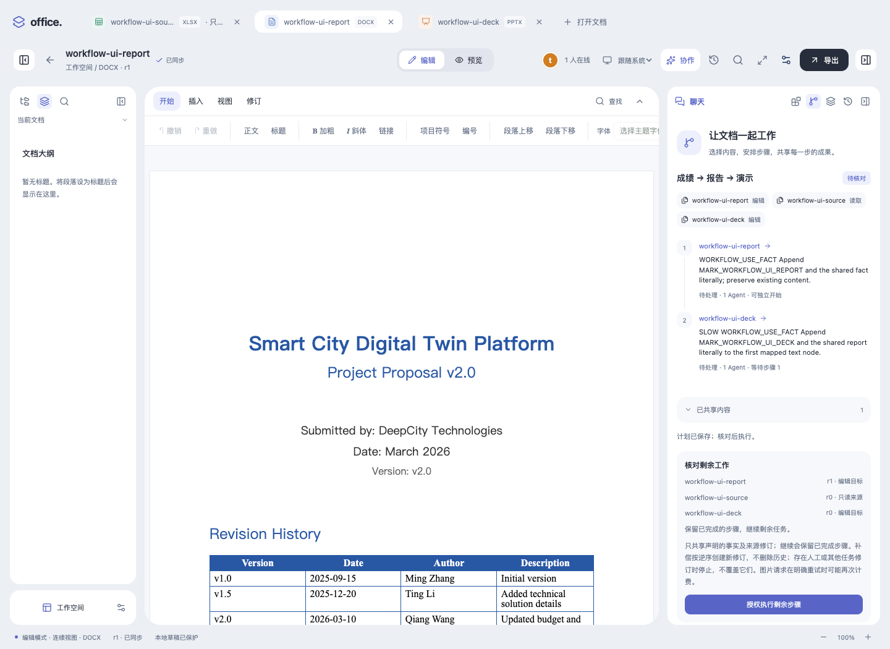
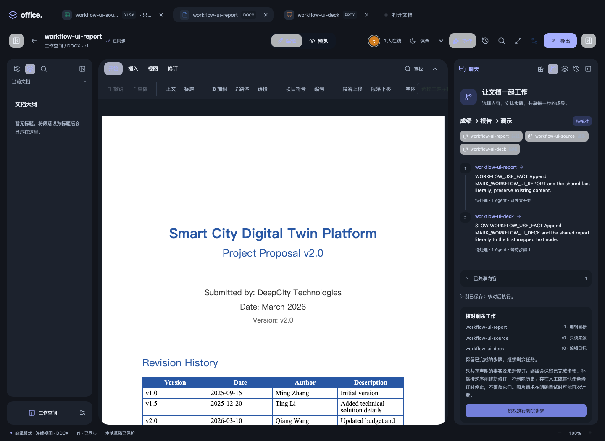
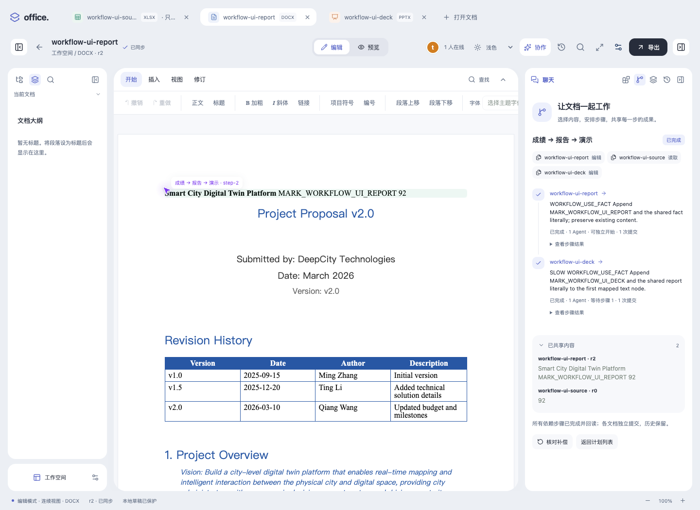

# 跨文档工作流面板 · 2026-11-15

范围：当前未提交工作区，为已有跨文档 API / MCP 增加编辑器入口。沿用 `docs/design/officecli-workspace-v2.pen` 的统一背景和圆角抽屉；本轮未调用 Pen MCP。整体五项建设目标仍未完成。

## 页面行为

打开至少两份同服务、同用户的 DOCX / XLSX / PPTX / PDF / Markdown / HTML / TXT 文档，在右侧 Agent 抽屉点击「多文档工作流」。面板可以随抽屉收起，不卸载文档编辑器、聊天或未保存输入。

1. 选择参与文档。当前文档为协调入口；其他身份、其他服务、独立图片和宿主集成会话不列入候选。来源可以使用只读授权，步骤目标需要编辑授权。
2. 从实际段落、已核算单元格、PDF / PPTX 映射文字中选择共享内容。分页和搜索用于缩小选择范围，不需要填写 JSON Pointer、hash 或 token。
3. 添加步骤、任务、协同人数及是否生成配图；PPTX 可选择整稿重做。同文档按步骤顺序编辑；跨文档可选择依赖，消费前一步产出时自动加入依赖。所有步骤共用进程的四 Agent 预算。
4. 「保存计划并核对」保存不可变计划，尚不调用模型。保存前依次检查所有参与文档，包括后台标签的单元格输入、文字保存与协同保存点。共享内容的选择版本已变化时要求重新选择，避免提交旧地址。
5. 「核对并继续」显示文档、当前修订、剩余工作和阻止原因；「授权执行剩余步骤」才启动或继续执行。核对后发生文档、任务或服务变化时，旧授权返回 409，清除旧核对结果；不自动重新授权。
6. 进度按文档和步骤显示待处理、执行中、已完成或失败。点击文档名称切换已有标签。原有 Agent 真实节点轨迹、操作记录和局部文档更新继续使用原 Harness。
7. 失败子任务显示「在工作流中核对」，不再提供后端拒绝的单独续跑入口。由本页面打开过的计划可以定位回协调文档；缺少本地关联信息时提示在协调文档核对。
8. 「核对补偿」先显示影响范围，再由用户确认并授权。补偿按逆依赖顺序追加恢复修订，保留历史；人工介入后保守拒绝，不覆盖人工修改。

## 共享位置与恢复

计划选择新增可选 `identity: {pointer, value}`。正文共享使用段落的稳定 block ID，表格共享使用单元格的 node ID（没有 node ID 时以地址核对），固定页面文字沿用 node ID。服务端每次提取初始内容或步骤产出时核对身份：段落文字更新可以重新读取；插入、删除或移动导致该位置指向其他对象时返回冲突，不能把相邻段落或单元格发布给下游。

这属于位置保护，不是自动地址重映射。整稿重做会替换节点，因此 UI 不为该步骤开放基于旧节点的产出选择。API / MCP 仍可配置完整显式计划。工作流 capabilities 增加 `selectionIdentityGuard`，schema 参与指纹；新 UI 在发送计划前拒绝缺少该能力的旧服务，避免出现未知字段的 422。

浏览器仅额外保存工作流 ID、名称和参与文档 ID 的书签，按服务、用户、协调文档隔离；不额外保存授权头、共享内容或核对指纹。页面刷新后由已有标签恢复流程逐文档重新鉴权，读取计划时仍须携带所有参与文档的有效授权。

服务端 list 保持只返回当前用户的 ID / 状态摘要。外部 MCP 创建、当前浏览器未打开过的计划，需先在面板选齐参与文档再打开；不会为了自动发现而把其他文档清单公开。关闭参与标签或授权过期后，重新打开相关文档再核对。

## 验证方法

```bash
cargo +1.90.0 test --workspace --quiet
cargo +1.90.0 clippy --all-targets -- -D warnings
cargo +1.90.0 fmt --all -- --check
cd examples/hdoc/editor
npm run build
npx tsx --test src/*.test.ts
HCD_BROWSER_PATH='/Applications/Google Chrome.app/Contents/MacOS/Google Chrome' \
  npx playwright test e2e/agent-harness.spec.ts \
  --grep 'cross-document workflow' --reporter=line
```

浏览器使用隔离临时目录、随机密钥、自有 API / sidecar / Chrome 及确定性模型替身；不重启日常服务，不把替身验收当作真实模型质量认证。

新回归覆盖：页面配置 XLSX → DOCX → PPTX 的真实内容传递、稳定位置守卫、保存后尚未启动模型、刷新找回与逆序补偿；后台表格未确认输入阻止计划且保留草稿；其他身份过滤；选中内容后来源变化与核对后的人工介入；失败子任务回到协调文档续跑且不重复前驱；旧服务能力预检。

最终结果：Rust 整树 **1,048 项通过**（含 doctests，新增身份提取/协商 2 项）；Clippy、格式、debug 构建和 diff 检查通过。编辑器 standalone / embed 构建及 **14 项前端单元**通过。组合浏览器回归 **39/39，3.3 分钟**；随后补 stdio 可选身份字段预检、工作流深色样式作用域及 PPT 模式切换时清理不兼容的产出选择，最终受影响的工作流/MCP 回归 **15/15，1.3 分钟**通过，其中新 UI 用例 6 项。两组有重复，不能相加。全程未再次调用真实模型，未认证远端 CI 或干净检出。代码未提交。

最终 15 项包含完整页面链路、抽屉收起保留输入、浅/深色核对、后台表格输入守卫、来源/人工变化、刷新书签、子任务导航续跑、整体停止和全部 7 项原后端工作流回归。新增 UI 回归已被现有 PR 工作流的 `cross-document workflow` 选择器包含。







上图同时保留一个未解决的排版问题：`assets/showcase/project-proposal.docx` 的封面标题经过结构替换后，字号/颜色与位置发生变化。内容传递和补偿验收通过，不代表 DOCX 原样保真通过。应优先修复结构编辑时原段落/文字样式与分页锚点的保留，再用可追溯的 Office/WPS 同源结果扩展验证。

后续已修复上述粗体标题追加普通文字的复现：原映射正文的文字/粗斜体修改保留原段落与 run，预览和原生源 DOCX 导出同步通过；见[行内保真补充验收](hcd-docx-inline-fidelity.zh.md)。上述截图和测试数保留为当时的历史证据，其他结构变化仍不能认定原样保真。

## 仍有边界

尚无任意自然语言自动规划、变更后地址重映射、保留中间人工编辑的对象级补偿、分布式 fencing 或跨文档原子事务。语义共享选择器当前列出含行内文字的段落，复杂表格、图片和任意 AST 的共享选择不是统一对象浏览器。固定页面仅列出有文字映射的节点，不包含扫描件 OCR。

未保存的计划编辑保留于当前挂载面板，刷新前应先保存计划；已保存计划在服务端持久化。书签使用当前标签会话存储，尚无跨设备工作流导航、共享画布或历史分页归档。公式、复杂对象和 Word/WPS 排版的其他未完成项仍见整体能力报告。
