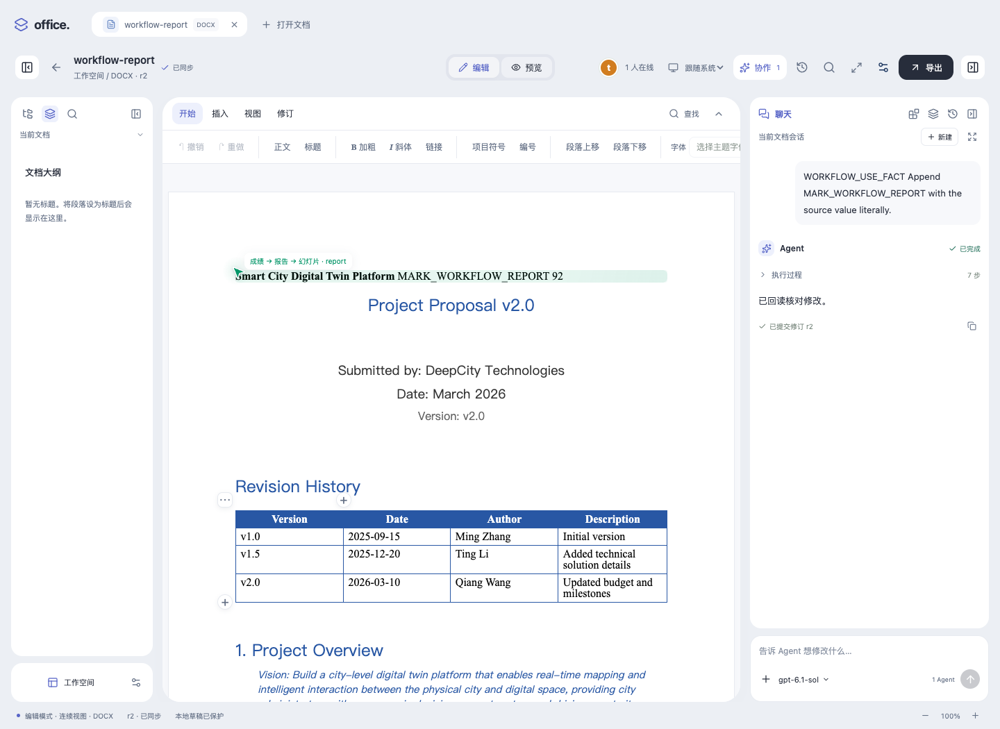

# 跨文档 Agent 工作流 · 2026-11-15

范围：`feature/hcd-font-format-integration`、HEAD `ccb5fd5` 的未提交工作区。本轮补充显式计划驱动的跨文档 Harness；整体五项建设目标仍未完成，不能据此宣称复杂对象、全部公式和 Office/WPS 排版已完全支持。

## 行为与入口

新增 `hcd-agent-workflow/1`，通过 HTTP API、HTTP MCP 和 stdio MCP 的 `hcd_workflow` 使用。计划显式列出参与文档、读写权限、共享事实的读取位置和步骤依赖；服务端自动运行就绪步骤。没有依赖的不同文档可同时执行，每个步骤可配置 1–4 个 Agent，继续共用原 Harness 的全进程四 Agent 预算。同一文档的步骤必须通过依赖排序。

原后端验收阶段以单文档聊天及外部 MCP 为入口。后续已增加[跨文档工作流面板](hcd-cross-document-workflow-ui.zh.md)，可从已打开文档选择来源、编辑目标、依赖与产出，在页面保存、核对、执行、停止、续跑和补偿；仍没有把任意自然语言请求自动转换为经过验收的跨文档计划。

计划支持 2–16 份 DOCX/XLSX/PPTX/PDF/HTML/Markdown/TXT 文档、1–32 个步骤及最多 64 个事实名称。独立图片文档不在此执行器中；已有文档 Harness 的插图工具与其边界继续适用。

## 共享事实与权限

- 每份文档有独立签名 token，必须属于同一用户；读取来源可以只授予 `read`，步骤目标必须有 `write`。委派 worker 和宿主集成会话不能创建或授权工作流。现有宿主权限适配尚未开放跨文档委派。
- HTTP 使用协调文档的 Bearer token；`x-hcd-document-grants` 是 Base64 编码的 JSON，内容为其他参与文档 ID 到 token 的映射。凭证只在请求/运行中的驱动器内存中存在，不存入工作流检查点、不返回给模型或公共任务接口。
- stdio 的 `token_env` 与 `token_envs` 只接收环境变量名称，由本地客户端读取凭证并组成传输头；HTTP 工具列表不提供这些本地环境参数。HTTP 请求仍须逐次携带授权，MCP 会话不会继承其他文档的权限。
- 初始 `facts` 与步骤 `produces` 使用 `hcd_read` 的 `manifest/editor/sheet/index/chunk/node` 资源及 JSON Pointer 选择实际内容。服务端读取并保存值、值 hash、文档修订、root hash 和生产步骤，不接受模型自行宣称的事实值。单条值上限 8 KiB。
- 后续 UI 增补加入可选 `identity: {pointer, value}`，在相同读取响应中核对段落或单元格的稳定身份。文字修改后可提取新内容；下标对应到其他对象时停止提取。新 UI 和 stdio MCP 对该可选能力预检，旧服务不接收自己无法识别的字段；这不是自动地址重映射。
- `consumes` 只能引用初始事实或依赖祖先的产出。只把声明消费的事实传给当前文档的模型，按不可信文档数据处理；模型没有其他文档的 token 或直接读写权。
- 事实值及内部来源信息存入私有执行上下文，聊天气泡只显示用户任务，不把 JSON、hash 等拼成用户消息。工作流核对 API 仍向已通过全部文档授权的发起用户提供明确来源，供其审查。
- 对公式 `calculation/value` 的选择必须来自 `status=calculated`；不能把未核验缓存作为已计算结果。选择其他结构时保留原始类型与限制，不能因此认证全部公式。
- 来源修订变化、人工待保存输入、非工作流修订或协同房间变化会停止后续写入。普通写入、恢复版本及切换主题在同一 API 的协同锁下串行；这不是跨进程/跨机器的全局事务。

## 依赖执行与中断

1. 创建计划只保存快照，不调用模型。核对返回完整计划、事实来源、各文档当前位置、子任务续跑摘要和指纹。
2. 明确授权 `continue` 后，调度满足依赖的步骤；先持久化确切子任务 ID 和基线，再创建对应单文档任务，避免崩溃后另起新任务。
3. 子任务完成并通过原 Harness 的回读后，由服务端提取声明的产出事实，再释放下游依赖。
4. 失败或停止会取消剩余子任务并保留已提交修订。再次授权时复用原 run ID、私有执行位置及确切提交回执，已完成步骤不会重新执行。
5. API 重启把活动工作流标记为中断，不自动执行。重新核对所有文档并提供有效授权后才能继续；缺少私有历史、表格地址变化、旧 PPT 队列被人工修改打断等子任务限制仍会阻止继续。
6. 文档/任务、模型、服务进程、协议或 schema 变化会使指纹过期，旧授权返回 409。每工作流最多 32 轮授权。

写入前同时检查工作流状态、参与文档及消费事实，原有子任务的 revision/hash/epoch 与团队租约检查继续执行。工作流停止后，即使原 worker 仍在返回模型结果，也不能继续获得写入权。缺少作者标记的提交只能通过保存的完整工具参数及 canonical patch hash 核对，不根据标题或近似值推断。

## 补偿

`compensate` 需要新的核对指纹和明确授权。服务端按逆依赖顺序把各已启动步骤恢复到其基线，**追加新修订并保留原有历史**。失败步骤已经提交的部分也会纳入核对，不把一次模型失败当作“没有写入”。

每笔补偿先持久化目标、预期 head 与 epoch，再实际提交。中断后按确切 restore ID/hash、父修订、内容 root 与作者核对；已提交但回执丢失时只补回执，不再恢复一次，也不重复切换协同 epoch。

存在人工或其他任务修订时拒绝整份文档补偿，保留所有内容，要求依据现状重新规划；不会尝试猜测哪些人工内容可以删除。补偿本身仍由多笔修订构成，失败可保留已补偿部分并再次核对，不是跨文档原子回滚。任一参与文档存在运行中的任务时不能开始实际补偿。

## API 与 MCP 契约

协调文档必须包含在计划中：

| 请求 | 用途 |
| --- | --- |
| `POST /v1/documents/{id}/agent-workflows` | 保存不可变计划及初始事实 |
| `GET /v1/documents/{id}/agent-workflows` | 当前用户的工作流 ID/状态摘要，不返回其他文档内容 |
| `GET /v1/documents/{id}/agent-workflows/{workflow_id}` | 完整计划、事实、进度及补偿回执；重新核对全部文档授权 |
| 同路径 `DELETE` | 停止剩余执行，保留提交；补偿正在提交时要求先等待结果 |
| 同路径 `/review` 的 `GET` | 当前指纹、`canContinue`、`canCompensate` 与阻止原因 |
| 同路径 `/actions` 的 `POST` | `{action:"continue"或"compensate",fingerprint,authorize:true}` |

MCP 的 `hcd_workflow` 有 `create/list/read/review/continue/compensate/cancel`。`document_id` 为协调文档，`workflow_id` 标识已建任务，`plan` 为创建参数。续跑/补偿前须先向发起用户展示核对内容，按其明确授权执行；内置 worker 不提供此调度工具，不能自行递归建队或授权。

`officecli capabilities --json`、服务端 capabilities 与 MCP 使用同一份完整 `planSchema`，参与协议指纹。[独立 schema 快照](../contracts/hcd-agent-workflow-1.schema.json)由本轮实际二进制导出并核对，可用于应用集成。stdio 操作先检查连接服务的工作流协议；创建请求携带该服务指纹，过期指纹在解析计划前返回 409。

最小计划示例（修订、epoch、JSON Pointer 均须来自实际读取；语义来源如未投影，先在独立授权下执行 `hcd_project`）：

```json
{
  "name": "把报告标题同步到演示稿",
  "documents": [
    {"documentId":"source-docx","access":"read","expectedRevision":1,"collaborationEpoch":0},
    {"documentId":"target-pptx","access":"write","expectedRevision":0,"collaborationEpoch":0}
  ],
  "facts": [
    {"key":"report-title","documentId":"source-docx","resource":"editor","pointer":"/blocks/0/content/inlines/0/text"}
  ],
  "steps": [
    {"stepId":"sync-title","documentId":"target-pptx","task":"把共享报告标题写入第一页的标题框，保留其他内容并回读核对。","consumes":["report-title"],"agentCount":1,"mode":"edit"}
  ]
}
```

## 持久化与限制

工作流写入服务根目录 `agent-workflows/`，目录 0700，检查点 0600，使用临时文件、fsync 和原子替换。文件上限 8 MiB，计划 256 KiB；最多加载/创建 128 个工作流，历史归档和分页仍待建设。检查点保存失败会阻止后续 Agent 写入，损坏记录保留并阻止静默重置。只在内容变化时写检查点；轮询仅取子任务状态摘要，不复制全部私有模型对话。

执行仍要求同一服务根目录的单个 API 进程；不提供分布式 fencing，也不承诺外部进程绕过 API 直接改 bundle 时的跨文档一致性。单文档历史列表、旧任务、独立图片写入、供应商侧重复计费和结构变化限制见[授权续跑验收](hcd-agent-continuation.zh.md)。

当前事实按明确指针发布，尚无自然语言事实冲突消解、变更后的地址重映射或人工编辑参与后的对象级逆向补丁。模型结果仍须依据实际文档验收，不能用工具成功替代用户任务质量。

## 验证

```bash
cargo +1.90.0 test --workspace --quiet
cargo +1.90.0 clippy --all-targets -- -D warnings
cargo +1.90.0 fmt --all -- --check
cd examples/hdoc/editor
HCD_BROWSER_PATH='/Applications/Google Chrome.app/Contents/MacOS/Google Chrome' \
  npx playwright test e2e/agent-harness.spec.ts \
  --grep 'cross-document workflow|OpenAI harness edits|Agent continuation|PPT continuation|HTTP and stdio MCP|MCP Streamable HTTP|human pending drafts' \
  --reporter=line
```

验证使用独立临时服务目录、随机密钥、自有 API/sidecar/Chrome 和本地确定性模型替身；未重启日常演示服务，未调用真实模型。跨文档验收核对 XLSX 的实际值、DOCX 正文、PPTX 映射内容、原生导出、各步骤修订及补偿后的原始 root，不只检查模型总结。

补偿故障窗口使用真实 restore 提交，在强杀 API 后重建与该笔提交匹配、仅缺回执的检查点，再重启核对。它明确模拟指定持久化窗口，不代表任意 CPU 指令边界或多主机故障认证。

原后端阶段最终结果：Rust 整树 **1,046 项通过**（含 doctests），其中新增工作流专项 5 项；Clippy `--all-targets -- -D warnings`、全量格式、debug 构建与 `git diff --check` 通过。组合浏览器/服务回归 **24/24，通过用时 1.6 分钟**，其中跨文档专项为 7 项，不另作总数累加。该阶段没有修改编辑器运行源码，未重复执行 standalone/embed 构建；后续实际 UI 的构建、页面回归和截图见[面板验收](hcd-cross-document-workflow-ui.zh.md)。

跨文档专项覆盖：

| 场景 | 实际核对 |
| --- | --- |
| XLSX → DOCX → PPTX | 只读源表的实际数值、服务端事实来源、两份目标正文、原生导出；HTTP/stdio MCP 均可核对和操作；补偿后恢复原始 root |
| 第二步失败 | 第一步保留原 run ID 和修订，不重新执行；第二步续用私有检查点完成 |
| API SIGKILL | 第一笔真实提交后强杀服务，原子任务继续、修订不增加；禁止绕过工作流单独续跑子任务 |
| 人工介入 | 旧指纹失效，新的核对明确禁止整份补偿，人工文字保留 |
| 独立步骤并行 | 两份文档上有不同身份的 Agent 同时运行，生命周期实际重叠 |
| 来源更新 | 目标写入前更新共享来源，工作流停止，目标与下游均无新增修改 |
| 补偿回执丢失 | 核对已提交补偿，不产生第二笔恢复修订，也不重复切换 epoch |

组合回归还包含七格式 Agent 编辑/回读/导出、三种算术续跑窗口、地址变化守卫、图片候选复用、PPT 队列和人工介入保护、MCP 协议及待保存人工草稿守卫。最终一轮使用已隔离私有事实上下文的二进制；聊天只保留原始步骤文字，截图已人工查看。



较早组合检查发现 HTTP 工具列表包含 stdio 专用环境参数，已修复，并通过 Rust 契约与真实 MCP 回归；未通过的早期快照不算最终验收。PR 工作流已纳入 7 项新回归，尚无远端 CI 或干净检出认证。代码未提交。
