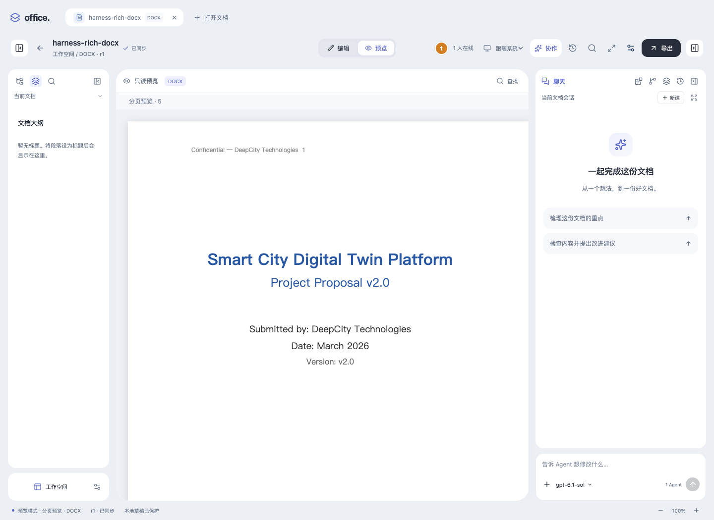
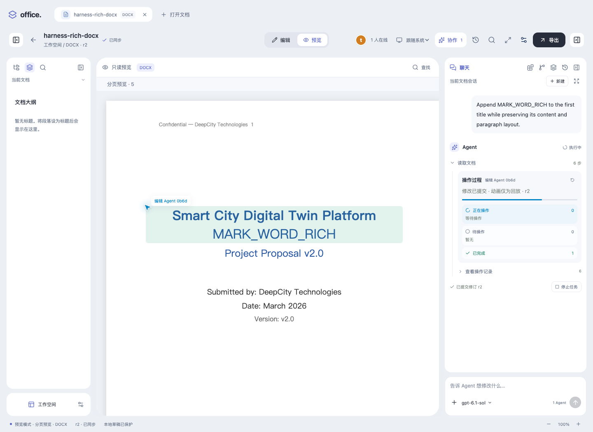
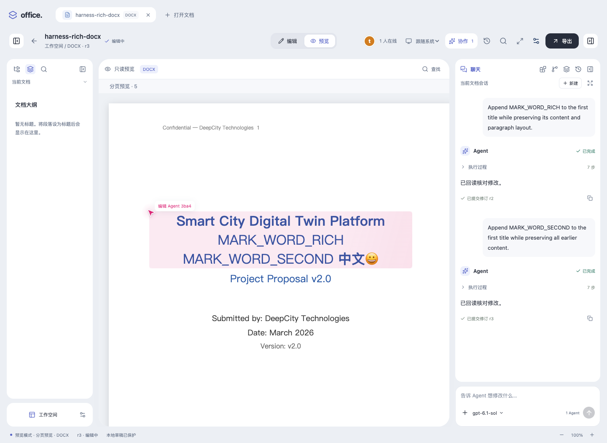

# DOCX 行内编辑保真补充验收

日期：2026-11-15。范围为 `feature/hcd-font-format-integration`、HEAD `ccb5fd5` 的未提交工作区。完整五项目标仍未完成，最新总体边界见[功能状态](hcd-capability-status-2026-11-15.zh.md)。

## 问题与修复

`assets/showcase/project-proposal.docx` 的封面标题为 24pt 蓝色、粗体、居中，段前留白 120pt。原实现只在新旧粗斜体/链接分组完全一致时保留源呈现。Agent 在粗体标题后追加普通文字时，组数改变，整段落入通用语义重建，导致字号、颜色和留白丢失。

修复保留原段落、run 包装和 `w:t` 的源 ordinal / canonical node ID。粗斜体改变在该文字锚点内部生成服务端拥有的行内片段；文字 hash 继续对应完整锚点文字，格式变化通过 block hash、修订和 dirty-node 集合记录。客户端仍不能提交 canonical node ID 或原始呈现 HTML。新的 `docxInlineEdits` 能力声明参与协议指纹。

本地草稿分页预览使用同一标量偏移分配规则。原生源格式导出仅拆分受影响的 `w:r`，继承原字体、字号、颜色、语言和其余属性，显式写入粗斜体开关；段落属性和其他 ZIP 部件保留。多文字元素、制表符和 drawing 不重复，拆出的 run 不重复原 `textId`；源 run 的读取有事件数和字节上限。后续 `text.splice` 使用请求中的确切标量范围保留分段样式，避免重复字符造成格式分配歧义。

## 验证结果

- Rust 整树 **1,052 项通过**（含 doctests；本轮新增 4 项），Clippy `--all-targets -- -D warnings`、格式、debug 构建和 diff 检查通过。
- 编辑器 standalone / embed 构建通过，前端单元 **15 项通过**（本轮新增 1 项）。本轮没有管理端源码变更，未重跑管理端构建。
- 最终浏览器组合 **29/29，2.8 分钟**。覆盖新增封面回归、七格式 Harness 编辑、DOCX 操作动画、工作流页面/API/HTTP 与 stdio MCP、API 强杀和回执补偿、表格协同/撤销、分页/源字体网格、预览局部更新、表格悬停和 20 步历史。
- 新封面回归核对原文字 32px / `rgb(40,87,164)`、段落居中/上边距/顶部位置；追加文字自然换行，后续内容相应重排。两次 Agent 修改保留 iframe Document、原锚点，第二次在滚动 750px 后提交不会返回顶部；编辑器实例保留。本地中文/emoji 粗体输入在保存前可预览，预览不会提交修订。
- 原生源导出解析 OOXML，确认第一段仍为原 `pPr`，原文字与普通新增文字同为 24pt 蓝色，各自的粗体开关正确，未修改部件逐一一致。Rust 另外覆盖混合粗斜体、完整重写、清空/恢复、多次编辑、字体 pin、重复字符的确切文字范围、导出并重新导入及后续 node splice。

最终 Rust 日志：`/tmp/hcd-docx-inline-workspace-tests-final.log`；Clippy：`/tmp/hcd-docx-inline-clippy-final.log`；构建：`/tmp/hcd-docx-inline-rust-build.log`、`/tmp/hcd-docx-inline-build.log`；前端单元：`/tmp/hcd-docx-inline-unit.log`；浏览器：`/tmp/hcd-docx-inline-broad-browser.log`。

## 真实文件独立验证

运行[只输出校验结果的 CLI 探针](hcd-docx-inline-fidelity/probe_inline_fidelity.py)，结果见[机器记录](hcd-docx-inline-fidelity/real-file-results.json)。所有输入原件 SHA-256 在执行前后保持一致；不调用模型，不将合同正文或截图写入仓库。

| 样本 | 本轮核验 |
| --- | --- |
| `project-proposal.docx` | 导入/HTML 生成/校验、混合行内修改、稳定锚点、源 DOCX 导出、段落及 run 属性和未修改部件、重新导入校验通过 |
| `170kV隔离开关采购合同.docx` | 同上，实际首个可编辑正文块追加普通中文/emoji 后可导出回读；不代表合同所有对象或逐页排版已验收 |
| `170kV隔离开关采购合同.pdf` | 导入 37 个 chunk、HTML 生成和 bundle 校验通过；未编辑的源格式导出与原 PDF 字节一致。本轮未验证该 PDF 的任意对象编辑或视觉重绘导出 |

用户确认合同 PDF 与 DOCX“不确定或不是同一版”。两者分别作为鲁棒性样本，不能互相用作同源 Word/WPS 逐页参考。

## 复现

```bash
cargo +1.90.0 build -p officecli
cargo +1.90.0 test --workspace
cargo +1.90.0 clippy --all-targets -- -D warnings
cargo +1.90.0 fmt --all -- --check
python3 docs/acceptance/hcd-docx-inline-fidelity/probe_inline_fidelity.py \
  assets/showcase/project-proposal.docx \
  '/Users/will/Downloads/170kV隔离开关采购合同.docx' \
  '/Users/will/Downloads/170kV隔离开关采购合同.pdf'

cd examples/hdoc/editor
npm run build
npx tsx --test src/*.test.ts
HCD_BROWSER_PATH='/Applications/Google Chrome.app/Contents/MacOS/Google Chrome' \
  npx playwright test e2e/workspace.spec.ts e2e/agent-harness.spec.ts \
  --grep 'Word mixed inline edits|Word pagination|Word source grids|Word remote edits|Word table edits share|cross-document workflow|OpenAI harness edits|table hover controls|insert ribbon creates|editor deletion supports|Agent operation queue and borderless animated areas on docx' \
  --reporter=line
```

浏览器运行于隔离根目录、自有 API / sidecar / Chrome，使用随机凭证和确定性模型替身，不认证真实模型质量或供应商可用性。新增封面用例已加入 PR 工作流选择器，尚未认证远端 CI 或干净检出；未重启日常演示服务，代码未提交。







三张截图均已查看。追加长文字会自然换行，本轮验证原字号/颜色/段落属性及原锚点保持，不声称整页几何位置完全不动。

## 仍有边界

本次保护原 DOCX 中已映射、可编辑的正文文字，且段落 kind/level/font 不变、链接关系不改变。新段落、列表/标题等级改变、新链接、部分字体变更、复杂表格结构等仍可能走语义重建；已被旧版本重建并丢失的样式不会自动恢复，需要恢复先前版本或重新导入原件。

源格式保留导出需使用识别此行内表示的最新 CLI / 服务。纯语义跨格式转换仍有 CSS/样式被简化的边界，不能把源 DOCX 保留导出通过当作所有转换模式通过。复杂浮动绕排、多栏、完整域/审阅/公式、复杂表格编辑和同源 Office/WPS 逐页基准仍未完成；本文不构成全格式保真认证。
