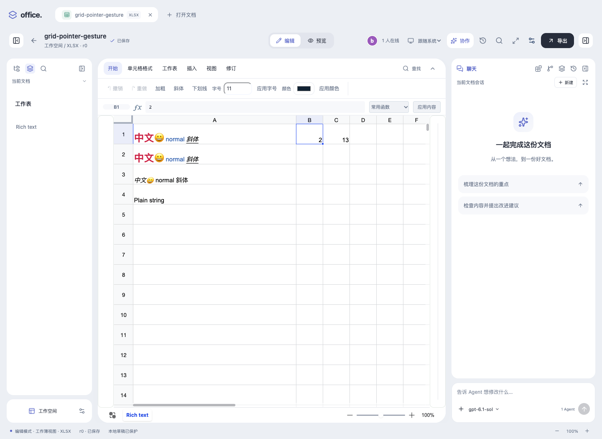

# 编辑器鼠标导航与本地代理连接复核

2026-11-16，`feature/hcd-font-format-integration`、HEAD `ccb5fd5` 的未提交工作区。承接 [XLSX 整批输入恢复](hcd-grid-batch-recovery.zh.md) 最后 37/39 的失败记录；历史结果保留，不能把后续通过与它相加。

## 鼠标导航的原因与修复

先前用焦点、绘制帧及诊断运行通过来观察时序，没有确切定位。本次将诊断安装在按键捕获阶段，不在发送按键前额外读取内部状态：两个相关用例各运行八轮，**12/16 通过**；四次导航失败都捕获到 `editing=true`、`EDITOR_ACTIVATED=true`，右方向键由原生文字编辑器接收。失败时焦点、权限和协同 epoch 均不能解释问题。

Univer 0.25.1 的 `InputManager._prePointerDoubleOrTripleClick` 只统计自身画布内的释放事件，阈值 500 ms。用户点一次单元格、点击外部重试或撤销按钮，再快速点击同一单元格，底层仍会认作双击。方向键因此移动文字光标。诊断与原始失败 trace 见 [记录](hcd-grid-batch-recovery/mouse-click-diagnostic/)。这些私有内部对象只用于临时诊断，生产代码和永久测试均不依赖 React fiber 或依赖注入容器的私有结构。

修复在鼠标 pointerup 的事件分发期间，使用浏览器原生 mousedown 的点击次数核对双击。浏览器判定为单击时取消错误的双击编辑入口；真实双击保留。触摸、直接键盘输入、F2 与程序编辑入口不经过该鼠标单击守卫。

首版取消所有鼠标 pointerup 触发的双击，破坏了正常双击；新增回归发现后已修正，不能将首版当作最终实现。永久回归使用真实鼠标，验证两次画布点击间隔小于 500 ms、中间点击工具栏后可导航到 B1；再验证真正双击 A1、输入、取消、不产生修订及 canvas 身份保持。通过样例的间隔约 78 ms，见 [结果](hcd-grid-batch-recovery/xlsx-mouse-navigation.json)。



## 连接失败的新增证据

本次后续失败中，隔离测试自有 Vite 进程日志明确记录：连接本机 API 时 `connect EADDRNOTAVAIL ... Local (0.0.0.0:0)`，代理再返回 HTTP 500。另有 Playwright 直接 API 请求同样收到 `EADDRNOTAVAIL`、浏览器首次导航收到 `ERR_ADDRESS_INVALID`。这类失败发生在 HTTP 文档处理之前，不能当作公式内容损坏。

同期一次系统快照含 **16,163 个 TIME_WAIT**，临时端口范围为 **49,152–65,535**；随后按端点分类的快照显示，绝大多数为非 loopback 连接，loopback 的 TIME_WAIT 为 15。当前复现支持本机临时地址分配受压，不能把压力全部归因于该项目或测试。此前在另一时间点只看到 26 个 TIME_WAIT；没有现场系统快照的历史失败仍不能一概认证同一原因。没有修改系统网络参数、终止外部进程或增加测试自动重试。

测试服务原先丢弃 stdout/stderr，现在仅将自有进程的输出附在失败报告中，保留代理层证据。服务日志见 [记录](hcd-grid-batch-recovery/proxy-address-diagnostic/)。

开发代理加入共享且有界的 HTTP/HTTPS keep-alive agent，在 Vite 关闭时销毁，减少轮询频繁创建连接。独立真实代理探针验证 `/health` 与 `/v1` 共同使用连接：20 次顺序请求，修复前使用 20 条上游连接，修复后为 **1 条**，每次返回状态与路径一致。它降低本项目的连接开销，**不能保证其他进程耗尽系统资源时仍能连接**，也没有加入文档写入重试。

```bash
cd examples/hdoc/editor
node scripts/probe-proxy-connections.mjs
HCD_BROWSER_PATH='/Applications/Google Chrome.app/Contents/MacOS/Google Chrome' \
  npx playwright test e2e/workspace.spec.ts \
  --grep 'XLSX canvas mouse|live retry keeps identity|keeps unapplied text bound' \
  --reporter=line
```

修正后以上三项专项 **3/3（15.6 秒）**通过。最终组合结果以 [验证汇总](hcd-grid-batch-recovery/verification-results.json) 为准；本轮没有修改 Rust 后端，Rust 1,074 项为前一阶段同一后端状态的已运行结果，没有重新执行整树 Rust 测试。前端单元 24/24，最终构建与组合结果分别记录。新鼠标回归及代理连接探针已配置到 PR 工作流，远端 CI 尚未执行。

这些修复不构成全部 Office 格式/对象、公式、协同、MCP 和 AI 能力完成证明。复杂排版与对象、同源 Office/WPS 参考、跨设备恢复、分布式 fencing 和可靠自然语言跨文档操作仍见 [整体状态](hcd-capability-status-2026-11-15.zh.md)。合同 PDF 和 DOCX 版本关系不确定，继续作为独立样本，本轮没有重跑或修改原件。没有调用真实模型、重启日常服务或提交代码。
