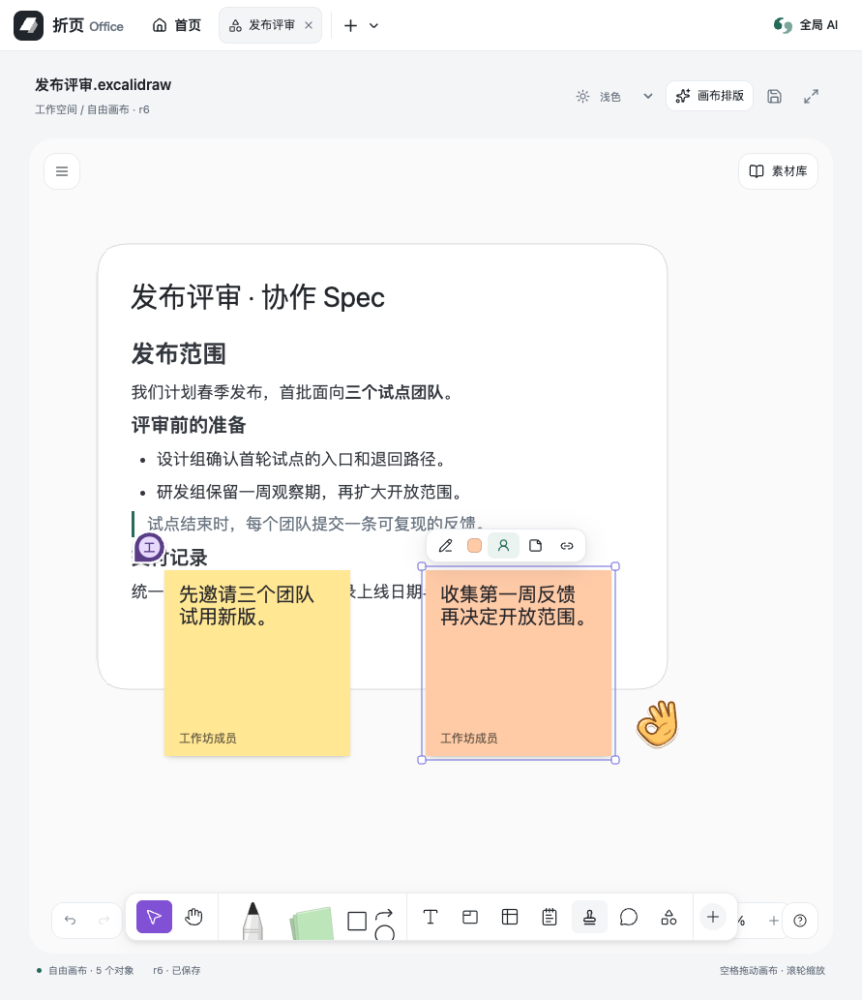
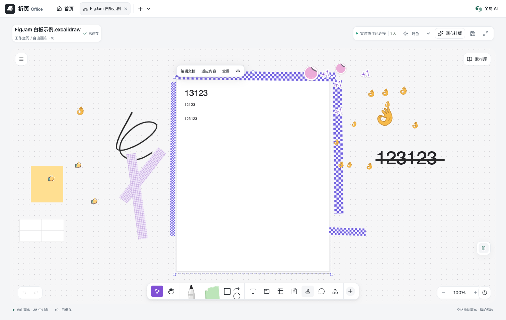
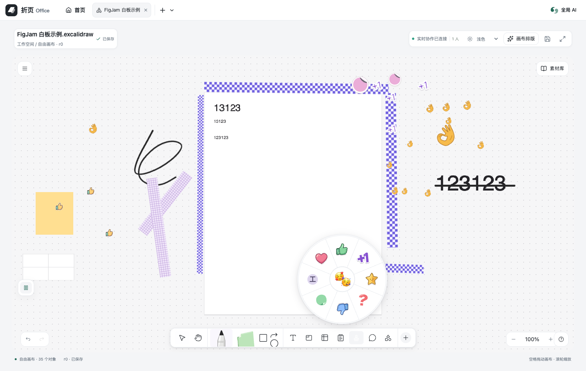
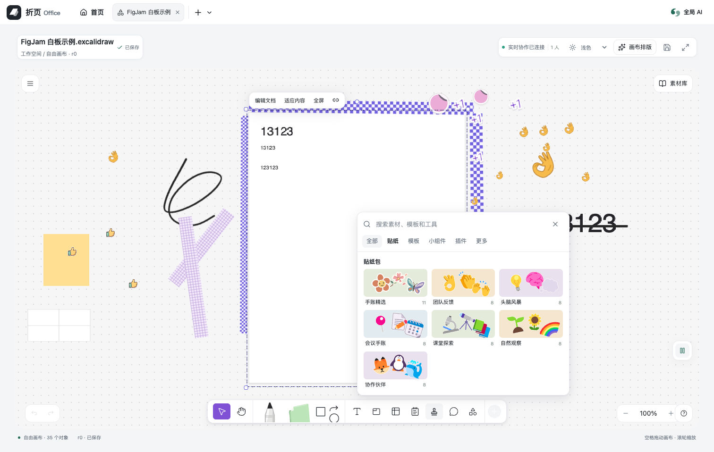
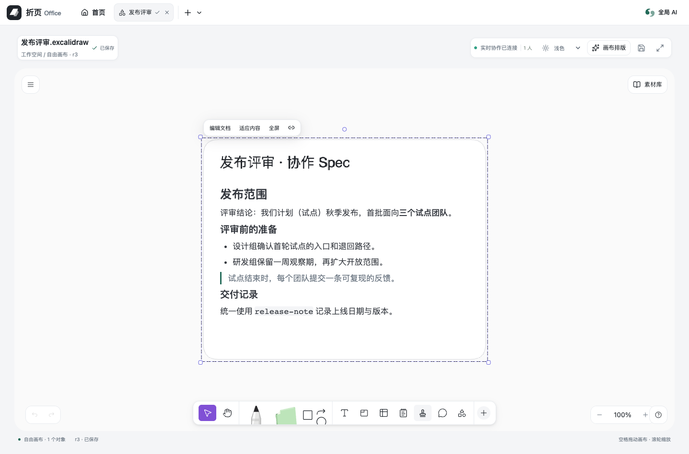
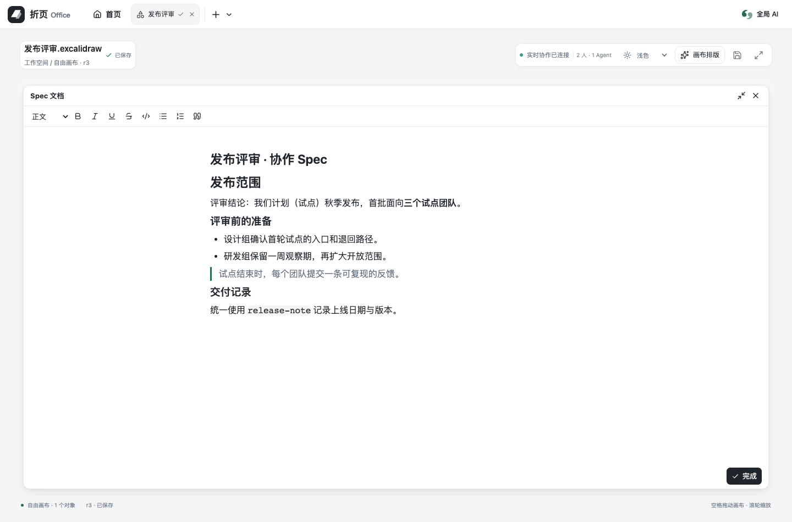

# FigJam 参考节点与 OfficeCLI 白板

[打开本机的可操作示例](http://fold.localhost:4422/examples/figjam)会进入工作台、打开白板并选中中央的 Spec。也可以下载[原生白板示例](../../examples/hdoc/embed-host/boards/spec-workshop.excalidraw)，导入自己的 OfficeCLI 实例。在[Pen 设计稿](../design/officecli-canvas-journal-v1/officecli-figjam.pen)中，画板 `00P 白板` 是可编辑设计，`00P 现场` 打开实际工作台。`00Q 印章` 和 `00Q 操作` 可分别编辑轮盘及命令面板。「00R 白板」展示画笔从笔槽展开时的矢量原稿。

## 参考节点

在已登录的 Chrome 中打开了用户指定的节点。它的主体是一张标题为「13123」的白色 Spec，正文含两个短段落。文档边缘贴着蓝紫棋盘格胶带、粉色卷角圆贴，旁边有交叉的细网格胶带、手绘墨线、黄色手势和紫色「+1」。灰白点阵上留有大块空白。底部窄托盘常驻，选择工具用紫色强调。文件、协作和缩放控件分布在画布四角。[原 FigJam 节点](https://www.figma.com/board/F9cTZ33Um03InSrhlWYYCl/Untitled?node-id=2-25)

底栏顺序为选择、手形、画笔、便利贴、形状与连接线、文字、分区、表格、Spec、印章、评论、Actions、「＋」。画笔内部区分记号笔、荧光笔、和纸胶带和橡皮。形状菜单一并提供连接线。加号面板分为全部、贴纸、模板、小组件、插件、更多六个入口。此处采用登录后看到的实际菜单顺序。[FigJam 文件界面说明](https://help.figma.com/hc/en-us/articles/15300412458647-Explore-FigJam-files)

## 对照与验收

| 项目 | 此前的差距 | 当前可操作的行为 |
| --- | --- | --- |
| 工具托盘 | 手账原型有绘制好的图标，实际编辑器仍露出原生工具条 | 13 个入口接上真实画布。便利贴、形状、Spec 和表格可从托盘拖出，也可点选后放置。工具支持快捷键、焦点反馈、Esc 退出和手机横向浏览。 |
| 画笔和连接线 | 需要在多个入口之间找笔、线和图形 | 画笔从底栏笔槽向上展开，四种笔型、粗细和颜色排在同一条笔盘上。连续落笔时可以随时换色，换回一支笔会恢复它的颜色。手机会按画布宽度换行。棋盘、方格、条纹胶带沿拖动方向生成。直线、曲线、折线、无箭头线共用图形菜单，已绑定的连接线会跟随卡片移动。 |
| 文档和表格 | 文本、矩形能画出外观，缺少文档和单元格操作 | Spec 支持画布内写作、全屏、适应内容、对象直达链接。表格支持选择行列数、双击单元格、Tab / Shift+Tab 顺序编辑。点击另一个工具会保存当前文本。 |
| 素材 | 实际工具条缺少直接搜索、整包预览和拖放 | 59 枚贴纸、6 种画笔、3 个头像、17 款手绘印章及反馈，另有 3,781 个 Unicode 表情序列（含肤色和组合变体）。加号里有七组贴纸，支持按中文、英文标签和用途搜索，拖放位置可以覆盖文档边缘。素材详情及 AI 接口按类别、摘要、详细参数逐级展开。 |
| 印章轮盘 | 原先两圈排满手绘图案，默认视觉较挤 | 第一层按参考顺序排成八个扇区。正上方是绿色拇指，顺时针依次是「+1」、星星、问号、蓝色倒拇指、圆点、自己的头像和爱心。中央入口通往八类表情、中英搜索和最近使用。空白落章、对象计票、即时表达分别保存为图像、个人反馈和临时事件。 |
| 操作面板 | 原先只显示 AI 操作 | 按 ⌘K / Ctrl+K 可搜索查找替换、全选、撤销、界面收起、协作者光标、快捷键、个人设置和 AI 操作。可用方向键与 Enter 执行。替换操作进入原生撤销记录。 |
| 模板和扩展 | 插入内容需要离开工具条 | 可插入头脑风暴、复盘、流程、架构、思维导图、课程讲解等可编辑模板。可以导入 Excalidraw 图形素材包和 OfficeCLI 声明式排版插件。共享计时器与举手表决可直接放上画布。 |
| 评论与现场表达 | 缺少独立的评论线程和短暂随指针表达 | 评论可回复、解决和重新打开。选择印章可给对象反馈，也可在空白处落章。按「/」输入光标气泡。即时表情和光标短消息自动消失。 |
| 共同浏览 | 看到协作者的光标后，异地视野仍难汇合 | 在线成员菜单可跟随另一人的视野，再返回自己的位置。计时器在两个浏览器共用开始与暂停状态，表决按身份计票，可撤回。 |
| AI 与人工并行 | 视觉效果需要同时检验授权、合并、追加范围 | AI 改边框时，另一位用户仍可拖动同一卡片。选区外字段保持原值。三个 Agent 可并行准备分区，再一次性追加。空位被人占用会拒绝整批写入。 |
| 跨文件协作 | 独立白板和办公工作台需要共用编辑器 | 复用原有文档、表格、白板标签与可收起的全局 AI。外部 MCP 客户端可以按文件或授权选区操作。选区链接沿用访问者原有的文件权限。 |

画布菜单和素材库分居左上、右上两角。在 390、891 和 1440 像素宽的工作台中，两者距画布顶部及各自侧边均为 16 像素。菜单提供查找、帮助、重置和背景设置。画笔、图形和印章从各自的按钮展开，面板抵达画布边缘时自动移入可见区域。按 Esc 退出绘制，开启系统减少动态效果后可立即切换。[工作台菜单](hcd-figjam-reference/canvas-menu.png) · [实际笔盘动效](hcd-figjam-reference/drawing-tray.gif) · [FigJam 绘图操作](https://help.figma.com/hc/en-us/articles/1500004414442-Doodle-and-highlight-in-FigJam-with-drawing-tools)

## 在示例中操作

1. 双击中央 Spec，在原位写入文字。点击「全屏」继续编辑，再返回画布。在选区浮层点击链条图标，即可复制定位到这个对象的链接。
2. 从底部拖一张薄荷色便利贴到页面边缘。输入内容后点击画布，再用选择工具拖动它。点「画笔 → 和纸胶带」，拖一条与纸边成角度的胶带。
3. 点「＋ → 贴纸」，打开一个素材包，直接把缩略图拖到纸面上。也可以搜索「折角」或「OK hand」，点击结果再点画布放置。
4. 按 E 打开印章轮盘。中央入口可搜「火箭」或「rocket」。在空白处落下「+1」，或给已选元素盖章。请使用两个不同身份测试计票。按「/」可以让旁人看见跟随指针的短消息。
5. 点「＋ → 小组件」放置计时器或表决卡。第二位成员可以在在线协作者菜单中跟随你的视图，也可以独立浏览。右上方「全局 AI」可打开跨文件工作区。

按 S 后移动鼠标可预览纸张位置，点击落纸就能输入。双击旧便利贴可改同一份正文。选中后可以换色、切换底部署名，或按 ⌘/Ctrl + Enter 在右侧空位续写同色便签。点击评论图钉可打开原线程，拖动图钉可移动评论位置。[FigJam 便利贴交互说明](https://help.figma.com/hc/en-us/articles/1500004414322-Sticky-notes-in-FigJam)









## 验证边界

- 本次运行通过 41 项白板浏览器回归、22 项画布核心测试、4 项服务端画布测试，以及工作台和嵌入验收。正式构建的桌面与 390 像素手机示例均已打开。
- 人工协作使用独立 Chrome 浏览器上下文和不同身份，连接实际 Rust 服务。覆盖拖动、绘画、撤销、离线重连、评论、短消息、跟随、共享计时器、计票和刷新恢复。
- AI 回归使用可控的测试模型响应，通过实际 Agent 调度、权限检查、工具执行、修订提交和回读。双用户与 AI 同场用例等待 Agent 读完旧快照后才让人拖动对象，随后逐项核对位置、颜色、旁边对象和两个浏览器的修订号。
- Codex 另外作为外部 Agent，在一份独立的本地演示画布上通过 MCP 读取「观察」卡片的三个对象，修改底色、边框和便笺文案。服务返回 r1，刷新后重新授权回读，两处编辑均在，三个对象的坐标保持一致。[实际 MCP 读写回执](hcd-figjam-reference/mcp-edit.json)
- 业务嵌入验收使用独立 MCP 客户端和真实短期授权。白板仅允许编辑授权对象，Word 选区能写回，工作台支持把原文追加到表格和白板。本机演示的内置聊天未配置模型。可单独使用外部 Agent。模型生成的文案品质、上百人房间的延迟与跨地域容量仍须在相应部署上测量。
- Spec 已支持段落、两级标题、列表、引用、代码和行内格式，画布预览与全屏编辑共享正文。两个独立用户和 MCP 客户端在同一段交错写入后，三个视图与刷新后的文档内容一致。[Spec 并发验收](#spec-同段协作)

- 素材中有 48 枚来源于 Microsoft Fluent Emoji 的扁平插画，已转换为可编辑矢量并随包附带许可。其余手账素材、卷角圆贴及工具图形随本项目提供。[原始素材](https://github.com/microsoft/fluentui-emoji/tree/1ffb34c752ecf5d402f04cfb4b392c77f57c54bc/assets) [随包许可](../../crates/canvas-core/assets/FLUENT-EMOJI-NOTICE.txt)

- 表情库使用 Unicode Emoji 16.0 的 fully-qualified 序列与 CLDR 46.1 简体中文名称。中央选择器按类和最近使用渐进展开。在 stdio 和 Streamable HTTP 两个 MCP 入口实测搜索「火箭」、读取元数据、生成原生追加计划。MCP 的 `hcd_read` 分页查询素材，`hcd_canvas_plan` 可以按素材 ID 生成带空白区域约束的追加计划。表情字形由操作系统绘制。[Unicode 数据](https://unicode.org/Public/emoji/16.0/emoji-test.txt) [CLDR 中文标注](https://github.com/unicode-org/cldr/tree/release-46-1/common/annotations) [随包许可](../../crates/canvas-core/assets/UNICODE-EMOJI-NOTICE.txt)

## Spec 同段协作

[打开本机示例](http://fold.localhost:4424/examples/spec)，双击「发布评审 · 协作 Spec」，可以就地编辑、选中文字设置格式，或点右上角切换全屏。点「完成」后，纸面上仍会显示标题、列表、引用及行内格式。

| 参与者 | 同一段中的操作 | 观察到的结果 |
| --- | --- | --- |
| 第一位成员 | 在画布内给句首加前缀 | 第二位成员的全屏编辑器显示相同前缀 |
| 第二位成员 | 在「春季」两个字之间插入说明 | AI 提交替换后，插入的说明仍在 |
| MCP 客户端 | 使用先前读取的修订，将「春季」改为「秋季」 | 客户端、两个编辑器和刷新后的纸面都能读到修改。用同一旧修订再次替换原词，服务拒绝，修订号保持原值 |

业务嵌入示例另用选区授权实测。Codex 在 r0 读到「我们计划春季发布，首批面向三个试点团队。」。两次人工输入推进到 r2，Codex 通过同一份授权提交局部改写并回读 r3。「三个试点团队」的加粗、其他段落及列表都保留下来。[选区 MCP 的实际回执](hcd-figjam-reference/spec-grant.json) · [双身份浏览器的并发记录](hcd-figjam-reference/spec-convergence.json)





## 插入内置工具与模板

在底部工具栏点「＋」，切到「更多」，或直接搜索中英文名称。用上下键选择结果，按 Enter 放置。思维导图支持扩展子节点和同级节点，连接线会跟随节点。代码块可以改语言、编辑和复制。链接卡片显示网站域名，点击「打开网页」进入原地址。媒体可上传或复用本板上的 PNG、JPEG、WebP 和 GIF。计时器共用开始、暂停与重置状态，可设置分秒，本机可单独开启背景音乐。[工作台实拍](hcd-figjam-reference/insert-tools.png)

「模板」中有头脑风暴、项目复盘、流程梳理、系统架构、思维导图、课程讲解、SWOT 分析、用户旅程和每周计划。点击预览图标可先查看内容，使用后可在画布上编辑各个对象。[模板预览实拍](hcd-figjam-reference/template-preview.png)

悬停便签后，点击上、右、下、左的「＋」会新建同色便签并进入输入。拖动「＋」可以指定落点，同时创建连接线。点选便签后，浮动工具栏可调字体、字号、粗体、删除线、链接、列表、对齐和署名。[四向续贴实拍](hcd-figjam-reference/sticky-four-sides.png) [FigJam Quick Create 交互说明](https://help.figma.com/hc/en-us/articles/1500004291601-Build-faster-with-quick-create-in-FigJam)

普通文字拖入 Spec 后成为可编辑段落。画布对象和从素材库直接拖入的贴纸会保留对象身份，并可以在全屏正文中预览。把正文工具栏的拖柄或文档内对象拖回画布即可移出。富文本摘出后再次拖回，仍保留原段落样式。移动 Spec 会一起移动纸张、标题、正文和嵌入对象。普通平移会保留重叠对象的前后顺序。[全屏嵌入对象实拍](hcd-figjam-reference/spec-embedded-object.png)

## 工作台主题与画布操作

在工作台顶栏「全局 AI」左侧切换「跟随系统」「浅色」或「深色」。首页、已打开的文件和 AI 面板会一起更新。打开 Word、白板和 Excel 后切换主题，可继续当前编辑。刷新后仍沿用所选主题。窄屏将入口收为显示器、太阳或月亮图标。[707 像素工作台](hcd-figjam-reference/board-global-appearance.png) · [深色白板与全局 AI](hcd-figjam-reference/board-global-ai-dark.png)

白板从工作台标签栏下沿铺到窗口底边。文件名、版本和保存状态可从画布左上菜单查看。排版和保存悬浮在画布内，作品导览和素材库在右上。桌面展开全局 AI 后，画布会填满左侧可用宽度。[707 像素实拍](hcd-figjam-reference/board-fill-pane.png)

双击思维导图的标题或描述，光标会出现在原卡片内。点空白处提交，按 Esc 取消。根节点两侧可添加分支，其他节点的侧面「＋」添加子节点，下方按钮添加同级。鼠标接近圆形按钮时图标会靠近指针，移开时回弹。Tab 和 Enter 也可连续添加。新分支按父节点和方向对齐，已有子树跟随同级节点移动，锁定的分支保持原位。

「周五读书会」示例同时包含标题和描述齐全、仅标题、仅描述和全空的四个节点。打开示例后双击已选的空卡片即可输入。Pen 稿中的「00U 思维导图」也可编辑这四种状态。[操作示例](http://fold.localhost:4431/workbench/?file=6c5fc52b-4f80-4ee0-9a34-8f14529167bf&ai=0&node-id=read-club-node-3) · [画布实拍](hcd-figjam-reference/mind-optional-fields.png)

点底栏印章，鼠标切换为盖戳指针。半透明印记按画布缩放预览实际落点，长按经过四档大小，松手时六条短线向外散开并淡出。空白处的每枚印记都是独立对象，点已有对象可表态。按 Esc 取消，Shift 点击发送即时表情。浏览器验收覆盖延迟加载、印记边缘像素、两个缩放档位和减少动态效果设置。[落章实拍](hcd-figjam-reference/stamp-release-lines.png) · [FigJam 印章说明](https://help.figma.com/hc/en-us/articles/1500004290981-Stamps-emotes-and-high-fives)

右键菜单会在画布边界内展开，适配明暗主题。有未提交的本地修改时，恢复浮层显示可恢复的时间。点「稍后处理」后，可从状态栏「本地草稿」重新打开。

## 复验

以下命令从仓库根目录执行。浏览器测试沿用项目 Playwright 配置，macOS 上也可将 `HCD_BROWSER_PATH` 设为本机 Chrome 可执行文件。

```sh
cargo test -p canvas-core
cargo build -p officecli --bin officecli
npm --prefix examples/hdoc/editor run test:workspace -- e2e/canvas.spec.ts e2e/canvas-composition.spec.ts
OFFICECLI_BIN="$PWD/target/debug/officecli" npm --prefix apps/workspace run build
npm --prefix examples/hdoc/embed-host run test:acceptance
npm --prefix apps/workspace run test:workbench
OFFICECLI_DEMO_REFERENCE_BOARD=1 OFFICECLI_EMBED_PORT=4422 node examples/hdoc/embed-host/demo.mjs
OFFICECLI_DEMO_SPEC_BOARD=1 OFFICECLI_EMBED_PORT=4424 node examples/hdoc/embed-host/demo.mjs
```

[画笔与胶带](hcd-figjam-reference/drawing.png) · [可搜索操作](hcd-figjam-reference/actions.png) · [八类表情](hcd-figjam-reference/emoji.png) · [手机印章轮盘](hcd-figjam-reference/phone.png) · [可收起的全局 AI](hcd-figjam-reference/global-ai.png) · [Pen 编辑稿预览](hcd-figjam-reference/pen.png)
