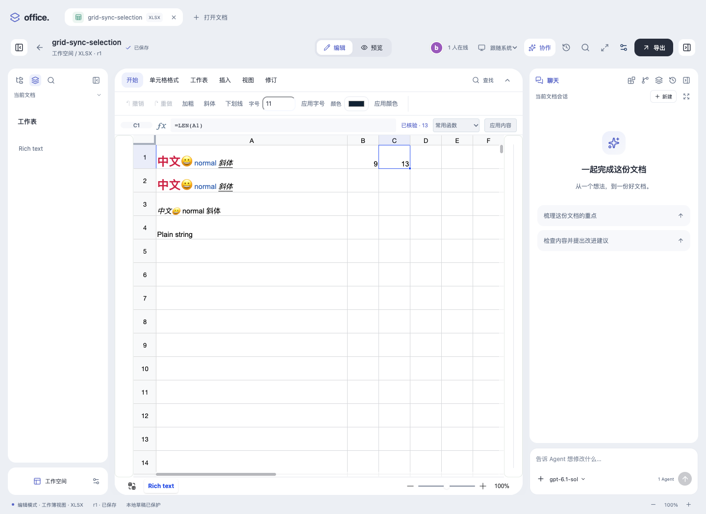
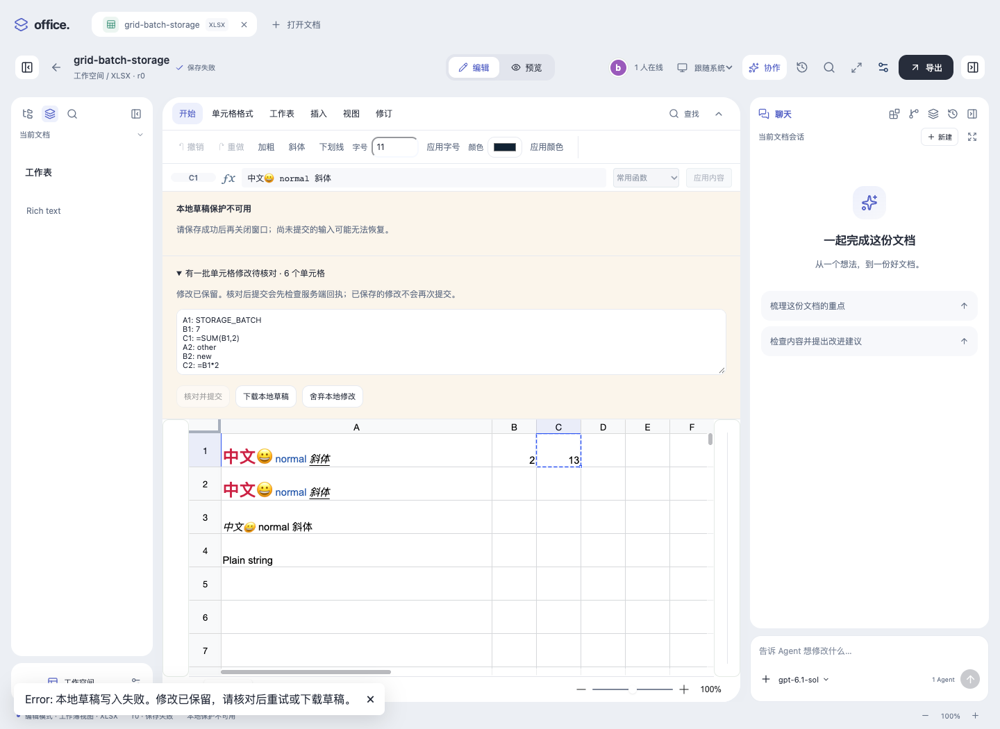

# XLSX 整批输入持久化与确切提交回执核对

2026-11-16，`feature/hcd-font-format-integration`、HEAD `ccb5fd5` 的未提交共享工作区。承接[混合粘贴阶段](hcd-xlsx-rich-paste.zh.md)，处理多格修改在请求失败、离线关闭与响应丢失时的恢复。本文是限定验收，不代表所有文档编辑或协同能力已经完成。

## 行为与协议

原生单元格确认或多格粘贴后，先冻结原始 patch ID、基准修订、目标守卫、内容和协同 epoch，并将整批 `hcd-grid-batch-input/1` 意图写入 IndexedDB；严格事务完成后才发送网络修改。沿用每窗口独立的日志与 Web Locks，不让一个窗口确认或清除另一个窗口的输入。保留富文本片段、数字及公式原生类型，成功仍只产生一个修订；不再自动改写基准修订。

请求未确认时，将画布恢复为原内容并保留完整意图，提供可收起的核对、下载与舍弃操作。原生编辑、公式栏、结构修改、Agent 和历史操作会等待该批次处理完成；选择、复制与滚动仍可使用。正常保存不展示恢复面板，避免每次输入引发布局跳动。公式表达式恢复时，另外局部恢复当前修订的核验标量缓存，避免公式格暂时空白。

恢复先重新核对服务、用户、文档与协同 epoch。新接口 `POST /v1/documents/{id}/node-patch-review` 接收原始 node patch，要求写权限与 `X-HCD-Collaboration-Epoch`；该接口只核对、不修改文档。能力发现公开 `hcd-node-patch-review/1`，客户端预检操作表与指纹，旧服务不会收到不支持的核对请求。

返回包含 `protocolVersion`、`documentId`、`patchId`、`revision`、`rootHash`、`state`，已提交时另外含 `appliedRevision`：

| 状态 | 判断与后续行为 |
| --- | --- |
| `ready` | 原基准仍是当前修订，且提供的 rootHash 一致；找回整批输入，等待用户明确提交。不是所有单元格/租约的 dry-run，实际提交仍完整检查 |
| `applied` | 原基准下一修订中的 patch ID、后端类型化 payload hash、基准与 JWT 用户均严格匹配；同步当前服务端内容、清理对应日志，不再次写入。后面即使已有其他协作者修订也可核对 |
| `conflict` / 错误 | 版本、用户、epoch 或确切内容不能证明一致；保留和允许下载，不自动改基准、重放或覆盖 |

使用与实际 apply 相同的 Rust 类型序列化计算 hash，避免浏览器猜测字段顺序。单凭 patch ID、用户可编辑的本地标记或文字 hash 不足以证明成功。明确舍弃只清理本地意图并同步服务端，不能撤回一个可能已经提交成功的网络请求。

## 选区回退的复现与修复

中间组合 25 项通过、1 项失败（3.1 分钟）：原生重试后撤销，再按方向键仍停留在 A1。随后隔离复验曾失败、加诊断的一次运行通过，未将时序变化当作修复。进一步用双窗口和挂起网络响应稳定复现：刷新开始时为 A1，在索引响应等待期间选到 C1，释放响应后又回到 A1。修复前截图、错误与 trace 保留在[原始证据](hcd-grid-batch-recovery/selection-before-fix/)。

`refreshFromServer` 原来在开始时保存选区，完成后无条件重设。现在保留原生画布的当前选择，不再回写过期快照；加载单元格本身不需要重建选区。两个相关用例各重复两轮 **4/4（27.8 秒）**通过，包含原生重试、撤销后使用新 epoch 编辑和在途协同刷新后的新选区保持。[中间结果](hcd-grid-batch-recovery/intermediate-browser-results.json)与最终组合分别记录。

保存确认后的索引同步完成前，继续保留输入和历史守卫；提交前还会核对日志内容与待提交意图完全相同，防止日志生命周期改变后误把空日志当作已保护。

## 最新追加复核 · 鼠标与连接

前一阶段的 37/39 是历史结果。追加修复后，编辑器独立/嵌入构建、24 项前端单元、代理连接探针通过，最终组合浏览器 **40/40（3.0 分钟）**通过；[完整日志](hcd-grid-batch-recovery/final-browser-40.log)与[汇总](hcd-grid-batch-recovery/verification-results.json)已更新。Rust 后端本次未修改，1,074 项与相关 Rust 检查沿用前一阶段的运行结果。

导航失败已定位为 Univer 在外部工具栏点击前后仍累计画布双击，误进入文字编辑；现在按浏览器鼠标点击次数守卫，真实双击输入与取消、导航及 canvas 身份均有回归。连接故障的后续现场记录到本机 `EADDRNOTAVAIL` 与大量主要为非 loopback 的 TIME_WAIT；开发代理共享有界 keep-alive agent，20 次请求的上游连接从 20 条降到 1 条。它不能保证其他进程造成系统地址不足时仍然可用，也不能证明所有历史连接失败均为同因。详见[鼠标与代理复核](hcd-editor-pointer-proxy-recovery.zh.md)。原始 trace 留在本地，Git 保存截图、文本诊断与复现命令。

## 前一阶段验收结果（37/39，历史）

Rust 整树 **1,074 项**（25 个结果组，零失败/忽略）、Clippy、格式、debug 构建及 diff 检查通过；编辑器独立/嵌入构建及 **24 项前端单元**通过。原生混合内容 CLI 探针和 5 项公式探针通过。最终组合浏览器为 **37/39（4.0 分钟）**，本轮没有全绿，也不认定整体目标完成。见[机器可读汇总](hcd-grid-batch-recovery/verification-results.json)。

两项仍待解决：

- 整批修改重试、撤销后，方向键偶尔停留 A1。等待原生编辑器获焦和一帧绘制后仍曾失败。内部状态诊断的 3 轮、4 倍 CPU 节流的 3 轮及带命令记录的 8 轮分别通过，但观测可改变时序，不能据此宣称已修复。[最新导航失败](hcd-grid-batch-recovery/latest-navigation-failure/)与[中间记录](hcd-grid-batch-recovery/intermediate-browser-results.json)保留。
- 旧单格公式草稿在恢复、保存成功后刷新，进入连接恢复页。追踪显示本地代理 `/auth` 与 manifest HTTP 500，另有 `ERR_ADDRESS_INVALID`；直接测试 API 的 manifest 仍返回 200。页面没有重新打开，不把它误记成公式内容损坏；具体根因仍未确认。[刷新失败](hcd-grid-batch-recovery/latest-reload-failure/)保留截图、错误与 trace。

通过的组合范围含七格式确定性 Harness、Word/HTML 行内样式与表格、分页、MCP、公式与原生类型、富文本混合粘贴/导出/撤销/同步，以及新增批次的未提交恢复、响应丢失后续修订核对、过期/损坏/存储失败与在途选区保持。以实际通过项为准，不把七格式工具回归计为所有复杂对象完成。相关浏览器指标见[内容与回执记录](hcd-grid-batch-recovery/browser-metrics.json)。

[首轮恢复专项](hcd-grid-batch-recovery/first-browser-results.json)为 5/5（44.0 秒），覆盖未提交、回执丢失、过期、存储失败及损坏意图。后续组合与最终结果另行记录，不能与专项相加。





## 限制

- 日志仍限制为每份内容 2 MiB、每个命名空间 128 条记录。写入失败或超过限制时不发送修改，完整运行时意图可手动下载，关闭前提示未保护。不能保证浏览器清除数据、隐私模式存储策略或设备损坏后的恢复。
- 这是 XLSX 内容批次的本地恢复，尚非任意格式/结构操作的离线队列、跨设备同步或跨文档原子事务。租约失效、地址结构变化或 epoch 变化仍保守停止。
- 源剪贴板的整格样式、链接和对象、全部公式及复杂 Office 排版仍未完整支持。
- 合同 PDF/DOCX 的版本关系不确定，作为独立鲁棒性样本，不能互作同源 Office/WPS 排版参考。本轮未重跑合同文件。
- 未调用真实模型、重启日常服务或提交代码；测试只重启其自有临时 API。无远端 CI 或干净检出认证。

## 复现

```bash
cargo +1.90.0 test --workspace
cargo +1.90.0 clippy --all-targets -- -D warnings
cargo +1.90.0 fmt --all -- --check
cargo +1.90.0 build -p officecli
python3 docs/acceptance/hcd-xlsx-rich-paste/probe_rich_paste.py \
  --output docs/acceptance/hcd-grid-batch-recovery/cli-results.json
python3 docs/acceptance/hcd-capability-audit-2026-11-15/probe_formulas.py \
  --output docs/acceptance/hcd-grid-batch-recovery/formula-results.json
cd examples/hdoc/editor
npm run build
npx --no-install tsx --test src/*.test.ts
HCD_BROWSER_PATH='/Applications/Google Chrome.app/Contents/MacOS/Google Chrome' \
  npx --no-install playwright test e2e/workspace.spec.ts \
  --grep 'XLSX batch input journal' --reporter=line

# 追加修复后的 40 项组合；最近一次 40/40 通过。
HCD_BROWSER_PATH='/Applications/Google Chrome.app/Contents/MacOS/Google Chrome' \
  npx --no-install playwright test e2e/workspace.spec.ts e2e/agent-harness.spec.ts \
  --grep 'XLSX batch input journal|XLSX canvas mouse|a grid agent highlights|XLSX rich clipboard|XLSX rich blank-cell|XLSX native text selections|XLSX rich input journal|grid input journal|XLSX rich strings|HTML inline fidelity|HTML and Markdown source tables|Word mixed inline edits|export menus use source-aware|export capabilities follow|all seven formats use|insert ribbon creates|Word pagination|OpenAI harness edits|table hover controls|editor deletion supports|protocol preflight|protocol fingerprint|calculation contract|verified grid caches|native literal types|workbook preview keeps' \
  --reporter=line
```
