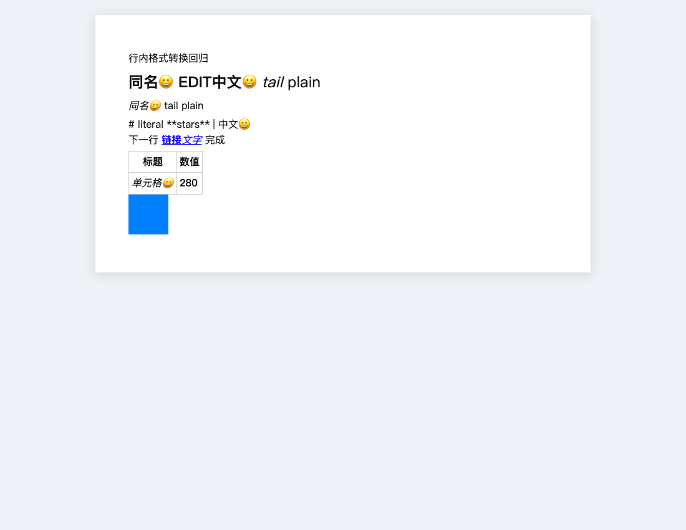
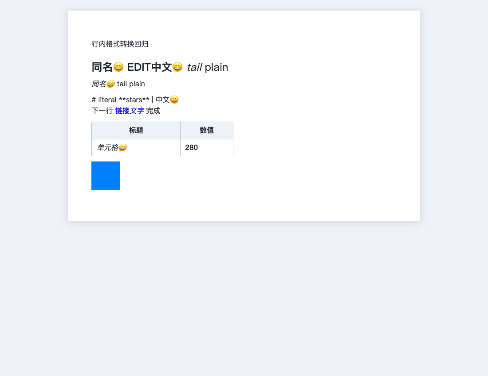
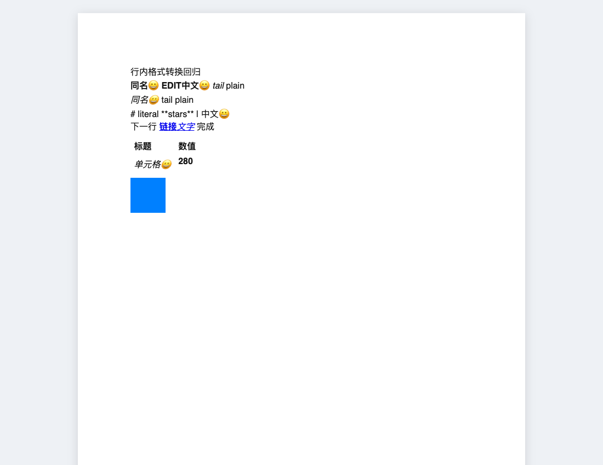
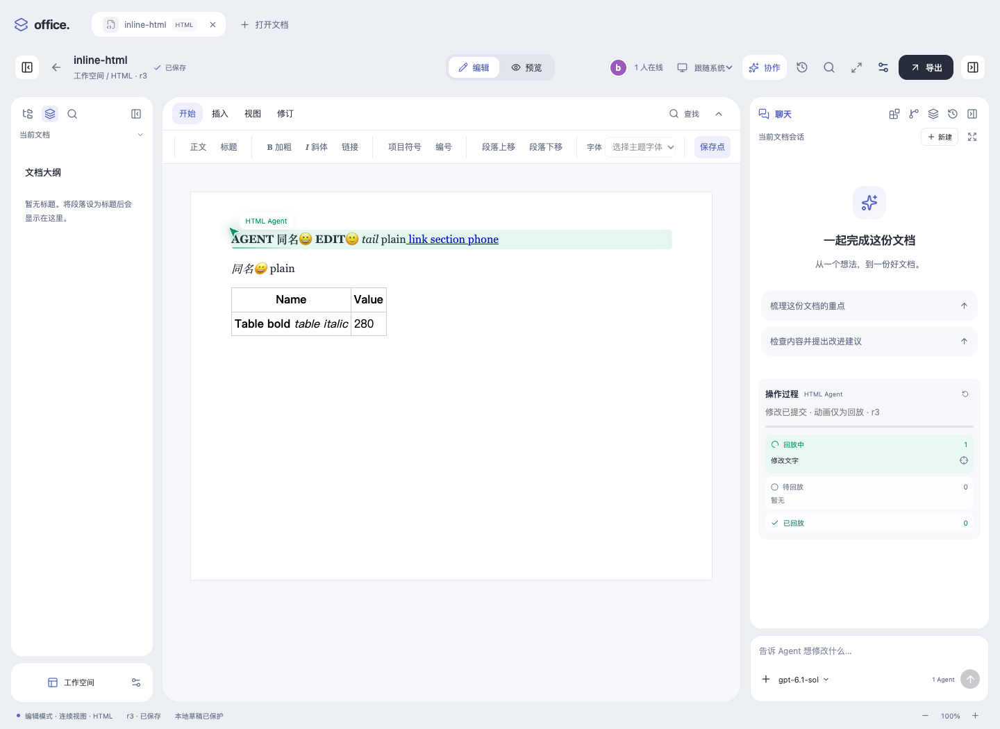

# HTML 导入、协同与导出回读验收

2026-11-15，`feature/hcd-font-format-integration`、HEAD `ccb5fd5` 的未提交工作区。整体五项目标继续未完成，见[当前状态](hcd-capability-status-2026-11-15.zh.md)与[建设记录](hcd-reliability-roadmap.zh.md)。

本文保留 HTML 阶段结果。后续已补 XLSX 单元格内富文本的导入、画布绘制、纯文字修改协同及源导出回读，见[补充验收](hcd-xlsx-rich-text.zh.md)；下方 XLSX 压平的边界描述属于本阶段历史状态，选区格式、富文本粘贴与主题解析仍未完成。

## 本轮修复

此前 HTML 导入保留了文字及表格，却丢掉基本粗斜体与链接；后续导出无法恢复上游丢失的信息。本轮不再绕开 HTML 导入准备原生样本，而是直接用[公开合成 HTML](hcd-semantic-inline-fidelity/fixture.html)走完整路径。

- 按源元素作用域保留 `b/strong`、`i/em`、`font-weight/font-style` 的继承、显式 normal 与局部 `!important`，以及允许的链接和标题。文字仍用原字节范围、原节点 ID 和独立 hash 定位；同名中文/emoji 不通过内容猜测样式。
- 格式包装按每个文字锚点闭合，跨块/表格分片不遗留悬空标签；扫描器和样式栈统一处理可省略的段落、列表及表格行/格闭合。300 行省略闭合标签的长表不串用样式、不累积伪嵌套。修复未加引号的 URL 被斜杠截断。
- 未改变文字分组的格式、链接和段落类型时，HTML 文字检查点保留原锚点和源范围；新增/改变格式或链接仍走语义重建，避免把新样式误写成纯文字。修复容器与首个文字同名时命中错误元素的问题，按携带 hash 的实际 XML 元素边界替换，不提前修改输入。
- 统一规范 HTML 与编辑提交的链接规则，允许 HTTP(S)、mailto、tel、页内 `#`，拒绝控制字符和反斜杠。HTML 导入/编辑链接限 2,048 UTF-8 字节；相对/本地链接不在此支持范围。编辑器链接对话框支持电话和页内地址；schema 参与现有协议指纹。
- 粗体在标题/表头中不再因浏览器 `bolder` 叠加到 900；Markdown 回读也固定布尔粗体为 700。
- 修复转换器漏读规范图片外层 `span` 的尺寸，且嵌套尺寸不泄漏给后续图片。独立 Markdown 内嵌栅格使用图片容器，移除错误代码块背景；其他原始 HTML 仍按转义代码显示。

## 实际证据

Rust 整树 **1,068 项通过**，含 doctests，新增 8 项；Clippy `--all-targets -- -D warnings`、全量格式和 debug 构建通过。编辑器独立/嵌入构建及 **15 项前端单元**通过。

最终组合浏览器 **19/19（1.9 分钟）**通过：HTML 人工输入、撤销/重做、另一浏览器同步、MCP 节点文字修改、段落 DOM 身份保持，以及实际链接对话框的电话/页内链接保存；同时覆盖七格式 Harness 编辑、Word 混合样式/分页、HTML/Markdown 表格、表格 hover/滚动/插入及原生导出、20 步撤销、导出版本选项和协议预检/指纹。使用确定性模型替身，不认证真实模型的任务质量。

[CLI 探针](hcd-html-inline-fidelity/probe_html_inline.py)直接导入 HTML，修改标题中的指定文字，检查源锚点、非结构修订和源 HTML 导出其余字节保持不变；随后无源导出 DOCX/XLSX/PPTX/Markdown，并逐一重新导入校验。原生 OOXML 的前五段粗斜体、DOCX 图片在表格外及实际 609,600×609,600 EMU 尺寸、真实链接关系另行核对；Markdown 再转 DOCX 核对原生 run。[机器结果](hcd-html-inline-fidelity/cli-results.json)。

[浏览器探针](hcd-html-inline-fidelity/probe_preview.mjs)实际打开 HTML、DOCX 和 Markdown 回读预览：分别核对 700/400 字重、粗斜体、表格 280 的粗体，以及图片 **64×64 CSS px**、实际加载且没有 `pre/code` 包裹。[指标](hcd-html-inline-fidelity/browser-metrics.json)与以下截图均已查看。原生 run、回读文字和浏览器外观分别检查，不能相互替代。









## 边界

- 仍是**语义转换**，图片尺寸和文字粗斜体通过不代表标题字号、段落间距、表格边框、分页或 Office/WPS 原样排版通过。截图中各格式仍使用各自的默认语义样式。
- HTML 样式表、字体/字号/颜色等其余 CSS、任意复杂对象、相对文件链接和原始 HTML 往返仍不完整；复杂标题在所有编辑入口中的显式 normal 行为尚未专项验收。旧 bundle 中已丢失的信息需要重导原件。
- XLSX 的原生富文本 run 已核对，但 HCD/网格内部富文本回读仍会压平；PPTX 原生 run 不代表母版及任意对象回读完整。
- 独立 Markdown 图片背景已修；任意嵌套 HTML 图片、未格式化文字转义、部分换行和扩展结构仍需完善。
- 网页默认 HTML 导出是规范预览版；原 HTML 标记保留通过 CLI 的 `--source` 路径单独验证。源导出按既有报告保留未编辑区域的原始内容，两种导出不能混为一项验收。
- 使用隔离服务/浏览器和确定性模型替身；未调用真实模型、重启日常服务、提交代码或执行远端 CI。完整图片工作区、原生公式 CLI 探针、管理端构建及完整故障恢复/跨文档套件未在本轮重复。

## 复现

```bash
cargo +1.90.0 test --workspace
cargo +1.90.0 clippy --all-targets -- -D warnings
cargo +1.90.0 fmt --all -- --check
cargo +1.90.0 build -p officecli
python3 docs/acceptance/hcd-html-inline-fidelity/probe_html_inline.py \
  --output docs/acceptance/hcd-html-inline-fidelity/cli-results.json
HCD_BROWSER_PATH='/Applications/Google Chrome.app/Contents/MacOS/Google Chrome' \
  node docs/acceptance/hcd-html-inline-fidelity/probe_preview.mjs

cd examples/hdoc/editor
npm run build
npx tsx --test src/*.test.ts
HCD_BROWSER_PATH='/Applications/Google Chrome.app/Contents/MacOS/Google Chrome' \
  npx playwright test e2e/workspace.spec.ts e2e/agent-harness.spec.ts \
  --grep 'HTML inline fidelity|HTML and Markdown source tables|Word mixed inline edits|export menus use source-aware|export capabilities follow|all seven formats use|insert ribbon creates|Word pagination|OpenAI harness edits|table hover controls|editor deletion supports|protocol preflight|protocol fingerprint' \
  --reporter=line
```

CLI、实际浏览器样式/尺寸探针和 HTML 人工/MCP 协同回归已加入 PR 工作流；尚无远端或干净检出认证。最终日志位于 `/tmp/hcd-html-inline-{workspace,clippy,format,build,browser}-final.log`，构建日志为 `/tmp/hcd-html-inline-editor-build.log`，前端单元为 `/tmp/hcd-html-inline-unit-final.log`。
