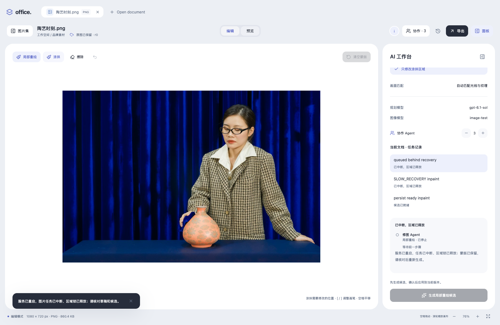

# 图片草稿、蒙版与任务检查点恢复

此项补齐图片工作区的主要本地恢复链路，整体五项建设目标仍未完成。验证对象是 `feature/hcd-font-format-integration`、HEAD `ccb5fd5` 之上的未提交工作区，并非 main、已发布版本或干净检出认证。

## 实现行为

- 裁剪/旋转/翻转/缩放/调色参数、尚未应用的裁剪范围、蒙版向量笔画、提示词、Agent 数量、画笔/羽化及转换参数接入现有独立输入日志。不会把图片二进制、候选 base64 或访问令牌塞入 IndexedDB 输入快照。
- 本地保护按服务、已鉴权用户、文档和协同 epoch 隔离，每窗口独立流。恢复重新鉴权，检查基准修订、原图尺寸及输入结构；蒙版点数、坐标、裁剪和转换尺寸有界。冲突保留下载，不覆盖当前图片，也不自动生成或提交。
- 输入存储成功后才显示“图片草稿已保存在此浏览器”。写入失败或超过既有 2 MiB/128 份预算时显示未保护状态；仍有未提交输入时触发关闭保护。保存回执只清理匹配的输入版本，读取期间发生的新输入不会被刷新清掉。
- 原图 canvas 保持原实例。恢复调整参数只更新像素预览，蒙版在原尺寸重放；不重建整个工作区。当前图片草稿可显式舍弃，旧流仍通过原有 CAS 删除守卫保护。
- 独立图片局部重绘与文档插图生成均接入私有原子检查点。检查点目录为 `image-jobs`，Unix 权限为 0700、文件为 0600；原子替换前同步文件，随后同步目录。完整快照有 16 MiB/128 项预算，删除/清理后的记录不会在重启时复活。
- API 根目录仍使用已有 OS 排他锁。重启把排队/生成/核对中的图片任务标为 `interrupted`，停止原 worker 并释放旧区域占用；不会自动重新请求模型。保留任务、共享规划/核对结果、私有 owner、已就绪候选和共享蒙版的资源引用，读取及恢复校验资源 hash。
- 工作台优先提示新中断的任务，显示“已中断，区域已释放”；已就绪候选仍可对比和守卫应用。公共插图 API 不泄露私有 owner/href/cancelled；重启后取消权限仍属于原发起者。
- 应用局部重绘前持久化意图，以确定性 patch ID 提交。若进程在提交与回执之间退出，恢复从确切修订核对结果并补回执；没有提交的意图仅恢复为候选，不自动应用。重复请求返回原回执，不增加修订。
- 检查点写入失败会停止相应 worker，并以 503 阻止继续生成/提交；不能以仅存内存的状态宣称已保护。损坏检查点保留原文件并阻止静默恢复；文档本地副本已移除时保留不可用记录，不重启任务。

## 本地验证

```bash
cargo +1.90.0 test --workspace --quiet
cargo +1.90.0 clippy --all-targets -- -D warnings
cargo +1.90.0 fmt --all -- --check
cargo +1.90.0 build -p officecli
cd examples/hdoc/editor
npm run build
npx tsx --test src/*.test.ts
HCD_BROWSER_PATH='/Applications/Google Chrome.app/Contents/MacOS/Google Chrome' \
  npx playwright test e2e/image-workspace.spec.ts --reporter=line
```

本轮结果：

| 检查 | 结果 |
| --- | --- |
| Rust 整树测试，含 doctests | 1,036 项通过 |
| Rust 1.90.0 Clippy / 全量格式 | 通过；格式差异已整理，不改变宿主集成行为 |
| 编辑器独立 / 嵌入构建 | 通过 |
| 前端单元 | 10/10 通过，含 2 项图片草稿结构/预算检查 |
| 图片工作区浏览器 | 9/9 通过，1.1 分钟；其中 6 项新增恢复回归 |
| 最终中断状态提示 / 蒙版恢复复验 | 2/2 通过，10.9 秒 |
| PR 门禁 | 已加入整个图片工作区套件；尚无远端 CI 成功认证 |

新增 Rust 用例实际验证候选/中断恢复、删除不复活、私有数据隔离、写入失败停止 worker、损坏文件保留，以及提交前后两个意图窗口。浏览器启动独立临时目录、自有 API/Vite/Chrome 和确定性模型服务，覆盖离线关闭、浏览器 SIGKILL、服务 SIGKILL、用户隔离、旧修订拒绝恢复、草稿下载和存储失败。图片恢复前后比较蒙版 data URL；服务重启前后比较候选及蒙版的实际字节，并核对 revision、锁和模型请求计数。没有重启用户演示服务，也没有再次调用真实供应商。




另有[调整与转换参数恢复](hcd-image-recovery/image-adjustments-recovered.png)、[旧版本草稿保留](hcd-image-recovery/stale-image-draft-retained.png)和[浏览器强杀恢复](hcd-image-recovery/image-browser-crash-recovered.png)。

## 仍有边界

浏览器日志只保护已完成持久事务的输入；清理站点数据、清空本地服务目录或未落盘前被强杀，不能保证找回最后一次输入。草稿和撤销历史不跨设备同步，重开不恢复本地撤销栈。格式转换保存参数，未下载的编码结果 Blob 与结果面板不恢复；可用恢复参数重新编码。

服务检查点面向单个服务根目录，不是多主机分布式租约。任务仍按现有一小时清理规则和数量预算保留。中断后没有供应商请求恢复、自动续跑或跨文档补偿事务；服务保留的蒙版可经授权接口读取，本轮没有新增“从任意另一设备一键恢复并重新生成”的完整交互。图片编辑仍为区域锁/候选/整图版本提交，不是图层或像素级 CRDT 合并。

同源 Office/WPS 排版、图表/母版/审阅等复杂对象、更多 Excel 计算语义、Agent 重新授权续跑及跨文档依赖/补偿，仍见[总体状态](hcd-capability-status-2026-11-15.zh.md)。用户合同 PDF/DOCX 来源关系不确定，两者不能互相充当保真基准。本轮没有进行新的 Office/WPS 逐页保真认证。
