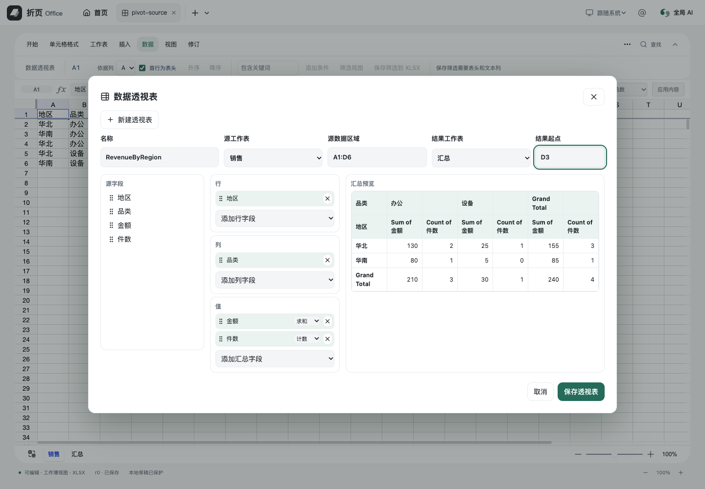
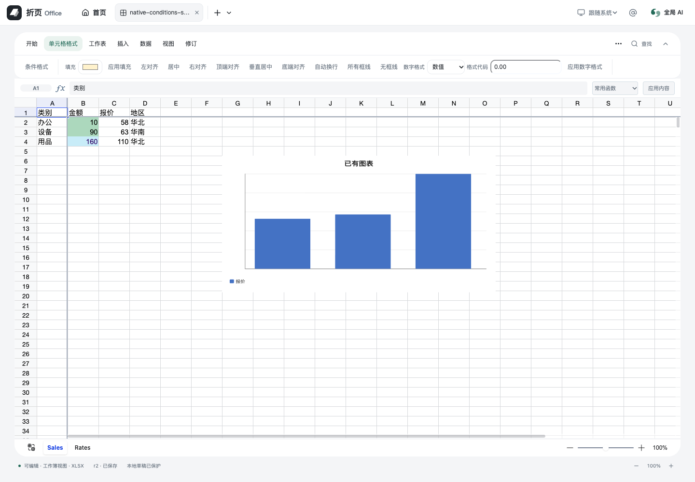
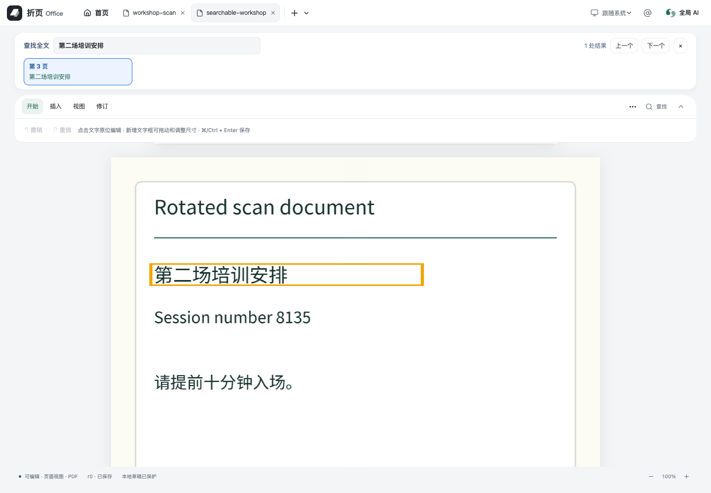
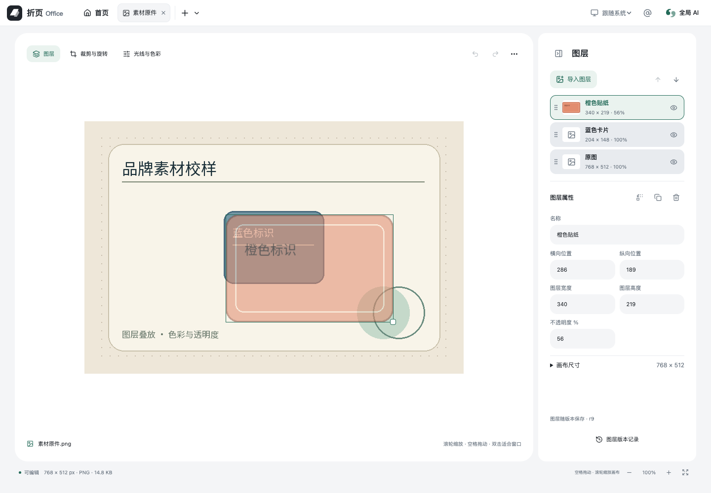

# 原生 Office、OCR 与图层往返验收

本轮将临时脚本中的完整操作迁入仓库。当前构建在真实主工作台通过四类 **16 项浏览器检查**，并由独立文件读取器检查实际下载的文件。结果与六份固定原件的 SHA-256 见 [validation.json](hcd-native-office-roundtrip/validation.json)。原件在测试前后均保持不变。

| 能力 | 实际操作与独立验证 |
| --- | --- |
| Excel 透视表 | 拖拽行列字段，跨工作表放置，求和/计数/平均，拒绝覆盖已有内容；源单元格修改使公式联动，刷新汇总从 240 变为 480；重开原生 XLSX 后继续编辑。openpyxl 检查浏览器下载中的透视定义、缓存记录、报表数字、源公式与原图表；独立 CLI 另验证删除和历史导出。 |
| Excel 条件格式 | 编辑已有阈值，新增区间规则，实际读取网格画布像素，刷新、原生导出重开、删除、撤销和重做。openpyxl 检查原生规则和颜色；XML 检查另一个高级色阶规则与原有图表没有被改写，冻结窗格仍在。 |
| PDF OCR | 阻断浏览器外网请求，使用随工作台提供的中英文模型识别扫描页、混合页和旋转裁切页；实际鼠标选字、键盘复制粘贴、原位纠错、保存、刷新、查找及下载重开。pypdf 和 Poppler 独立检查文字层、裁切、旋转与原内容流；按相同裁切框、96 DPI 对比，原生/便携导出的页面均没有像素差异。还检查归档解包、单页导出、拒绝重复 OCR、再导入后纠错和历史恢复。 |
| 图片图层 | 导入透明图片、实际拖动与缩放、改名、透明度、拖拽排序、隐藏/显示、调整图层、刷新及恢复历史；陈旧修改返回 409。Pillow 检查叠放改变了 27,901 个像素，隐藏图层、撤回调整、PNG 下载和重开均按像素还原。解包 HCD 图层项目后逐一校验素材哈希，再通过原生操作编辑恢复出的图层图并恢复原图。 |

原生规则填充检查读取差异样式中的 `bgColor`；这是条件格式的填充颜色，并非普通单元格前景填充。此处也对照了 [LibreOffice 的差异填充导入逻辑](https://github.com/LibreOffice/core/blob/master/sc/source/filter/oox/stylesbuffer.cxx#L1844)。

## 结果与截图

[透视表原生结果](hcd-native-office-roundtrip/pivots-native.json) · [条件格式原生结果](hcd-native-office-roundtrip/conditions-native.json) · [OCR 原生结果](hcd-native-office-roundtrip/ocr-native.json) · [图层原生结果](hcd-native-office-roundtrip/layers-native.json)









原生 XLSX 公式探针也通过 Unicode 长度、空白计数、非空计数以及负数向上/向下舍入检查，见 [formula-probe.json](hcd-native-office-roundtrip/formula-probe.json)。这五个探针是对已发现问题的复验，不代表所有 Excel 函数均已支持。

后续断网复验发现并修复了条件格式撤销时先发布新修订号、后刷新索引的时序问题。条件格式现在从刷新后的索引读取；本次真实浏览器撤销后 177 ms 恢复填充，重做与再次撤销也立即更新画布，见[复验](hcd-native-office-roundtrip/conditions-recheck.json)和[实测记录](hcd-native-office-roundtrip/conditional-undo.json)。OCR 搜索重开还补充检查命中高亮和第三页实际进入视口，见[导航复验](hcd-native-office-roundtrip/ocr-navigation-validation.json)。

## 重复执行

先构建工作台，再在 Python 3.12 环境安装测试读取器，系统另需 Poppler。产品运行不依赖这些测试用 Python 库。

```bash
python -m pip install -r examples/hdoc/embed-host/fixtures/native-office/requirements.txt
npm run build --prefix apps/workspace
npm run test:workbench-native --prefix apps/workspace
```

`OFFICECLI_NATIVE_PYTHON` 可指定虚拟环境，`HCD_BROWSER_PATH` 可指定 Chromium/Chrome，`OFFICECLI_NATIVE_ARTIFACTS` 可指定新的产物目录。设置 `OFFICECLI_NATIVE_CASE=pivots|conditions|ocr|layers` 可单独复验。固定原件、生成脚本与各独立读取器见 [native-office](../../examples/hdoc/embed-host/fixtures/native-office/README.md)。

四类流程已接入 `hcd-regression.yml` 的工作台任务，保存 JSON、截图和原生检查日志。本轮实际结果来自本地执行，远端 CI 尚未运行。

## 边界

这些结果证明所列操作和同一原件的往返，不表示完整替代 Office。透视表和条件格式支持当前列出的基础编辑，高级色阶规则保留在源文件中。PNG 导出是合成图；可继续编辑的图层图保存在 HCD 项目中，本轮通过 CLI 解包后继续编辑，未声称首页可以导入该项目。

本轮没有使用 Microsoft Office 客户端打开输出，原生文件由工作台再次导入和独立库交叉检查。PPT 母版文字样式的全局编辑已补齐并有[单独验收](hcd-pptx-master-text.zh.md)，两个平台的安装包也通过了包含母版文字的[五类断网操作](hcd-workspace-release-current.zh.md)。完整目标仍需按各项要求核对，不能把这些检查视为完整替代 Office。
