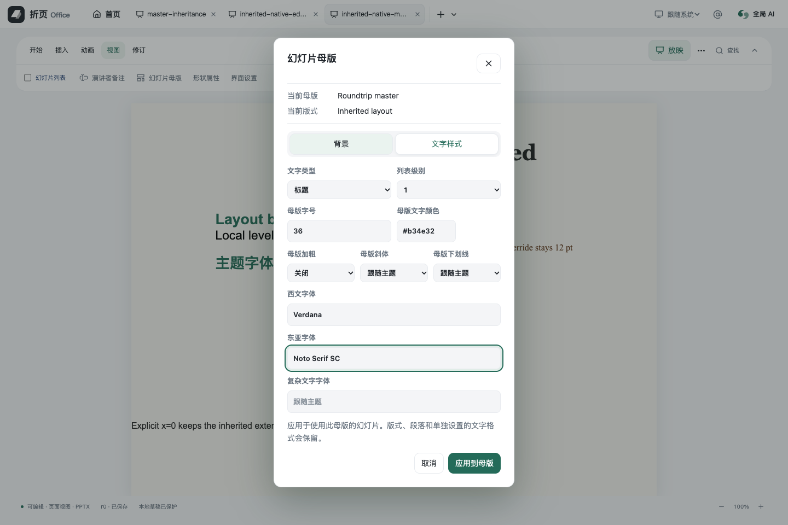
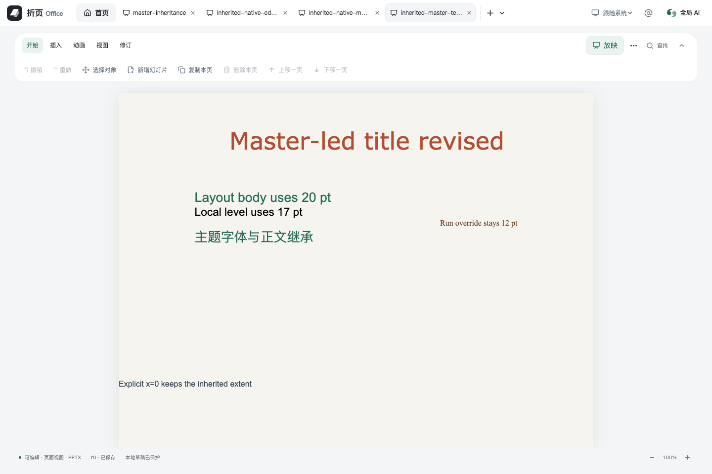

# PPTX 母版文字样式

主工作台的「视图 → 幻灯片母版」现在支持背景和文字样式两部分。文字样式可分别编辑标题、正文和其他文字的 1–9 级字号、颜色、加粗、斜体、下划线，以及西文、东亚和复杂文字字体。

这是共享母版修改。使用同一母版的幻灯片会跟随更新；版式、形状列表样式、段落默认值、原生文字属性和后来手动设置的局部格式继续按原有优先级生效。取消加粗、取消斜体等显式 `false` 也属于覆盖，不会被继承值替代。

## 原生与历史

- 导入时按文字属性分别记录继承来源，不通过“当前数值相同”推测继承关系。
- HCD 视图只更新实际继承该属性的文字，不把共享修改标为逐字的局部编辑。
- 原生导出写入 `p:txStyles` 的对应 `a:lvlNpPr/a:defRPr`，保留无关属性和子节点。没有局部样式的标题不会被添加直接 `a:rPr`，之后仍能继续跟随母版。
- 版式与主题 XML 保持逐字节不变。原始文件不被修改。
- 母版文字修改进入不可变修订快照，复制页、后续局部编辑、撤销和重新应用历史都保留共享样式状态。
- 旧 HCD 缺少继承来源时，界面不提供文字样式编辑；重新导入原始 PPTX 可建立来源记录。原有背景编辑仍可使用。

## Agent 接口

`capabilities` 公开 `hcd-patch/66`，通过已有 `/node-patch`、CLI 与 MCP patch 通道提交一项 `pptx.master.text-style`。`chunkId` 取自当前幻灯片，服务据此确定所属母版，`baseRevision` 继续防止过期写入。

`style` 包含 `kind`（`title`、`body`、`other`）、1–9 的 `level`，以及需要改变的 `format` 或 `font` 字段。省略的属性保持原值；字号范围为 1–256 pt，颜色为六位 RGB，字体沿用安全字体名称校验。一次操作只编辑一项级别，整次修改在一个修订中完成。

## 实际验证

```bash
cargo test -p hcd-core -p hcd-formats --lib
cargo clippy -p hcd-formats --lib -- -D warnings
cargo build -p officecli --bin officecli
OFFICECLI_BIN="$PWD/target/debug/officecli" npm run build --prefix apps/workspace
OFFICECLI_BIN="$PWD/target/debug/officecli" \
  HCD_BROWSER_PATH='/Applications/Google Chrome.app/Contents/MacOS/Google Chrome' \
  npm run test:workbench-pptx --prefix apps/workspace
```

本轮 145 项 HCD Core 与 231 项格式测试通过。新增原生文件测试实际复制幻灯片，更新共享样式，追加局部颜色覆盖，再次更新共享颜色，导出并重开，最后撤销和恢复历史；逐字节核对版式、主题与原件。协议能力测试也确认了新 schema 的公开路由。

真实浏览器通过母版弹窗编辑标题和正文，检查刷新后的可见样式，然后下载原生 PPTX、用独立 XML 读取器检查母版与局部属性，再作为新文件上传并核对显示。[浏览器结果](hcd-pptx-master-text/validation.json) · [原生 XML 检查](hcd-pptx-master-text/native-inspection.json)。





该能力编辑母版文字默认值和背景，不包含母版装饰图形、完整主题效果或 SmartArt 的可视化编辑。这些内容仍保存在原生源文件中。本轮未使用 Microsoft PowerPoint 桌面应用打开输出；验收范围是原生 XML、工作台重导入与实际显示。
