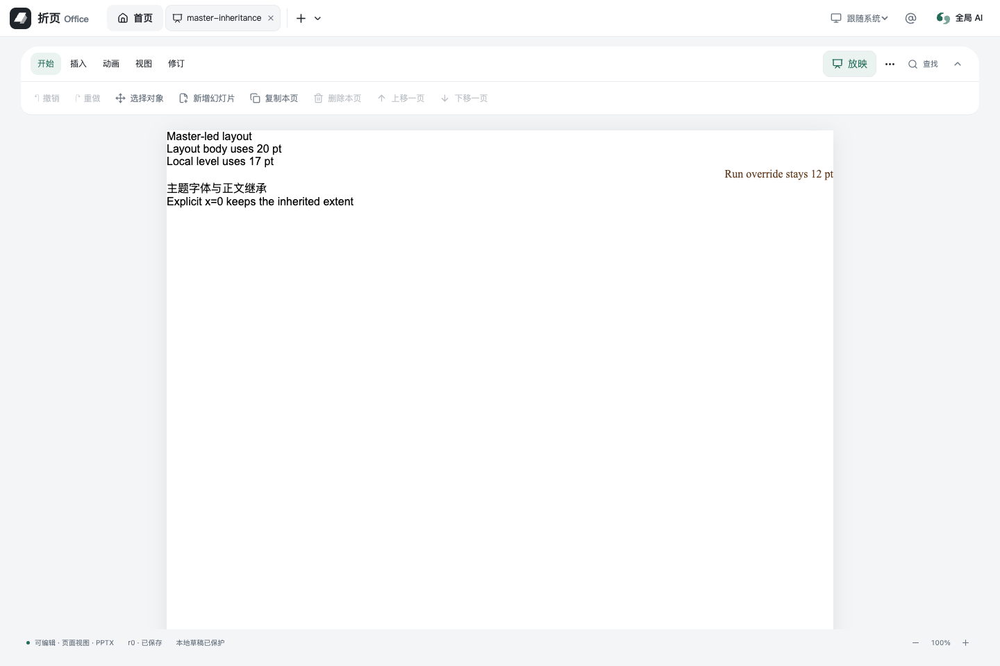
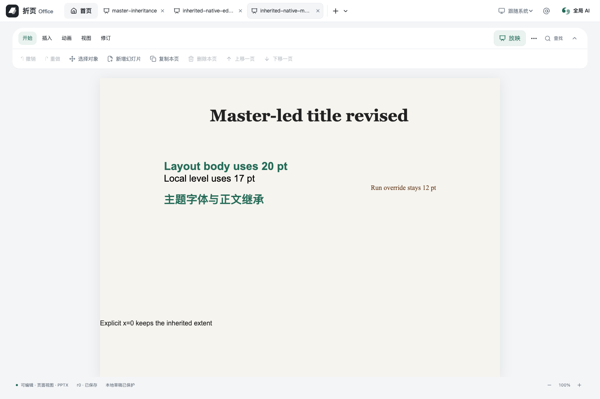

# PPTX 占位符与母版继承验收

原生幻灯片中的占位符可以不保存自身坐标和字号，而从版式、母版与主题读取。旧实现把这类文字挤在页面左上角，并且无法把移动后的坐标写回没有 `a:xfrm` 的占位符。

现在按占位符 `idx` 匹配版式，再按类型读取母版；继承坐标、尺寸、旋转、翻转、文字边距、段落与各级默认文字格式。源文件显式设置的零坐标、零边距、取消加粗和取消斜体会覆盖继承值。主题别名解析为实际字体，中文及阿拉伯语等可使用主题的补充脚本字体。单页的 `masterClrMapping` 或 `overrideClrMapping` 单独参与配色计算，同版式的不同单页不会串用缓存。

当用户只改文字时，版式、母版和主题 XML 保持逐字节不变。拖动缺少局部坐标的占位符时，只给当前形状补充本地坐标；普通缺损形状不会因此绕过原来的导出校验。

## 同一原件的浏览器验证

测试夹具由仓库中的 [XML 部件](../../examples/hdoc/embed-host/fixtures/pptx-inheritance) 与 [打包脚本](../../examples/hdoc/embed-host/fixtures/pptx-inheritance.py) 生成，不依赖 PowerPoint 或额外 Python 包。修复前后原件 SHA-256 相同，结果保存在 [before.json](hcd-pptx-placeholder-inheritance/before.json) 和 [roundtrip.json](hcd-pptx-placeholder-inheritance/roundtrip.json)。

1. 上传原件，检查标题、正文和显式 `x=0` 占位符的坐标与尺寸；检查 30/20/17/12 pt 字号、加粗取消、右对齐、主题中文字体和单页配色。
2. 在画布原位修改标题，通过键盘保存；实际拖动对象手柄。
3. 下载原生 PPTX，核对本地坐标和文字，逐字节核对共享母版、版式和主题没有改变。重新上传下载的文件，核对坐标、文字和样式。
4. 修改母版背景，添加标题淡入、正文跟随飞入、标题淡出三步动画；刷新后核对时长、延迟与顺序。
5. 进入放映，实际前进和后退动画；再次下载并上传原生文件，核对背景、文字、坐标、主题字体和三个动画步骤。

[浏览器结果](hcd-pptx-placeholder-inheritance/validation.json) · [导入效果](hcd-pptx-placeholder-inheritance/imported.png) · [拖动后](hcd-pptx-placeholder-inheritance/moved.png) · [重开效果](hcd-pptx-placeholder-inheritance/reopened.png) · [动画编辑](hcd-pptx-placeholder-inheritance/animations.png)

修复前：



编辑、移动、母版背景与动画导出重开后：



## 复验命令

```bash
cargo test -p hcd-formats --lib --offline
cargo test -p hcd-docx --lib --offline
cargo clippy -p hcd-formats --lib --offline -- -D warnings
npm run build --prefix apps/workspace
npm run test:workbench-pptx --prefix apps/workspace
```

可用 `HCD_BROWSER_PATH` 指定本机 Chromium/Chrome；不指定时使用 Playwright 安装的 Chromium。浏览器验证启动随机端口、隔离业务数据和真实引擎，结束时关闭自己创建的进程。该流程也已纳入主工作台的 `test:workbench`，由现有 CI 工作台任务调用。

本地最终构建通过 `hcd-formats` 的 230 项和 `hcd-docx` 的 59 项单元测试、`hcd-formats --lib` 的 Clippy（依赖库也参与检查），并通过 Rust 1.90.0 的 `cargo check -p hcd-formats --lib --offline`。同一构建的[主工作台回归结果](hcd-pptx-placeholder-inheritance/workbench-validation.json)也已保存。CI 配置已接入，远端 CI 本轮未运行。

## 当前边界

这份结果覆盖常见占位符和文字默认值，不代表完整 PowerPoint 排版实现。母版编辑器已进一步支持[共享文字样式编辑](hcd-pptx-master-text.zh.md)，并验证局部格式覆盖与原生重开。母版装饰图形、完整主题效果、SmartArt、复杂表格样式和高级动画仍以原生源文件为准。没有使用 Microsoft PowerPoint 桌面应用打开本次输出；本次验证包含原生 XML 检查和真实工作台再次导入。

单页配色覆盖按 [Microsoft 的 PresentationML 说明](https://learn.microsoft.com/en-us/office/open-xml/presentation/working-with-presentation-slides#colormapoverride-class) 处理：显式请求母版配色时使用母版映射，显式单页映射则使用单页映射。
