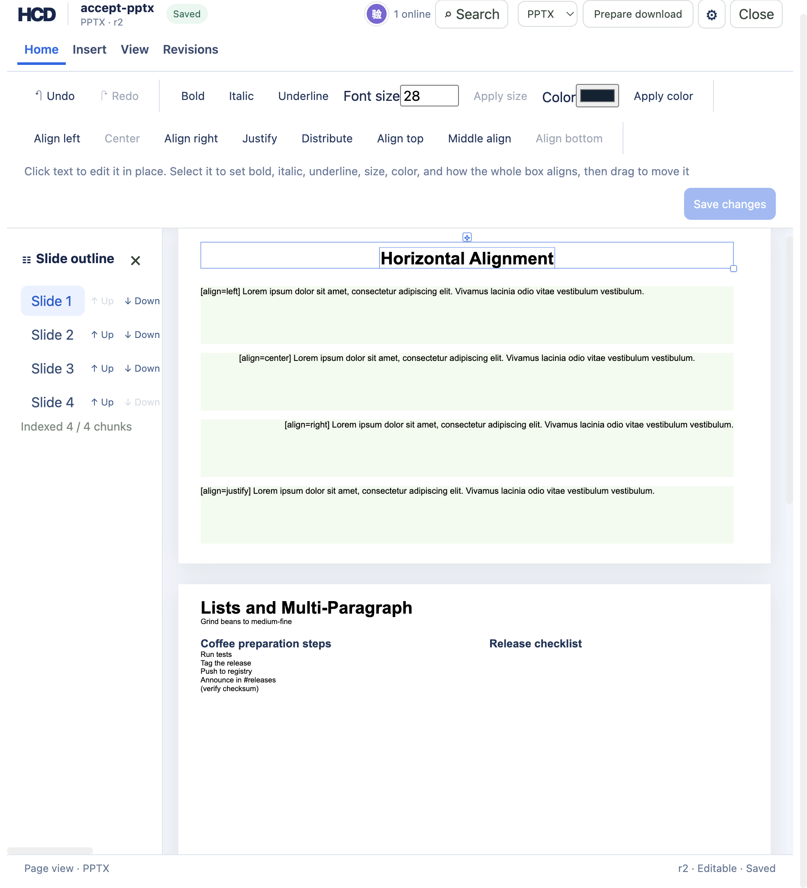

# PPT 文字框对齐（hcd-patch/46）

`examples/ppt/textboxes/textboxes-basic.pptx` 导入后是 4 个分片。开始页在文字格式那一组后面多出一组 **左对齐 / 居中 / 右对齐 / 两端对齐 / 分散对齐** 与 **顶端对齐 / 垂直居中 / 底端对齐**（英文 `Align left`、`Center`、`Align right`、`Justify`、`Distribute`、`Align top`、`Middle align`、`Align bottom`），这一组的 `aria-label` 是**形状对齐**（`Shape alignment`）。点一次走 `hcd-patch/46` 的 `pptx.shape.align`，参数只有 `nodeId` 和 `align.horizontal` / `align.vertical`。



对齐是整个文字框的，不是光标底下那一段的：请求落在文字节点上，因为那是编辑器能选中的东西，动的是装着它的框。分片里没有段落 ID，所以不装作能按段落调 —— 一次点下去把这个框里**每一条**段落水平对齐成同一个值，垂直锚定落在文字体上，跟 WPS/PowerPoint 选中框再点“居中”一样。词汇是水平 `left|center|right|justify|distributed`、垂直 `top|center|bottom`，分别写成 OOXML 的 `a:pPr@algn`（`l`/`ctr`/`r`/`just`/`dist`）和 `a:bodyPr@anchor`（`t`/`ctr`/`b`）。

分片这边：水平写进这个形状每一条 `<p class="hcd-slide-text">` 的 `text-align`，垂直写进形状外层 div 的 `display:flex;flex-direction:column;justify-content:flex-start|center|flex-end`；两条都另外在形状起始标签上留 `data-hcd-align-edited="true"` 加上 `data-hcd-horizontal`、`data-hcd-vertical`。导出只认带这个标记的形状，所以没点过的形状在部件里一个字都不动。

## 复现

```bash
cargo build -p officecli
mkdir -p /tmp/hcd-46-doc/sources /tmp/hcd-46-doc/out
cp examples/ppt/textboxes/textboxes-basic.pptx /tmp/hcd-46-doc/sources/accept-pptx.pptx
target/debug/officecli hdoc import /tmp/hcd-46-doc/sources/accept-pptx.pptx \
  --output /tmp/hcd-46-doc/accept-pptx.hcd --document-id accept-pptx
target/debug/officecli hdoc validate /tmp/hcd-46-doc/accept-pptx.hcd
```

```
Imported sources/accept-pptx.pptx as 4 chunks at revision 0
HCD validation passed
```

四条补丁按这个顺序打（`nodeId` 从 `hdoc get-chunk` 的分片里读，`precondition.nodeHash` 从 `hdoc get-node` 读）：

```bash
target/debug/officecli hdoc apply /tmp/hcd-46-doc/accept-pptx.hcd \
  --patch align-1.json --expected-revision 0 --json
```

```json
{"schemaVersion":"hcd-patch/46","documentId":"accept-pptx","patchId":"align-multi-center-bottom",
 "baseRevision":0,"actor":{"client":"cli-acceptance"},"metadata":{},
 "operations":[{"op":"pptx.shape.align","nodeId":"n_d125706465ba48a0a2d1bdd3e57e8960",
   "align":{"horizontal":"center","vertical":"bottom"},
   "precondition":{"nodeHash":"fc48b8662235db64c50b01eb05e9ee4c4419b734c788e4b450602624b98f5172"}}]}
```

| # | 节点（分片里的文字） | 请求 | 落在哪个部件 |
|---|----------------------|------|--------------|
| r1 | `Heat water to 93°C`（第 2 页那个 6 段的项目符号框） | `center` + `bottom` | `ppt/slides/slide2.xml` |
| r2 | `[align=center] Lorem ipsum …`（第 1 页中间那条） | `distributed` | `ppt/slides/slide1.xml` |
| r3 | `Lists and Multi-Paragraph`（**和 r1 同一个框**的第一段） | 只 `top` | `ppt/slides/slide2.xml` |
| r4 | `Horizontal Alignment`（第 1 页标题框，源里没有任何 `algn`） | 只 `right` | `ppt/slides/slide1.xml` |

r1 的响应（`success:true`，`data` 全文）：

```json
{"annotationRootHash":"4f53cda18c2baa0c0354bb5f9a3ecbe5ed12ab4d8e11ba873c2f11161202b945",
 "baseRevision":0,"dirtyChunkIds":["c_42c8e5a96044951961d7304815515a2e"],
 "dirtyNodeIds":["n_d125706465ba48a0a2d1bdd3e57e8960"],
 "dirtySourceParts":["ppt/slides/slide2.xml"],
 "documentId":"accept-pptx","idempotentReplay":false,"patchId":"align-multi-center-bottom",
 "revision":1,
 "rootHash":"5c7687475b446c9d1d54beb5630230350005527ce8a5ac18297cbc9fb9bbbfe8",
 "warnings":[{"code":"PPTX_DIRECT_SHAPE_ALIGN","nodeId":"n_d125706465ba48a0a2d1bdd3e57e8960",
   "message":"slide shape alignment writes a:pPr@algn on every paragraph of the shape and a:bodyPr@anchor on its text body; indents, spacing, and autofit stay on the source shape"}]}
```

四条修订各自只弄脏一个分片、一个部件，`hdoc validate` 仍然 `HCD validation passed`：

```
r0  root=b397dd2b
r1  root=5c768747 dirtyParts=['ppt/slides/slide2.xml'] dirtyChunks=['c_42c8e5a9'] dirtyNodes=1
r2  root=fbd9924c dirtyParts=['ppt/slides/slide1.xml'] dirtyChunks=['c_fa23b6dd'] dirtyNodes=1
r3  root=1931130f dirtyParts=['ppt/slides/slide2.xml'] dirtyChunks=['c_42c8e5a9'] dirtyNodes=1
r4  root=a428e58a dirtyParts=['ppt/slides/slide1.xml'] dirtyChunks=['c_fa23b6dd'] dirtyNodes=1
```

## 分片里写成了什么

r0 与 r4 的同一个 div（`hdoc get-chunk … 0`，标题框 `data-hcd-shape-id="10000"`）：

```
r0  <div class="hcd-slide-shape" data-hcd-id="n_14a719c9…" data-hcd-shape-id="10000"
       data-hcd-shape-name="TextBox 1" … style="position:absolute;left:48.00px;top:28.80px;
       width:1152.00px;height:57.60px;overflow:hidden">
       <p class="hcd-slide-text">

r4  …同上… style="position:absolute;left:48.00px;top:28.80px;width:1152.00px;height:57.60px;
       overflow:hidden" data-hcd-align-edited="true" data-hcd-horizontal="right">
       <p class="hcd-slide-text" style="text-align:right">
```

只调水平的时候 div 的 `style` 不动，值挂在每条段落的 `text-align` 上，另加两个 `data-hcd-*`。第 2 页那个 6 段框被 r1 设成 `center`+`bottom`、r3 又只把垂直改成 `top`：

```
<div class="hcd-slide-shape" data-hcd-shape-id="10005" …
     style="display:flex;flex-direction:column;height:57.60px;justify-content:flex-start;
            left:48.00px;overflow:hidden;position:absolute;top:28.80px;width:1152.00px"
     data-hcd-align-edited="true" data-hcd-horizontal="center" data-hcd-vertical="top">
<p class="hcd-slide-text" style="text-align:center">   × 6 段
```

两条都能看出来：r3 没提水平，`data-hcd-horizontal="center"` 和六条 `text-align:center` 全留着（**没写的轴保持框上已有的值**）；垂直一写，整个 `style` 属性由 `update_start_tag_style` 按字母序重排整条吐回来，所以 `position`/`left`/`top` 这些原来在前的属性挪到了后面，属性值本身一条没丢。

## 导出与部件检查

```bash
for r in 0 1 2 3 4; do
  target/debug/officecli hdoc export /tmp/hcd-46-doc/accept-pptx.hcd --revision $r \
    --source /tmp/hcd-46-doc/sources/accept-pptx.pptx \
    --output /tmp/hcd-46-doc/out/deck-r$r.pptx --fidelity-report /tmp/hcd-46-doc/out/report-r$r.json
done
```

```
r0  EXACT  条目 27->27 逐字节 27/27 改写 []
r1  HIGH   条目 27->27 逐字节 26/27 改写 ['ppt/slides/slide2.xml']
r2  HIGH   条目 27->27 逐字节 25/27 改写 ['ppt/slides/slide1.xml', 'ppt/slides/slide2.xml']
r3  HIGH   条目 27->27 逐字节 25/27 改写 ['ppt/slides/slide1.xml', 'ppt/slides/slide2.xml']
r4  HIGH   条目 27->27 逐字节 25/27 改写 ['ppt/slides/slide1.xml', 'ppt/slides/slide2.xml']
```

修订 0 与源包 27 个部件逐字节一致。每修订新增的只有被点的那一张：从 r2 起两张都不同，是因为导出按修订顺序把历史写过的那两页一并重跑。`HIGH` 那条警告（`PPTX_PARTIAL_VISUAL_LAYOUT`）在 r0 就在，对齐没添新的；新增的是补丁响应里的 `PPTX_DIRECT_SHAPE_ALIGN`。

一个部件里逐个形状看（按 `<p:sp>` 切开数 `algn`、读 `bodyPr@anchor`、记该形状片段长度）：

```
slide2.xml  id=10005 6段框   r0 len=1455 algn=-                    anchor=-
                    r1 len=1531 algn=ctr,ctr,ctr,ctr,ctr,ctr      anchor=b
                    r3 len=1531 algn=ctr,ctr,ctr,ctr,ctr,ctr      anchor=t
            id=10006         r0/r1/r3 len=1933 algn=-             anchor=-
            id=10007         r0/r1/r3 len= 788 algn=-             anchor=-
slide1.xml  id=10000 标题框   r0 len=702  algn=-                    → r4 len=719 algn=r
            id=10001         r0/r2/r4 len=932 algn=l
            id=10002         r0 len=936 algn=ctr  → r2/r4 algn=dist
            id=10003         r0/r2/r4 len=933 algn=r
            id=10004         r0/r2/r4 len=966 algn=just
            整片 algn 数：slide1 r0=4 → r2=4（替换）→ r4=5（本来没有的那个补上一条）
```

同部件里的邻居片段长度一字不变；剩下 25 个部件 —— 没被点过的第 3、第 4 页和它们的 `.rels`、5 个版式、母版、主题、`presentation.xml`、`docProps/*`、`[Content_Types].xml` —— 都跟源包逐字节一致，也就跟修订 0 那份一致。

没写过 `a:pPr` 的段落会合成一条，并且必须排在 `<a:p>` 的第一个孩子位置（`a:r` 之前）；已经有的只是在原元素上加一个属性，`marL`/`indent`/`buChar` 原地留下：

```xml
<!-- r0 -->  <a:p><a:r><a:rPr lang="en-US" sz="2800" b="1" /><a:t>Horizontal Alignment</a:t></a:r></a:p>
<!-- r4 -->  <a:p><a:pPr algn="r"/><a:r><a:rPr lang="en-US" sz="2800" b="1" /><a:t>Horizontal Alignment</a:t></a:r></a:p>

<!-- r0 -->  <a:bodyPr xmlns:a="…/drawingml/2006/main" />
            <a:pPr marL="457200" indent="-457200"><a:buChar char="•" /></a:pPr>
<!-- r1 -->  <a:bodyPr xmlns:a="…/drawingml/2006/main" anchor="b"/>
            <a:pPr marL="457200" indent="-457200" algn="ctr"><a:buChar char="•" /></a:pPr>
```

只调水平的修订不碰 `a:bodyPr`（r4 的标题框还是 `<a:bodyPr … />`），只调垂直的不碰任何 `a:pPr`。合成元素的命名空间前缀跟着它落进的那条段落走，源里用 `a:` 还是别的都照抄。

## 导出的包重新导入

```bash
target/debug/officecli hdoc import out/deck-r4.pptx --output reimport.hcd --document-id reimport46
target/debug/officecli hdoc validate reimport.hcd
```

```
HCD validation passed
第 1 页标题框  <div … data-hcd-shape-id="10000" style="…overflow:hidden">（没有 data-hcd-align-edited）
               <p class="hcd-slide-text" style="text-align:right">
第 2 页 6 段框 <div … style="position:absolute;left:48.00px;top:28.80px;width:1152.00px;
                            height:57.60px;overflow:hidden;display:flex;flex-direction:column;
                            justify-content:flex-start">
               <p class="hcd-slide-text" style="text-align:center">   × 6 段
```

对齐在包里活下来了，并且变成普通的“源形状自带的”CSS，编辑标记不再存在 —— 这正是界面在没有标记时要读的那一份。

## 界面

用 `hdoc serve` + `npm run sidecar` + `npm run dev` 起三件套（`HCD_DEMO_ROOT` 指向一个空的验收目录，`HCD_TOKEN_SECRET` 两边同一个、≥32 字节），语言选 English (US)，点“本地验收文档”里的**产品发布演示**（`accept-pptx`，可编辑），实测：

| 点什么 | 状态 |
|--------|------|
| 第 1 页标题框 `Horizontal Alignment` | 页眉 `PPTX · r0`，八个按钮全部可点，没有一个是按下的（源里没有对齐） |
| `Center` | `PPTX · r1`，撤销可点，修订步骤里记 **设置形状对齐**（`Align shape`） |
| 再选同一个框 | `Center` 变灰（读回的是 `data-hcd-horizontal`），四个垂直按钮照旧可点 |
| `Align bottom` | `PPTX · r2`，`Center` 与 `Align bottom` 同时为灰 —— 截图就是这一眼 |

按钮的按下态来自形状自己的 `data-hcd-*`，那是唯一区分得开 `distributed` 和 `justify` 的记录；标记不在的时候退回读导入画出来的 CSS，而 `pptx_alignment` 把 `dist`/`thaiDist` 折成 `justify`、一个框里段落不一致时什么也不说，所以这种时候只会显示得出 `left|center|right|justify` 和 `top|center|bottom`。已经是他当前值的那一格直接 `disabled`，所以点下去不会撞上一条 400。

`hdoc serve` 上直接发同一份请求（把 r2 的 `center`+`bottom` 原样再发一次）：

```
{"error":"invalid HCD patch: PPTX shape alignment is unchanged"}
HTTP 400
```

## 边界

补丁侧和导出侧都宁可拒绝也不写坏文件。`cargo test -p hcd-core -p hcd-formats` 通过 72 + 146 项，其中本片是补丁侧 `patch::tests::aligning_a_slide_text_shape_moves_every_paragraph_and_the_body_anchor` 与 `patch::tests::a_shape_alignment_that_finds_no_box_or_reads_junk_is_refused`，导出侧四条：`pptx::tests::aligning_a_slide_shape_writes_every_paragraph_and_the_body_anchor`、`pptx::tests::a_second_paragraph_alignment_only_moves_the_axis_it_names`、`pptx::tests::an_alignment_the_part_has_no_shape_or_no_paragraph_for_is_refused`、`pptx::tests::a_text_box_hcd_created_keeps_the_alignment_it_was_drawn_with`（最后一条是先用 `hcd-patch/16` 新增文字框、再给它设对齐，导出的新形状带着这个对齐）：

- 词汇之外的值一律 400：`PPTX horizontal alignment must be left, center, right, justify, or distributed`、`PPTX vertical alignment must be top, center, or bottom`（实测 `{"horizontal":"middle"}`、`{"vertical":"left"}` 各一条）、`PPTX shape alignment must set a horizontal or a vertical value`（`align:{}`）。没有“恢复成继承自母版”的取值 —— 只能改成这五个/三个里的一个。
- 什么都没变不记空转修订：`invalid HCD patch: PPTX shape alignment is unchanged`（400）。比的是**合并之后**框上要写的值和框上已有的值，不是请求里写了什么 —— 所以 `{"horizontal":"center"}` 打在一个已经 `center`+`bottom` 的框上会拒，而 `{"vertical":"top"}` 打在同一框上过。
- 一条补丁只放一个对齐：`unsupported HCD operation: hcd-patch/46 accepts one PPTX shape alignment operation only`（422，实测两条 `pptx.shape.align` 和一条 `align` + 一条 `pptx.run.format` 都是这条）。文档不是 pptx、或者这个节点不是可编辑的幻灯片文字（`node_kind != "slide-text"` 或 `editable` 为假），报 `PPTX shape alignment requires an editable slide text node`；节点哈希不对还是老那条 `PPTX text node {id} expected hash {a}, actual {b}`。
- 分片被改坏时宁可不导：找不到装这个节点的框报 `PPTX text node {id} is missing`、`PPTX shape tag is not closed`、`PPTX slide has an unmatched closing div`；`data-hcd-horizontal`/`-vertical` 上的值不在词汇里报 `PPTX stored {属性} is invalid`；导出侧按形状 ID 认人，部件和源映射不一致时整片拒绝（`PPTX slide part differs from its source map`、`PPTX aligned shape ID is duplicated`、`PPTX aligned text node is duplicated`、`PPTX aligned shape has no text node`、`PPTX aligned shape names no alignment`）。
- 这条路径只写 `a:pPr@algn` 与 `a:bodyPr@anchor` 这两个属性。缩进、段前段后、自动缩放（`normAutofit`/`spAutoFit`）、项目符号、主题字色都留在源形状上不动 —— 补丁响应里那条 `PPTX_DIRECT_SHAPE_ALIGN` 警告说的就是这件事，也是为什么它是“形状级”而不是“段落级”的操作。
- 文字节点的哈希不受对齐影响：r4 那次用前置哈希 `8563c433…` 打 `n_57daec3c…`（同一页里另一个框在 r2 已经被改过），打完再 `hdoc get-node` 读回来还是 `8563c433…`，形状 div 自己的 `data-hcd-id`（`n_14a719c9…`）也一样不变 —— 因为值挂在框和段落上，不在那一串文字上。但对齐算内容变化（`types.rs` 的 `is_content_change`），所以修订、撤销/重做、还原都把它当成一次真编辑。
- 对齐和几何各写各的：在已经设过对齐的框上再打 `hcd-patch/17` 的 `pptx.shape.geometry`（实测把标题框挪到 `yEmu=400000`、宽 `8000000`），起始标签上 `data-hcd-align-edited="true" data-hcd-horizontal="right" data-hcd-geometry-edited="true"` 三条并存，导出的部件里 `<a:off x="457200" y="400000" />`、`<a:ext cx="8000000" …>` 和 `algn="r"` 同时在场（r4 还是 `y="274320" cx="10972800"`，`algn` 一样是 `r`）。文字格式（`hcd-patch/30`）只碰 `a:rPr`，同理不动这一份标记。
- **但被 HCD 改写过的页复制不了**：拿同一份簿子在那一页上试 `pptx.slide.copy`，报 `invalid argument: hcd-patch/44 cannot copy ppt/slides/slide1.xml yet: revision 5 rewrote that page in HCD, and a copy is written from the page the source package holds` —— 副本是从源包里那一页写的，而源那一页没有历史的对齐，所以宁可拒绝。这条是 patch 44 那条路径自己的边界，不是本片加的；也就是说“复制一页会带着对齐一起走”这句本片没法实测，界面点“复制这一页”在对齐过的页上会失败。
- 界面这边留了一件没做的：`style.css` 里 `.hcd-surface .semantic-workspace .ribbon button{background:transparent;color:#20365e}` 比 `.hcd-surface button.primary` 更具体，所以 ribbon 里 `primary` 的底色被吃掉，按下态只剩 `:disabled` 的 `opacity:.45` 一层灰。这不是本片的（patch 45 之前就这样，加粗/斜体那一组的选中态同样看不出来），改它要动全局样式、牵连别片的控件，因此本片不碰，记在这里。
- 还没对齐 WPS 的：表格单元格的对齐（PPT 里的表格文字）、把某一段单独居中（分片里没有段落 ID，只能整框）、以及 `xlsx.sheet.filter`、PPT 图片插入。
