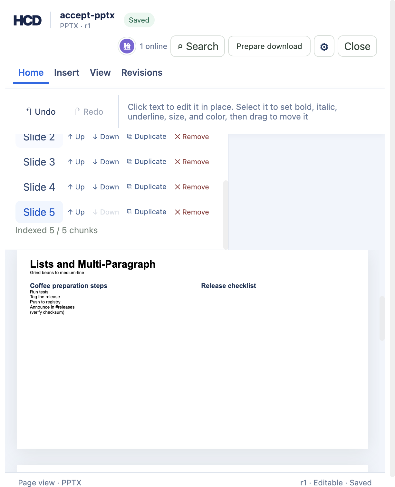
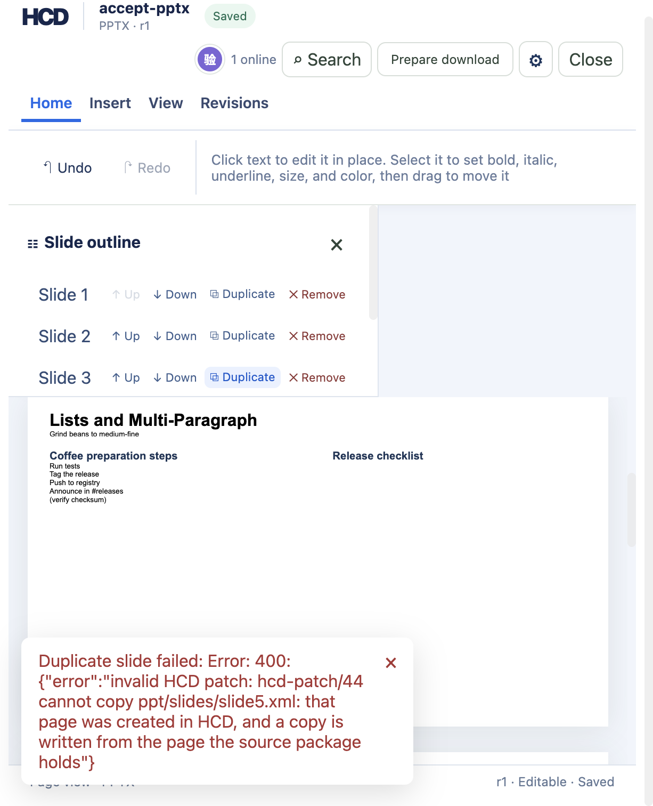

# PPTX 复制幻灯片（hcd-patch/44）

`examples/ppt/textboxes/textboxes-basic.pptx` 导入后有 4 页。幻灯片目录每页一行的行尾有 **⧉ Duplicate**（中文界面 `⧉ 复制`），发送 `hcd-patch/44` 的 `pptx.slide.copy`，只用该行的分片 ID 找到那一页。点第二页行尾的 **⧉ Duplicate** 之后页眉变成 `PPTX · r1`，目录变成 5 行，`已索引 5 / 5 个分片`，副本站在原来那一页的身后，正文和原件一模一样。



副本不是引用：它拿到一个新的部件名（本例是 `ppt/slides/slide5.xml`，源包里从来没有过）、自己的一份关系表、清单里自己的一条 `<p:sldId>`、内容类型里自己的一条 Override，页里每个节点的 ID 也按新部件重算，所以副本可以自己改而不带动原件。

## 复现

```bash
cargo build -p officecli
mkdir -p /tmp/hcd-44-accept/sources /tmp/hcd-44-accept/logs
cp examples/ppt/textboxes/textboxes-basic.pptx /tmp/hcd-44-accept/sources/accept-pptx.pptx
target/debug/officecli hdoc import /tmp/hcd-44-accept/sources/accept-pptx.pptx \
  --output /tmp/hcd-44-accept/accept-pptx.hcd --document-id accept-pptx
target/debug/officecli hdoc validate /tmp/hcd-44-accept/accept-pptx.hcd
```

用同一个 `HCD_TOKEN_SECRET`（≥32 字节）开三个终端：

```bash
HCD_TOKEN_SECRET='replace-with-a-private-random-secret-at-least-32-bytes' \
  target/debug/officecli hdoc serve --root /tmp/hcd-44-accept --bind 127.0.0.1:8766
```

```bash
cd examples/hdoc/editor
HCD_TOKEN_SECRET='the-same-private-secret' HCD_API_URL=http://127.0.0.1:8766 npm run sidecar
```

```bash
cd examples/hdoc/editor
HCD_DEMO_ROOT=/tmp/hcd-44-accept HCD_TOKEN_SECRET='the-same-private-secret' npm run dev
```

打开 `http://127.0.0.1:8767/`，语言选 English (US)，在“本地验收文档”里点 **产品发布演示**，展开幻灯片目录，点第二页行尾的 **⧉ Duplicate**。页眉 `PPTX · r1`，目录 5 行、`Indexed 5 / 5 chunks`，第三行是副本，正文与第二页相同。

再点第三行（也就是那个副本）行尾的 **⧉ Duplicate**，界面报错、修订不动，页眉仍是 `PPTX · r1`：

```
Duplicate slide failed: Error: 400: {"error":"invalid HCD patch: hcd-patch/44 cannot copy
ppt/slides/slide5.xml: that page was created in HCD, and a copy is written from the page
the source package holds"}
```



## 修订与导出检查

```bash
target/debug/officecli hdoc get-revision /tmp/hcd-44-accept/accept-pptx.hcd 1 --json | python3 -c "
import json,sys
record = json.load(sys.stdin)['data']
print(record['chunkCount'], record['slideCopies'], len(record['dirtyChunkIds']),
      len(record['dirtyNodeIds']), record['dirtySourceParts'])
"
target/debug/officecli hdoc validate /tmp/hcd-44-accept/accept-pptx.hcd
target/debug/officecli hdoc export /tmp/hcd-44-accept/accept-pptx.hcd --revision 1 \
  --source /tmp/hcd-44-accept/sources/accept-pptx.pptx --output /tmp/hcd-44-accept/deck-r1.pptx \
  --fidelity-report /tmp/hcd-44-accept/report-r1.json
```

实测输出：修订 1 记录 `chunkCount = 5`（4 → 5，只多副本那一页的分片）、`slideCopies = [{"slidePart": "ppt/slides/slide5.xml", "sourceSlidePart": "ppt/slides/slide2.xml"}]`、`dirtyChunkIds` 1 个（副本那一页的分片）、`dirtyNodeIds = []`、`dirtySourceParts = []`——复制不改写任何已有内容，只是多出一页。校验通过；导出保真 `HIGH`，告警码 `PPTX_SLIDE_COPY`：

```
slide ppt/slides/slide5.xml was copied in HCD from ppt/slides/slide2.xml; the export wrote
that page again under a name the source package did not carry, with its own relationship list,
entry in the presentation's slide list, and content-type override; what this history wrote on
the page it was copied from after the copy was made does not reach it
```

```bash
python3 - <<'PY'
import re, zipfile
src = zipfile.ZipFile('/tmp/hcd-44-accept/sources/accept-pptx.pptx')
out = zipfile.ZipFile('/tmp/hcd-44-accept/deck-r1.pptx')
s, o = set(src.namelist()), set(out.namelist())
kept = {n for n in s & o if src.read(n) == out.read(n)}
print(f'{len(s)} -> {len(o)} 条目，逐字节一致 {len(kept)}')
print('新增', sorted(o - s), '改写', sorted((s & o) - kept))
print('副本 == 源页:', out.read('ppt/slides/slide5.xml') == src.read('ppt/slides/slide2.xml'))
print('副本关系表 == 源页关系表:',
      out.read('ppt/slides/_rels/slide5.xml.rels') == src.read('ppt/slides/_rels/slide2.xml.rels'))
rels = {}
for m in re.finditer(r'<Relationship\b[^>]*/>', out.read('ppt/_rels/presentation.xml.rels').decode()):
    text = m.group(0)
    rels[re.search(r'\bId="([^"]+)"', text).group(1)] = re.search(r'\bTarget="([^"]+)"', text).group(1)
def part(target):
    target = target.lstrip('/')
    return target if target.startswith('ppt/') else 'ppt/' + target
order = [part(rels[rid]) for rid in
         re.findall(r'<p:sldId[^>]*\br:id="([^"]+)"', out.read('ppt/presentation.xml').decode())]
print('清单顺序', order)
print('副本有内容类型 Override:',
      'PartName="/ppt/slides/slide5.xml"' in out.read('[Content_Types].xml').decode())
PY
target/debug/officecli hdoc import /tmp/hcd-44-accept/deck-r1.pptx \
  --output /tmp/hcd-44-accept/reimport.hcd --document-id reimport44
target/debug/officecli hdoc validate /tmp/hcd-44-accept/reimport.hcd
```

实测输出：条目 `27 → 29`，24 个部件逐字节不变，新增的只有副本那一页和它的关系表，改写的只有 `[Content_Types].xml`、`ppt/presentation.xml`、`ppt/_rels/presentation.xml.rels` 这三个控制部件；副本页和它的关系表与源包里那一页逐字节一致；清单顺序 `slide1, slide2, slide5, slide3, slide4`，也就是副本紧挨在原页身后；内容类型里能看到 `/ppt/slides/slide5.xml` 的 Override。导出结果重新导入并校验通过。

副本拿到的是自己的新条目，原页的条目一个字都不动：

```
ppt/_rels/presentation.xml.rels  +  <Relationship Id="rId3" … Target="slides/slide5.xml"/>
ppt/presentation.xml             +  <p:sldId id="260" r:id="rId3"/>
```

`rId3` 在这份包里没被用过（源包既有 `rId1`，也有 `R82ee15e02cb14f15` 这种 GUID 写法的关系 ID，新 ID 取数值最大的 `rIdN` 往后数），`260` 是原清单最大 `id` 259 的下一号，条目插在 `<p:sldId r:id="Rd58ec9132ef1410d">`（第二页）之后，也就是索引要的顺序。核对顺序要先从幻灯片清单取 `r:id`、再去关系表查部件，目标写成绝对路径（`/ppt/slides/slide1.xml`）还是相对路径（`slides/slide5.xml`）都算得出来。

## 在副本上打字

副本能自己改，是这一片要证明的重点，也是它和“引用同一页”的区别。用 CLI 补一个修订，把副本第一行的前面加几个字（`nodeId` 是副本自己的节点 ID，不是原页的）：

```bash
cat > /tmp/hcd-44-accept/edit-copy.json <<'JSON'
{"schemaVersion": "hcd-patch/1", "documentId": "accept-pptx", "patchId": "copy-only-edit",
 "baseRevision": 1, "actor": {"client": "cli-acceptance"}, "metadata": {},
 "operations": [{"op": "text.splice", "nodeId": "n_713df9dfa7e4d537ebd81fdb6d04ae3e",
   "start": 0, "deleteCount": 0, "insertText": "副本上改的：",
   "precondition": {"nodeHash": "0c9319289adf41dcea362213c187465423a29a316a4bd9a8128a497f54a7bf1a"}}]}
JSON
target/debug/officecli hdoc apply /tmp/hcd-44-accept/accept-pptx.hcd \
  --patch /tmp/hcd-44-accept/edit-copy.json --expected-revision 1
target/debug/officecli hdoc get-revision /tmp/hcd-44-accept/accept-pptx.hcd 2 --json | python3 -c "
import json,sys
record = json.load(sys.stdin)['data']
print(record['chunkCount'], len(record['dirtyChunkIds']), record['dirtyNodeIds'], record['dirtySourceParts'])
"
target/debug/officecli hdoc export /tmp/hcd-44-accept/accept-pptx.hcd \
  --source /tmp/hcd-44-accept/sources/accept-pptx.pptx --output /tmp/hcd-44-accept/deck-r2.pptx \
  --fidelity-report /tmp/hcd-44-accept/report-r2.json
```

实测输出：修订 2 记录 `chunkCount = 5`、`dirtyChunkIds` 1 个、`dirtyNodeIds = ["n_713df9…"]`、`dirtySourceParts = ["ppt/slides/slide5.xml"]`。导出 `HIGH`，包形状和修订 1 一样（`27 → 29`，24 个部件逐字节不变，只改三个控制部件），但内容分开了：

```bash
python3 - <<'PY'
import re, zipfile
src = zipfile.ZipFile('/tmp/hcd-44-accept/sources/accept-pptx.pptx')
out = zipfile.ZipFile('/tmp/hcd-44-accept/deck-r2.pptx')
first = lambda p: re.findall(r'<a:t>(.*?)</a:t>', out.read(p).decode())[0]
print('副本第一行:', first('ppt/slides/slide5.xml'))
print('原页第一行:', first('ppt/slides/slide2.xml'))
print('原页逐字节未变:', out.read('ppt/slides/slide2.xml') == src.read('ppt/slides/slide2.xml'))
PY
```

```
副本第一行: 副本上改的：Lists and Multi-Paragraph
原页第一行: Lists and Multi-Paragraph
原页逐字节未变: True
```

告警尾巴换成说明这一页带着自己的改动：

```
…; the copy carries the edits this history wrote on it, rebuilt onto the page it was made from
```

副本在源包里没有部件可就地改写，所以导出把它要复制的那一页当底本重跑一遍：定位文字用的是节点源锚里记的文本栏序号，副本又是那一页的逐字节拷贝，同一个序号在两页上数的就是同一个文本栏，所以改动只落在副本上，页面上的字体、颜色、旋转和另外的栏都不动。这条路径以前是坏的——修订 2 的导出直接报 `validation error: failed to read part: ppt/slides/slide5.xml: specified file not found in archive`，因为部件重算那一段拿着脏部件名去源包里读，而副本那个名字源包从来没有；现在先把“哪些副本还站着”算清楚再重算部件，脏的副本改用原页当底本。

```bash
target/debug/officecli hdoc import /tmp/hcd-44-accept/deck-r2.pptx \
  --output /tmp/hcd-44-accept/reimport-r2.hcd --document-id reimport44r2
target/debug/officecli hdoc validate /tmp/hcd-44-accept/reimport-r2.hcd
target/debug/officecli hdoc extract-text /tmp/hcd-44-accept/reimport-r2.hcd --json | python3 -c "
import json,sys
seen = []
for entry in json.load(sys.stdin)['data']['entries']:
    part = entry['source']['part']
    if part not in seen: seen.append(part)
print(seen)
"
```

导出结果重新导入并校验通过（`issues: []`，`valid: true`），索引里的页序是 `slide1, slide2, slide5, slide3, slide4`：还是 5 页，副本仍在第三位，带着自己那行改动。

## 边界

补丁与导出都宁可拒绝也不写坏文件。`cargo test -p hcd-core -p hcd-formats` 通过 67 + 133 项，其中本片是补丁侧 `patch::tests::pptx_slide_copy_duplicates_a_page_right_behind_the_original`、`pptx_slide_copy_copies_every_chunk_of_a_page_that_spans_two`、`pptx_slide_copy_twice_names_each_copy_by_its_own_part`、`pptx_slide_copy_needs_the_page_and_the_version_it_addresses`、`pptx_slide_copy_refuses_a_page_hcd_created_or_hcd_rewrote`，导出侧 `pptx::tests::a_copied_page_is_written_as_a_slide_part_the_package_did_not_carry`、`an_edit_on_a_copied_page_is_rebuilt_onto_the_page_it_was_made_from`、`a_copy_outlives_the_page_it_was_made_from`、`a_page_copied_and_deleted_again_writes_the_package_unchanged`、`a_page_that_points_at_nothing_copies_with_an_empty_relationship_list`、`a_page_whose_relationship_list_names_a_notes_page_is_not_copied`：

- 副本与原页各自独立，而且是单向的：复制之后在原页上写的东西不会进副本，因为副本是从源包那一页写的。反过来说，一页若是本次历史写过的，就不能再拿来复制，报 `hcd-patch/44 cannot copy {page} yet: revision {n} rewrote that page in HCD, and a copy is written from the page the source package holds`；HCD 自己新建的页、以及已经复制出来的副本，也照样拒绝（上面截图实测的是 `that page was created in HCD` 这一条）。
- 副本的关系表只允许三类指向：版式（`ppt/slideLayouts/`）、图片（`ppt/media/`）、嵌入字体（`ppt/fonts/`）——这些本来就能被两页共用。指向备注页、图表、嵌入对象这类只属于那一页的资源时拒绝导出，报 `PPTX slide copy cannot duplicate {page}: its relationship {id} points at {target}, which belongs to that page alone; remove it in PowerPoint or WPS and export again`，因为一份资源被两页指着是应用打开就要修复的包。
- 一页若是什么都不指向（手写的或最小的包里常有），源包就没有它的关系表，导出给副本写一份空的 `<Relationships/>`，让它的名字照样解析。
- 复制后又删掉这一页 → 两个记录相互抵消，导出与源包逐字节一致，告警 `slide {page} was copied and deleted inside this history; the export wrote no slide part for it`；只删原页、副本留下 → 副本还在，内容还是复制时那一页（`a_copy_outlives_the_page_it_was_made_from`），这时源包的那一页在导出末尾才被拿走，所以副本还读得到。
- 一页被拆成多个分片时，复制的是整页：连续同一个 `data-hcd-source-part` 的分片算一页（`pptx_slide_copy_copies_every_chunk_of_a_page_that_spans_two`）。本例的每页都是单分片，拆分页只有 Rust 覆盖。
- 副本要站在原页身后，走的是重排那片（`hcd-patch/43`）改写 `<p:sldIdLst>` 的同一条路径，所以源包带分节（`p:sectionLst`）时同样拒绝导出。这条实际走不到：导入器现在读不了分节的 deck（节里的 `<p:sldId>` 不带关系 ID，导入直接报 `presentation slide entry has no relationship id`），留出的是导出侧的第二道网。
- 浏览器里点副本正文会被 `button.fixed-page-hitbox` 挡住（报 `Element … is covered by <button.fixed-page-hitbox inside div#hcd-page-2>`）：副本忠实复刻了原页本来就重叠的命中区，界面上这一页的文字点不中。正文改写因此用 CLI 那条 `text.splice` 走通，包里的结果按上面的脚本核对。
- 分片 ID、页、版本对不上，或一条补丁里又想复制又想删、又想复制又想移，都拒绝（`pptx_slide_copy_needs_the_page_and_the_version_it_addresses`）。
