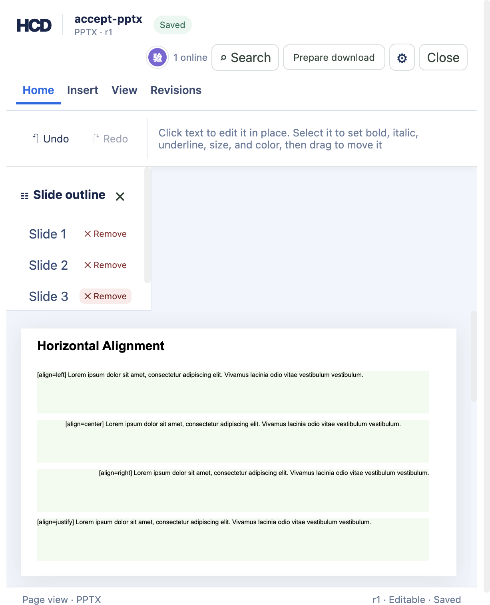

# PPTX 删除幻灯片（hcd-patch/42）

`examples/ppt/textboxes/textboxes-basic.pptx` 导入后有 4 页。幻灯片目录每一页一行，行尾的 **✕ 删除**（英文界面 `✕ Remove`）发送 `hcd-patch/42` 的 `pptx.slide.delete`，用该行的分片 ID 指定要删掉的页；删完后目录只剩 3 行，修订号走到 r1。没有确认弹窗：这只是一次普通修订，撤销和修订历史都能把页找回来。



## 复现

```bash
cargo build -p officecli
mkdir -p /tmp/hcd-42-accept/sources /tmp/hcd-42-accept/logs
cp examples/ppt/textboxes/textboxes-basic.pptx /tmp/hcd-42-accept/sources/accept-pptx.pptx
target/debug/officecli hdoc import /tmp/hcd-42-accept/sources/accept-pptx.pptx \
  --output /tmp/hcd-42-accept/accept-pptx.hcd --document-id accept-pptx
target/debug/officecli hdoc validate /tmp/hcd-42-accept/accept-pptx.hcd
```

用同一个 `HCD_TOKEN_SECRET`（≥32 字节）开三个终端：

```bash
HCD_TOKEN_SECRET='replace-with-a-private-random-secret-at-least-32-bytes' \
  target/debug/officecli hdoc serve --root /tmp/hcd-42-accept --bind 127.0.0.1:8766
```

```bash
cd examples/hdoc/editor
HCD_TOKEN_SECRET='the-same-private-secret' HCD_API_URL=http://127.0.0.1:8766 npm run sidecar
```

```bash
cd examples/hdoc/editor
HCD_DEMO_ROOT=/tmp/hcd-42-accept HCD_TOKEN_SECRET='the-same-private-secret' npm run dev
```

打开 `http://127.0.0.1:8767/`，在“本地验收文档”里点 **产品发布演示**，点第三页行尾的 **✕ 删除**。页眉变为 `PPTX · r1`，目录剩 `Slide 1 / Slide 2 / Slide 3` 三行，底部 `已索引 3 / 3 个分片`，浏览器控制台无报错。

## 修订与导出检查

```bash
target/debug/officecli hdoc get-revision /tmp/hcd-42-accept/accept-pptx.hcd 1 --json | python3 -c "
import json,sys
record = json.load(sys.stdin)['data']
print(record['chunkCount'], record['slideRemovals'], len(record['dirtyNodeIds']), record['dirtySourceParts'])
"
target/debug/officecli hdoc validate /tmp/hcd-42-accept/accept-pptx.hcd
target/debug/officecli hdoc export /tmp/hcd-42-accept/accept-pptx.hcd \
  --source /tmp/hcd-42-accept/sources/accept-pptx.pptx --output /tmp/hcd-42-accept/deck-r1.pptx \
  --fidelity-report /tmp/hcd-42-accept/report-r1.json
```

实测输出：修订 1 记录 `chunkCount = 3`、`slideRemovals = [{"slidePart": "ppt/slides/slide3.xml"}]`，随页离开的 17 个文字节点与 `dirtySourceParts = ["ppt/slides/slide3.xml"]` 成对出现，校验通过；导出保真 `HIGH`，告警码 `PPTX_SLIDE_DELETE`。

```bash
python3 - <<'PY'
import zipfile
source = zipfile.ZipFile('/tmp/hcd-42-accept/sources/accept-pptx.pptx')
export = zipfile.ZipFile('/tmp/hcd-42-accept/deck-r1.pptx')
kept = [name for name in source.namelist() if name in export.namelist() and source.read(name) == export.read(name)]
print(len(source.namelist()), len(export.namelist()), len(kept))
print(sorted(set(source.namelist()) - set(kept) - {'ppt/slides/slide3.xml', 'ppt/slides/_rels/slide3.xml.rels'}))
print(export.read('ppt/presentation.xml').decode().count('p:sldId id') // 2)
PY
target/debug/officecli hdoc import /tmp/hcd-42-accept/deck-r1.pptx --output /tmp/hcd-42-accept/reimport.hcd --document-id reimport-pptx
target/debug/officecli hdoc validate /tmp/hcd-42-accept/reimport.hcd
```

实测输出：包内条目 `27 → 25`，22 个保留部件逐字节不变，改动的只有 `[Content_Types].xml`、`ppt/_rels/presentation.xml.rels`、`ppt/presentation.xml` 三张清单，`<p:sldId>` 剩 3 条；导出结果重新导入得到 3 个分片且校验通过。

## 边界

补丁与导出都宁可拒绝也不写坏文件，以下情况在 Rust 测试里逐条覆盖（`cargo test -p hcd-core -p hcd-formats`，`pptx::tests::deleting_a_slide_*` 与 `patch::tests::pptx_slide_deletion_*`）：

- deck 只剩一页时拒绝，报 `PPTX presentation must keep one slide`；界面上按钮仍可点，错误进提示条，因为客户端无法只看索引就区分“一页”和“一页被拆成多片”。
- 分片不在索引里、或那个分片不是页面，拒绝。
- 一页的表格被拆成多个分片时，行尾按钮删的是整页：补丁会找出指向同一个源部件的全部分片。
- 源包带自定义放映（`p:custShowLst`）或分节（`p:sectionLst`）时拒绝导出，先去掉再导；源包没有该页部件、或部件名不是幻灯片时也拒绝。分节那一条不在已有测试里，而且现在也造不出来：导入器读不了分节的 deck（节里的 `<p:sldId>` 不带关系 ID，导入直接报 `presentation slide entry has no relationship id`），导出侧留出的是第二道网。
- 幻灯片带备注页时拒绝导出：备注的关系列表反向指着这一页，删掉页就留下悬空引用。错误文案点名是哪个 `.rels` 还指着它。
- 只在本次历史里新增又删除的页互相抵消，导出回到 `EXACT`，三张清单逐字节等于源包。
- 撤销走的是结构性修订：`hdoc restore --revision 0 --expected-revision 1` 生成修订 2 后，`hdoc export --source` 得到 `EXACT`，包内 27 个条目与源包逐字节一致，被删的页原样回来。删除记录只属于它自己那条修订，撤销不需要额外补偿逻辑。
