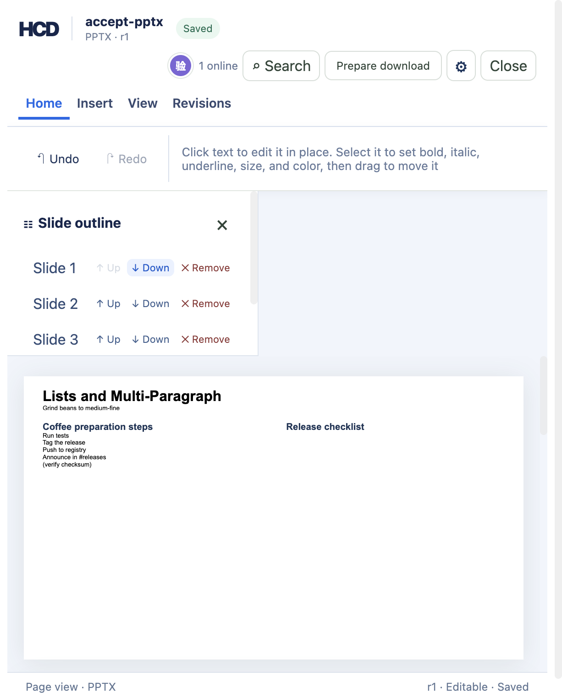

# PPTX 移动幻灯片（hcd-patch/43）

`examples/ppt/textboxes/textboxes-basic.pptx` 导入后有 4 页。幻灯片目录每页一行的行尾有 **↑ 上移** 与 **↓ 下移**（英文界面 `↑ Up` / `↓ Down`），发送 `hcd-patch/43` 的 `pptx.slide.reorder`，用该行的分片 ID 加上 `direction` 指定往哪一格走。点第一页的 **↓ 下移** 之后页眉变成 `PPTX · r1`，正文第一页从 `Horizontal Alignment` 变成 `Lists and Multi-Paragraph`，目录仍是 4 行，`已索引 4 / 4 个分片`。第一页的 ↑ 与最后一页的 ↓ 是禁用状态，不需要请求就能知道走不动。



移动不新增也不减少任何东西：部件、关系、内容类型都保持原名，改的只有 `ppt/presentation.xml` 里 `<p:sldIdLst>` 条目站的顺序，所以导出后其余部件逐字节不变。

## 复现

```bash
cargo build -p officecli
mkdir -p /tmp/hcd-43-accept/sources /tmp/hcd-43-accept/logs
cp examples/ppt/textboxes/textboxes-basic.pptx /tmp/hcd-43-accept/sources/accept-pptx.pptx
target/debug/officecli hdoc import /tmp/hcd-43-accept/sources/accept-pptx.pptx \
  --output /tmp/hcd-43-accept/accept-pptx.hcd --document-id accept-pptx
target/debug/officecli hdoc validate /tmp/hcd-43-accept/accept-pptx.hcd
```

用同一个 `HCD_TOKEN_SECRET`（≥32 字节）开三个终端：

```bash
HCD_TOKEN_SECRET='replace-with-a-private-random-secret-at-least-32-bytes' \
  target/debug/officecli hdoc serve --root /tmp/hcd-43-accept --bind 127.0.0.1:8766
```

```bash
cd examples/hdoc/editor
HCD_TOKEN_SECRET='the-same-private-secret' HCD_API_URL=http://127.0.0.1:8766 npm run sidecar
```

```bash
cd examples/hdoc/editor
HCD_DEMO_ROOT=/tmp/hcd-43-accept HCD_TOKEN_SECRET='the-same-private-secret' npm run dev
```

打开 `http://127.0.0.1:8767/`，语言选 English (US)，在“本地验收文档”里点 **产品发布演示**，点第一页行尾的 **↓ Down**。页眉 `PPTX · r1`，正文第一页标题变为 `Lists and Multi-Paragraph`，浏览器控制台无报错。再点第二页行尾的 **↑ Up** 把这一页移回原位，页眉 `PPTX · r2`，正文第一页回到 `Horizontal Alignment`。

## 修订与导出检查

```bash
target/debug/officecli hdoc get-revision /tmp/hcd-43-accept/accept-pptx.hcd 1 --json | python3 -c "
import json,sys
record = json.load(sys.stdin)['data']
print(record['chunkCount'], record['slideReorders'], len(record['dirtyChunkIds']),
      len(record['dirtyNodeIds']), record['dirtySourceParts'])
"
target/debug/officecli hdoc validate /tmp/hcd-43-accept/accept-pptx.hcd
target/debug/officecli hdoc export /tmp/hcd-43-accept/accept-pptx.hcd \
  --source /tmp/hcd-43-accept/sources/accept-pptx.pptx --output /tmp/hcd-43-accept/deck-r1.pptx \
  --fidelity-report /tmp/hcd-43-accept/report-r1.json
```

实测输出：修订 1 记录 `chunkCount = 4`、`slideReorders = [{"slidePart": "ppt/slides/slide1.xml"}]`、`dirtyChunkIds` 2 个（换位的两页）、`dirtyNodeIds = []`、`dirtySourceParts = []`——移动不重写任何 HTML 分片，也不动源部件的内容。校验通过；导出保真 `HIGH`，告警码 `PPTX_SLIDE_REORDER`：

```
slide ppt/slides/slide1.xml was moved in HCD; the export rewrote the presentation's
slide list to the order the HCD index holds, which puts this page at position 2
```

```bash
python3 - <<'PY'
import re, zipfile
src = zipfile.ZipFile('/tmp/hcd-43-accept/sources/accept-pptx.pptx')
out = zipfile.ZipFile('/tmp/hcd-43-accept/deck-r1.pptx')
def order(package):
    entries = re.findall(r'<p:sldId id="(\d+)" r:id="([^"]+)"',
                         package.read('ppt/presentation.xml').decode())
    rels = dict(re.findall(r'Target="/?(ppt/slides/slide\d+\.xml)" Id="([^"]+)"',
                           package.read('ppt/_rels/presentation.xml.rels').decode()))
    return [(rid, rels.get(rel, '?')) for rid, rel in entries]
print('source', order(src))
print('export', order(out))
kept = [name for name in src.namelist() if name in out.namelist() and src.read(name) == out.read(name)]
print(len(src.namelist()), len(out.namelist()), len(kept))
print(sorted(set(src.namelist()) - set(kept)))
PY
target/debug/officecli hdoc import /tmp/hcd-43-accept/deck-r1.pptx \
  --output /tmp/hcd-43-accept/reimport.hcd --document-id reimport43
target/debug/officecli hdoc validate /tmp/hcd-43-accept/reimport.hcd
```

实测输出：条目数 `27 → 27`，26 个部件逐字节不变，改写的只有 `ppt/presentation.xml`；两条换位的条目带着自己原来的 `id` 和 `r:id`，顺序从 `slide1, slide2, slide3, slide4` 变成 `slide2, slide1, slide3, slide4`。这个源包的关系 ID 是 `R82ee15e02cb14f15` 这种形式而不是 `rIdN`，导出要的顺序是先从幻灯片清单读条目、再拿 `r:id` 去关系表里查部件，所以按名字重排对两种写法都成立。导出结果重新导入并校验通过，索引里的顺序就是 `slide2, slide1, slide3, slide4`。

```bash
target/debug/officecli hdoc export /tmp/hcd-43-accept/accept-pptx.hcd \
  --source /tmp/hcd-43-accept/sources/accept-pptx.pptx --output /tmp/hcd-43-accept/deck-r2.pptx \
  --fidelity-report /tmp/hcd-43-accept/report-r2.json
```

移回来之后的修订 2 导出是 `EXACT`，27 个条目与源包逐字节一致，报告里没有 `PPTX_SLIDE_REORDER`：索引顺序回到源包的样子，导出就不碰 `ppt/presentation.xml`。

## 边界

补丁与导出都宁可拒绝也不写坏文件。Rust 侧 `cargo test -p hcd-core -p hcd-formats` 通过 62 + 127 项，其中本片的导出与共享助手是 `pptx::tests::moving_a_page_writes_the_slide_list_in_the_decks_new_order`、`a_page_moved_and_moved_back_writes_the_package_unchanged`、`a_page_hcd_created_moves_through_the_deck_it_joined`、`a_deck_that_grew_moved_and_lost_a_page_exports_all_three` 与 `common::tests` 的 8 项，补丁侧是 `patch::tests::pptx_slide_reorder_*` 4 项：

- 一页的表格被拆成多个分片时，移的是整页：连续的同一个源部件算一页（`pptx_slide_reorder_moves_every_chunk_of_a_page_that_spans_two`）。本例的 4 页都是单分片，拆分页只有 Rust 覆盖。
- deck 只有一页时拒绝，报 `PPTX presentation must hold two slides to move one`；已经在最前或最后时拒绝，报 `... cannot move up: it is already the first page`。界面上这两个按钮直接禁用，只有“全部片都读完了”才能判定最后一行，因为分片是按索引页顺序加载的。
- 分片不在索引里、或那个分片不是页面、方向不是 `up`/`down`、一条补丁里又想移动又想删除，都拒绝。
- 源包带分节（`p:sectionLst`）时拒绝导出，因为节自己另有一份页清单。这条实际走不到：导入器现在读不了分节的 deck（节里的 `<p:sldId>` 不带关系 ID，导入直接报 `presentation slide entry has no relationship id`），所以留出的是导出侧的第二道网，不是已有测试。
- 源包带自定义放映（`p:custShowLst`）时**允许**移动：换位只是重排 `sldIdLst`，放映点名的 `id` 全都还在，不会留下悬空引用。
- 移动过的页若是本次历史里 HCD 新增的页，照样在 deck 里走（新增写在移动之前完成）；新增 + 移动 + 删除同一条历史里也能一起导出，这时新增的页会拿到被删那页放手的 `r:id`，测试因此通过包自己的关系表来核对顺序，而不是假定一定是 `rId3`。
