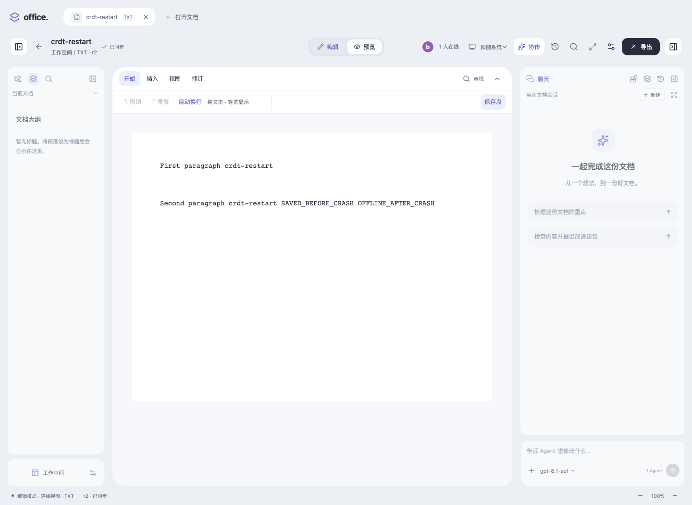
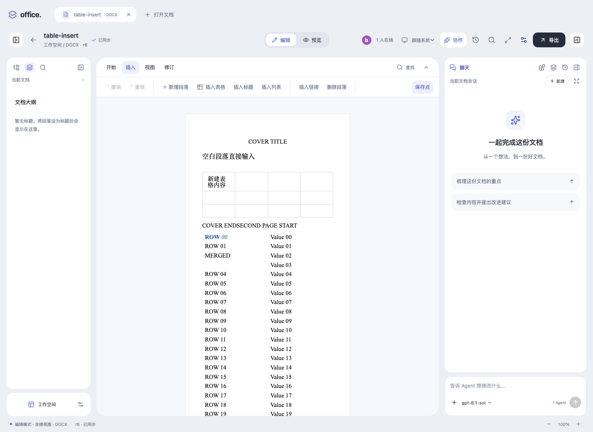
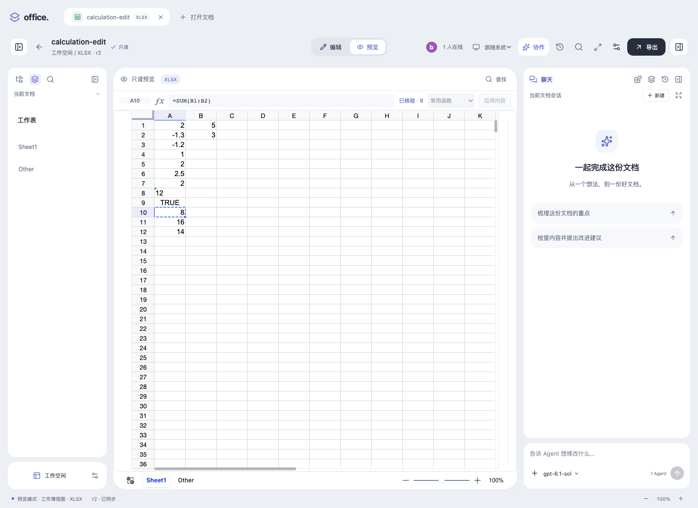
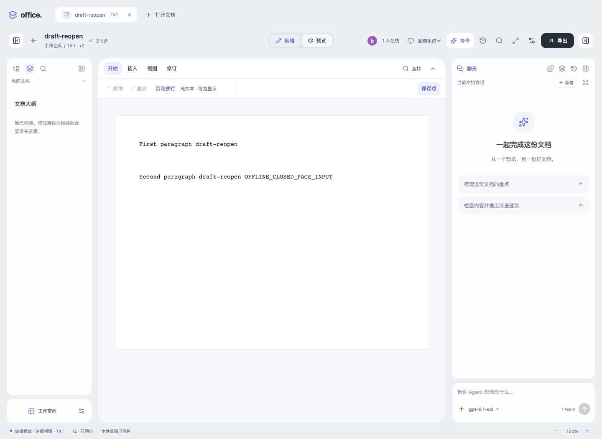
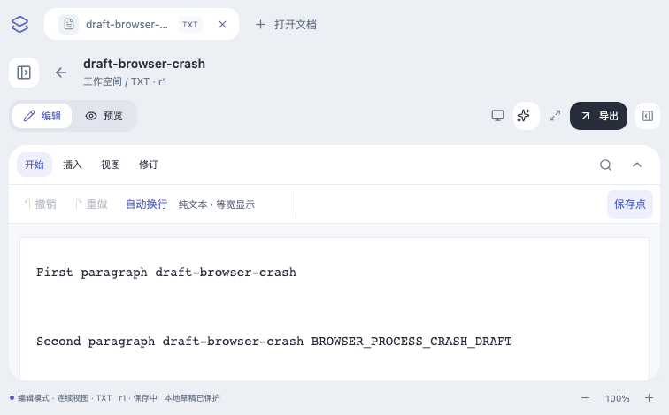
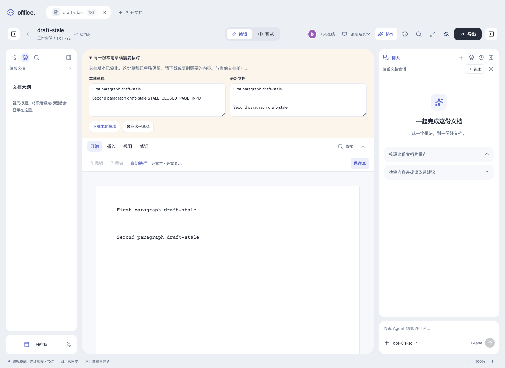
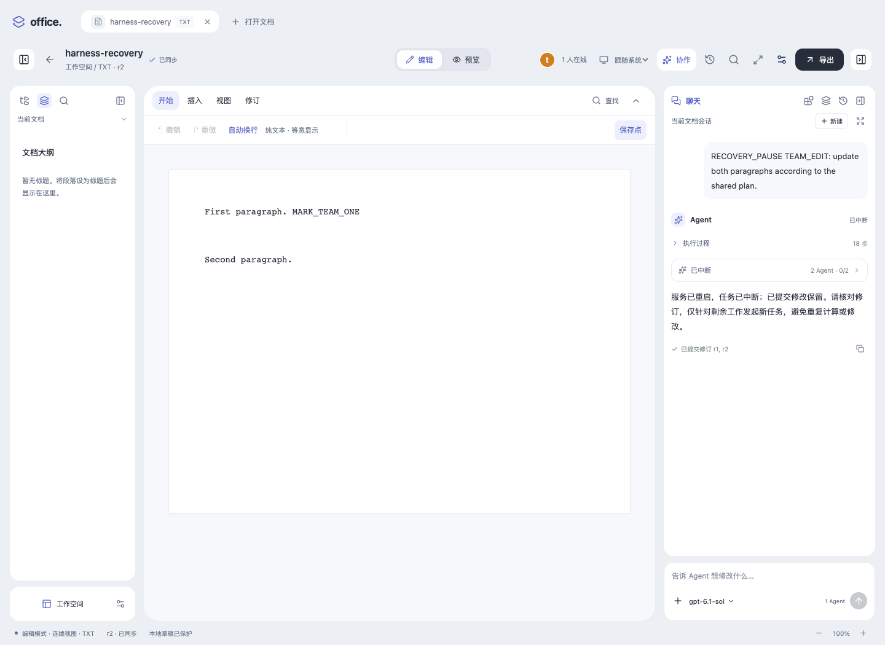

**可靠性建设第一阶段 · 2026-11-15**

最新补充：跨文档 API/MCP 之上已接通工作流抽屉，包含文档/实际内容选择、步骤依赖、后台标签保存检查、核对/执行/停止/续跑/补偿、刷新找回与稳定位置守卫。当前整树 1,048 项 Rust、Clippy/格式、debug 构建、编辑器 standalone/embed 构建与 14 项前端单元通过；组合浏览器回归 39/39，最后补 stdio 可选字段预检和深色样式后受影响的 15/15 项复验通过，详见[面板验收](hcd-cross-document-workflow-ui.zh.md)。两组回归有重复，不累加。单文档续跑、后端工作流及其他阶段保留各自历史结果；整体功能仍未完成，DOCX 结构编辑后的原样排版仍有可见缺口。

完整目标仍见 [建设记录](hcd-reliability-roadmap.zh.md)。本阶段修计算与画布结果、能力协商、语义草稿日志、协同房间身份及任务/租约检查点，并建立回归门禁。第一阶段当时尚未覆盖全部固定/网格/图片草稿、任务重新授权续跑、Office/WPS 复杂排版基准和跨文档 Agent 编排。后续进展见[当前功能状态](hcd-capability-status-2026-11-15.zh.md)，不将历史结果视作所有目标已经完成。

后续已补齐导入布尔/错误/空字符串的类型保留及错误计数语义，修复拒绝操作后的重复提交和计算恢复后残留的错误悬停提示，见[字面值补充验收](hcd-calculation-literal-types.zh.md)。该历史补充记录当时并行集成开发造成的全量编译限制，后续已通过上述全量检查；仍需干净检出/远端 CI 核验，不能把本地大量未跟踪文件的通过结果直接视为已可合并。

**计算与能力协商**

```bash
cargo build -p officecli
python3 docs/acceptance/hcd-capability-audit-2026-11-15/probe_formulas.py
target/debug/officecli capabilities --json
cargo test --workspace --quiet
```

五个原始错误的修复结果为 2、1、2、-1.3、-1.2，复现脚本退出 0；[结果记录](hcd-reliability-phase1/formula-results.json)。工作区 Rust 测试通过；Rust 1.90.0 的 `cargo clippy --all-targets -- -D warnings` 与 `cargo fmt --all -- --check` 也通过。新增回归还检验旧公式缓存、跨表/中文表名、Unicode 数组和比较、错误/循环/过大区域、文本与空白计数，以及负数和负小数位取整。

`officecli-calculation/1` 当前包含 15 个已核验函数。原生 `get` 的结构化计算结果和服务端工作表读取使用相同策略，包括依赖公式的递归检查。现有其他引擎函数保留为兼容预览；未核验值不会成为服务端核验总数。浏览器公式栏显示核验结果和状态，常用函数菜单从服务端契约加载。

能力端点列出 patch schema、对应入口和操作名；它声明协议支持，不替代文档权限、源对象是否可写、版本/hash/epoch 或租约校验。UI、stdio MCP 与内置 Agent 在提交前核对；旧 API 没有能力端点时仍允许读取，编辑会明确提示升级。协议指纹覆盖完整 schema 及计算契约，防止相同操作名但参数定义已改变的服务被继续使用。

**前端与真实服务回归**

```bash
cd examples/hdoc/editor
npm run build
npx tsx --test src/*.test.ts
npx playwright install chromium
npx playwright test e2e/workspace.spec.ts \
  --grep 'calculation contract|protocol preflight|protocol fingerprint|collaboration room identities|table hover controls|insert ribbon creates|editor deletion supports|all seven formats|document tabs retain|workbook preview keeps' \
  --reporter=line
```

本机使用已安装的 Chrome，通过 `HCD_BROWSER_PATH` 指定；CI 安装 Playwright Chromium。该次执行 10 项全部通过，耗时 54.5 秒。测试只启动和强杀测试自己创建的临时目录与子进程，使用随机测试密钥，不接触已有文档和运行服务。

- 原生 CLI、stdio MCP、实际 HTTP 工作表和浏览器选中单元格的核验结果一致。
- 模拟旧服务保留相同 patch 版本但移除 `xlsx.formula.set`；UI 明确报能力不支持，实际编辑 POST 数为 0，修订仍为 0。
- 给服务发送过期指纹和非法 JSON，返回 `409 service_version_changed`，证明在 JSON 反序列化前拒绝，文档未变。
- 表格头部/左侧悬停、行列操作、合并、滚动及 canvas 节点保留没有回归；插表能导出并回读 DOCX。
- 保存后浏览器断网继续输入，真实 `SIGKILL` API 和 sidecar 后重新启动；持久房间 generation 不变，离线内容只合并一次，编辑器 DOM 保留，刷新后内容仍在。

上述 10 项是较早一轮记录。当时截图复核发现无缓存公式格为空白，虽公式栏核验值正确；本轮已补齐核验标量结果到实际 canvas 的同步，并加入实际单元格复制、本地/远端依赖更新、跨表和导出重开检查。详见下文及[最新功能状态](hcd-capability-status-2026-11-15.zh.md)。





这项崩溃测试中浏览器始终存活，因此不能当作 IndexedDB 离线草稿、关闭窗口或任务恢复的验收。PR 工作流已经配置，本地结果不等于 GitHub 上的检查已运行通过。

**本轮新增：公式格显示和语义草稿恢复**

Univer 适配器按修订拉取受核验的标量计算结果，并使用原生计算结果 mutation 刷新缓存；保留数字、文本和布尔类型。不会将显示缓存当作用户编辑产生修订。回归验证旧缓存 777→2、无缓存取整、字符串 `"12"` 和布尔 TRUE、两级依赖、跨表、本地与远端数值修改；实际格复制、公式栏、HTTP/CLI/MCP 及原生 XLSX 导出回读一致，canvas 实例未更换。TRUE 在画布显示为 TRUE，Univer 剪贴板返回其原始标量 1，测试分别核对这两种接口语义。



DOCX/HTML/MD/TXT 语义正文使用 IndexedDB 内容日志，一次房间基线后追加增量 CRDT 更新。基线、更新和 dirty 标记使用原子事务；只有服务端保存点与当前正文一致且期间没有本地输入时才确认。保存点合并更新，Web Locks 防止清理其他活跃编辑器的基线；单日志上限 32 MiB。浏览器不支持 Web Locks 时保留清洁日志，不因此删除正在使用的数据。

恢复前重新鉴权，按 API 地址、稳定服务 ID、用户、文档、epoch 和 generation 隔离；草稿在隔离 Y.Doc 中预检后才合并。旧 epoch/房间及无法解析的日志单独保留，可下载原始内容或日志；不会自动覆盖新版本。日志写入失败有可见提示，服务端未确认当前输入前有关闭保护。浏览器用户清理存储或未完成事务的输入不在持久化保证内。

专项 **9 项通过，19.1 秒**，包括显式切断协同 WebSocket 后关闭页面/强杀自有浏览器进程、只恢复一次、跨用户/服务隔离、恢复历史版本、同 epoch 重建房间、启动或写入中途存储失败、清理 140 条废弃清洁日志时保留活跃基线、损坏日志下载。Chromium 的 HTTP 离线开关可能保留现有 WebSocket，因此测试同时切断协同连接，并检查输入没有到服务端；避免用服务端回读冒充本地恢复。







**本轮新增：任务、共享记录和租约检查点**

任务、事件、共享计划/发现、私有资源映射和租约写入服务目录 `agent-runs/`，文件通过临时文件、fsync 与原子替换提交；Unix 目录权限 0700、文件 0600。密钥、调用方令牌和委派凭证不写入检查点。公开任务 JSON 继续隐藏 owner 和租约令牌。当前内存列表恢复最新 128 项，较旧文件留在磁盘；历史分页/保留策略尚未完成。

启动时将运行/取消中的任务标为“已中断”，保留计划、发现、事件、图文草稿及提交修订，释放旧租约。服务根目录的 OS 锁在任何远端 hydration 前取得，防止同根目录重叠进程；委派凭证绑定服务进程身份，服务重启后旧 worker 的读写请求被拒绝。任务存储失败会停止 Agent 后续写入，人工文档编辑继续使用既有守卫。此方案针对本地单根目录，不是多主机共享存储的分布式接管。

写文档前持久化 patch ID 和预期修订，恢复时结合实际不可变修订核对提交回执，覆盖“文档已提交但作者标记/任务回执尚未写入即崩溃”的窗口。查找受任务身份、精确 patch ID/基础修订及时间约束，并限最近 10,000 个文档修订；不依赖标题或近似修订号。该阶段恢复不会自动重放操作；后续[授权续跑](hcd-agent-continuation.zh.md)已补执行位置和确切 patch hash 核对，[跨文档工作流](hcd-cross-document-workflow.zh.md)另补显式依赖与守卫补偿，仍不等于跨文档原子事务。

新增服务端回归验证检查点失败、损坏记录、根目录排他、共享事实/映射恢复、租约释放、旧 worker 拒绝和回执补齐。真实服务专项强杀 API 进程，重启后验证任务/修订/共享内容、owner 隔离、可见中断状态，以及新任务可继续编辑。

扩展回归另复现了执行器与心跳同处一个 select 分支时的公平锁等待问题：执行器已排队等待任务锁，心跳排在其后，而父任务停止轮询执行器，导致长期“执行中”。已将心跳放入生命周期受 JoinSet 管理的独立任务；取消轮询不取得任务锁，结束时撤销并等待心跳退出。新增公平锁和取消专项回归。



扩展首次运行 39 项中 37 项通过，2 项失败：上述心跳锁等待，以及表格测试用较新的节点 hash 搭配旧投影修订提交。后者已改为使用同一次节点读取的修订与 hash。修复后重跑并发、取消、任务强杀、表格及错误状态解释 **12 项全部通过，32.2 秒**。

最终扩展至 **46 项全部通过（2.9 分钟）**，增加 7 格式 Harness 编辑回读/导出、三 Agent 完整 PPT 替换、四页错误计划纠正成十页图文 PPT、Word 表格/排版/远端局部更新和撤销。确定性模型用本地脚本提供响应，实际 API、鉴权、MCP、文档操作、图片制作占位和导出链路均运行；不代表重新认证真实模型供应商或所有内容质量。

完整 `cargo +1.90.0 test --workspace --quiet` **1,024 项通过**；Rust 1.90.0 Clippy/格式、编辑器独立/嵌入与管理端构建、8 项前端单元检查和 5 项原生公式探针通过。下面命令可复现新恢复专项；完整门禁选择器见 [.github/workflows/hcd-regression.yml](../../.github/workflows/hcd-regression.yml)。该工作流尚无远端运行通过记录。

最后对已脱离房间的保存回包增加生命周期守卫，避免 epoch 切换重置计数后误确认新房间草稿；重新构建编辑器并复测语义恢复/epoch/表格 **6 项通过（19.1 秒）**。结构化结果见 [reliability-results.json](hcd-reliability-phase1/reliability-results.json)。

```bash
cargo +1.90.0 test -p officecli hdoc_server::agent_
cd examples/hdoc/editor
npx playwright test e2e/workspace.spec.ts e2e/agent-harness.spec.ts e2e/agent-run-status.spec.ts \
  --grep 'verified grid caches|offline content journal|killed browser process|quarantines an older|browser storage failures|failed journal write|rebuilt collaboration room|journal maintenance|unreadable local journal|offline journals stay|API SIGKILL|two model agents preserve|restored interrupted task' \
  --reporter=line
```


## 固定版式与网格未提交输入补充

PDF/PPTX 文字与新框位置、XLSX 公式栏及原生未确认单元格输入已补持久日志与鉴权/版本/目标守卫。20 项组合浏览器回归全部通过（1.4 分钟），其中 10 项为新增输入日志专项；当前整树 Rust 测试、编辑器独立/嵌入构建与 8 项前端单元检查通过。Clippy 仍被宿主集成模块 `policy.rs:143` 的 `collapsible_if` 阻断，格式检查也有宿主集成相关差异；当前门禁不能认定全部通过。详细证据及边界见[未提交输入恢复](hcd-uncommitted-input-recovery.zh.md)。整体五项目标保持未完成。
