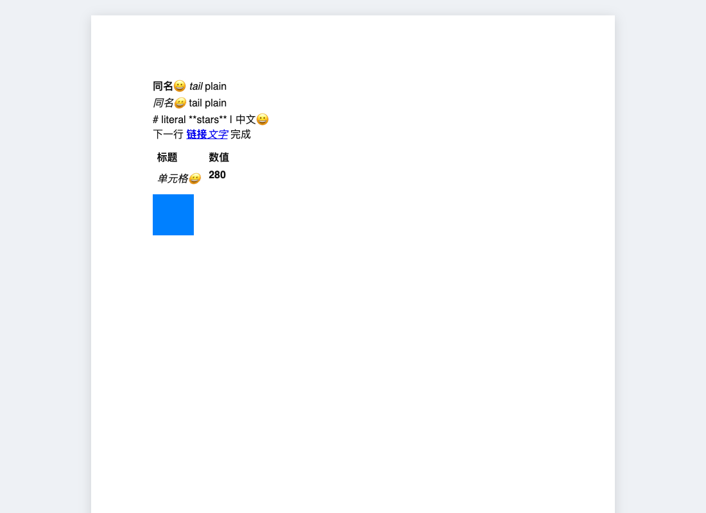
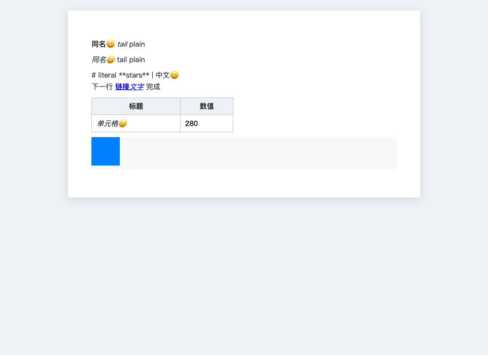

# 源文件缺席时的行内格式转换验收

2026-11-15，`feature/hcd-font-format-integration`、HEAD `ccb5fd5` 的未提交工作区。整体功能仍未完成，完整支持范围见[当前状态](hcd-capability-status-2026-11-15.zh.md)。本轮没有提交代码或重启日常服务。

## 修复范围

此前 DOCX 的已映射文字修改已能保留源段落和原生导出，但源文件缺席时，转换器仍把 HTML 块与单元格读取为纯文字，混合粗斜体再次丢失。本轮按具体块、表格行列和规范化 UTF-8 文字范围记录行内样式，支持粗斜体标签及 `font-weight` / `font-style` 的继承、显式 normal 和局部优先级。不通过内容相同来寻找目标，重复中文/emoji 段落可分别带不同样式。

- DOCX 直接通过原生段落、表格与 run 构造，批量写入普通节点；链接走带关系注册的操作。正文的 `#`、`**`、表格中的竖线不会再被当成 Markdown 重解释；换行和制表符使用原生节点。图片保留为独立段落，避免与表格内的段落序号混淆。
- XLSX 写原生 inline-string 富文本 run；PPTX 按生成时的行序号和表格窗口源坐标写 DrawingML run，长表重复表头保持正确样式。
- Markdown 使用受限行内标签表示相邻粗斜体及 normal 覆盖，避免 Markdown 分隔符歧义。导入只接受无属性的允许标签及三种确切 normal 样式，限制嵌套、核对闭合并在语义边界补齐；其他 HTML 仍作为字面内容。换行规范化成 XML 可校验的 `<br/>`。
- DOCX 导入增加对直接 run 属性中“显式取消粗体/斜体”的区分；此前它与未指定属性混为一类。样式定义的既有级联逻辑保持独立；这不代表完整 Word toggle / 样式继承已认证。
- 样式片段跟随空白规范化、首尾裁剪、稀疏单元格地址与连续表格分片调整。嵌套和片段数有上限；追加内容只检查新增文字的控制字符，避免每次追加都扫描此前的整段。

导出结果继续标为 **SEMANTIC**。本轮没有把语义转换升级为原样排版或无损转换。

## 验证

最终 Rust 整树 **1,060 项通过**（含 doctests，新增 8 项），Clippy `--all-targets -- -D warnings`、全量格式、debug 构建与 diff 检查通过。47 项转换器专项包含在整树计数中。当前没有前端源码变化，未重复编辑器/管理端构建或前端单元；上一阶段的结果见[源 DOCX 行内保真](hcd-docx-inline-fidelity.zh.md)。

最终浏览器组合 **13/13（49.7 秒）**：覆盖七格式 Harness 编辑、Word 混合样式/分页、导出菜单与版本选项，以及插表后原生导出。使用隔离的 API、sidecar、Chrome 和确定性模型替身，不认证真实供应商可用性或任意任务质量。

[命令行探针](hcd-semantic-inline-fidelity/probe_semantic_inline.py)使用[公开合成样本](hcd-semantic-inline-fidelity/fixture.html)，先直接转换为原生 DOCX，再通过图片操作附加栅格，随后导入 HCD 并在不提供原件的情况下导出 DOCX/XLSX/PPTX/Markdown。这个准备步骤明确绕开 HTML 导入的既有简化，不能据此认定 HTML → HCD 已保真。

[机器结果](hcd-semantic-inline-fidelity/cli-results.json)核对原生 OOXML 的粗斜体开关、重复文字、DOCX 链接关系、图片不进入表格、各格式重新导入和 bundle 校验；Markdown 还再次转成 DOCX，核对原生 run。专项单元另覆盖分片表格、稀疏坐标、长表窗口与重复表头、嵌套/片段上限及不安全/未平衡标签。

另用[既有真实文件探针](hcd-docx-inline-fidelity/probe_inline_fidelity.py)重跑公开提案及用户合同 DOCX、合同 PDF，见[独立样本结果](hcd-semantic-inline-fidelity/real-file-results.json)。两份 DOCX 均通过导入校验、规范 HTML 渲染、混合行内修改、稳定锚点、源导出及导出重导入；所检查的段落/run 属性与未修改 ZIP 部件保留。PDF 通过导入校验和规范 HTML 渲染，未修改源导出的字节与原件一致；此项不验证修改后的 PDF 保真，也未取得页数。所有原件保持不变，未调用模型；合同两种文件按独立样本处理，不作同源逐页对照。日志：`/tmp/hcd-semantic-inline-real-files.log`。

[浏览器探针](hcd-semantic-inline-fidelity/probe_preview.mjs)实际打开重新导入生成的 DOCX/Markdown HTML，核对前五个文字节点的粗斜体、表格中 280 的粗体以及栅格加载；[指标](hcd-semantic-inline-fidelity/browser-metrics.json)与下方截图均已检查。原生 run 正确与回读预览正确分别验证，不能相互替代。下图均使用默认语义版式，并非 Office/WPS 逐页对照。





日志：`/tmp/hcd-semantic-inline-workspace-final.log`、`/tmp/hcd-semantic-inline-clippy-final.log`、`/tmp/hcd-semantic-inline-build-final.log`、`/tmp/hcd-semantic-inline-browser-final.log`。中间一次整树运行曾在 `a_page_created_and_deleted_inside_the_history_writes_no_slide_part` 出现 `another local HCD mutation is already in progress`；隔离复验和最终整树通过，根因尚未确认，不能据此宣称并发稳定性全部完成。隔离记录：`/tmp/hcd-semantic-inline-lock-recheck.log`。

## 仍未完成

后续进展：以下保留本阶段结论；基本 HTML 粗斜体/允许链接导入、图片包装尺寸及 Markdown 独立栅格代码背景已在[HTML 全链路阶段](hcd-html-inline-fidelity.zh.md)修复并重新验收。其余边界以[当前状态](hcd-capability-status-2026-11-15.zh.md)为准，以下原始探针和截图未被替换。

1. **HTML 导入**仍简化部分基本行内标签和链接；转换器只能保留收到的规范内容，无法恢复上游已经丢掉的信息。旧 DOCX bundle 已丢失的显式 normal 也需重导原件，不能凭空补回。
2. **XLSX 单元格内富文本预览/编辑**尚未闭环。原生导出可含多个富文本 run，但重新导入 HCD/网格仍压平为单一显示字符串；浏览器探针保留了实际观察结果。单元格整体格式与单元格内部的多种格式是不同能力。
3. **Markdown 仍有简化**：独立 HTML 图片可能带原始 HTML 块的代码背景；未格式化文字的通用转义、部分换行/扩展 AST 和复杂结构不能据此认证。图片尺寸可核对不等于图片在所有编辑入口中的外观都一致。
4. **完整样式与物理排版**仍未完成，包括 CSS 级联/字体字号颜色的普遍往返、段落样式/列表层级、多栏/浮动绕排、复杂合并表格、PPT 母版及任意对象、PDF OCR/文本重流。PPT/XLSX 的原生 run 检查不代表这些格式的任意混合样式回读已验收；TXT 和旧语义 PDF 不保留富文本。
5. 合同 PDF 与 DOCX 的同源关系不确定，只能独立做鲁棒性验证；仍缺少来源可追溯的同源 Word/WPS 逐页基准。跨文档自然语言自动规划、变更后的地址重映射、保留人工修改的对象级补偿、多机 fencing、更多公式及其余五项目标继续未完成。

## 复现

```bash
cargo +1.90.0 test --workspace
cargo +1.90.0 clippy --all-targets -- -D warnings
cargo +1.90.0 fmt --all -- --check
cargo +1.90.0 build -p officecli
python3 docs/acceptance/hcd-semantic-inline-fidelity/probe_semantic_inline.py \
  --output docs/acceptance/hcd-semantic-inline-fidelity/cli-results.json
HCD_BROWSER_PATH='/Applications/Google Chrome.app/Contents/MacOS/Google Chrome' \
  node docs/acceptance/hcd-semantic-inline-fidelity/probe_preview.mjs

cd examples/hdoc/editor
HCD_BROWSER_PATH='/Applications/Google Chrome.app/Contents/MacOS/Google Chrome' \
  npx playwright test e2e/workspace.spec.ts e2e/agent-harness.spec.ts \
  --grep 'Word mixed inline edits|export menus use source-aware|export capabilities follow|all seven formats use|insert ribbon creates|Word pagination|OpenAI harness edits' \
  --reporter=line
```

CLI 探针已接入 PR 工作流，本地通过不代表远端 CI 或干净检出认证。
