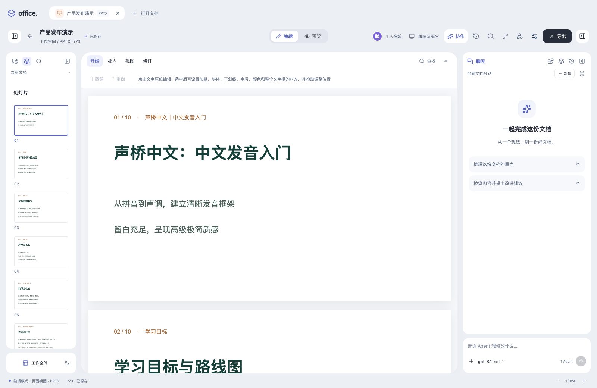

# 最新 Pen 共享面板实现

本轮以 [officecli-workspace-v2.pen](../design/officecli-workspace-v2.pen) 中最新的可复用组件 `VpLwm`（左侧共享外壳）和 `AUmlC`（AI 统一抽屉）为准。此前导出的 PPT / AI PNG 没有包含这两套组件的最新结构，本记录替代上一轮仅依据旧导出图的[面板外观验收](hcd-ppt-panels.zh.md)。

| 区域 | 设计源节点 | 实现 |
| --- | --- | --- |
| 左侧整体 | `VpLwm` | 背景透明的纵向布局，上下两区间距 10px |
| 左侧导航与内容 | `RyRNw`、`mC2NP` | 连续表面、圆角 16px；顶部 80px 工具与路径区；格式相关内容保持挂载 |
| 左侧底栏 | `f2tJj` | 独立 56px 工作空间栏，包含工作空间及外观设置入口 |
| 右侧整体 | `AUmlC` | 344px 宽；聊天主面板与独立输入区间距 10px |
| 右侧导航与聊天 | `R2MN9R`、`b4pcp` | 连续表面、圆角 16px；80px 导航区，包含聊天、工具、资源、历史与收起入口 |
| 右侧输入 | `nrKmJ` | 独立圆角 16px 输入区，默认最小高度 96px，显示实际模型与上下文入口 |

左侧外壳复用于 DOCX、XLSX、PPTX、PDF、Markdown、HTML 和 TXT；PPT 保持 188px 缩略图栏，支持拖拽、悬停复制与删除。PPT 形状属性保留独立属性抽屉。右侧工具在聊天主面板上部展开，共享聊天与输入框保持挂载，切换工具、收起、专注模式均保留草稿与浏览位置。

深色直接采用 `.pen` 变量：背景 `#12151C`、表面 `#1C222D`、内容背景 `#161C25`、文字 `#E8EDF5`、次级文字 `#A4B0C3`、分隔线 `#323C4D`、强调色 `#A6AFFF`。左右收起继续零占位，右侧开关继续位于导出右侧。

“新建”开启当前文档会话中的新任务输入，保留已有任务记录；历史入口定位到对应任务。展开聊天区域可将桌面抽屉扩至 480px，手机限制在视口内。模型显示来自服务端实际配置，本地页面为 `gpt-6.1-sol`。

## 验证

在仓库根目录运行：

```bash
npm --prefix examples/hdoc/editor run build
HCD_BROWSER_PATH='/Applications/Google Chrome.app/Contents/MacOS/Google Chrome' \
  npm --prefix examples/hdoc/editor run test:workspace -- e2e/workspace.spec.ts \
  --grep 'shared side panels|PPT thumbnail drag|PPT shape properties|collapsed sidebars|appearance follows|dark workspace|context menu uses|mobile drawers dismiss|workspace drawers,|phone workspace|all seven formats|canvas zoom|workbook preview|document tabs retain|workspace reload restores|fixed history saves|history uses the selected|agent commits preserve preview'
HCD_BROWSER_PATH='/Applications/Google Chrome.app/Contents/MacOS/Google Chrome' \
  npm --prefix examples/hdoc/editor run test:workspace -- e2e/agent-harness.spec.ts \
  --grep 'Pen chat drawer|Codex-style chat|chat composer handles|chat preserves history|right-click and slash'
```

新增验收直接读取 `.pen` 中的尺寸、圆角、间距和深色色值，与七种文档的实际浏览器布局比较；同时检查切换文件与结构、搜索、图片工具、聊天展开时保持原内容节点和草稿。分别截图浅色、深色及手机抽屉。浏览器测试中的任务回复使用可控数据；另保留本地真实页面截图，未发送新 AI 任务或修改演示文档内容。

### 验证结果（2026-11-15）

- TypeScript、独立应用及嵌入包构建通过：[构建日志](hcd-shared-panel-shells/build.log)。
- 18 项工作区回归全部通过，覆盖七格式面板、深浅主题、手机抽屉、收起零占位、PPT 拖拽及属性提交、版本与多标签状态：[工作区日志](hcd-shared-panel-shells/workspace-regression.log)。
- 5 项聊天回归全部通过，覆盖 Markdown、Enter / IME、协同设置、任务停止及工具切换时保留草稿与阅读位置：[聊天日志](hcd-shared-panel-shells/chat-regression.log)。
- 单独运行直接对照 `.pen` 的七格式尺寸与配色验收也通过：[设计核验日志](hcd-shared-panel-shells/design-geometry.log)。
- `git diff --check` 通过；本地页面 `http://127.0.0.1:58402/?locale=zh-CN` 返回 HTTP 200。

本轮验收范围是面板布局与已有交互回归，不等同于全部格式转换或全部 AI 任务的完整验收。

## 页面截图

本地真实 PPT 页面，使用已有“产品发布演示”文档，输入框显示服务端配置的 `gpt-6.1-sol`：



以下截图中的聊天任务使用测试数据，用于核验布局与交互，不代表实际执行过文档修改：

| 文档 | 浅色 | 深色 |
| --- | --- | --- |
| PPTX | [查看](hcd-shared-panel-shells/pptx-shared-panels-light.png) | [查看](hcd-shared-panel-shells/pptx-shared-panels-dark.png) |
| DOCX | [查看](hcd-shared-panel-shells/docx-shared-panels-light.png) | [查看](hcd-shared-panel-shells/docx-shared-panels-dark.png) |
| XLSX | [查看](hcd-shared-panel-shells/xlsx-shared-panels-light.png) | [查看](hcd-shared-panel-shells/xlsx-shared-panels-dark.png) |
| PDF | [查看](hcd-shared-panel-shells/pdf-shared-panels-light.png) | [查看](hcd-shared-panel-shells/pdf-shared-panels-dark.png) |
| Markdown | [查看](hcd-shared-panel-shells/md-shared-panels-light.png) | [查看](hcd-shared-panel-shells/md-shared-panels-dark.png) |
| HTML | [查看](hcd-shared-panel-shells/html-shared-panels-light.png) | [查看](hcd-shared-panel-shells/html-shared-panels-dark.png) |
| TXT | [查看](hcd-shared-panel-shells/txt-shared-panels-light.png) | [查看](hcd-shared-panel-shells/txt-shared-panels-dark.png) |

[手机端深色抽屉](hcd-shared-panel-shells/pptx-shared-panels-mobile-dark.png)保留独立输入框，390px 视口无横向溢出。
