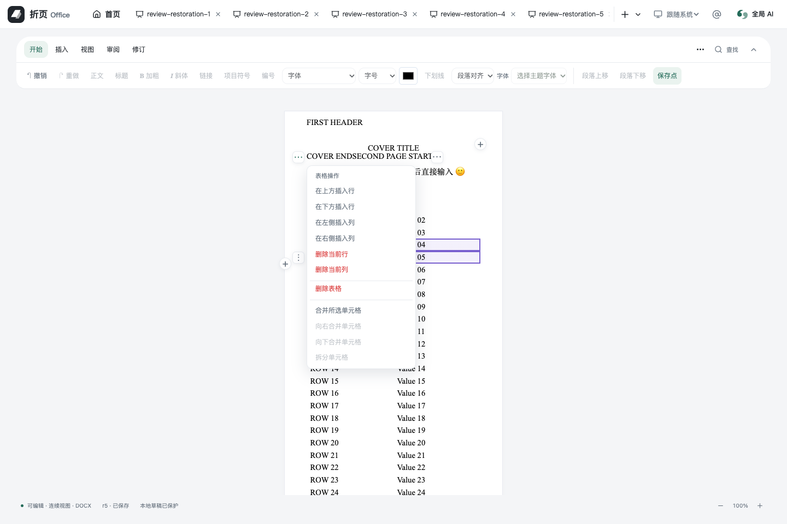
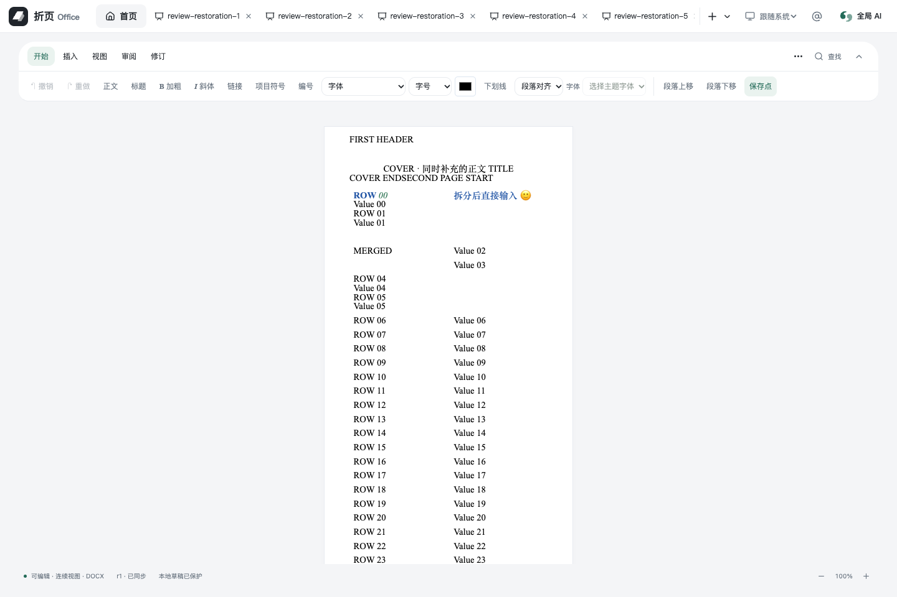

# Word 表格合并与拆分

表格边缘菜单支持向右合并、向下合并，以及按住 Shift 点击另一格后合并完整矩形区域。选区显示在实际单元格上，文字仍在原处编辑。拆分已有合并格后，内容保留在第一格，其余格获得新的可编辑身份；不弹出第二个文字编辑器。

合并按行顺序移动完整的段落和来源标识，保留文字格式。已有合并格必须完整落在选区内，不允许切开其跨度。客户端等待共享检查点后会再次核对单元格身份和网格；期间布局变化会要求重新选择。服务端继续检查修订、表格 hash、协作代次、未落盘输入和 Agent 工作区锁。

撤销与重做使用已有的带 hash `table.restore`，只恢复目标表格。表格外的后续输入继续保留；目标表格已有后续修改时拒绝覆盖。刷新后保留保存的内容，本地表格撤销栈沿用已有的 20 步会话范围。

## 原格式与协议

源格式导出将合并几何写成原生 `w:gridSpan` 和 `w:vMerge`，按顺序复用所有来源单元格的 OOXML 正文。保留各段落的原生文字属性、书签和无关包部件；分割出的新格生成原生可编辑段落。不会修改原件或自动降级为语义重建。

新协议 `hcd-patch/67` 通过 `/patch`、CLI `hdoc apply` 或 MCP `hcd_patch` 的 `structure` 模式提交。必须先协商实际服务器能力。操作坐标为从零开始的逻辑网格位置：

```json
{
  "op": "table.cells.merge",
  "blockId": "从 editor-state 读取",
  "tableIndex": 0,
  "range": { "row": 0, "column": 0, "rows": 2, "columns": 2 },
  "precondition": { "blockHash": "从当前块读取" }
}
```

拆分操作为 `table.cell.split`，提供 `blockId`、`tableIndex`、起始格的 `row`、`column` 和相同的 hash 前提。批次还必须提供文档 ID、唯一 patch ID、schemaVersion 和当前 baseRevision。旧 `hcd-patch/4` 不接收新操作；现有增删行列及恢复接口保持原协议。

## 验证入口

```bash
cargo test -p hcd-core -p hcd-docx --lib
cargo test -p officecli --bin officecli table_structure_edits_guard
cargo build -p officecli --bin officecli
python3 docs/acceptance/hcd-table-cells/verify_cli.py
OFFICECLI_REVIEW_CASE=table-cells npm run test:workbench-review --prefix apps/workspace
```

核心测试覆盖文字身份、格式、行顺序、空格可编辑性、已有合并格边界、越界、协议版本、原子拒绝、陈旧 hash 和幂等重放。原生测试用同一原件执行合并、拆分、输入、恢复和导出重开，核对原生书签、格式和无关部件。

真实工作台通过鼠标选择、菜单操作和原位输入验证横向、纵向与 2×2 合并；第二个页面补写其他正文，再验证结构撤销/重做保留补写。下载的 DOCX 用独立 XML 读取器检查后，作为新文件重新上传，继续查看实际内容。

[六项 Word 实测](hcd-table-cells/validation.json) · [十标签恢复后的七项实测](hcd-table-cells/mixed-tabs-validation.json) · [42 项主工作台](hcd-table-cells/workbench-validation.json) · [焦点检查](hcd-table-cells/focus-validation.json) · [CLI](hcd-table-cells/cli-validation.json) · [JSON Schema](hcd-table-cells/schema-validation.json) · [原生检查](hcd-table-cells/native-inspection.json) · [下载的 DOCX](hcd-table-cells/native-reopened.docx)





当前拆分按既有合并格的逻辑网格恢复，不提供把任意普通格细分成自定义行列的功能。任意分片表格重组、嵌套表格的原生结构改写和完整 Word 表格样式编辑仍有边界。本轮未使用 Microsoft Word 桌面客户端逐页对照。
