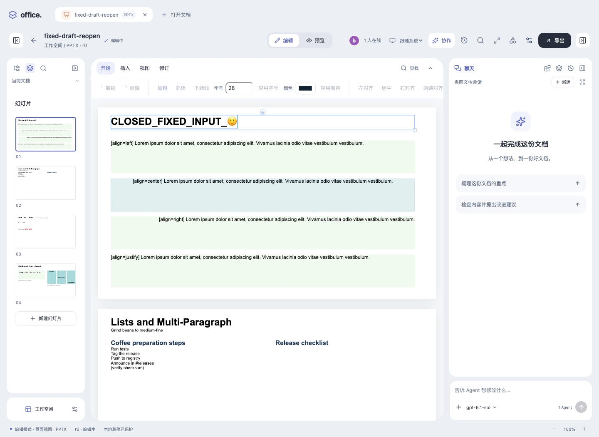
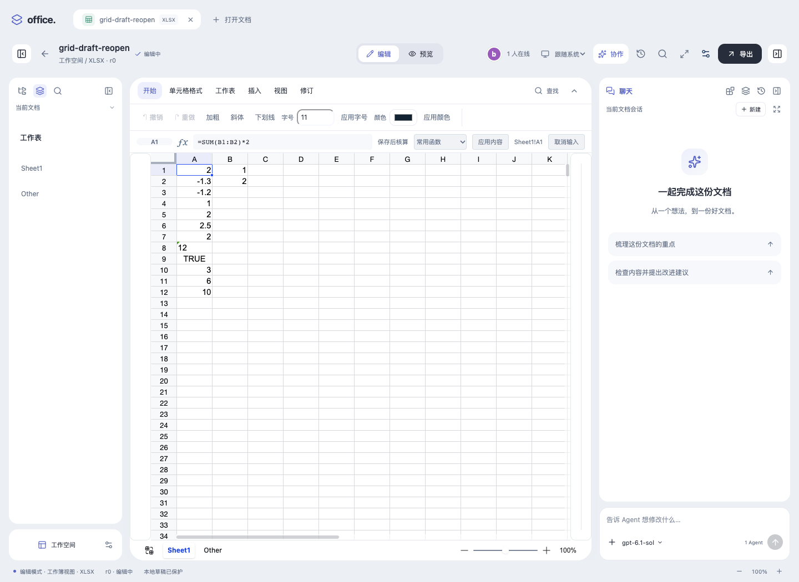

# 固定版式与表格未提交输入恢复

后续更新：图片输入/蒙版/任务和候选恢复已另行实现并通过验收，最新整体 Clippy 与格式也已通过；见[图片恢复记录](hcd-image-recovery.zh.md)。本文保留固定/网格阶段当时的结果与边界。

本次补齐 PDF/PPTX 文字编辑与 XLSX 单元格输入的本地保护，属于五项可靠性目标中的一部分。整体功能仍未全部完成。用户提供的合同 PDF 与 DOCX 版本关系不确定，两者继续分别作为鲁棒性样本，不能据此认证 Office/WPS 同源保真。

## 行为

- PDF/PPTX：保护已有映射文字的未保存输入，以及新文本框的文字、目标页和几何位置。取消会移除本窗口对应草稿；远端保存成功才确认清理。
- XLSX：保护外部公式栏尚未应用的输入，也监听原生单元格正在输入但尚未确认的文字。输入绑定原工作表/行/列；切换选区不会把输入挪到别的格子，也不会被计算刷新清掉。当前选区与未应用输入的目标分别显示。
- 重开后展开保留提示，点击“恢复输入”找回内容；仅恢复输入不会产生修订、创建对象、重放算术运算。用户明确保存/应用后才修改文档。
- 恢复重新检查鉴权范围、服务身份、用户、文档、协同 epoch、基准修订及节点 hash。版本/身份变化、目标丢失或内容无法解析时保留原记录供下载核对，不自动覆盖新文档。
- 各窗口使用独立流，Web Locks 隔离活跃写者。清理旧草稿时比较确切版本和内容；旧保存响应不能清除后续输入或另一窗口的修改。恢复先把副本持久化，再清理已放弃的流。
- IndexedDB 严格持久事务成功后才显示“已保护”。不可用、事务失败或容量超限时显示失败，并在仍有未提交输入时触发浏览器关闭保护。每份输入快照上限 2 MiB，每个隔离空间最多 128 份保留记录；没有静默淘汰脏草稿。

未提交输入使用独立的 `hcd-input-drafts-v1` 数据库，记录单个输入的快照，不改动正文的 Yjs 增量日志；不持久化令牌，也不在每个按键重写整份文档。固定文字恢复继续挂载在原画布节点上，网格恢复保留 canvas 实例。定位等待组件的 Rendered 生命周期完成，避免模型已加载但滚动控制器尚未注册时的依赖异常。

## 验证

```bash
cargo +1.90.0 build -p officecli
cargo +1.90.0 test --workspace --quiet
cd examples/hdoc/editor
npm run build
npx tsx --test src/*.test.ts
HCD_BROWSER_PATH='/Applications/Google Chrome.app/Contents/MacOS/Google Chrome' \
  npx playwright test e2e/workspace.spec.ts e2e/agent-harness.spec.ts \
  --grep 'input journal|calculation contract|verified grid caches|native literal types|protocol preflight|protocol fingerprint|workbook preview keeps|fixed text box initial focus|fixed history saves|four-worker spreadsheet team|two model agents preserve' \
  --reporter=line
```

浏览器使用真实隔离 API、协同服务与临时目录。新增用例包括离线关闭、浏览器 SIGKILL 后恢复原输入、PDF/PPTX 新框定位、旧 epoch/修订隔离、原生单元格未确认输入、保存后只清理一次、取消不产生对象、写入失败警告、活跃窗口隔离及旧快照拒绝删除新输入。恢复之前和恢复之后都检查服务端修订，避免把服务端已保存内容误判成本地恢复。

本地最终组合回归 **20/20，通过，1.4 分钟**；其中 10 项是本次输入日志/恢复专项，另外覆盖计算契约、实际画布缓存、原生字面值、协议预检与指纹、预览模式、固定文字输入与历史，以及多 Agent 冲突/四列分工。当前 Rust 整树 `cargo +1.90.0 test --workspace --quiet` 通过（观察到 1,031 项，包括文档测试）；编辑器独立/嵌入构建、前端 8 项单元检查和 `git diff --check` 通过。浏览器使用本轮新构建的 API 二进制与当前前端。

**整树门禁没有全部通过：** 最新 Clippy 被 `crates/officecli/src/hdoc_server/integration/policy.rs:143` 的 `collapsible_if` 阻断；格式检查在宿主集成模块、`exports.rs` 和 `hdoc_server.rs` 有差异。本次没有覆盖这些共享工作区的其他改动，也没有把此前门禁通过当作当前整树已通过。CI 已加入 `input journal` 选择器，但没有远端 CI 成功或干净检出认证。

浏览器调试曾发现两个实际问题：保留输入时连当前选区地址也被冻结；模型加载早于滚动控制器注册，快速恢复会报依赖缺失。分别改为独立显示输入目标、等待 Rendered 生命周期，最终上述 20 项回归通过。原生单元格专项同时验证取消恢复输入不写文档、再次直接输入并确认后只产生一个修订，刷新不再残留草稿。





截图复核发现未应用输入的位置显示了内部工作表 ID，挤压了公式输入框。已改为工作表名称与地址，并限制提示宽度；两项最终表格恢复专项通过（17.5 秒），包括输入框可用宽度与实际原生输入确认。

另存有 [PDF 新框恢复](hcd-uncommitted-input-recovery/pdf-placement-recovered.png)、[PPTX 新框恢复](hcd-uncommitted-input-recovery/pptx-placement-recovered.png)及[浏览器强杀恢复](hcd-uncommitted-input-recovery/fixed-browser-crash-recovered.png)。

## 边界

图片调色/裁剪草稿、蒙版、候选及服务端图片任务重启恢复仍待实现。原生单元格富文本按纯文本输入恢复，不能据此宣称完整富文本或多格剪贴板草稿恢复。独立的预览器、文档本地撤销栈、跨设备草稿同步、草稿加密、重新授权后的 Agent 续跑与跨文档补偿也不包含在本次能力内。浏览器清理站点数据或未完成写入前被强杀，无法保证恢复最后一次输入；状态栏明确区分正在保护、已保护和失败。

同源 Office/WPS 复杂排版、更多计算语义、图片恢复、任务继续/回滚、分布式租约及远端 PR 门禁，仍按[建设记录](hcd-reliability-roadmap.zh.md)继续验收。
