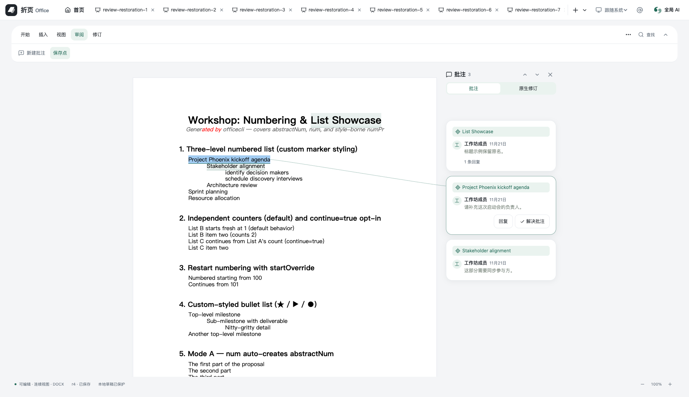
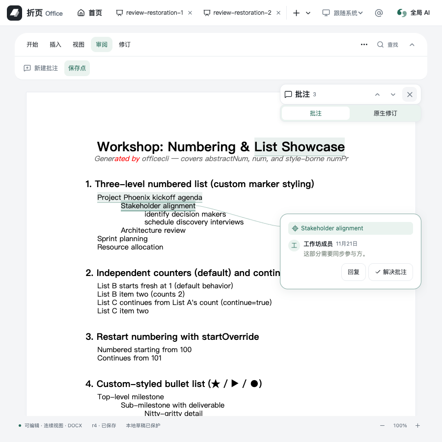

# Word 页边批注

当前 Word 编辑视图把批注放到对应段落的页边。原文选区高亮，当前线程显示连接线；点击原文或批注可切换当前线程。相邻批注自动错开，正文和卡片使用同一滚动面与缩放，不再使用独立滚动的批注列表。

窄画布只展开当前线程，并保留上一条、下一条以及批注 / 原生修订入口；恢复宽窗口后重新展开页边卡片。回复、解决、重新打开和原生 DOCX 导出重开沿用已有审阅接口。

## 锚点与数据

- 原生字符偏移按 Unicode 标量解析，转换为编辑器的 UTF-16 位置，支持 emoji。
- 本地输入跟随编辑事务；Yjs 撤销或协作者更新替换整个编辑器文档时，按稳定段落 ID 和段内变化恢复批注位置。删除段落会清除其高亮，撤销删除后恢复。
- 高亮和连接线属于视图装饰，不写入正文、Yjs 文档或原生 DOCX；切换线程不产生文档修订。
- 多标签刷新后，在每个 Univer 实例上约束编辑器及渲染输入的聚焦路径。临时单元格输入框短暂位于标签容器之外时，也不能取得其他文件或全局 AI 的焦点；当前工作簿仍可正常点击、输入和恢复选区。
- 历史版本仍沿用只读审阅视图；这里的页边交互针对当前 Word 编辑视图。

## 验证

```bash
npm run test:word-review-anchors --prefix examples/hdoc/editor
cargo build -p officecli --bin officecli
OFFICECLI_BIN="$PWD/target/debug/officecli" npm run build --prefix apps/workspace
OFFICECLI_BIN="$PWD/target/debug/officecli" \
  HCD_BROWSER_PATH='/Applications/Google Chrome.app/Contents/MacOS/Google Chrome' \
  npm run test:workbench-review --prefix apps/workspace
OFFICECLI_REVIEW_WARM_TABS=1 HCD_BROWSER_PATH='/Applications/Google Chrome.app/Contents/MacOS/Google Chrome' \
  npm run test:workbench-review --prefix apps/workspace
```

浏览器用真实工作台、协同服务和 Word 审阅接口，覆盖选句批注、回复、解决 / 重开、正文前缀修改、本地输入后 Yjs 撤销、刷新、原生 DOCX 导出再上传，以及原生文字修订的接受 / 拒绝。页边交互另检查相邻卡片不重叠、原文与卡片同步滚动、120% 缩放和窄画布中的实际可见性。

锚点单测模拟 Yjs 整篇替换事务，覆盖协作者段落排序、格式变化、段落删除 / 恢复及 Unicode 范围。这些测试在本地浏览器和原生文件重导入中验证；未使用 Microsoft Word 客户端验收。

混合标签复验会先打开八个 PPTX、一个 XLSX 和一个 DOCX，再完成批注、保存、刷新、回复、表格合并/拆分与原生导出重开，检查后台工作簿恢复时当前 Word 的选区和焦点。早先的 `disableAutoFocus` 只能约束组件自动聚焦，后续完整回归又捕获到渲染器直接聚焦临时输入框，见[底层焦点事件](hcd-word-margin-comments/native-focus-before.json)。当前按实例同时约束这两条路径，[七项复验](hcd-word-margin-comments/mixed-tab-validation.json)与[零后台焦点记录](hcd-word-margin-comments/focus-validation.json)均通过；双账号表格实际输入、格式和 AI 撤销也通过复验。

最终构建的主工作台回归也已通过，包括多 tab 恢复、跨文件流转、Word 原生批注 / 修订和 DOCX 重导入，见 [完整结果](hcd-word-margin-comments/workbench-validation.json)。该工作台回归中的 AI 使用本地确定性模型夹具，未验证外部商业模型服务。

已验证桌面与窄画布效果，结果见 [validation.json](hcd-word-margin-comments/validation.json)。




