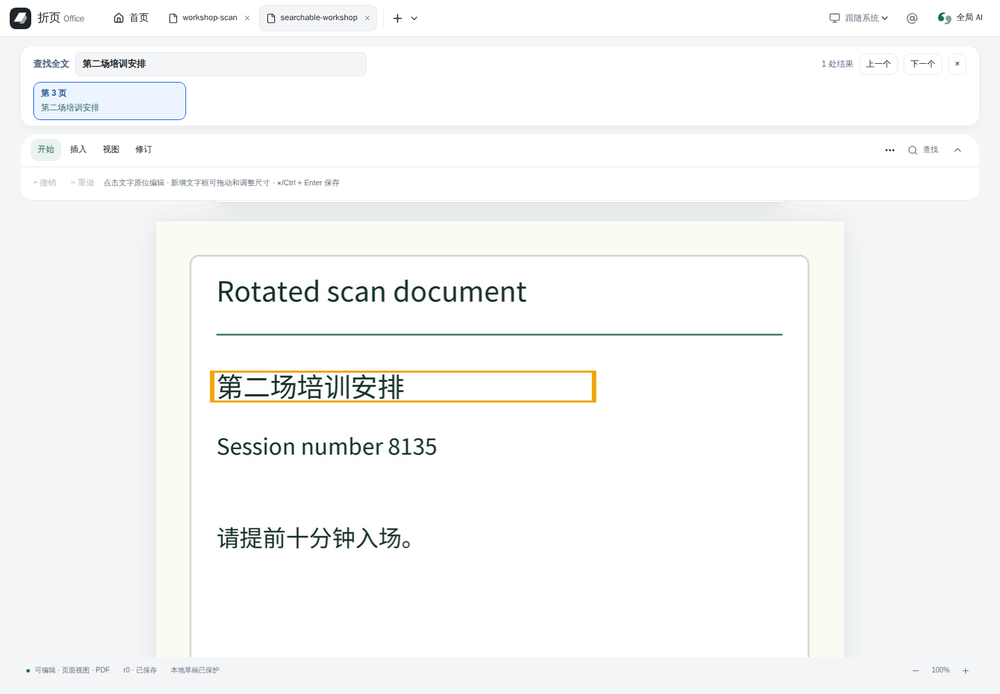
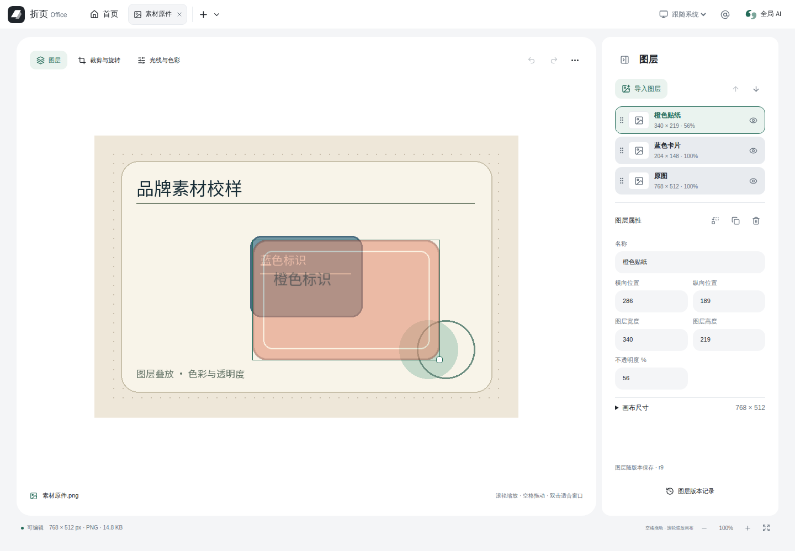
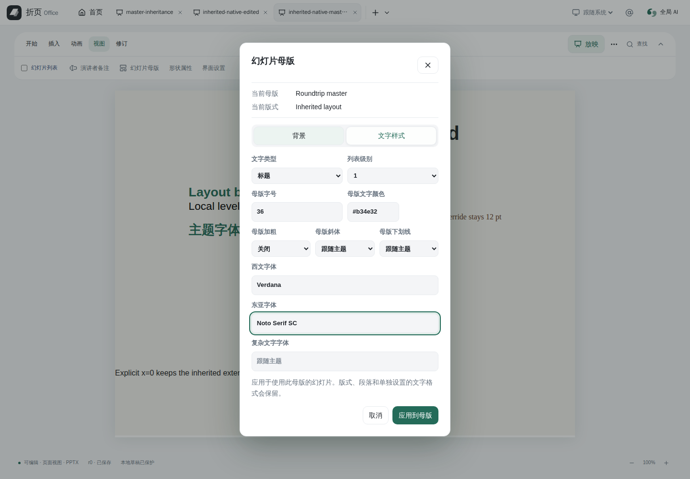
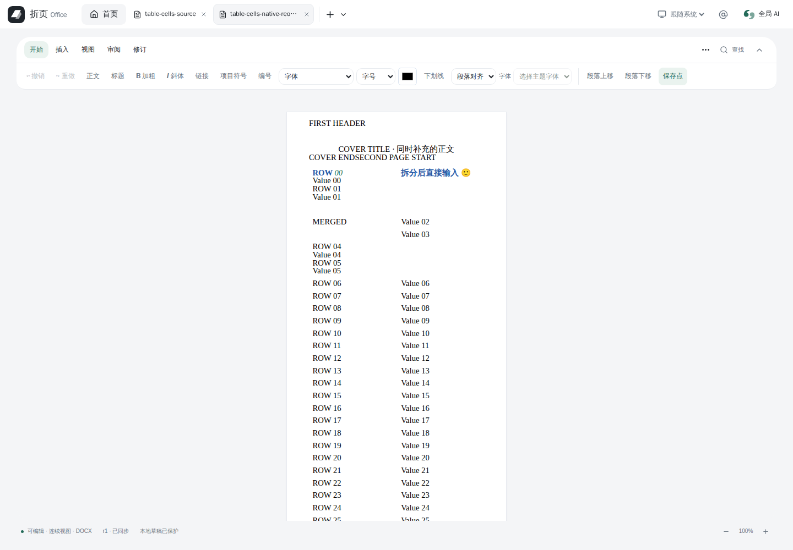
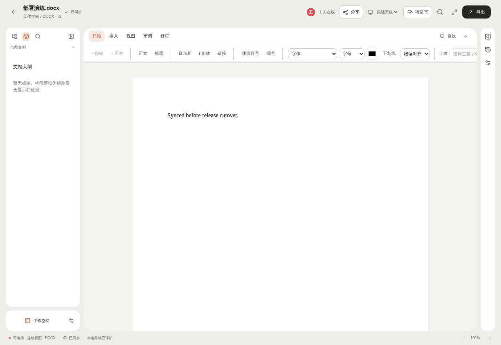

# 当前发行、离线运行与恢复验收

本轮重新用当前原生引擎和已验证的界面封装 macOS / Linux ARM64 发行候选，包含 Word 表格合并/拆分、正确的段落读取顺序、后台工作簿焦点约束、母版文字编辑及条件格式撤销修复。两种包的引擎版本均为 `0.1.31`，协议指纹为 `9dd62f7cf9f39d9ac1f31f538be07c2c9e4fc0ad23e40889da2df3d16a98fdac`。

| 检查 | 结果与范围 |
| --- | --- |
| macOS ARM64 安装 | 包内 Node.js 26.13.0、原生引擎和全部静态资源；系统策略将服务进程限制为 loopback，外网探针返回 `EPERM`；冷浏览器打开 Word、Excel、PPT、白板、PDF 和 PNG，两个 Word 页面实际协作。随后完成六类 22 项实际编辑检查。 |
| Linux ARM64 完全断网 | 包内 Node.js 24.22.3；在 `docker --network none` 中安装和运行，外网探针返回 `ENETUNREACH`。完成同样六种格式冷启动，并在已安装产品中实际编辑、下载和重开透视表、条件格式、OCR PDF、图片图层、PPTX 母版文字及 Word 合并/拆分表格；OCR 模型与 WASM 由包内资源提供，六类 22 项检查均通过。 |
| 升级失败恢复 | 密封的候选版本修改自己的迁移数据库后，协作服务真实退出。控制器恢复旧发行及旧数据，失败迁移的改名没有进入原数据，已同步正文仍在。 |
| 升级、回滚与重新激活 | 在新数据副本上执行真实 schema 迁移，保存切换前快照；切换后的新写入留在新版数据里。回滚同时切换程序和对应数据，重复指定同一目标保持幂等，重新激活新版及重启控制器后仍保留新写入。 |
| 在线备份 | 当前构建通过读写并发取点、放行已受理上传、短暂拒绝新写入、取点失败释放屏障、篡改拒绝与异目录恢复；签名身份和 Yjs 状态保留。恢复后的 Word 可导出，待回写任务沿原任务号完成提交且旧业务版本不被覆盖。 |
| SaaS 业务复验 | 当前构建另验证项目与文件夹、范围搜索、项目权限变更、匿名共享与协同、跨白板 `@我`、读回执、重启恢复、撤权，以及回写任务的丢失回执核对、重试与幂等冲突副本。此业务套件本身不做发行离线判断，离线证据来自上述独立安装套件。 |

[macOS 发行及六类实际编辑](hcd-workspace-release-current/macos-validation.json) · [Linux 发行及六类实际编辑](hcd-workspace-release-current/linux-validation.json) · [在线备份结果](hcd-workspace-release-current/backup-validation.json) · [21 项 SaaS 业务结果](hcd-workspace-release-current/saas-validation.json)

最终 macOS 候选为 `0.1.31-reviewed-workspace-20261121-61ca533db4d80d82`，Linux 候选为 `0.1.31-reviewed-workspace-20261121-a0b9842018872ccc`。两个候选均完成六项部署检查，包括失败切换恢复、真实 schema 迁移和版本及数据一起回滚。运行时依赖的资源全部取自密封发行包，验证驱动另提供 Python 3 标准库以生成和检查原生 Office 夹具。











## 复验入口

```bash
# 构建机器先准备对应平台的引擎、界面和带 LICENSE 的 Node.js 目录。
npm run package --prefix apps/workspace -- \
  --version <候选版本> --node-runtime <Node目录> --output <新发行目录>

OFFICECLI_RELEASE_PACKAGE=<新发行目录> OFFICECLI_RELEASE_NATIVE_VERIFY=1 \
  npm run test:deployment --prefix apps/workspace

npm run test:backup --prefix apps/workspace
npm run test:acceptance --prefix apps/workspace
```

Linux 的完整断网验证必须将包和只读测试驱动放进 `--network none` 容器；检查脚本会另外验证外网 socket 确实不可达，不能只凭浏览器拦截声称系统已经断网。测试驱动提供合成输入与浏览器，安装后的产品只使用包内 Node、引擎、模板、界面、协作服务和 OCR 资源。

本轮验证的是上述两个 ARM64 平台，没有验证 Windows 或 x86_64。候选包和测试部署保存在隔离临时目录，未改动日常服务，也未提交或发布发行包。本轮目标的逐项实现、证据与高级能力边界见[工作台验收总表](hcd-workspace-goal-2026-11-21.zh.md)。
