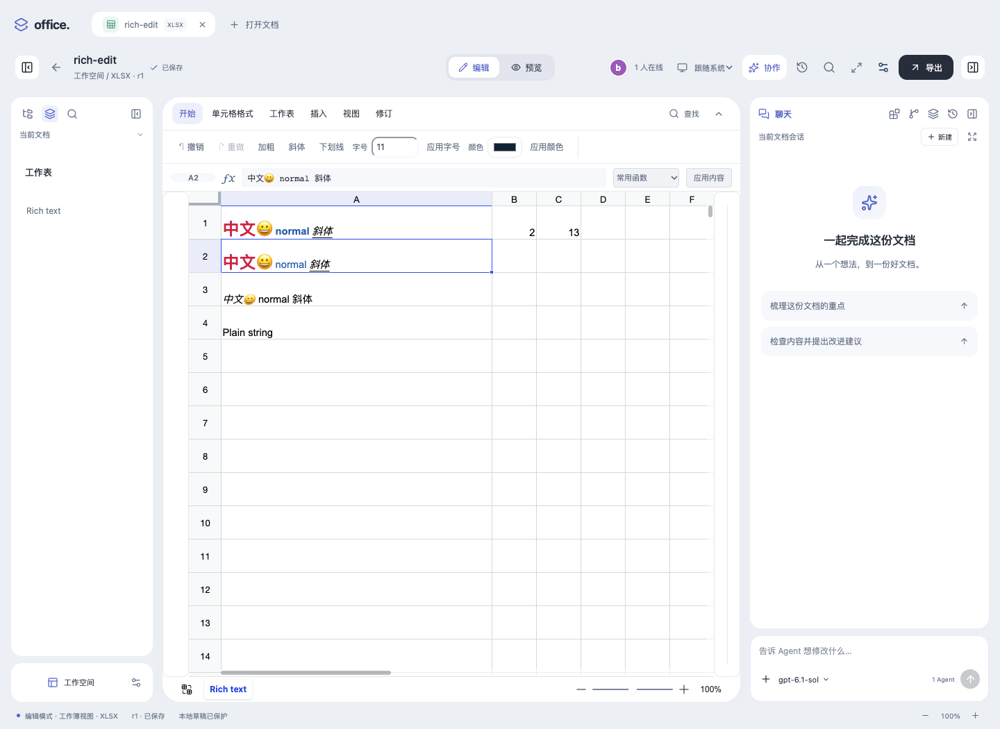
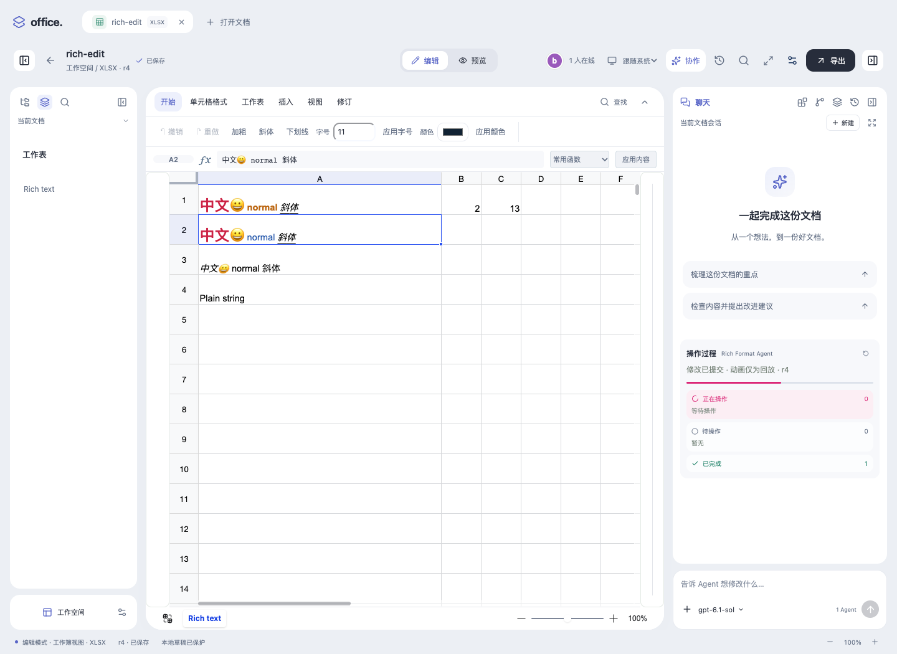
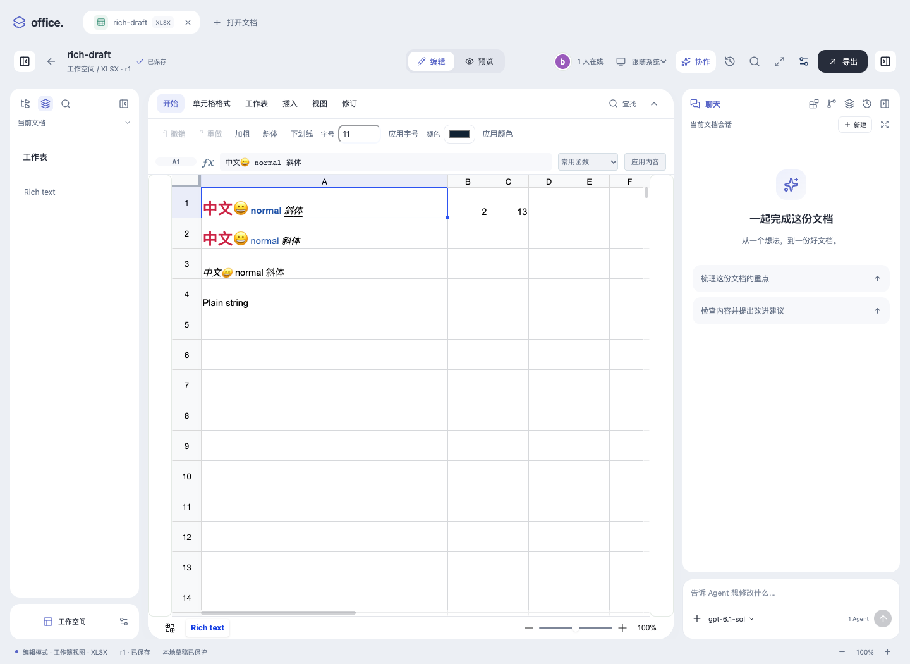

# XLSX 选区格式编辑、MCP 与未提交输入恢复验收

2026-11-16，`feature/hcd-font-format-integration`、HEAD `ccb5fd5` 的未提交工作区。在[富文本保留阶段](hcd-xlsx-rich-text.zh.md)上补齐实际选区编辑和单格格式输入恢复。整体五项目标仍未完成，见[当前功能状态](hcd-capability-status-2026-11-15.zh.md)。

本文保留 schema 49 阶段的历史结果；空白格富文本、混合数字/公式批次及新格格式草稿已在后续 [schema 50 阶段](hcd-xlsx-rich-paste.zh.md)补齐。下面相应限制仅描述当时版本。

## 本轮行为

进入已有文字单元格、选中部分文字后，工具栏粗体、斜体、下划线、字号和文字颜色使用原生选区命令；结束编辑后提交原生格式片段。未进入文字编辑时仍按整格设置格式。按钮按下保留文字选择，填充颜色要求先结束文字编辑。

新增 `hcd-patch/49` 的 `xlsx.richText.set`，仅用于已有字符串单元格。支持与不同目标的 `text.splice` 一起提交；公式、数值和空白格创建继续使用各自操作。原生片段使用同一属性白名单，限制 1–4096 段、32767 个 UTF-16 单位。更新保留节点 ID、源地址和无关属性；纯格式修改保持文字 hash，但仍要求当前修订，防止同文字的旧样式覆盖新提交。确切重放保持幂等，重复目标和不支持的属性被拒绝。

CLI `get-node`、API 和 MCP `hcd_read resource=node` 在根字段 `xlsxRuns` 返回原生片段。能力契约公开读字段、schema、操作名及限制，加入完整协议指纹。Agent 应先读取全部片段，仅修改目标属性，再按当前修订及节点 hash 提交；保留无关的主题、字体方案和字符集属性。

前端按 UTF-16 原生范围和 Unicode 标量边界比较实际选区样式；仅覆盖变化属性，不把主题颜色或字体方案误写成渲染回退值。显式更换字体时移除原方案继承。嵌入对象/链接、截断 emoji 的范围和局部文字背景不在此操作范围。

单格输入日志现可保留尚未确认的文字格式。离线关闭页面后可下载原始本地草稿，明确恢复，再手动应用；恢复前核对用户、文档、epoch、修订和目标。公式栏继续修改已恢复文字时继承待提交格式。恢复本身不创建修订，提交成功才清理相应日志；过期输入不覆盖文档。输入基线优先读取已确认节点，避免依赖原生富文本格可能为空的普通值。

修复实际浏览器问题：原生富文本格可能 `v=null`，文字存于 `p`，此前保存路径可能把它当空文本。现在捕获和确认均从原生文档读取文字。本地更新保留 canvas；选区格式、撤销/重做与 Agent 修改不以重建整个网格来刷新。

## 验收证据

Rust 整树 **1,072 项**通过（25 个测试结果组，含 doctests，零失败/忽略），Clippy、全量格式和 debug 构建通过。编辑器独立/嵌入构建与 **19 项前端单元**通过。新增后端回归验证纯格式修改、混合文字操作、幂等、过期/重复/数值/非法请求拒绝和源导出回读；前端覆盖 emoji 边界、主题/方案保留、文字替换和局部改色、多行草稿重建及不支持对象拒绝。

最终组合浏览器 **29/29（2.5 分钟）**通过，包括下述选区/MCP/恢复链路，以及已有富文本、公式与类型、协议、HTML/Word、七格式 Harness、导出菜单、表格悬停/插入/20 步历史。此前组合为 29/29（3.0 分钟），新增未修改确认断言先行专项为 1/1（12.6 秒），均与最终组合重叠，不相加。截图已查看，[机器汇总](hcd-xlsx-rich-edit/verification-results.json)注明本地工作区与未认证项。

真实隔离 API、协同服务、两个浏览器页面及 MCP 客户端验证：

1. 原生单元格内选择 `normal` 并加粗，只产生一项 schema 49 提交；拦截实际 canvas 绘制，确认两个页面的该片段变为蓝色粗体。
2. 重新进入后直接确认没有留下输入或新增提交；撤销/重做进入修订 2/3，原 canvas 身份保持。
3. MCP 读取 `xlsxRuns`，仅将中间片段改为橙色，两端实际绘制同步至修订 4。
4. 从页面下载原生 XLSX，核对修改片段的粗体/颜色、完整文字，以及未修改尾部的 `scheme=minor`。
5. 未确认的选区加粗在离线关闭页面后恢复；服务端仍为修订 0，本地下载包含真实格式片段。用户恢复并应用后才变为修订 1，刷新后日志清空，服务器格式保留。

[选区/MCP 指标](hcd-xlsx-rich-edit/browser-metrics.json)和[CLI 结果](hcd-xlsx-rich-edit/cli-results.json)保留限定结论。CLI 探针还检查同文字/hash/锚点保持、过期格式拒绝、未改 styles/sharedStrings 部件原字节保留、重新导入和原件不变。5 项原生 CLI 公式探针全部通过，差异数为 0，见[公式结果](hcd-xlsx-rich-edit/formula-results.json)。

以下截图展示实际网格选区格式、Agent 改色及输入恢复；仅代表所构造的样本，不是主题字体或 Office/WPS 的视觉认证。







## 仍未完成

- 任意外部富文本剪贴板、多格富文本草稿、跨设备恢复。空白格富文本粘贴仍可能按纯文字创建，不能承诺格式保留；已有富文本与空白/数值/公式混合批次会恢复并提示。
- 工具栏已接入上述选区命令，真实浏览器专项核验的是选区加粗及 MCP 局部改色；不能把它扩展为每种原生选区交互均已认证。没有新增选区字体选择器，整格填充与文字背景分开处理。
- 主题/索引颜色和字体方案完整视觉解析；原生属性保留不代表显示一致。旧版压平的 bundle 需重新导入原件。
- 所有公式、图表/透视表、完整条件格式、复杂共享/数组公式、Office/WPS 同源逐页基准和大文件并发性能。Univer 构建分块仍约 16.26 MB、gzip 约 3.95 MB。
- 合同 PDF/DOCX 版本关系不确定，不能拿它们做同源视觉比较。本轮未重跑这两个样本。

本轮未调用真实模型、重启日常服务或提交代码。完整独立图片、完整恢复/跨文档工作流及管理端套件未重复；无远端 CI 或干净检出认证。以前出现的 PPT 本地写锁间歇冲突根因未明，不能因当前整树通过而标记修复。

## 复现

```bash
cargo +1.90.0 test --workspace
cargo +1.90.0 clippy --all-targets -- -D warnings
cargo +1.90.0 fmt --all -- --check
cargo +1.90.0 build -p officecli
python3 docs/acceptance/hcd-xlsx-rich-edit/probe_rich_edit.py \
  --output docs/acceptance/hcd-xlsx-rich-edit/cli-results.json
python3 docs/acceptance/hcd-capability-audit-2026-11-15/probe_formulas.py \
  --output docs/acceptance/hcd-xlsx-rich-edit/formula-results.json

cd examples/hdoc/editor
npm run build
npx --no-install tsx --test src/*.test.ts
HCD_BROWSER_PATH='/Applications/Google Chrome.app/Contents/MacOS/Google Chrome' \
  npx --no-install playwright test e2e/workspace.spec.ts e2e/agent-harness.spec.ts \
  --grep 'XLSX native text selections|XLSX rich input journal|grid input journal|XLSX rich strings|HTML inline fidelity|HTML and Markdown source tables|Word mixed inline edits|export menus use source-aware|export capabilities follow|all seven formats use|insert ribbon creates|Word pagination|OpenAI harness edits|table hover controls|editor deletion supports|protocol preflight|protocol fingerprint|calculation contract|verified grid caches|native literal types|workbook preview keeps' \
  --reporter=line
```

CLI 和浏览器用例已接入 PR 工作流配置，远端未运行。最终本地日志为 `/tmp/hcd-rich-edit-{workspace,clippy,format,build,cli,formulas}-final.log` 与 `/tmp/hcd-rich-edit-{editor-build,unit,browser}-verified.log`；永久证据为本文旁的探针、JSON 和截图。
