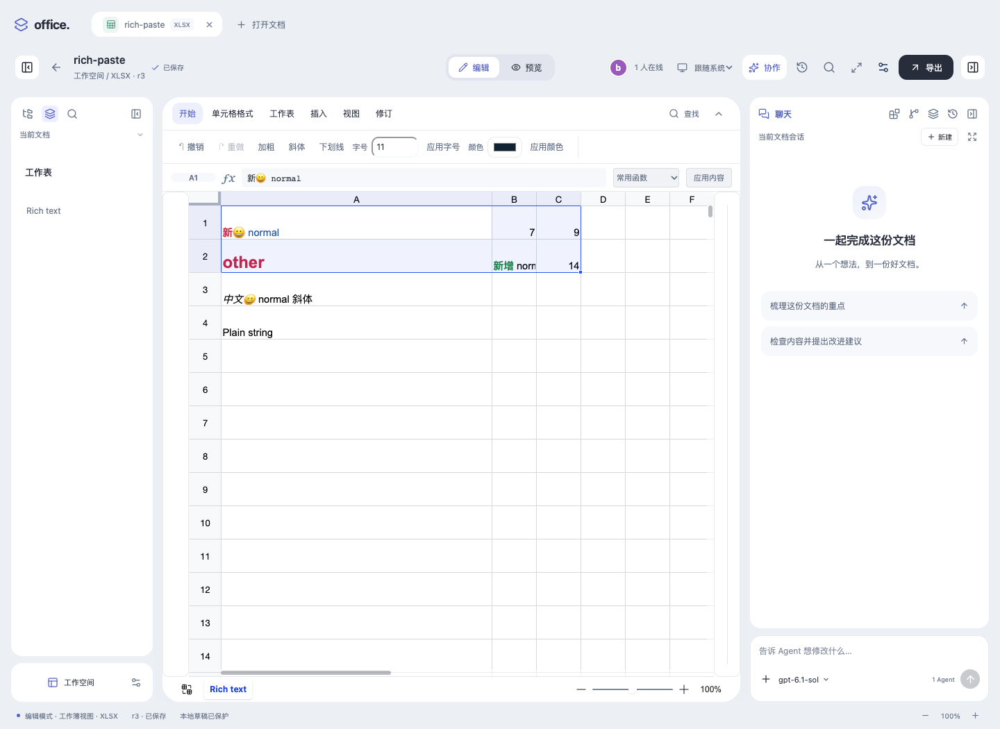
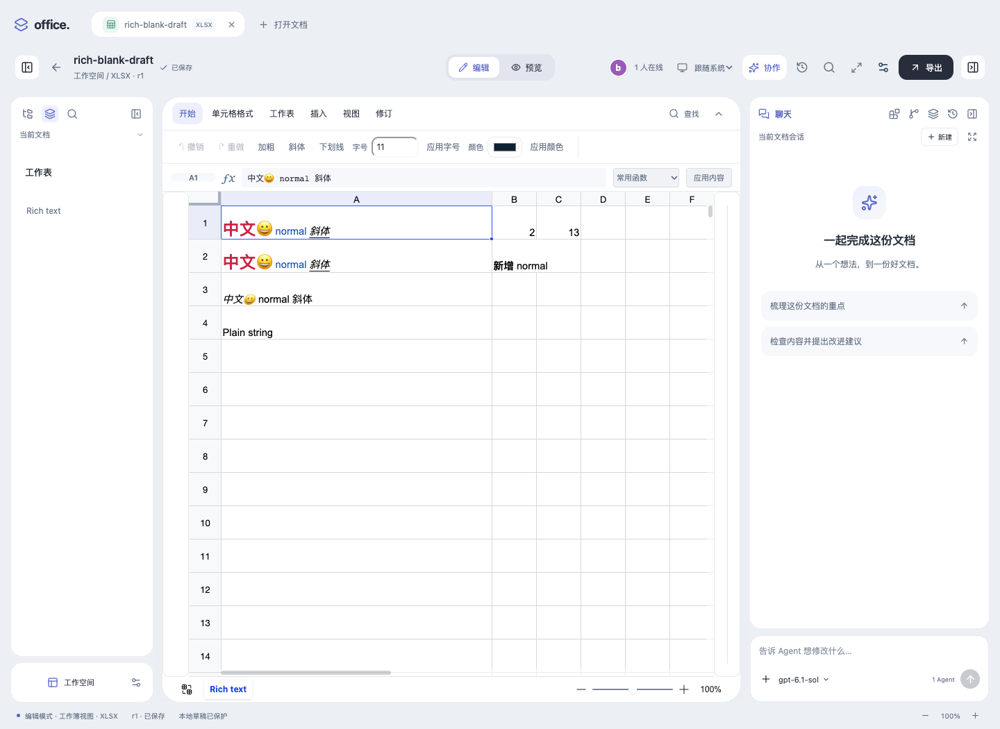

# XLSX 混合富文本粘贴、空白格创建与原生回读验收

这是混合粘贴阶段的历史记录。后续新增整批输入持久化与确切回执核对，并发现两项尚未解决的浏览器验收失败，最新状态见[整批恢复验收](hcd-grid-batch-recovery.zh.md)；本文 31/31 不能代替当前整体验收结果。

2026-11-16，`feature/hcd-font-format-integration`、HEAD `ccb5fd5` 的未提交工作区。承接[选区编辑阶段](hcd-xlsx-rich-edit.zh.md)，补齐已有富文本、新空白格、数值和公式一起修改时的内容保存。完整产品仍有缺口，见[整体状态](hcd-capability-status-2026-11-15.zh.md)。

## 实现范围

新增 `hcd-patch/50`：`xlsx.richText.create` 在可写空地址创建原生文字片段，`xlsx.richText.set` 可将已有可写文字、数值或公式目标替换为富文本。新版本允许不同目标的文字、富文本、数字及公式在同一批次提交，成功只增加一个修订；任何一项失败都不提交该批次。旧 schema 49 保持仅修改已有文字格的语义。

创建沿用空地址、合并区域和已加载窗口等检查。修改要求当前修订与节点 hash，拒绝重复目标、重复创建地址、不支持属性、非法字符和超限片段；确切重放保持幂等。每格限制 1–4096 段、32767 个 UTF-16 单位。数字和公式仍使用各自原生操作，不能把它们误存为带等号的普通文字。

CLI、API 和 MCP 共用能力发现与完整 schema 指纹，公开 `xlsxContentBatch`。多 Agent 的新增富文本格按工作表列租约检查，不能写入其他 worker 认领的列。新版本公式转富文本会记录转换节点，导出时清除原公式。

原生 XLSX 导出补齐缺失格、空行、带样式空格及源 XML 缺失行的富文本写入。原有格的源地址与新建格的当前地址分开收集，避免结构移动后混用；只扫描相关脏块一次。未修改的 styles/sharedStrings 部件保留原字节。

浏览器适配器识别支持的 HTML 剪贴板文字片段；CSS `rgb(...)`、不透明 `rgba(...)` 与短十六进制颜色转成原生 ARGB，非不透明或非法颜色明确拒绝。混合粘贴统一提交与撤销，保存和远端更新沿用原 canvas。拒绝时恢复原内容，并将原因送入可见错误提示。

新空白格以及可写数字/公式目标的单格格式输入可加入本地日志。离线关闭后，重新鉴权与核对目标/修订，再由用户恢复并应用；恢复本身不创建单元格或修订。该日志仍是单格输入保护，不能推导为多格粘贴中途关闭也已完整恢复。

## 验收结果

Rust 整树 **1,073 项**通过（25 个结果组，含 doctests，零失败/忽略），Clippy、全量格式及 debug 构建通过。编辑器独立/嵌入构建及 **21 项前端单元**通过。最终组合浏览器结果：**31/31（2.6 分钟）**。

标准 JSON Schema 2020-12 校验回归覆盖单独富文本创建、设置、公式创建和混合原生类型，以及非法地址/属性/空片段/缺少守卫的拒绝。该回归先复现了复制旧 schema 时残留的“必须含数字操作”限制，修复后通过，避免客户端校验与 Rust 接受范围不一致。

首轮组合为 29 通过/2 失败（3.4 分钟）：HTML 用例的 MCP 节点读取未返回预期文字；另一个用例的模块与 WebSocket 请求出现 Chromium `ERR_ADDRESS_INVALID` 并白屏。保存的原节点经 CLI 读取 ID/文字正确，两项隔离复验 **2/2（13.1 秒）**通过，随后再次运行完整组合。首个用例增加对 MCP 原始错误结果的断言，方便再次失败时定位；没有新增运行时重试或宣称已修复其根因。[中间失败记录](hcd-xlsx-rich-paste/intermediate-browser-results.json)保留，不与最终结果相加。

后端原子批次回归还覆盖公式/数字转富文本、转换修订记录、确切重放、重复/过期/UTF-16 超限请求、较后操作失败不提交前面的有效修改、原生回读和原件不变。[公开 CLI 探针](hcd-xlsx-rich-paste/probe_rich_paste.py)独立验证上述四种原生创建形态、数字/公式类型、styles/sharedStrings 原字节保留和重新导入，见[CLI 结果](hcd-xlsx-rich-paste/cli-results.json)。5 项原生公式探针复验，差异数为 0，见[结果](hcd-xlsx-rich-paste/formula-results.json)。

真实隔离服务与浏览器验证：

1. 实际操作系统剪贴板的 2×3 HTML 表格，一次粘贴包含旧格富文本、新格富文本、数字、已有公式修改及新公式创建；只发送一个 schema 50 请求。
2. 服务器保留 B2 原生格式片段，另一页面同步内容；撤销/重做为修订 2/3，canvas 实例不变。
3. 从页面下载原生 XLSX，检查 A1/B2 的文字及粗体、B1 的原生数值 7、C1 的 `SUM(B1,2)` 与 C2 的 `B1*2` 公式表达式。
4. 在新空白 B2 输入文字并选区加粗，离线关闭页面时服务器仍为修订 0；重开后恢复，再明确应用才创建富文本格与修订 1，刷新后对应日志清空。

[浏览器指标](hcd-xlsx-rich-paste/browser-metrics.json)与[本轮汇总](hcd-xlsx-rich-paste/verification-results.json)保留限定结论。单独空白格专项先修正了测试按坐标误选 C2 的问题，改为从 A1 用方向键到 B2 并断言实际选择；该失败不归类为运行时输入缺陷。历史用例、专项与最终组合有重叠，不相加。





## 边界

- 不保证任意来源的完整剪贴板往返。整格粘贴样式、文字背景、嵌入对象和链接没有完整支持；保留受支持文字片段不等于保留整张外部表格的所有格式。
- 单格格式输入可恢复，多格/剪贴板草稿与跨设备恢复仍未完成。纯格式修改的 hash 可能相同，因此仍需当前修订守卫。
- 主题/索引颜色和字体方案完整视觉解析、全部选区命令、所有公式/数组/复杂共享公式、图表/透视表、完整条件格式与大工作簿性能仍待验收。旧版压平的 bundle 要重新导入原件。
- 没有同源 Office/WPS 逐页参考；合同 PDF 与 DOCX 的版本关系不确定，不能互作视觉基准，本轮没有重跑合同文件。
- 本轮未调用真实模型、重启日常服务或提交代码；完整图片、完整故障恢复/跨文档工作流及管理端套件未重复。无远端 CI 或干净检出认证。历史 PPT 本地写锁间歇冲突根因仍未确认。

## 复现

```bash
cargo +1.90.0 test --workspace
cargo +1.90.0 clippy --all-targets -- -D warnings
cargo +1.90.0 fmt --all -- --check
cargo +1.90.0 build -p officecli
python3 docs/acceptance/hcd-xlsx-rich-paste/probe_rich_paste.py \
  --output docs/acceptance/hcd-xlsx-rich-paste/cli-results.json
python3 docs/acceptance/hcd-capability-audit-2026-11-15/probe_formulas.py \
  --output docs/acceptance/hcd-xlsx-rich-paste/formula-results.json

cd examples/hdoc/editor
npm run build
npx --no-install tsx --test src/*.test.ts
HCD_BROWSER_PATH='/Applications/Google Chrome.app/Contents/MacOS/Google Chrome' \
  npx --no-install playwright test e2e/workspace.spec.ts e2e/agent-harness.spec.ts \
  --grep 'XLSX rich clipboard|XLSX rich blank-cell|XLSX native text selections|XLSX rich input journal|grid input journal|XLSX rich strings|HTML inline fidelity|HTML and Markdown source tables|Word mixed inline edits|export menus use source-aware|export capabilities follow|all seven formats use|insert ribbon creates|Word pagination|OpenAI harness edits|table hover controls|editor deletion supports|protocol preflight|protocol fingerprint|calculation contract|verified grid caches|native literal types|workbook preview keeps' \
  --reporter=line
```

CLI 探针与浏览器回归已加入 PR 工作流配置；标准 schema 校验在前端单元步骤运行。日志为 `/tmp/hcd-rich-paste-{workspace,clippy,format,build,editor-build,unit,cli,formulas,browser}-final.log`，永久证据为本文旁的探针、JSON 和截图。
