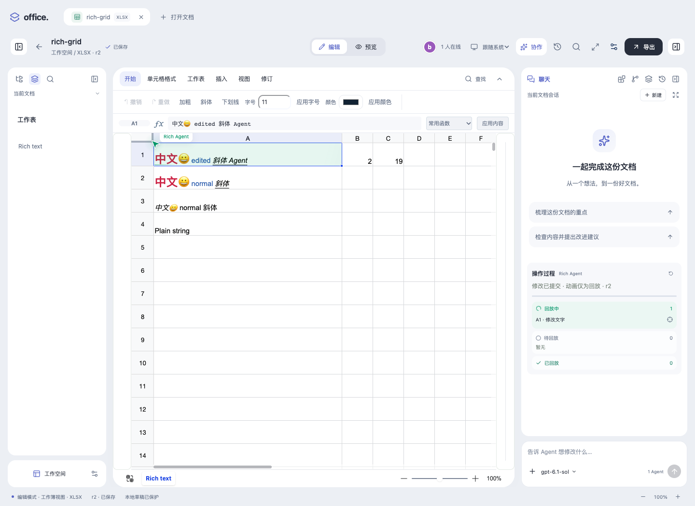

# XLSX 单元格内富文本、协同与原生回读验收

2026-11-15，`feature/hcd-font-format-integration`、HEAD `ccb5fd5` 的未提交工作区。整体仍未实现所有格式和复杂对象的完整支持，见[当前状态](hcd-capability-status-2026-11-15.zh.md)。

后续 2026-11-16 的[选区编辑与单格格式输入恢复](hcd-xlsx-rich-edit.zh.md)已补齐部分缺口；本文保留本阶段结果与当时边界。

## 修复范围

此前导入 XLSX 时，inline/shared string 的字体片段被压平成纯文字。现在单元格保持一个稳定的文字锚点，内部保留有类型约束的富文本片段。相同的中文/emoji 文字可以携带不同属性，样式不依赖文字内容匹配；拼音注音 `rPh/t` 不混入可见文字。

- 原生字体、字号、粗斜体、颜色、下划线、删除线和上下标等属性进入规范内容；主题/索引颜色、字体方案等保留原生值。属性名和值经过白名单及类型校验，不保存任意 XML。
- `text.splice` 与公式栏纯文字修改按 Unicode 标量切片，保留未改片段属性、单元格地址、节点 ID 及源映射，并更新内容 hash；Univer 文本偏移单独转换为 UTF-16。替换从目标片段继承样式，边界处纯插入沿用前一片段。
- 转为数字或公式会清除不适用的文字片段。整格格式修改只移除对应的片段覆盖属性；不相关样式保留。未改变的片段不触发额外源部件重写。
- 网格实际绘制富文本，并在每个片段上合并基础单元格样式，修复整格改色后片段错误显示为黑色的问题。服务器确认后的文字和拒绝恢复都保留富文本快照；本地确认仅更新受影响单元格，保留 canvas 实例。
- 源 XLSX 导出将修改格写为带原生属性的 inline runs，未修改 sharedStrings/styles 部件保持原字节。导出后重新导入，继续保留片段。

同时修复撤销与协同同步的时序问题：本地确认的修订在同一服务/文档/协同 epoch 内不会被较旧 React 属性覆盖；已启动的远端刷新若回到同一个本地确认修订，不清空撤销记录。真正不同的远端修订仍使旧栈失效，防止撤销覆盖 Agent 提交。格式等操作进行中锁定历史按钮。

## 验收证据

Rust 整树 **1,071 项通过**，含 doctests，25 个测试组无失败或忽略；Clippy `--all-targets -- -D warnings`、全量格式及 debug 构建通过。新增两个核心片段/校验测试及一个原生导入、文字与格式修改、源导出和回读测试。编辑器独立/嵌入构建、**15 项前端单元**通过。

最终组合浏览器 **24/24（2.2 分钟）**通过，覆盖下面的富文本链路、HTML 人工/Agent 协同、Word 混合格式/分页、七格式 Harness、公式计算/类型、导出菜单、协议预检/指纹及表格悬停/插入/20 步历史。修复后的先行 HTML/XLSX 专项为 2/2，包含在组合中，不相加。此前的失败曾分别暴露整格改色后显示黑色和撤销栈丢失；两项均经修复后的最终组合验证。

[公开样本生成器](hcd-xlsx-rich-text/make_fixture.py)构造 inline/shared 两条路径、相同文字不同属性、中文/emoji、显式 normal、注音及混合格式。[CLI 探针](hcd-xlsx-rich-text/probe_rich_text.py)验证导入、指定片段修改、稳定锚点、原生导出、未修改 ZIP 部件和重新导入，原件保持不变。[机器结果](hcd-xlsx-rich-text/cli-results.json)的 `HIGH` 是限定的源文件局部重写报告，不是 Office/WPS 视觉一致认证。

浏览器专项使用真实临时 API、协同服务、两个浏览器页面及 MCP 客户端，未调用真实模型。实际拦截 `CanvasRenderingContext2D.fillText`，确认红色粗体中文、蓝色普通文字、斜体尾部确实进入画布绘制；不是只检查 HTML 或原生 XML。人工把 `normal` 改为 `edited`，MCP Agent 追加文字，两端同步；通过页面下载原生 XLSX，检查实际 runs、显式 normal、字体和颜色。随后整格改绿、撤销、重做，两端恢复对应外观且 canvas 身份保持。真实远端更新会清除旧撤销栈，本地改色产生的新历史保留。

[画布指标](hcd-xlsx-rich-text/browser-metrics.json)摘录实际绘制调用。以下截图已查看，展示人工文字、Agent 后缀及同一文字的不同格式；主题颜色仍未认证。



原生 CLI 的 5 项公式探针也重新运行，全部通过、差异数 0，见[结果](hcd-xlsx-rich-text/formula-results.json)；其范围不同于服务端受核验计算契约。此前 HTML 全链路 CLI 探针复验通过。

## 仍未完成

- 单元格内部任意选区的格式修改、任意富文本剪贴板粘贴、多格富文本输入和富文本草稿恢复；已保留片段不等于已提供所有原生富文本编辑操作。
- 主题/索引颜色与字体方案的完整视觉解析，HTML 回退预览的复杂装饰继承；不能把原生属性保留视为实际外观相同。
- 无源跨格式转换仍是语义转换，未保留每种片段属性。旧版导入已压平的 bundle 需要重新导入原件。
- 所有 Excel 公式、数组/共享公式任意改写、图表/透视表、完整条件格式、Office/WPS 同源视觉基准和大文件并发性能。
- 编辑器构建的 Univer 分块约 16.25 MB、gzip 约 3.95 MB；首屏、低配置设备及大工作簿性能仍需单独验收。

本轮使用隔离服务与临时文件，未修改用户合同原件、重启日常服务或提交代码；完整图片、完整恢复/跨文档套件及管理端构建未重跑，无远端 CI 或干净检出认证。Rust 中间一轮曾再次出现 PPT 本地写锁冲突，最终整树通过，但其根因未确认，不能标记为已修复。

## 复现

```bash
cargo +1.90.0 test --workspace
cargo +1.90.0 clippy --all-targets -- -D warnings
cargo +1.90.0 fmt --all -- --check
cargo +1.90.0 build -p officecli
python3 docs/acceptance/hcd-xlsx-rich-text/probe_rich_text.py \
  --output docs/acceptance/hcd-xlsx-rich-text/cli-results.json
python3 docs/acceptance/hcd-capability-audit-2026-11-15/probe_formulas.py \
  --output docs/acceptance/hcd-xlsx-rich-text/formula-results.json

cd examples/hdoc/editor
npm run build
npx tsx --test src/*.test.ts
HCD_BROWSER_PATH='/Applications/Google Chrome.app/Contents/MacOS/Google Chrome' \
  npx playwright test e2e/workspace.spec.ts e2e/agent-harness.spec.ts \
  --grep 'XLSX rich strings|HTML inline fidelity|HTML and Markdown source tables|Word mixed inline edits|export menus use source-aware|export capabilities follow|all seven formats use|insert ribbon creates|Word pagination|OpenAI harness edits|table hover controls|editor deletion supports|protocol preflight|protocol fingerprint|calculation contract|verified grid caches|native literal types|workbook preview keeps' \
  --reporter=line
```

CLI 富文本探针和对应浏览器用例已加入 PR 工作流配置；尚无远端运行成功记录。

最终本地日志为 `/tmp/hcd-xlsx-rich-{workspace,clippy,format,build}-final.log`、`/tmp/hcd-xlsx-rich-{editor-build,unit,browser}-verified.log`。机器结果和截图随本文保留，临时目录不作为永久依赖。
