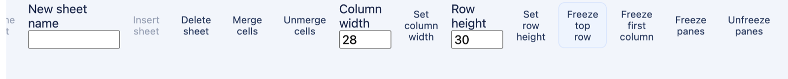

# XLSX 冻结窗格（hcd-patch/45）

`assets/showcase/budget-tracker.xlsx` 导入后有三个工作表：`Overview`、`Transactions`、`Settings`。源包里 `Transactions` 本来就带一个窗格（`<pane ySplit="1" topLeftCell="A2" activePane="bottomLeft" state="frozen"/>`），`Overview` 和 `Settings` 没有。开始页工具条末尾多出四个按钮：**冻结首行 / 冻结首列 / 冻结窗格 / 取消冻结**（英文 `Freeze top row`、`Freeze first column`、`Freeze panes`、`Unfreeze panes`），点一次走 `hcd-patch/45` 的 `xlsx.sheet.freeze`，参数只有 `sheetId`、`rows`、`columns`。



冻结记在分片上，不记在修订记录里：补丁把窗格词汇写进这张工作表**每一个** `cells` 窗口的 `<section class="hcd-sheet">` 起始标签上，并加一个 `data-hcd-pane-edited="true"`。导出只认带这个标记的窗口，所以没被冻结过的源部件逐字节不动；被冻结过一次的部件在后面的修订里即使整窗重建，窗格也还在。

## 复现

```bash
cargo build -p officecli
mkdir -p /tmp/hcd-45-accept/sources /tmp/hcd-45-accept/logs
cp assets/showcase/budget-tracker.xlsx /tmp/hcd-45-accept/sources/accept-xlsx.xlsx
target/debug/officecli hdoc import /tmp/hcd-45-accept/sources/accept-xlsx.xlsx \
  --output /tmp/hcd-45-accept/accept-xlsx.hcd --document-id accept-xlsx
target/debug/officecli hdoc validate /tmp/hcd-45-accept/accept-xlsx.hcd
```

用同一个 `HCD_TOKEN_SECRET`（≥32 字节）开三个终端：

```bash
HCD_TOKEN_SECRET='replace-with-a-private-random-secret-at-least-32-bytes' \
  target/debug/officecli hdoc serve --root /tmp/hcd-45-accept --bind 127.0.0.1:8766
```

```bash
cd examples/hdoc/editor
HCD_TOKEN_SECRET='the-same-private-secret' HCD_API_URL=http://127.0.0.1:8766 npm run sidecar
```

```bash
cd examples/hdoc/editor
HCD_DEMO_ROOT=/tmp/hcd-45-accept HCD_TOKEN_SECRET='the-same-private-secret' npm run dev
```

打开 `http://127.0.0.1:8767/`，语言选 English (US)，在“本地验收文档”里点 **预算跟踪表**，进 `Overview` 后按这个顺序点：

| # | 点什么 | 界面状态（中文界面） | 这一张表的窗口 |
|---|--------|----------------------|----------------|
| r1 | 冻结首行 | `revision 1 · Overview 已冻结前 1 行 0 列` | `frozen` / 1 行 / `A2` / `bottom-left` |
| r2 | 冻结首列 | `revision 2 · Overview 已冻结前 1 行 1 列` | `frozen` / 1×1 / `B2` / `bottom-right` |
| r3 | 选中 `E4`，点冻结窗格 | `revision 3 · Overview 已冻结前 3 行 4 列` | `frozen` / 3×4 / `E4` / `bottom-right` |
| r4 | 冻结首列 | `revision 4 · Overview 已冻结前 3 行 1 列` | `frozen` / 3×1 / `B4` / `bottom-right` |
| r5 | 冻结首行 | `revision 5 · Overview 已冻结前 1 行 1 列` | `frozen` / 1×1 / `B2` / `bottom-right` |

**冻结首行 / 冻结首列只动自己那一侧**，另一侧保持 `currentFreeze()` 读到的数，所以 r4 从 3×4 变成 3×1、r5 从 3×1 变成 1×1，都是按 Excel 的“冻结首行/首列”语义做的替换而不是叠加。r5 把 `Overview` 放回 r2 的形状，包的内容寻址于是认出这是同一个状态：`get-revision 5` 的 `rootHash` 与 `get-revision 2` 完全相同（`a716e195…`），修订还是两条，分片树只有一份。

在 `E4` 上再点一次 **冻结窗格**（已经是 3×4 的时候），界面报错、修订不动：

```
Freezing panes failed: Error: 422: {"error":"XLSX worksheet already freezes 3 rows and 4 columns"}
```

切到 `Transactions` —— 这一张表的源部件本来就写着窗格 —— 选中 `B2` 点 **冻结窗格**（r6）：新窗格把源的那一套整组换掉，`ySplit="1" A2 bottomLeft` 变成 `xSplit="1" ySplit="1" B2 bottomRight`，分片上的 `data-hcd-pane-edited="true"` 是这一换的记录。再点 **取消冻结**（r7）：窗口留在分片上，窗格词汇全拿掉，导出把源部件的 `<selection>` 也一并复原。取消之后 **取消冻结** 变成灰的（`!currentFreeze().rows && !currentFreeze().columns`）。

`Transactions` 上接着点 **冻结首列**（r9）得到只冻列的形状，再点 **冻结窗格** 回 1×1（r11）。中间 r8、r10 两次改单元格内容，用来证明窗格换了形状之后格子照样能编辑、`refreshFromServer()` 之后坐标也还在。


## 修订与导出检查

```bash
for r in 1 2 3 4 5 6 7 8 9 10 11; do
  target/debug/officecli hdoc get-revision /tmp/hcd-45-accept/accept-xlsx.hcd $r --json | python3 -c "
import json,sys
d=json.load(sys.stdin)['data']
print('r%-2d root=%s dirtyGrid=%s dirtyChunks=%d dirtyNodes=%d' %
      (d['revision'], d['rootHash'][:8], d.get('dirtyGridParts'), len(d['dirtyChunkIds']), len(d['dirtyNodeIds'])))
"
done
target/debug/officecli hdoc validate /tmp/hcd-45-accept/accept-xlsx.hcd
for r in 0 5 6 7 8 9 10 11; do
  target/debug/officecli hdoc export /tmp/hcd-45-accept/accept-xlsx.hcd --revision $r \
    --source /tmp/hcd-45-accept/sources/accept-xlsx.xlsx \
    --output /tmp/hcd-45-accept/out-r$r.xlsx --fidelity-report /tmp/hcd-45-accept/fid-r$r.txt
done
```

实测：

```
r1  root=166cb098 dirtyGrid=['xl/worksheets/sheet1.xml'] dirtyChunks=1 dirtyNodes=0
r2  root=a716e195 dirtyGrid=['xl/worksheets/sheet1.xml'] dirtyChunks=1 dirtyNodes=0
r3  root=7ab62584 dirtyGrid=['xl/worksheets/sheet1.xml'] dirtyChunks=1 dirtyNodes=0
r4  root=c2734703 dirtyGrid=['xl/worksheets/sheet1.xml'] dirtyChunks=1 dirtyNodes=0
r5  root=a716e195 dirtyGrid=['xl/worksheets/sheet1.xml'] dirtyChunks=1 dirtyNodes=0
r6  root=0ba63b05 dirtyGrid=['xl/worksheets/sheet2.xml'] dirtyChunks=1 dirtyNodes=0
r7  root=3cd6c8d0 dirtyGrid=['xl/worksheets/sheet2.xml'] dirtyChunks=1 dirtyNodes=0
r8  （没有 dirtyGridParts）dirtyNodes=1
r9  root=66bf651d dirtyGrid=['xl/worksheets/sheet2.xml'] dirtyChunks=1 dirtyNodes=0
r10 （没有 dirtyGridParts）dirtyNodes=1
r11 root=ddf1d52a dirtyGrid=['xl/worksheets/sheet2.xml'] dirtyChunks=1 dirtyNodes=0
```

一条冻结只弄脏一张表的部件，改内容只弄脏节点，两件事不在同一条账上：

```
r0  EXACT 条目 32->32 逐字节 32/32 改写 [] 新增 []
r5  HIGH  条目 32->32 逐字节 31/32 改写 ['xl/worksheets/sheet1.xml']
r6  HIGH  条目 32->32 逐字节 30/32 改写 ['xl/worksheets/sheet1.xml', 'xl/worksheets/sheet2.xml']
r7  HIGH  条目 32->32 逐字节 30/32 改写 ['xl/worksheets/sheet1.xml', 'xl/worksheets/sheet2.xml']
r11 HIGH  条目 32->32 逐字节 30/32 改写 ['xl/worksheets/sheet1.xml', 'xl/worksheets/sheet2.xml']
```

修订 0 与源包 32 个部件逐字节一致，一个字都不动 —— 没被冻结过的表不会被这条路径碰。从 r6 起两个部件都不同，是因为 r5 之前 `Overview` 已经冻过，导出按修订顺序把历史写过的那几张表一并重跑，每修订新增的还是只有一张。

四种形状写进包里的样子：

```
r5 sheet1（HCD 冻结 1×1）
  <sheetView zoomScale="105" zoomScaleNormal="105" workbookViewId="0">
    <pane xSplit="1" ySplit="1" topLeftCell="B2" activePane="bottomRight" state="frozen"/>
    <selection pane="bottomRight" activeCell="B2" sqref="B2"/></sheetView>

r6 sheet2（把源包那套 <pane ySplit="1" topLeftCell="A2" activePane="bottomLeft"/> 整组换掉）
  <sheetView zoomScale="176" zoomScaleNormal="176" workbookViewId="0">
    <pane xSplit="1" ySplit="1" topLeftCell="B2" activePane="bottomRight" state="frozen"/>
    <selection pane="bottomRight" activeCell="B2" sqref="B2"/></sheetView>

r7 sheet2（取消冻结：窗格没了，源的那两条 <selection> 回来）
  <sheetView zoomScale="176" zoomScaleNormal="176" workbookViewId="0">
    <selection/><selection activeCell="A1" sqref="A1"/></sheetView>

r9 sheet2（只冻列）
  <sheetView zoomScale="176" zoomScaleNormal="176" workbookViewId="0">
    <pane xSplit="1" topLeftCell="B1" activePane="topRight" state="frozen"/>
    <selection pane="topRight" activeCell="B1" sqref="B1"/></sheetView>
```

`r7` 那条 `<selection/>` 后面跟着的 `pane="bottomLeft"` 属性是源包写的，取消冻结之后窗格已经不存在、这个属性指向的是拿掉的那块窗格，所以跟着一起清掉；`zoomScale` 留在原位。

导出结果重新导入，窗格读得回来，也不再带 HCD 的编辑标记：

```bash
target/debug/officecli hdoc import /tmp/hcd-45-accept/out-r11.xlsx \
  --output /tmp/hcd-45-accept/reimport.hcd --document-id reimport45
target/debug/officecli hdoc validate /tmp/hcd-45-accept/reimport.hcd
```

```
HCD validation passed
chunks 4
Overview    pane-state=frozen top-left=B2 active=bottom-right frozen-rows=1 frozen-columns=1
Transactions pane-state=frozen top-left=B2 active=bottom-right frozen-rows=1 frozen-columns=1
Settings     （没有窗格词汇）
```

`Settings` 那张没被点过的表，重新导入之后仍然什么都没有 —— 冻结是记在“哪张表被点过”上的，不是给整本工作簿加一层视图状态。

## 边界

补丁侧和导出侧都宁可拒绝也不写坏文件。`cargo test -p hcd-core -p hcd-formats` 通过 70 + 142 项，其中本片是补丁侧 `patch::tests::freezing_a_worksheet_replaces_every_window_pane_and_reports_what_changed`、导出侧 `xlsx::tests::freezing_a_worksheet_writes_a_window_list_for_a_part_that_names_none` 与 `xlsx::tests::freezing_a_worksheet_replaces_the_panes_of_every_window_it_names`：

- 分片里没有窗口的表不能冻结，补丁直接报 `XLSX freeze panes require a worksheet window with a known source part`；有窗口却找不到对应部件同样拒绝。一张表的窗口被拆成多个分片时全部一起改（上面那个补丁侧测试里同一张表两个窗口，`(2,3)` 报的是改写 2 个、读到 2 个），因为 Excel 打开时读哪一个窗口都是同一块窗格。
- 不改任何东西的请求不算成功：`XLSX worksheet already freezes {rows} rows and {columns} columns`（422，上面实测的是 `3 rows and 4 columns`）、`XLSX worksheet has no frozen panes to release`（422）、`XLSX worksheet freeze target disappeared`（500，分片里的窗口不见了）。所以不会有“点了一下、修订多一条、内容一样”的空转记录，界面上按钮也不会把自己按下去。
- 形状上到 Excel 的极限：`rows` 到 1048575、`columns` 到 16383 都收，写出来是 `<pane ySplit="1048575" topLeftCell="A1048576" activePane="bottomLeft" state="frozen"/>` 和 `<pane xSplit="16383" topLeftCell="XFD1" activePane="topRight" state="frozen"/>`；再往上一格报 `XLSX freeze panes must leave at least one row and one column free`（400），`sheetId` 不是工作表 ID 报 `invalid XLSX worksheet freeze target`（400），一条补丁里放两个冻结、或者跟别的操作混着放，报 `hcd-patch/45 accepts one XLSX worksheet freeze operation only`（422）。
- 只冻一侧时另一侧的词汇不留在分片上：`(0,1)` 写 `frozen-columns="1"` 而不写 `frozen-rows`，导出成 `topRight`；`(1,0)` 写 `frozen-rows`，导出成 `bottomLeft`；`(1,1)` 才是 `bottomRight`。取消冻结留着 `data-hcd-pane-edited="true"`，只把窗格词汇拿掉，这样后面的修订重建同一个部件时知道这张表的窗格归 HCD 管。
- 冻结会连带重建整张表的窗口清单，所以取消冻结之后部件也不是逐字节回到源文件：`sheetViews` 逐字符一样（`<sheetViews><sheetView zoomScale="105" zoomScaleNormal="105" workbookViewId="0"><selection activeCell="L12" sqref="L12"/></sheetView></sheetViews>`），但 `mergeCells` 的九条按 HCD 记录的顺序重排（源是 `A1:H1, A3:B3, C3:D3, E3:F3, G3:H3, A4:B4, …`，导出是 `A1:H1, A3:B3, A4:B4, C3:D3, C4:D4, E3:F3, …`），条数和内容一条不差。这条是整窗重建路径带来的，跟行高、列宽那几片用的是同一条路。
- 冻结之后再插删行/列，走的是分片重算，窗格跟着留在包里：用一份源部件没有 `sheetViews` 的工作簿实测，先 `hcd-patch/45` 冻 1×1、再 `hcd-patch/12` 插一行，导出 `HIGH`，部件里 13 行变 14 行、`<x:pane xSplit="1" ySplit="1" topLeftCell="B2" activePane="bottomRight" state="frozen"/>` 照样写出来。
- **源部件自己就带 `<pane>`** 的那一张表也跟着移位走了。以前移位那趟重跑不认识 `pane` 元素（放行表里有 `sheetViews`、`sheetView`、`selection`，没有 `pane`），同一对修订导出报 `failed to read part: grid shift cannot update worksheet element pane`；外面冻好窗格的簿子插删行也一样撞这条，跟有没有用过冻结无关。现在窗格按行/列计数记带宽，插在带里的行把带宽加大一格、删在带里的行把它缩小一格，`topLeftCell` 跟 `selection` 走同一个 `shifted_xlsx_view_cell`，插在带外的什么都不动；`activePane`、`state`、`zoomScale` 这些移位不置可否的照原样抄。实测把上面 `out-r11.xlsx`（`Overview` 冻成 1×1）重新导入再插删：r1 写成 `<pane xSplit="1" ySplit="2" topLeftCell="B3" activePane="bottomRight" state="frozen"/>`，同一部件 `<selection pane="bottomRight" activeCell="B3" sqref="B3"/>`，12 行变 13 行；r2 删掉带里那一行回到 `ySplit="1" B2`；r0 仍然 `EXACT`，`sheet1.xml` 与源包逐字节一致。导出的那份重新导入读回 `frozen-rows="2" top-left=B3`，带宽在 HCD 这边也认得。对应 `xlsx::tests::a_pane_the_source_workbook_froze_follows_the_rows_a_shift_moves`。
- 放行不等于什么都认得，读不懂的窗格宁可拒绝：按距离分的 `horizontalSplit`/`verticalSplit`（twips，不是行也不是列，没东西可跟着移）报 `grid shift cannot update a worksheet pane split by a measured distance`，`xSplit`/`ySplit`/`splitTopRow`/`splitLeftColumn` 不是整数的报 `… whose split is not a whole number of rows or columns`（两条都跟在其它移位拒绝后面报 `failed to read part: …`，`hdoc export` 里是 `Error: unsupported mode: failed to read part: …`），没被移位碰的那一张表照原样导出。这张表要是被历史冻过或解过（分片带 `data-hcd-pane-edited="true"`），源窗格整个被换掉、没人会去读它，于是也不拦：检查那趟因此挪到 `collect_canonical_panes` 之后，先知道哪些表归 HCD 说话再判。两条都由 `xlsx::tests::a_pane_the_shift_cannot_count_stops_the_export` 与 `xlsx::tests::a_history_freeze_replaces_a_source_pane_a_shift_cannot_count` 覆盖。带宽还有天花板：源里已经写着 `ySplit="1048575"` 的窗格再往上插一行，移位会把它推出这张表。这条现在在补丁那趟就拒（见下面“分片那本账”那条），写的那一趟报的还是 `grid shift moves a worksheet pane past the sheet it freezes`（列那一侧到 16383，两边同一个上限），留给没人计数的那类窗格：`ySplit="1048576"` 这种数超过一个带宽，分片照着源写下来但移位不会去动它，于是由导出来说话。三条分别由 `xlsx::tests::a_band_that_cannot_grow_past_its_sheet_stops_the_shift`、`xlsx::tests::a_pane_no_window_counted_stops_the_export_that_would_move_it_off_the_sheet` 与 `patch::tests::a_frozen_band_that_cannot_grow_past_its_sheet_is_refused_untouched` 钉住。
- 分片那本账跟着移位走：`data-hcd-frozen-rows`/`-columns` 记的是带宽，插进带里的行、列要把它们一起加大，删在带里的要缩小 —— 以前补丁不动这两个数，只有落进源部件之后（重新导入）才跟着移位走，界面读的是分片，于是显示的冻结范围比文件里的窄一格。现在补丁侧按上面导出侧同一条规则走：插在带里加大一格、删在带里缩小一格、插在带外不动，一次插删几行就过几遍。这张表的**每一个** cells 窗口都要过一遍，不是只过移位自己碰到的那些：一个窗口说 2 行、另一个说 3 行，`collect_canonical_panes` 会报 `XLSX HCD frozen pane differs between windows`，整张表导不出来。窄到 0 就把窗格词汇整套拿掉、只留 `data-hcd-pane-edited="true"`，跟主动取消冻结写出来的一模一样；带 `data-hcd-pane-edited` 的窗口按新的数重算 `topLeftCell` 和 `activePane`（跟 `xlsx.sheet.freeze` 写的同一套），源部件带来的窗口只改这两个计数，角点和 `state` 留给导出自己移。非 cells 的窗口（图表、图片）没有窗格词汇，不动。数读不出来的窗口（不是整数，或者大过一个带宽）整个窗口不碰，交给导出判断那份源窗格还塞不塞得进这张表。实测（`/tmp/hcd-band`，源是 `assets/showcase/budget-tracker.xlsx`）：`Overview` 先 `hcd-patch/45` 冻 2×1，窗口写 `frozen / B3 / bottom-right / 1 列 2 行`，导出 `<pane xSplit="1" ySplit="2" topLeftCell="B3" activePane="bottomRight" state="frozen"/>`；r2 `hcd-patch/12` 在第 1 行前插一行 → 窗口读回 `frozen / B4 / bottom-right / 1 列 3 行`，导出 `ySplit="3" topLeftCell="B4"`；r3 删掉带里的第 2 行 → 回到 `2 行 / B3`；r4 在第 1 列前插一列 → `2 列 2 行 / C3`，导出 `xSplit="2" ySplit="2" topLeftCell="C3"`；r5 在第 12 行前插一行（带外）→ 计数与窗格一个字不动，只有 `dimension` 从 `A1:I15` 变 `A1:I16`。r2 那份导出重新导入读回 `frozen-rows="3" frozen-columns="1" top-left=B4`。没被历史冻过、源部件自带 `xSplit="1" ySplit="1" B2 bottomRight` 的那张表插一行之后，窗口读到 `frozen-rows="2" frozen-columns="1"`、仍然没有 `data-hcd-pane-edited`，导出是 `<pane xSplit="1" ySplit="2" topLeftCell="B3" …/>`，两边都认 2 行。天花板那条实测：把 `Overview` 的源窗格写成 `ySplit="1048575"` 再插一行，`hdoc apply` 报 `Error: invalid argument: XLSX frozen band grows past the worksheet it freezes`（HTTP 侧 `ResourceLimit` 映射成 413），修订表还是只有 r0，r0 导出的 `sheet1.xml` 与源包逐字节一致。界面不用改：`hcd-parser.ts` 就是把这两个数喂给 Univer 的 `startRow`/`startColumn`。对应 `patch::tests::a_row_or_column_moved_through_a_frozen_band_moves_the_band_in_every_window`、`xlsx::tests::a_frozen_band_the_history_records_follows_the_rows_and_columns_a_shift_moves` 与 `xlsx::tests::a_window_the_importer_filled_in_names_the_band_the_shift_widened`。
- 这条路径不碰源包以外的东西：`Transactions` 有 `definedName`、`Overview` 的行不在物化窗口里，所以拿这两张表试插删行时先撞上各自的旧边界（`XLSX grid shift cannot update a defined name on the edited sheet`、`insert before a materialized XLSX row`），跟冻结无关。`definedName` 那一条已经关了，见 [XLSX 行/列移位把 workbook 里的命名区域一起带走](hcd-xlsx-grid-shift-defined-names.md)：同一份 `budget-tracker.xlsx`、同一个修订再跑一次，`Transactions` 卡的是自己部件的 `autoFilter`、`Settings` 卡的是自己部件的 `sheetProtection`（都还在 `failed to read part: …` 那一层），命名区域不再是原因；`Overview` 那条是补丁侧的，跟着不变。`autoFilter` 那条也在下一片关了，见 [XLSX 行/列移位把自动筛选和数据验证一起带走](hcd-xlsx-grid-shift-filter-validation.md)：`Transactions` 现在插删行/列一路走通；`Settings` 的 `sheetProtection` 也在再下一片关掉了，见 [XLSX 行/列移位放行受保护的工作表](hcd-xlsx-grid-shift-protection.md)，那张表同样插得出行。剩下的是 `Overview` 的物化窗口一条。
- 界面这边，`冻结窗格` 按 Excel 的习惯读选区：光标站的那一格就是窗格右下方那一格，所以 A1 没有可冻结的东西，直接报 `A1 的上方和左侧没有可冻结的行或列，请选中其他单元格`，没选中区域报 `请先选中要冻结区域右下方的单元格`。有单元格还在保存时按冻结报 `请等待当前单元格保存完成`。状态栏和报错文案的中英文都登记在 `sourceLocale.tsx`：`revision N · {表名} 已冻结前 {rows} 行 {columns} 列` 和 `… 已取消冻结` 是带插值的句子，走 `localizeDynamic` 里的两条正则，英文分别是 `Revision N · {Sheet}: froze 3 rows and 4 columns` 与 `Revision N · {Sheet}: unfrozen`（1 行时是 `froze 1 row`）；失败前缀 `设置冻结窗格失败：` 登记在 `dynamicEn`，因为它是接在异常文本前面的。
