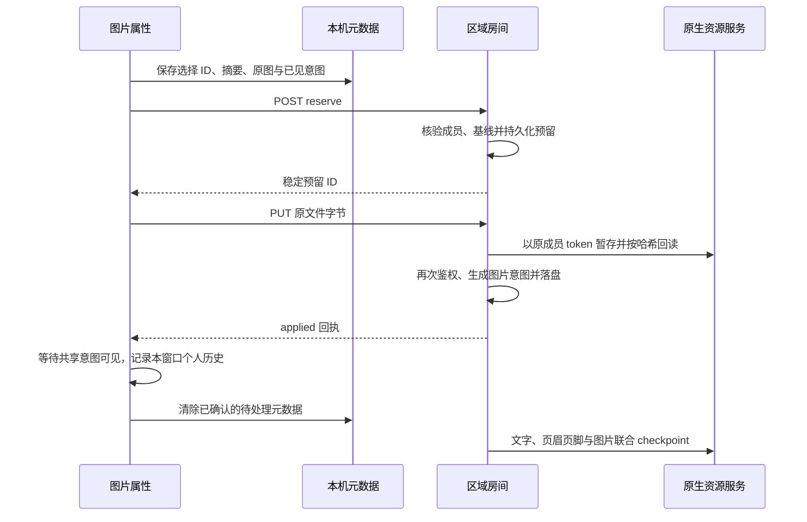

# 区域换图：浏览器预留、恢复与个人撤销

2026-10-27。承接[区域浏览器入口](hcd-word-browser-regional.zh.md)和[服务端上传账本](hcd-word-upload-lifecycle.zh.md)，本轮接通实际 `EmbeddedHcdEditor` 的换图入口。仍只对显式 `hcd-word-regions/1` 文档开放，不迁移旧文档；管理平台和实际提醒暂缓。

## 完整链路



文件选择开始就阻止本窗口显示“已保存”。发送字节之前，选择元数据先落在 IndexedDB，再落服务端签名日志；服务端预留同时阻止其他成员创建遗漏换图的新 checkpoint。正文仍可编辑、协同和保存在草稿中。已有在途 checkpoint 仍遵循原有捕获边界，不把后来的上传一起确认。

- 本机记录包含文件名、长度/摘要、目标图片、原生版本、文件选择时看见的图片意图、原图和个人撤销需要的可见值；不存 Bearer token。文件字节不写入 Yjs 或该元数据，缺字节时要求重新选择同一原文件。
- 服务端以不可变原图核验 `visualHash`，只绑定选择时确实看见且仍匹配的意图；后来到达的另一份换图不会被最后完成的上传静默抹去。
- 请求重复使用同一 UUID。预留请求摘要绑定完整选择；不同文件、基线或意图集合不能借同一个 ID 改写原选择。已应用记录的重复恢复不重复上传或生成图片意图。
- 网络断开不等于取消。缺少结果时保留选择、显示错误码和说明，提供核对、恢复、选择原文件、取消操作。设备下载副本现在也包含待处理换图元数据，仍不是完整 HCDZ。
- 取消建立持久化取消记录。即使取消先于一个迟到的预留请求，也不会被同 ID 的请求复活。只有确认取消后才解除本机门禁；未确认时继续保留待处理状态。取消已应用的选择会提示使用撤销。
- 服务重启后，未结束预留标为中断；不自动换图。原成员在新连接中明确恢复，先核对已有暂存字节；缺少时再接收相同文件。

## 成员与房间边界

sidecar 提供以下内部接口：

| 路由 | 请求 | 作用 |
|---|---|---|
| `POST /v1/documents/:id/collaboration/word-uploads` | `operation: list, ids?` | 仅列出本人待处理选择，按指定 ID 补查已结束回执 |
| 同上 | `operation: reserve, selection` | 字节发送前持久化选择 |
| 同上 | `operation: resume, id` | 按相同哈希核对暂存字节并恢复 |
| 同上 | `operation: cancel, id` | 取消已经存在的本人选择 |
| 同上 | `operation: cancel-selection, selection` | 对本机未知结果建立同 ID 取消记录 |
| `PUT .../word-uploads/:uploadId` | 原始文件字节 | 核对长度与哈希后继续同一选择 |

请求需要 Bearer、`X-HCD-Node-Edits-Version: 7` 和当前 `X-HCD-Collaboration-Epoch`。房间必须已加载、有有效原生 lease，且未处于迁移/恢复排他阶段。metadata 请求最多 1 MiB，单文件最多 8 MiB，服务端最多 16 个未结束选择。客户端限制未完成选择数量，并裁掉超量的已结束显示记录。

身份来自原生 `/auth`，不采用客户端 userId。服务端上传用对应成员 token；协作服务 token 不会绕过原生上传权限。暂存和应用前再次核验账户、写权限、epoch 与 lease。token 只留在所属房间的内存映射，卸载时清理，不进入日志或归档。只读成员只能查看自己的记录，不能上传、恢复或取消；另一名成员不能认领选择。

## 个人历史与协作

服务器应用换图后，当前窗口只记录一条对应的图片动作。旧窗口恢复的上传仍携带旧 clientId；浏览器通过受权回执接纳这一个纯资源意图的本地历史归属，不篡改共享作者或 clientId。

撤销只反转自己的资源字段。未提交时可以去掉这一个上传意图；同伴尺寸意图继续保留。已提交时按不可变当前图片生成反向意图。对同伴冲突字段，即使目标恰好等于规范基线，也会报告冲突，不能弹出历史却不产生变化。重做沿用相同当前基线检查。

保存、导出和关闭统一检查本机选择、服务端 pending、图片意图摘要及 provider 同步。上传任务状态和文档保存状态分开显示，上传中断不会误当文档版本冲突，也不会建议反复重连来代替选择原文件。

## 实测与证据

隔离 fixture：`target/hcd-preview-runtime/word-room-ay3p6fl8`。测试使用生产 sidecar/嵌入组件、合成账户与原生本机文件，不改原用户预览。

- 真实 HTTP：先预留再发送半段字节，取消后补齐旧请求，收到拒绝且没有换图。只读写入、旧 epoch 和其他成员认领被拒绝；重复恢复只应用一次。
- 浏览器：错误文件保留任务；同一原文件可恢复。上传 pending 时另一成员输入仍能协同，保存按钮保持门禁。
- 独立本机代理暂停了真实浏览器 PUT，文件名和选择已在设备和服务端落盘。代理断开请求后重启原生服务及 sidecar；新浏览器实例仍显示 `interrupted-original.png`，保留同伴后续文字。无暂存字节时要求同一原文件，没有自动换图。
- 新窗口恢复后，在 checkpoint 前撤销旧窗口的换图。实际 r4 图片仍为 r3 的原值，同伴新正文已保存；重做保存 r5 后图片改为所选新哈希。
- 全量 898 项前端测试、TypeScript、生产/嵌入构建通过。专项覆盖本机落盘期间取消、未知结果、响应身份不匹配、精确重试、取消记录、旧窗口撤销和同伴字段保护。
- 实际 DOCX 引用 r5 的新图片字节；HCDZ 解包后 r0–r5 编辑状态逐版一致，原图和所有已提交替换图片的字节都保留。具体浏览器下载回读和源码摘要见 `docs/assets/hcd-word-upload-browser-2026-10-27/`。

代理丢弃的是尚未转交到 sidecar 的 PUT；本轮不把它冒充“原生已经上传成功但响应丢失”。后者及原生 GC 后恢复已有[上一轮服务端证据](hcd-word-upload-lifecycle.zh.md)。取消请求若未确认，界面会保留待处理并允许核对/重试；确认后才记录取消完成。

```bash
cd examples/hdoc/editor
npm test
npm run build
```

```bash
python3 scripts/hcd-word-room.py --rich-ui
# 使用该隔离 fixture 自动生成的不同测试 PNG：
node --import ./examples/hdoc/editor/node_modules/tsx/dist/loader.mjs \
  scripts/hcd-word-upload-http.mts FIXTURE/private.json
node scripts/hcd-word-upload-proxy.mjs FIXTURE
# 停止自有 fixture 后，以相同原生端点和私有日志恢复：
python3 scripts/hcd-word-browser-preview.py FIXTURE
python3 scripts/hcd-word-upload-browser-files.py FIXTURE
```

`--rich-ui` 会生成 `replacement.png`、`recovery-original.png` 和 `interrupted-original.png` 三个不同的 2×1 PNG，供 API、文件恢复和网络中断验证。代理的 `/__hold`、`/__drop`、`/__release` 只存在于独立测试进程，未向生产编辑器添加测试开关。

## 仍待完成

旧房间/epoch 草稿与上传选择的协调迁移、被永久撤权成员的跨 epoch 选择审阅、资源 pin 精确回收、远端日志和跨主机路由仍未解决。页面精确分页/长文虚拟化、区域自定义节点和 AI 仍在原实施清单中。本轮不代表这些能力或生产部署已完成；管理平台和提醒投递不做。
