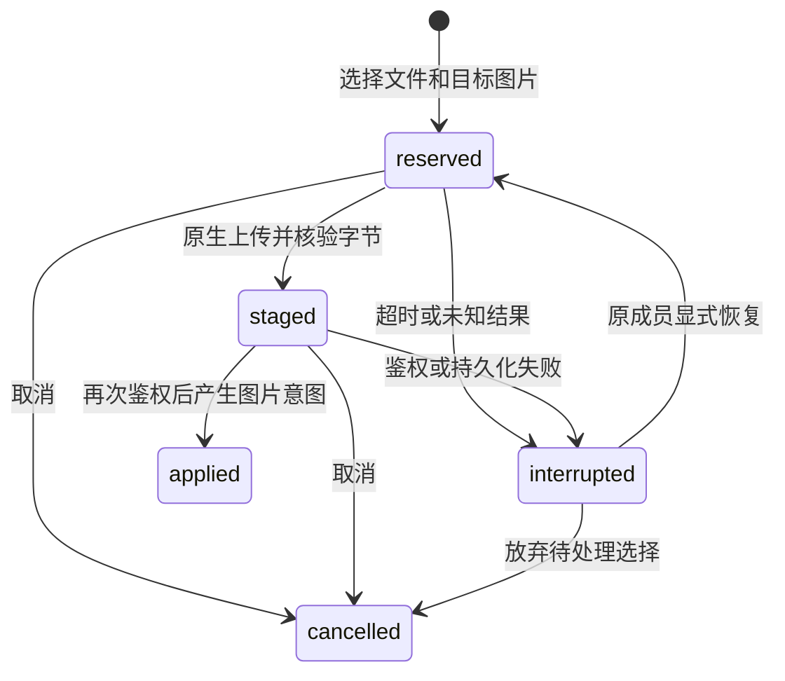

# Word 区域上传预留、中断恢复与保存门禁

后续进展（2026-10-27）：[浏览器与 HTTP 接入](hcd-word-upload-browser.zh.md)已完成本机实际验证。本页保留服务端账本首次交付时的验证与未接入范围。

2026-10-26。在[区域图片联合保存](hcd-word-regional-images.zh.md)之后，将上传尚未完成的选择纳入区域保存协调器的私有日志。此处实现的是服务端内部生命周期；Hocuspocus 区域房间和现有纸张浏览器尚未切换到该链路。

后续已有[本机区域房间与逐包接入](hcd-word-room.zh.md)，默认关闭，先接保存/状态。上传 HTTP/消息入口、成员 transport 和浏览器恢复选择仍未接入此房间。

## 状态与持久化



- 上传开始立即占用 pending。新保存等待上传；已经在途的旧 checkpoint 仍可确认它捕获的内容，但上传继续使文档保持待保存。上传期间输入照常进入草稿及后续私有日志快照，不把尚未完成的换图遗漏后显示已保存。
- 私有记录包含随机 upload ID、文档/epoch/lineage 所属日志、region/node、原生版本、成员 ID/名称快照、文件 hash/长度/扩展名，以及选择文件时已见到的图片意图。文件字节、Bearer token 和签名密钥不进入该记录。
- 完整原始图片基线及已见意图先持久化，再执行原生 POST。原生返回成功后按 hash 读取暂存文件，核对实际长度和 SHA-256；阶段日志先于正文绑定。应用后再次持久化，失败时不能显示可靠保存。
- 重启把未结束状态标为中断，不自动应用，也不替原成员重新选择当前意图。原成员显式恢复时先找同一 hash 的已归档字节；不存在则要求相同文件，换成不同内容必须另建选择。重复恢复已应用记录只补日志，不再插入图片意图。
- 取消不等待不配合 abort 的 transport。其迟到成功可以留下原生暂存资源，但不能复活取消的意图。45 秒网络等待上限、drain 和 dispose 均能终止本组件的等待；这不等于远端服务器保证停止写入。
- 应用只替换文件选择时捕获、且此后未变化的资源意图。之后的尺寸修改保留；两个独立换图交错完成会保留冲突候选，而不是以最后到达的响应覆盖前者。

服务端 API 为 `owner.uploads.start/resume/cancel`，适用于可信房间宿主。客户端声明的 userId 或 uploadId 不是授权依据：宿主必须提供当前成员鉴权回调和成员 token 对应的上传 transport；在开始和应用前再次检查。未配置任一依赖时拒绝开始。原生继续禁止协作服务通过普通资源上传路由写入，不修改此限制。区域规范保存仍使用专用协作服务接口，二者身份不会混用。

## 资源保留与边界

原生 `assets/staged` 描述符已经是持久化资源 pin，GC 会保留其描述符和字节。本轮复用并实测该保证；上传预留不是分布式房间租约，也没有新增会静默丢弃离线选择的过期时间。取消后暂存字节保守保留，精确回收策略和跨实例所有权另行完成。

每个 owner 最多 16 个未结束上传，每个文件最多 8 MiB，记录最多 128 条，达到上限时只裁掉已结束记录。沿用整个私有日志 32 MiB payload、8 MiB Yjs 状态等限制，超限/落盘失败不开始规范提交。

## 验证

```bash
cd examples/hdoc/editor
npm test
npm run build
```

```bash
python3 scripts/hcd-word-region-store.py --coordinator --images --uploads
```

- 新增 12 个协调器案例、1 个私有日志案例。协调器/日志共 47 项，前端共 824 项通过。覆盖上传 pending、取消与迟到响应、超时/缺文件/同文件重试、重启、两次恢复、日志失败、撤权、并发换图、在途保存、缺少身份/transport 配置，以及 drain/dispose。超时、磁盘失败和不配合取消的 transport 是受控注入，不冒充真实磁盘故障或浏览器关闭验收。
- 真实原生测试先以 Bob 的 token 上传不同 PNG。代理等待原生成功后暂不交付响应；Alice 此时输入，手动保存没有发出规范 checkpoint，head 仍 r1，上传选择和文字已进私有日志。
- 代理实际关闭 TCP；第一个 Node 进程结束。执行原生 `hdoc gc --delete` 后，第二个进程仍能核验同一暂存文件。Alice 不能认领 Bob 的记录；Bob 显式恢复无需再次上传，重复恢复只应用一次，上传期间文字仍在。
- 随后的独立进程继续原有联合保存验证：正文/页眉页脚/图片提交为 r2，响应再次丢失，另一进程重放后保留新输入和尺寸并提交 r3。实际 DOCX 的关系目标、图片字节与尺寸、HCDZ r1/r2/r3、validate、人员关联事件作者及去重均通过，提醒仍关闭。

证据与实际文件：`docs/assets/hcd-word-upload-lifecycle-2026-10-26/`。测试新建独立文档、身份、端口和私有日志；没有改动用户文档或历史预览。

## 继续接入

还需把这些状态和恢复选择接到 regional room 的 stateless 消息、逐包身份、epoch 迁移、房间所有权及浏览器上传/关闭/导出交互。本轮没有浏览器区域富文本端到端验收。之后继续区域 binding、统一命令/Notion 菜单、个人撤销、扩展节点和 AI 接受事务。

超长文档数据虚拟化、私有日志压缩/GC、远端日志适配和多实例验收仍在总清单。管理平台暂不做；提醒协议保留，不发送。
