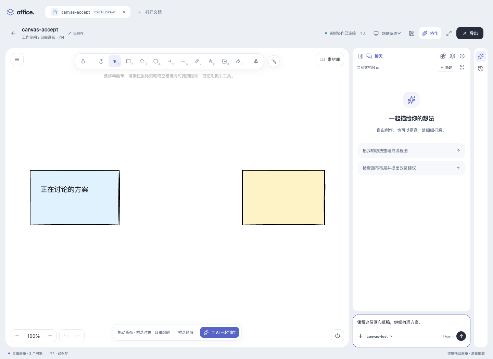
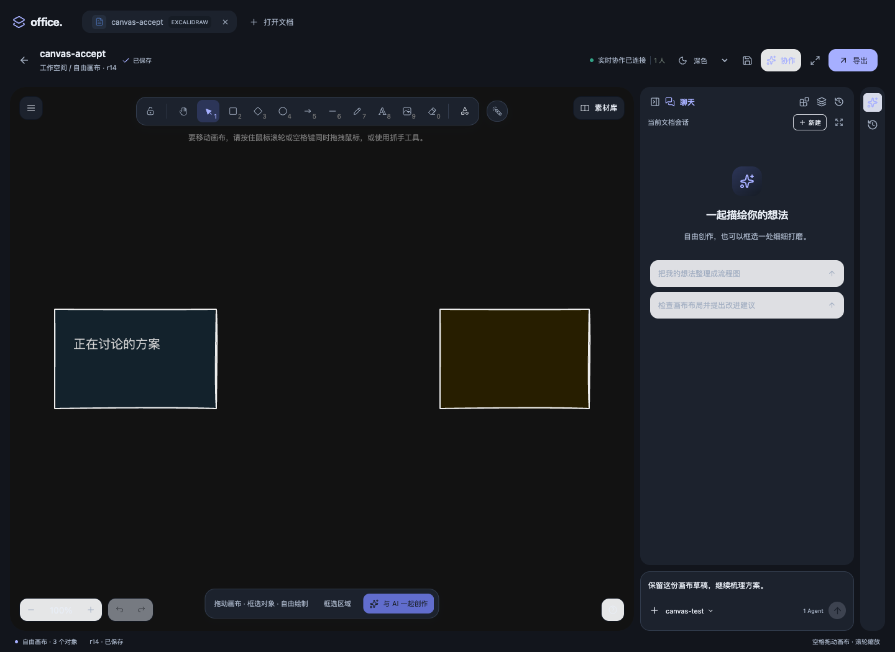

# 自由画布：统一 Pen 工作空间样式

日期：2026-11-17。

本轮依据仓库已有的 Pen V2 共享组件 `AUmlC` 和[圆角停靠面板](../officecli-docked-panels-v2/README.md)约束调整实际页面。设计工具 `get_app_state`、`read_skill` 均返回本计费周期额度已用尽，因此没有实时读取、修改或保存 `.pen` 原稿。原稿更新仍待额度恢复后进行；本记录和页面截图属于实现与验收资料。

## 页面约束

| 区域 | 约束 |
| --- | --- |
| 工作空间 | 复用现有 `--canvas`、`--surface`、`--stage`、`--ink`、`--accent` 等变量 |
| 中央画布舱 | 26px 圆角，独立裁切；原生绘制、拖动、选择和缩放继续由 Excalidraw 负责 |
| AI 主面板 | 复用文档页同一个 `AgentPanel`，默认 344px，展开聊天为 480px，圆角 16px |
| AI 输入区 | 独立 16px 圆角，和聊天主面板相隔 10px；焦点反馈包围整个圆角输入区 |
| 面板布局 | 正常停靠，画布与侧栏相隔 10px；收起释放空间，保留编辑器和草稿 |
| 原生工具栏 | 浮动工具栏采用共享字体、强调色、表面和圆角变量 |
| 顶部操作 | 沿用文档身份、保存状态、分享、外观、协作和导出的布局；原生文件与 PNG 归入导出菜单 |
| 历史 | 使用同一套停靠面板，和 AI 面板互斥打开 |
| 手机 | 面板使用内容列；关闭或 Escape 返回仍挂载的画布，无覆盖画布的遮罩 |

深色沿用现有主题：背景 `#12151C`、表面 `#1C222D`、内容背景 `#161C25`、文字 `#E8EDF5`、次级文字 `#A4B0C3`、分隔线 `#323C4D`、强调色 `#A6AFFF`。原生场景的颜色仍由 Excalidraw 场景和主题控制。

## 共用组件

- `CanvasWorkspace.tsx` 使用现有的 `workspace semantic-workspace`、`WorkspacePanel`、`WorkspacePanelControls` 与 `DocumentViewState`。
- 右侧直接使用 `AgentActivityLayer.tsx` 中的 `AgentPanel` 和任务上下文，去掉独立画布 AI 外壳及重复任务轮询。
- 聊天导航、历史、新建任务、展开聊天、输入、模型信息、工具过程均来自现有组件。
- 图片资源页显示原生画布图片；画布不显示不适用的多文档工作流与生成配图设置。
- `canvas.css` 只适配画布工具、选区反馈、资源和导出菜单，其余视觉复用 `soft-canvas.css`、`panel-shells.css` 与 `workspace-panels.css`。

## 验证与预览

完整记录见[样式验收](../../acceptance/hcd-canvas-style-v2.zh.md)。

