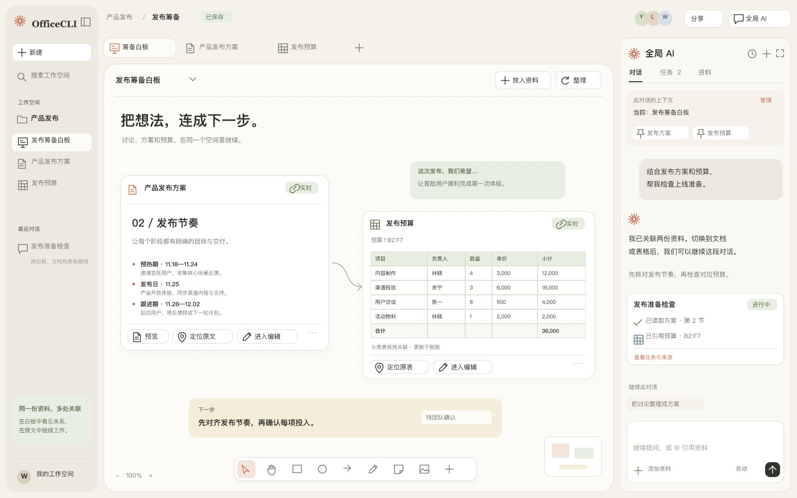
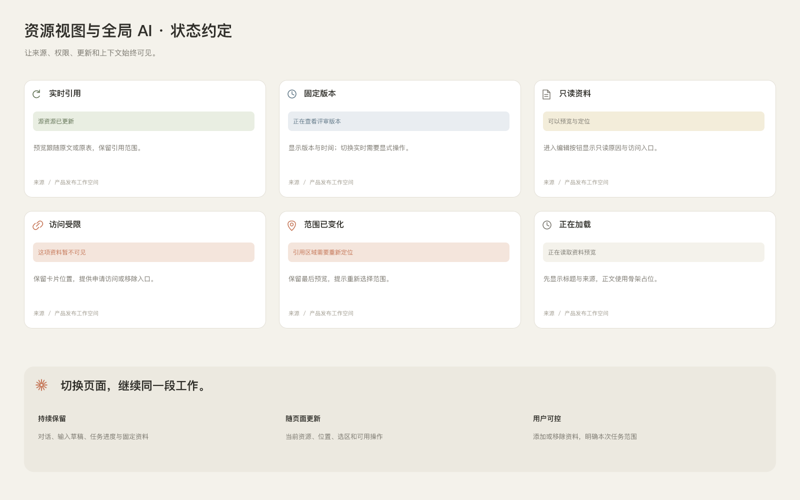

# 资源白板与全局 AI · FigCraft 设计稿

更新：浅灰白与低饱和蓝的完整办公版本见 [V2 设计稿](../officecli-resource-workspace-v2/README.zh.md)。本目录保留暖色 V1 原稿用于比较。

日期：2026-11-17。项目：OfficeCLI · 资源白板与全局 AI。

本轮先交付可编辑设计稿与可点击原型。通过本机 FigCraft 0.18.1 的 stdio MCP 创建独立原生文件，没有修改已有 Pen 或其他 FigCraft 项目。卡片引用刷新、跨资源定位及全局 AI 会话迁移仍需接入产品代码；稿中的内容、状态和金额为设计样例。

## 打开与演示

- 原生文件：[officecli-resource-workspace.figcraft](officecli-resource-workspace.figcraft)。
- 在 FigCraft 的「01 · 资源引用与编辑流程」页选择第一张画板，点击 Present。
- 「00 · 视觉规范与共享组件」保存颜色与全局 AI 主组件；「02 · 状态与交互约定」说明资源异常和会话持续规则。
- 八张流程画板为 1600 × 1000，共设置 113 个跳转，包含重复出现的资源导航和返回入口。

| 画板 | 内容 | 预览 |
| --- | --- | --- |
| 01 | 白板总览：文档卡片、表格区域、关系与全局 AI | [查看](previews/01-board.png) |
| 02 | 插入资源：可访问资料、文档片段预览、实时引用 | [查看](previews/02-insert.png) |
| 03 | 文档预览：目录、引用位置、定位与编辑入口 | [查看](previews/03-doc-preview.png) |
| 04 | 原文编辑：位置高亮、返回白板、AI 对话持续 | [查看](previews/04-doc-edit.png) |
| 05 | 选择表格区域：预算!B2:F7、范围确认 | [查看](previews/05-range.png) |
| 06 | 白板中的表格区域：选中工具栏、来源与编辑入口 | [查看](previews/06-range-board.png) |
| 07 | 原表编辑：范围高亮、公式栏、返回白板 | [查看](previews/07-sheet-edit.png) |
| 08 | 全局 AI：当前页面、固定资料、上下文管理 | [查看](previews/08-ai.png) |

## 视觉约束

采用暖白、炭灰、陶土色和低饱和鼠尾草绿。白板、文档和表格处于同一个工作空间外壳，保持相同的导航、标签、保存状态与 AI 位置。英文品牌用 Georgia，中文界面用 PingFang SC，数字与部分工具标签用 Inter；当前本机字体检查无缺失。

| 项目 | 约束 |
| --- | --- |
| 页面背景 | #F4F2EB |
| 导航背景 | #ECE9E0 |
| 内容背景 | #FCFBF7 |
| 正文 | #302F2A |
| 强调色 | #C57556 |
| 成功与实时状态 | #607153 / #E9EEE2 |
| 主工作区圆角 | 26px |
| 资源卡片、AI 外壳与输入框 | 16px |
| 按钮圆角 | 10px |
| 全局 AI 默认宽度 | 344px |
| 工作区与 AI 间距 | 12px |

原生文件包含 18 个颜色变量，以及一个复用到八个流程页面的 Global AI 主组件。组件暴露 CurrentPage、Reply、Selection、HasSelection 属性，以便统一改样式、分别表达页面上下文。

## 全局 AI 的产品边界

AI 由工作空间持有。切换白板、文档和表格时，保留同一个对话、输入草稿、固定资料与任务进度。

- 当前页面：由「跟随当前页面」控制，可随导航更新。
- 当前选区：明确展示文档引用位置或表格范围，提交任务时固定执行范围。
- 固定资料：由用户添加或移除，跨页面持续保留。
- 资料与操作权限：每项引用独立检查；全局 AI 入口不会自动获得所有资源权限。
- 任务来源：同时记录来源资源、范围和执行时版本；编辑途中发生变化时重新核对。

右侧面板保持「对话 / 任务 / 资料」结构，输入区与聊天区共用字体、边框和圆角。当前设计演示对话持续与上下文管理，其他标签的完整子页面不在本轮交付范围内。

## 资源引用与进入编辑

白板节点保存资源身份、视图、范围和几何位置；正文仍由原文档或原表格管理。建议落地字段如下，此处为实现约定而非已实现接口。

| 字段 | 用途 |
| --- | --- |
| resourceRef | 提供方、资源 ID、格式 |
| selector | 文档稳定节点或片段；表格稳定 sheetId 与范围 |
| versionMode | 实时引用或固定版本 |
| sourceRevision | 解析引用时的源版本，用于校验和重新定位 |
| view | 预览方式、标题、缩放、宽高、白板位置 |
| capabilities | 可预览、可定位、可编辑、可用于 AI |

文档示例引用「产品发布方案 / 第 2 节 · 发布节奏」。预览界面突出引用位置，进入编辑后仍高亮原文位置，返回白板恢复原视角与选中对象。

表格示例引用「发布预算 / 预算!B2:F7」，六行五列包含表头、四项费用与合计；编辑示例定位 F3，公式为 =D3*E3。范围名称用于用户理解，实际身份应包含稳定 sheetId 和版本校验。

卡片按「预览 → 定位 → 编辑」逐级打开。画布拖动与内容编辑需要明确切换交互焦点；轻量卡片预览无需常驻完整文档编辑器。

## 状态

状态画板覆盖实时引用、固定版本、只读、访问受限、范围变化和加载。权限失效时隐藏正文预览；范围变化且仍有访问权限时，才允许保留最近预览并引导重新定位。

## 验证记录

- MCP 创建、保存、重新打开与导出成功；原生内容为文本、矢量、框架、组件与实例。
- 检查八个流程画板、八个全局 AI 实例、113 个跳转目标及十张导出图片。
- 在 FigCraft 原生演示中实际点击：01 → 03 → 04 → 01 → 02 → 05 → 06 → 07 → 08 → 01。
- 逐张检查布局和字体，修正选中工具栏与便签遮挡；最终工具栏间距为 13px。
- 记录：[manifest.json](manifest.json)、[validation.json](validation.json)、[font-report.json](font-report.json)、[inspection.json](inspection.json)。
- MCP 作者脚本：[build_design.py](build_design.py)、[figcraft_mcp.py](figcraft_mcp.py)。脚本对已填充的文件保守拒绝覆盖。

## 参考

交互方向参考 [Claude Whiteboards 官方使用说明](https://support.claude.com/en/articles/18324319-get-started-with-claude-whiteboards)和 [Claude 跨白板、表格及连接器的产品介绍](https://claude.com/resources/articles/more-ways-to-work-with-claude-sheets-whiteboards-and-interactive-connectors)。资源卡片内的文档与表格视图、全局 AI 上下文管理是本项目的设计方案，不据此声称还原了 Claude 的私有实现。
