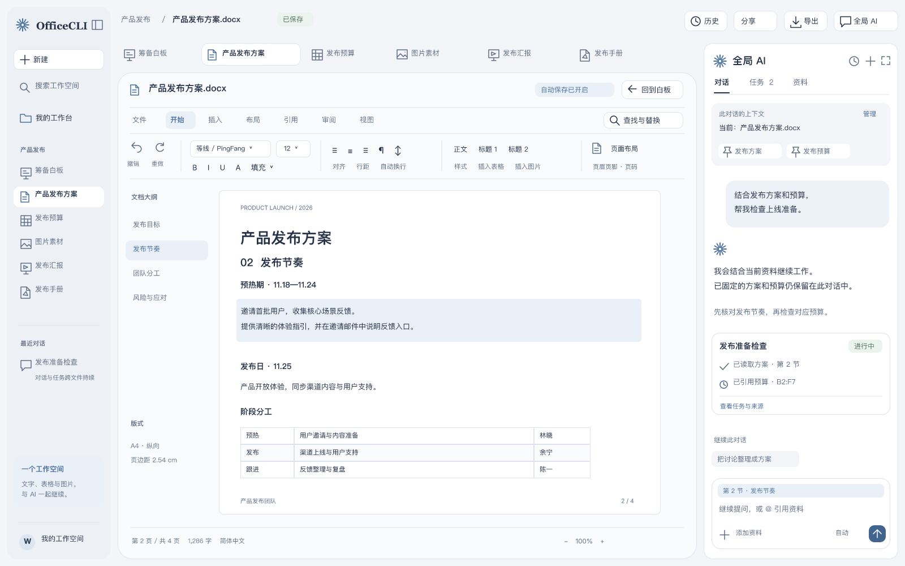

# OfficeCLI 统一办公工作空间 · V2

最新版本见 [V3 · 墨色、纸白与陶土 / 角角](../officecli-resource-workspace-v3/README.zh.md)。本目录保留此前浅灰白与低饱和蓝方案。

日期：2026-11-17。按照本轮选择，整体采用浅灰白与低饱和蓝，保留统一圆角和全局 AI。通过本机 FigCraft 0.18.1 的 stdio MCP 扩展原项目，交付可编辑原生设计与可点击原型。

**本轮是设计更新。** 文档和表格的新增常用工具、白板资源引用以及全局 AI 会话迁移仍需逐项接入实际产品；不能由设计中的按钮推断相应功能已经运行。原 V1 原生文件保持不变。

- [打开 FigCraft 原生稿](officecli-office-workspace-v2.figcraft)
- [全部画板清单](manifest.json)
- [MCP 导出的颜色变量](neutral-blue.tokens.css)
- [原生结构与验证](validation.json)
- [已有能力与新增设计的对应关系](capabilities.zh.md)

在 FigCraft 中打开「01 · 统一办公与资源白板」页，选择「10 · 统一工作台」，再点击 Present。也可以从「01 · 白板总览」开始。

## 本轮变化

| 范围 | 设计内容 |
| --- | --- |
| 整体配色 | 页面、导航、工具栏、内容区、资源卡片、AI、选区、按钮和状态统一换色 |
| 文字文档 | WPS/Word 式常用工具栏、字体字号、段落与样式、表格图片入口、页面布局、审阅批注、查找替换 |
| Excel | 单元格格式、公式栏、数字格式、边框、合并、冻结入口、工作表、筛选图表、查找替换、区域引用 |
| 图片 | 预览信息、裁剪旋转、尺寸、光线色彩、蒙版、生成中、候选对比、PNG/JPEG/WebP、导出副本、版本、专注及手机布局 |
| 演示与 PDF | 幻灯片缩略图、形状属性、演讲备注；PDF 页缩略图、文字高亮与批注 |
| 全局 AI | 同一个主组件贯穿各格式，当前页面与选区更新，对话、固定资料和任务持续保留 |

这里的 WPS/Word 表示常用文字编辑的交互方向，文件仍面向现有 DOCX/XLSX/PPTX 等格式；本轮没有新增专有 .wps/.et/.dps 格式兼容承诺。

## 配色与布局

| 角色 | 色值 |
| --- | --- |
| 页面背景 | #F3F5F8 |
| 导航 | #EDF1F6 |
| 内容工作区 | #FAFBFD |
| 内容卡片与 AI | #FFFFFF |
| 正文 | #253248 |
| 次要文字 | #5F6F86 |
| 强调色 | #486F9D |
| 选中底色 | #EAF0F8 |
| 主按钮 | #42658F |
| 分隔与边框 | #DDE4EE |

圆角沿用主工作区 26px、资源卡片和 AI 16px、按钮 10px。标准桌面画板为 1600 × 1000，AI 宽 344px，与主内容相隔 12px；手机画板为 390 × 844。

绿色只用于实时、完成等状态及部分表格识别；操作、焦点和选中态统一使用蓝色。图片原始内容与 PDF 的用户高亮色独立于界面主题。

## 画板

共 32 张：原有 8 个资源流程页面及 2 张规范/状态画板一并换色，新增 22 个页面。

| 编号 | 页面 | 预览 |
| --- | --- | --- |
| 00 | 新配色与共享 AI 组件 | [查看](previews/00-foundations.png) |
| 01–08 | 白板、资源插入、文档预览、表格范围、全局上下文 | [白板](previews/01-board.png) · [资源插入](previews/02-insert.png) |
| 09 | 资源状态与 AI 持续性 | [查看](previews/09-states.png) |
| 10 | 统一工作台 | [查看](previews/10-library.png) |
| 11 | 文字常用编辑 | [查看](previews/11-word.png) |
| 12 | 文字审阅与批注 | [查看](previews/12-review.png) |
| 13 | Excel 常用编辑 | [查看](previews/13-excel.png) |
| 14 | Excel 筛选与图表 | [查看](previews/14-data.png) |
| 15 | 图片预览与信息 | [查看](previews/15-image.png) |
| 16 | 裁剪旋转与尺寸 | [查看](previews/16-crop.png) |
| 17 | 光线与色彩 | [查看](previews/17-adjust.png) |
| 18 | 涂抹区域与局部重绘 | [查看](previews/18-mask.png) |
| 19 | 生成中与后台任务 | [查看](previews/19-progress.png) |
| 20 | 原图与候选对比 | [查看](previews/20-compare.png) |
| 21 | WebP 转换 | [查看](previews/21-convert.png) |
| 22 | JPEG 透明区域填充 | [查看](previews/22-jpeg.png) |
| 23 | 转换完成与副本 | [查看](previews/23-done.png) |
| 24 | 图片历史 | [查看](previews/24-history.png) |
| 25 | 图片专注模式 | [查看](previews/25-focus.png) |
| 26 | 手机图片与全局 AI | [查看](previews/26-mobile.png) |
| 27 | 演示编辑 | [查看](previews/27-ppt.png) |
| 28 | PDF 阅读与批注 | [查看](previews/28-pdf.png) |
| 29 | 文字查找替换 | [查看](previews/29-find.png) |
| 30 | Excel 查找替换 | [查看](previews/30-excel_find.png) |
| 31 | PNG 无损与透明输出 | [查看](previews/31-png.png) |

## 交互约定

- 左侧和标签均可切换主要资源；原白板中的进入编辑按钮连接完整文字/表格编辑界面。
- 文字审阅、查找替换和 Excel 数据工具各有独立状态；工具栏细项为界面示例，主要导航设置了可点击链接。
- 图片参数在内容区停靠。右侧全局 AI 保存对话与任务，图片选区及任务状态通过共享组件属性表达。
- 蒙版按原图坐标与显示比例对齐，图片本身保留原始矩形边界；裁剪框仅在裁剪状态显示。
- 原图与候选共用视口与比例；分割线两侧分别显示橙色花瓶与绿色花瓶。
- PNG 隐藏有损画质参数，JPEG 显示透明填充颜色，WebP 显示画质和透明选项。进入结果页时，通过原型变量更新对应的文件名及格式。
- 专注模式收起两侧面板并保留 AI 入口；手机使用统一配色的全局 AI 抽屉。手机仅交付一张布局状态，完整手机流程尚未制作。

## 素材与实现边界

复用仓库已有的 [ceramic-portrait.jpg](../officecli-image-workspace/assets/ceramic-portrait.jpg) 和 [局部候选示意](../officecli-image-workspace/assets/vase-repaint-candidate-demo.png)。候选是之前的蒙版内颜色合成示意，本轮没有调用图像模型。照片以位图嵌入；界面文字、矢量、控件、框架和组件保持可编辑。

全局 AI 仍遵循每项资源的访问权限。全局入口、对话持续和跨格式任务的设计不改变现有宿主授权规则，执行前仍需核对来源、选区与版本。

## 验证与作者文件

- 通过 MCP 保存并重新打开原生文件，检查 32 张导出 PNG。
- 原生结构中共 699 个交互，所有导航目标均存在；28 个桌面 AI 实例复用一个主组件。
- 本机字体缺失数为 0。原 V1 原生文件与上一轮 SHA256 相同。
- 结构验证与应用内点击验证分开记录在 [validation.json](validation.json)。
- 作者脚本：[extend_design.py](extend_design.py)。它默认拒绝覆盖已存在的 V2；重新生成需显式传入 --rebuild。
- 本轮只修改设计交付目录，没有把这些设计直接替换到运行中的编辑器。
