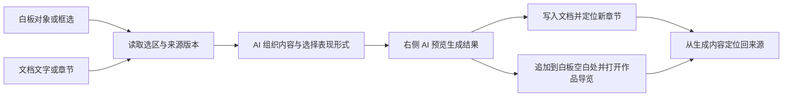

# 当前方案：Excalidraw 资源白板与工作空间 AI

更新：2026-11-17。根据用户“还是按照当前的方式进行，并进行调整”的决定，继续现有 Excalidraw，保留 Yjs/Hocuspocus 文字协同和 HCD 表格提交，不迁移到 tldraw。

## 分层与实际落地

| 层 | 当前实现 | 本轮调整 |
| --- | --- | --- |
| 白板 | Excalidraw + CanvasConnection + Rust 权威补丁 | 用自定义 embeddable 渲染文档及表格区域卡片；资源元数据随画布修订保存 |
| 文档 | Tiptap + Yjs/Hocuspocus | 根据稳定 blockId 定位；沿用原编辑和保存流程 |
| 表格 | Univer + HCD node-patch；Yjs 用于在线状态与版本通知 | 根据 sheetId、区域与单元格 nodeId 预览、加载和选中 |
| 工作空间导航 | 已打开且已认证的 sessions | 从白板进入源文件 Tab，定位后编辑，并返回仍挂载的白板 |
| 工作空间 AI | WorkspaceAgentProvider | 已打开文件共享任务记录与输入目标；每条任务标明源文件 |
| 提交与授权 | 每个文件自己的凭据、保存检查和写入接口 | 切换 Tab 不改变任务目标；启动、停止及续跑仍调用任务所属文件 |

底层依然只有一个权威写入路径：画布对象走现有 canvas patch，文字走原协同检查点，表格走 node-patch。没有把整个工作空间合并成一个 Y.Doc，也没有添加第二套白板同步服务。

## 资源契约

`src/resources/resourceReference.ts` 定义 `officecli-resource/1`，存放在 Excalidraw 元素的 `customData.officeResource` 中：

```ts
type ResourceReference = {
  schemaVersion: 'officecli-resource/1'
  documentId: string
  service: string
  anchor:
    | { kind: 'document'; blockId?: string }
    | { kind: 'sheet-range'; sheetId: string; range: string;
        cells: { nodeId: string; address: string }[] }
}
```

白板保存布局及来源定位，不复制源文件正文、单元格内容或访问令牌。只有当前用户已打开、同服务、同身份的源文件才能用于解析引用；不能根据引用提供的任意 URL 携带凭据请求。

文档支持整份文字摘要和具体段落。表格支持最多 200 个单元格的矩形区域，至少包含一个已有单元格。数值与文字来自当前源文件，公式只显示已核算结果，否则显示“待核算”。

预览仅在白板活动且卡片可见时加载，约每 5 秒刷新，也可手动刷新。请求失败会清除旧预览并显示原因。段落删除或原有单元格的地址变化时明确提示失效，不定位到相同地址的其他内容。首版不自动变换插入行列后的范围，也不提供固定历史版本预览。

## 操作链路

1. 先在工作台打开源文档或表格，再在白板点击“插入资源”。
2. 选择文档段落或表格区域。卡片保留源文件关联，可移动、缩放并随白板保存。
3. 单击卡片选中，使用“进入引用源文件”或“AI 编辑源内容”；双击卡片可操作卡片内部按钮。
4. 工作空间执行源编辑器的保存检查，重新读取引用，激活对应 Tab 并定位。
5. AI 输入绑定源文件和引用选区。返回白板或切换其他 Tab，目标保持不变；“使用当前文件”才显式改变目标。
6. 原文件提交后，白板预览读取新修订。返回白板不会重建画布实例或重置当前相机。

源文件关闭后，不会默默把未发送任务转到其他文件。输入保留，界面提示目标已关闭；显式选择新目标后才恢复提交。任务记录和草稿目标按服务及用户身份隔离。

## 全局 AI 的边界

这轮提升到工作空间层的是**输入目标、任务记录、来源导航和任务动作分发**。任务执行、内容凭据和保存检查仍属于各源文件。图片制作及文档内操作回放也继续保留各自文件上下文。

这不等于模型自动获得所有文件正文，也不等于多个独立 Agent 请求共用模型对话历史。跨文件多步骤执行继续使用现有 WorkflowWorkspace 的计划与授权。本轮没有扩大工作流格式白名单，没有新增白板、图片的跨资源工作流协议。

文档及表格的选区作为已有 Agent `target` 参数传入；本轮验证其来源与路由，不宣称新增了服务端单元格级授权机制。服务端原有文件权限、版本、哈希和提交校验继续生效。

## 界面

沿用 V3 的暖灰纸白、墨色文字和陶土强调，资源卡片与 AI 面板使用统一圆角。AI 输入上方显示明确目标，历史条目标明源文件。角角的圆角三角 SVG 用于欢迎区和回复标识；减少动态效果或离开可见区域时，欢迎形象使用静态版本。

## 仍未纳入本轮

- 在每张白板卡片中嵌入完整 Word / Univer 编辑器。
- 自动范围重定位、固定版本引用、双向反向链接、PDF 页和图片区域引用。
- 跨文件连续模型上下文及白板/图片参与多步骤工作流。
- 为单文档嵌入宿主新增跨文档授权、资源目录或委托 AI 权限。
- 动态 HTML 资源预览的 PNG 烘焙。原生画布文件保留引用，但静态图片导出不保证包含卡片的实时内容。
- 全量 Office/WPS 功能或 35 张设计画板的全部产品化实现。

这一版首先覆盖独立多 Tab 编辑工作台中的“资源引用 → 预览 → 定位 → 源文件编辑 → 返回与刷新”。验收命令与截图见 [资源白板验收](../../acceptance/hcd-resource-workspace-v1.zh.md)。

## 为什么继续现有技术栈

Excalidraw 的 MIT 许可和已有产品集成符合当前复用要求；自定义 embeddable 足以支撑这一阶段的资源预览。Yjs 继续用于适合它的文字协同，不承担 Excel 公式语义或跨文档权限。

tldraw 的自定义形状和同步接口仍可作为技术参考，但当前不引入 SDK、许可依赖或记录迁移。相关上游资料：[Excalidraw LICENSE](https://github.com/excalidraw/excalidraw/blob/master/LICENSE)、[Yjs](https://docs.yjs.dev/)、[tldraw shapes](https://tldraw.dev/docs/shapes)、[tldraw license](https://tldraw.dev/community/license)。

## 白板与文档双向生成

首版已接通独立多 Tab 工作台中的双向生成、预览应用和回源定位。白板与文档共用右侧 AI 面板与来源导航。每条任务使用一个明确选区和一个目标。统计图表与通用工作流按下文的交付顺序扩展。[首版验收](../../acceptance/hcd-resource-workspace-v1.zh.md#白板与文档双向生成)



### 白板头脑风暴整理为文档

1. 用户选中一个主题的分支、几张便签或一个区域，点 **「整理为文档」**。右侧显示白板名称和选中内容概况。选择新文档，或追加到已打开的可编辑文档。
2. 读取选中的卡片、文本、分组和连接关系。优先使用图解已有的节点、分区和边，手工图形使用原生分组与连接器。选区边界的连接可标记为外部关联，资源卡保留原有引用。需要读取多份文件的正文时，在多来源任务中明确选择各自的范围。
3. AI 按目的组织初稿。头脑风暴通常整理为主题、候选想法、已明确的结论、待确认事项和行动项。负责人、日期和决议状态从来源核对，尚未明确的字段显示「待确认」。每节列出对应白板分支或卡片。
4. 用户在 AI 面板预览章节后应用。新文件走现有 Markdown 新建与 DOCX 导出路径。写入现有 Word 时，追加到用户指定的段落后或文末。「查看结果」打开目标 Tab 并定位到新增章节，章节的来源入口定位回白板对象或区域。

例如，一个上线方案白板讨论了灰度发布、可用性测试、培训三个分支。文档可以整理出「确定灰度发布」「待确认培训人选」「安排可用性测试」三组内容，每条保留原便签的回源位置。

### 文档选区生成白板讲解

1. 用户选中文字，或从大纲选择一节，点 **「在白板讲解」**。右侧显示来源及其范围，目标可选新白板或已打开的可编辑白板，可选补充「用来讲给谁」或「重点展开什么」。
2. AI 先提炼一句总览、要点和阅读顺序，再给各分区选择合适的表现形式。短选区可以只生成一个重点区，长章节可以组合概念、流程、案例与总结。模型补充的类比或例题以「讲解示例」标识，来源事实关联原段落。
3. 预览显示全图与讲解顺序。应用时编译成原生可编辑文字、卡片、图形与连接线，追加到白板空位。生成完成后定位总览，作品导览提供逐区跳转，每个讲解区提供「查看原文」。
4. 表现由 AI 随内容选择。暖灰与纸白作为工作区底色，蓝色标记选区，陶土色强调关键动作。标题、卡片和右侧 AI 使用现有圆角。教学或讨论场景可以采用手账笔触和少量贴纸，正式架构或数据讲解采用清晰网格、轴和标签。

| 来源内容 | AI 可选择的表现 |
| --- | --- |
| 多层概念或拆解主题 | 思维导图、概念与例子卡片 |
| 步骤、判断或反馈关系 | 带判断分支和连接标签的流程图 |
| 服务、组件和依赖 | 带分组与关系说明的架构图 |
| 时间、阶段和里程碑 | 时间线、阶段目标卡 |
| 概念讲解、例题、练习 | 分步讲解，支持由全图进入各讲解区 |
| 同口径类别比较或有序时间序列 | 有标签和来源的柱状图、折线图 |

例如，从《上线方案》的一节可生成上方「发布目标」总览、中部「设计 → 联调 → 灰度 → 发布」流程图、右侧「风险与准备」卡片。选区中给出连续三周完成率 72%、83%、90% 时，可增加趋势图，并从数据点回到对应记录。

### 右侧 AI 操作

面板顶部持续显示来源文件、选区和目标位置。用户只需选择目标，可按需补充用途与重点。内容结构、图解类型、配色、笔触和装饰由 AI 根据场景规划。

| 阶段 | 用户看到和可以执行的动作 |
| --- | --- |
| 准备生成 | 确认来源、生成目的、目标及其共享范围 |
| 生成中 | 查看进度、取消任务，或切换其他标签继续工作 |
| 草稿就绪 | 查看章节预览或白板分区预览，调整要求重新生成，或应用当前草稿 |
| 已应用 | 点击「查看结果」定位产物，或点击「查看来源」定位原选区 |

### 统计图表与证据

- 图表计划包含图型、标题、类别或时间字段、度量、单位、口径、数据点来源。AI 选择图型和讲解重点，后端根据来源重建数值与时间顺序。单位、百分比、日期及公式核算状态使用源数据的表达和格式。
- 文档中的可定位文字与表格数据对应段落或单元格锚点。Excel 选区复用工作表 ID、范围与单元格 ID，公式使用已核算结果。缺失点保留缺失状态，口径或单位无法建立时，生成有出处的数据卡或提示补充可核对的范围。
- 图表生成时带标题、轴名称、单位和数据标签，并记录所用修订。图表以原生对象组呈现，摆放和样式可在画布编辑。数据更新从来源生成新的图表草稿，应用时保留此次引用的版本。

### 选区、预览与提交

| 对象 | 需要记录的内容 |
| --- | --- |
| 来源 | 服务、文件 ID、修订、协同版本、选区锚点和选区内容校验值 |
| 白板选区 | 原生对象 ID、选中区域、选中的分组与连接关系 |
| 文档选区 | 按文档顺序保存段落 `blockId` 及块内起止偏移，章节范围按标题和所属段落解析 |
| 目标 | 新文件或已有文件 ID、文档插入锚点或白板目标区域、目标基准修订 |
| 生成计划 | 文档章节与行动项，或按顺序排列的白板分区。各分区携带来源，统计图额外携带数据点来源 |
| 应用回执 | 任务 ID、提交 ID、目标文件和新修订，以及新增段落或画布对象 ID |

- 文档适配器把编辑器的 UTF-16 位置映射为 HCD 文本中的 Unicode 标量偏移。服务端从对应修订解析锚点与所选文本。跨段落选区按块切分，段落锚点用于从产物回源。画布对象 ID 来自已保存场景，区域用于取景和定位。
- 开始生成前执行协同保存检查，并在保存后的修订中复核选区。服务端使用该选区提供内容，用户应用预览时才写入目标。应用前复验两份文件的授权、来源协同版本与选区锚点。来源修订变化时，同一协同版本内可通过选区内容校验继续应用。协同版本变化、选区内容改变或锚点失效时保留草稿，要求重新读取来源。产物按目标文件的共享范围可见，点击来源时重新验证当前访问权限。
- 目标文档用 HCD 结构补丁写入新块，依据稳定插入锚点核对位置。锚点失效时重新选择插入处。目标白板把各分区编译到场景副本并合并为一次追加补丁，沿用 `vacantRegions` 在提交时检查空位。空位被占用时保留生成草稿并重新计算位置。若指定的区域不足，提示选择更大的区域或使用白板其他空位。
- 任务按服务、账号和来源文件绑定，并记录指定的目标或新建选项。刷新、切换 Tab 或重新打开后，以任务 ID 找回来源、目标、草稿及进度。写入使用同一任务的幂等提交标识，新建目标的重试复用已分配的文件 ID。提交回执记录实际目标与新增对象，并用于后续定位。

### 代码落点与交付顺序

1. **先接通双向转换。** 工作台从编辑器选区发起，在共享 AI 面板展示来源、目标、任务和草稿。文档使用原有段落结构补丁，白板复用场景快照、图解元数据、原生布局与一次追加。首轮覆盖 Word 或 Markdown 与白板的双向生成，以及刷新后恢复、查看来源和定位产物。[白板工作台](../../../examples/hdoc/editor/src/canvas/CanvasWorkspace.tsx) · [文档结构补丁与 MCP](../../../crates/officecli/src/mcp_hcd.rs#L54)
2. **丰富白板讲解与数据图。** 在同一作品里组合总览、分步讲解、流程和案例，扩展现有作品导览。接入可定位文档数值和 Excel 区域，先支持比较型柱状图和有序折线图。[作品导览](../../../examples/hdoc/editor/src/canvas/CanvasCreationNavigator.tsx) · [表格范围读取](../../../examples/hdoc/editor/src/resources/resourceReference.ts#L61)
3. **对外开放同一转换流程。** 给 API 和 MCP 提供来源、目标、生成预览、查询状态与应用入口，沿用 `hcd_read`、`hcd_canvas_plan` 和 `hcd_patch` 的读取和写入权限。需要串联多个文件或多个步骤时，把白板来源与目标纳入现有工作流的授权与产出契约。[当前工作流授权](../../../crates/officecli/src/hdoc_server/agent_workflows.rs#L379)

### 验收场景

| 场景 | 通过条件 |
| --- | --- |
| 白板选中两个分支并整理到 Word | 目标出现对应章节和行动项，点击来源定位原分支，未指定的负责人显示待确认 |
| 选择含中文和表情符号的跨段文字生成讲解 | 读取范围与屏幕选区一致，生成结果可以逐区查看并返回原段落 |
| 文档数据生成趋势图 | 每个数值、单位和日期可从来源复核，缺失点能区分于零值 |
| 预览后他人改动来源或占用目标白板位置 | 选区变化时提示重新读取，目标空位被占用时重新排版后再应用 |
| 刷新后恢复，或提交响应中断后重试 | 来源和目标按原任务还原，一次任务对应同一文件与提交回执 |
| 共享目标但访客没有源文件权限 | 访客可以按目标权限查看生成产物，来源内容按独立授权检查 |
