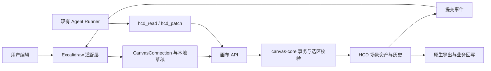

# OfficeCLI 自由画布 v1

自由画布作为 `.excalidraw` 文档接入现有 Workspace、HCD 与 Agent 工具链。画布使用 `@excalidraw/excalidraw` 0.18.1，场景保留原生对象；编辑和协作结果保存到 HCD，不依赖浏览器缓存维持文档。

界面已复用文档页的共享 AI 面板及圆角停靠布局，见[样式 V2 设计说明](design/officecli-canvas-v2/README.zh.md)和[样式验收](acceptance/hcd-canvas-style-v2.zh.md)。

气泡、自动追加、确定性排版和多 Agent 分区协作已接入，见[追加与分区协作验收](acceptance/hcd-canvas-composition-v1.zh.md)。新接口 `/canvas/layout` 与 MCP `hcd_canvas_plan` 只生成计划；实际写入复用原事务端点及权限，使用空位保护保证不重排旧内容。

AI 创作现支持流程图、架构图、头脑风暴和课程讲解，生成原生节点、圆角折线和分区；包含课程步骤导览、连线绑定及原生拖动保存修复，见 [AI 图解与连线验收](acceptance/hcd-canvas-ai-diagrams-v1.zh.md)。

AI 创作进一步支持自主规划手账视觉：纸张、笔触、配色、原生符号贴纸和少量 SVG 动态点缀，用户仅描述需求。设计、协议与验证见 [AI 手账视觉验收](acceptance/hcd-canvas-journal-v1.zh.md)。

## 已支持的交互

- 自由笔迹、文字、图形、连线、图片、分组、框架、移动、缩放和原生撤销/重做。
- 多人光标、对象选中状态与拖动轮廓，以及提交后的对象同步。
- 使用原生框选选择已有对象，点击“让 AI 修改选区”。
- 点击“框选区域”，拖出包含对象或空白位置的矩形，让 AI 在范围内增加内容。
- 人和 AI 同时修改；不同字段可合并，同一字段发生竞争时保留本地草稿并报告冲突。
- HCD 历史、恢复、归档、原生文件导出、浏览器 PNG 导出，以及业务版本回写。
- 断网修改先存入 IndexedDB；连接恢复后可重试、下载草稿或读取协作版本。

这些交互支持白板对象编辑的自由度。尚未包含可运行网页组件、任意代码执行、网页嵌入沙盒、PDF/Office 文件转画布，也没有复刻 Claude 私有协议。AI 绘制质量仍取决于使用的模型；目前模型读取结构化场景，未提供画布截图视觉工具。

## 模块边界

| 模块 | 职责 |
| --- | --- |
| `crates/canvas-core` | 纯 Rust 场景模型、几何范围校验、对象事务、字段比较与交换；无 HTTP、存储、账号或模型依赖 |
| `crates/hcd-core/src/canvas/` | 原生场景/图片资产、HCD 修订、幂等回执、历史读取；复用 HCD 写锁和不可变对象 |
| `crates/hcd-formats/src/canvas.rs` | `.excalidraw` 原生导入与导出 |
| `crates/officecli/src/hdoc_server/canvas.rs` | 签名会话授权、场景 API、SSE、临时协作状态，以及服务端 AI 选区约束 |
| `examples/hdoc/editor/src/canvas/model.ts` | 浏览器协议类型 |
| `changes.ts` | 原生元素差异、待提交操作合并和选区几何 |
| `CanvasConnection.ts` / `transport.ts` | 请求排序、幂等重试、草稿日志、断线重连和增量事件 |
| `CanvasWorkspace.tsx` | Excalidraw 适配、Agent 任务入口、历史和导出 |
| `CanvasRegionPicker.tsx` / `CanvasPresenceLayer.tsx` | 空白区域框选和临时拖动预览 |
| `apps/workspace` | 业务文件、账号/访客、权限、源版本及最终版本 |

现有富文本协作继续使用原来的 Yjs 链路。自由画布使用“对象事务 + HCD 修订 + SSE”；HCD 是提交结果的唯一权威来源，避免同时维护第二份可独立提交的场景。



## 底层协议

协议为 `officecli-canvas/1`，JSON Schema 在 `crates/canvas-core/schema.json`，并加入现有能力发现及协议指纹。

```json
{
  "schemaVersion": "officecli-canvas/1",
  "documentId": "board",
  "patchId": "a-unique-batch-id",
  "baseRevision": 3,
  "operations": [
    {
      "op": "element.update",
      "id": "plan-a",
      "before": { "strokeColor": "#000000" },
      "changes": { "strokeColor": "#7c3aed" }
    }
  ]
}
```

支持 `element.add`、`element.update`、`element.remove`、`file.add`、`scene.update`。每批原子提交。更新必须提供每个变更字段的准确旧值；删除需要当前对象哈希。`id` 和 `type` 不可变。相同 `patchId`、内容与作者重试返回原回执。

例如：人把 `x` 从 0 改为 90，AI 同时把颜色从黑色改为紫色，两者能够合并；两人同时更改 `x` 时，后提交者必须重新读取。客户端不会悄悄把冲突操作变成对方新值上的覆盖。

Spec 的正文和标题各自拥有一个 Yjs 文档，沿用同一份画布修订、权限和事件流。历史纯文本第一次编辑时按换行生成段落。浏览器用 `spec.update` 提交字符、块结构和排版的增量。HCD 存储协作状态，并从中生成供搜索和原生 Excalidraw 读取的文字。

AI 使用 `spec.splice` 局部修改读到的段落。以下操作针对「我们计划春季发布」。「春季」占第 4 到 6 个 Unicode 码点，起点从 0 开始，终点不包含在内。

```json
{ "op": "spec.splice", "id": "spec-release-body", "block": 1, "start": 4, "end": 6, "expected": "春季", "insert": "秋季" }
```

`baseRevision` 取自读取时的快照。服务用该版本定位原有字符，并将改动合入最新版本。期间有人插入的文字会保留。原词已被替换、段落被移除、换了协作版本或文档被锁定时，编辑失败，Agent 需要重新读取。宿主通过选区 MCP 的 `read_selection` 读取 `specBlocks`，将同样的范围作为 `edit_canvas_selection` 的 `specSplice` 提交，可用同一授权回读已提交的内容。[Spec 同段协作验收](acceptance/hcd-figjam-reference.zh.md#spec-同段协作)

| API | 用途 |
| --- | --- |
| `GET /v1/documents/:id/canvas` | 当前场景、修订及协作 epoch |
| `POST /v1/documents/:id/canvas/patch` | 原子对象事务；需写权限及当前 `X-HCD-Collaboration-Epoch` |
| `GET /v1/documents/:id/canvas/events` | 带 Authorization 的 fetch SSE；断线/事件缺口后重新读取场景 |
| `POST /v1/documents/:id/canvas/presence` | 临时光标、选中 ID 和拖动轮廓；不生成文档修订 |

SSE 不在 URL 中携带令牌。提交事件包含变更对象；光标与拖动预览会过期。历史恢复切换协作 epoch，旧 epoch 的写入被拒绝，本地未提交草稿保留供用户处理。

## AI 范围与权限

AI 使用现有耐久任务执行器，通过 `hcd_read resource=canvas` 读取场景，通过 `hcd_patch mode=canvas` 提交同一套事务。读取分页时省略图片 base64，并提供对象哈希供删除与回读校验使用。

任务启动时保存 `target.canvas = {elementIds, region}`。服务端固定该范围：既有对象只能修改授权 ID，新增对象必须完整落入区域，后续步骤可继续修改同一任务新增的对象。锁定对象不能被 AI 解锁。整画布任务同样经过服务端权限检查。

Workspace 默认关闭 AI。显式启用 `OFFICECLI_AI_ENABLED=true` 后复用现有模型配置；Provider 仍须授予 `document.view`、`document.edit`、`document.ai`，并在 `constraints.modelIds` 中列出部署配置的模型 ID。空名单拒绝调用；任务启动和每次模型调用前重新核对。内置 Workspace 将实际传给引擎的 `HCD_OPENAI_MODEL` 加入名单。分享访客不能消耗模型额度。选区修改继续使用单 Agent；新增内容可使用 2–4 Agent 分区并行准备，统一排版后原子追加，可与多个真人协作。

## 存储与保真边界

权威场景为 HCD 资产 `canvas/scene.json`，图片为单独的内容寻址资产 `canvas/files/<id>`。修订引用相应资产索引；历史读取、恢复及 `.hcd` 打包均沿用原有基础设施。手绘点、压感、绑定、分组和原生自定义属性保存在场景中。

HCD 中另有用于搜索的文字预览。HTML、语义 DOCX/PDF 等导出不会重建画布几何；需要可继续编辑的文件时导出 `.excalidraw`，需要视觉快照时使用浏览器 PNG。服务端尚无原生 PNG/SVG 渲染器。

当前场景最多 20,000 个元素、32 MiB（含图片），单批最多 2,000 个操作，选区最多 2,000 个对象。图片支持 PNG/JPEG/WebP/GIF；SVG 图片暂不支持；网页嵌入遵循 Excalidraw 原有限制，文档与表格预览通过资源引用组件处理。大规模房间、长期断网多分支合并和跨节点事件分发尚未压测；当前在线房间事件在单个引擎进程中广播，持久数据由 HCD 保存。

## 本地使用与验证

```bash
cargo build -p officecli --bin officecli
target/debug/officecli create /tmp/board.excalidraw
target/debug/officecli hdoc import /tmp/board.excalidraw --output /tmp/board.hcd --document-id board
target/debug/officecli hdoc canvas --bundle /tmp/board.hcd --json
# patch.json 使用上述事务协议
target/debug/officecli hdoc canvas --bundle /tmp/board.hcd --patch /tmp/patch.json --author local-user
target/debug/officecli hdoc export /tmp/board.hcd --output /tmp/board-export.excalidraw
```

UI 构建及 Workspace 启动沿用 `apps/workspace/README.zh.md`。针对画布的验收：

```bash
cargo test -p canvas-core
cargo test -p hcd-formats native_canvas_history
cargo test -p officecli --bin officecli committed_canvas_events
cd examples/hdoc/editor
HCD_BROWSER_PATH='/Applications/Google Chrome.app/Contents/MacOS/Google Chrome' \
  npx playwright test e2e/canvas.spec.ts
cd ../../..
# 先按 Workspace README 完成打包
HCD_BROWSER_PATH='/Applications/Google Chrome.app/Contents/MacOS/Google Chrome' \
  node apps/workspace/scripts/verify-canvas.mjs
```

浏览器和 Workspace 验收使用本地脚本模型，验证真实工具调用、服务端选区约束、权限和提交链路，不代表外部模型的绘制质量已验收。Excalidraw 及字体的声明随构建发布于 `/canvas-assets/THIRD_PARTY_NOTICES.txt`。
