# HCD 优化进度与验收

顺序：保存正确性与内容完整性 → 国际化与字体基础 → 协同可靠性。云文档管理平台及字体管理界面归入后续阶段。

属性侧栏补充分析见 [上下文属性侧栏设计](design/hcd-context-properties.zh.md)：区分页面、文字框、字符选区和图片；对照当前源码记录缺口，明确 Word/PPT/PDF 的作用范围、紧凑分组和验收条件。该文为设计分析，不代表新增字段已经实现。

## 保存正确性

- 文本 splice 平移未受影响的 annotation，使与编辑相交的旧识别标注失效，并接受同批基于新文本的 annotation upsert。
- 结构替换及修订接受/拒绝清理不再有效的标注，历史 revision 保持不可变。
- 文本补丁定位带 hash 的 canonical span，避免外层 block 共享 nodeId 时错误定位。
- 语义 checkpoint 与 HTML 重建保留代码块、代码语言、段内换行、下划线、删除线、行内代码、引用、多段列表项、嵌套列表、编号起点和水平线。
- 固定版式草稿按 nodeId 独立于视口组件保存；远端同节点更新保留本地文本并要求显式选择冲突结果。保存响应到达时保留请求期间继续输入的内容。
- 固定版式导出及关闭前检查未保存草稿；浏览器导航使用未保存提示。当前草稿仅在已挂载工作区内保留，不声称浏览器崩溃后的磁盘恢复。

回归命令：

```bash
python3 scripts/hcd-save-correctness.py --officecli target/debug/officecli
cargo test -p hcd-core -p hcd-docx -p hcd-formats --offline
cargo test -p officecli --offline hdoc_server::tests
cargo test -p officecli --offline --test hdoc_cli --test hdoc_multi_format --test html_convert
npm --prefix examples/hdoc/editor test
npm --prefix examples/hdoc/editor run build
cargo fmt -- --check
cargo clippy -p hcd-core -p officecli --all-targets --offline -- -D warnings
```

2026-10-22 本地浏览器已验证：

1. PPTX 第一页输入草稿，外部 API 更新另一文本节点，草稿不丢失。
2. 滚至末页令第一页预览卸载，再返回，草稿恢复。
3. 外部 API 更新同一节点，显示冲突，保存暂不可用；选择保留本地草稿后保存到新 revision，重新打开可读取。
4. 粘贴含中英文与 emoji 的代码块、删除线、换行、引用、从 4 开始的编号列表及嵌套列表，保存、重新打开后检查真实 DOM。
5. 服务端 HCD 校验通过；无源 DOCX 语义导出保留九项测试正文。

以上是本地样例验证，未覆盖生产部署、真实 PostgreSQL/S3 故障或大文档容量。

## 紧凑编辑工作区（2026-10-23）

本轮按用户最新要求对齐 Word、PPT、PDF：

- 顶部保留文档身份、语言、协作状态和关闭。保存和导出集中在操作区左侧；导出格式和版式选项在导出选项卡展开。
- PPT/PDF 使用左侧缩略图、单页画布、右侧属性、底部状态栏。Word 完整模式保留连续正文、大纲与修订面板；统一工具尺寸、间距、蓝灰色、图标和状态栏。
- 导航栏和属性栏支持拖动分隔条，也支持聚焦分隔条后按左右键每次调整 10px。导航宽度 120–340px，属性宽度 220–440px。支持收起面板、画布缩放、适应窗口、专注视图和重置布局。宽度状态在当前工作区内保留。
- 属性由当前对象驱动：点击文字显示一个内容编辑框；点击图片显示图片替换与位置/尺寸；点击空白画布显示页面与视图选项。文字对象列表可折叠、查找、按 40 个对象分组浏览，避免整页文本框堆叠。
- 固定版式的原文字体和字号目前作为原文样式信息展示；没有把尚未支持的字体/字号编辑伪装成可用控件。Word 完整模式的文字属性提供实际可用的粗体、斜体、下划线、删除线、颜色、高亮、段落和列表操作。
- PDF 使用预览内的文字矩形建立可点击区域。图片矩形也可选择；位置/尺寸提交复用版本校验 API。PPT 图片位置提交已在本地浏览器验收。PDF 图片保存及源文件回写的新增验收见下文；旋转与复杂图层仍有限制。

### 长文按需加载

- 语义文档有至少 4 个 HCD 分片时，默认进入分段编辑；短文也可从完整编辑模式的视图选项卡切换。
- 分段模式只请求当前正文分片，左侧目录不请求每段正文或缩略图；正文放在禁止脚本、限制资源来源的独立 frame 中。缓存限于 16 个已访问分片、32 个资产条目。
- 点击正文定位当前 canonical 文字节点，修改通过 nodeHash + revision 校验提交，保留未编辑段和原有格式。不同分段草稿可以统一保存。
- “完整格式工具”会在保存草稿后读取最新协同 epoch，再加载完整 Word/Yjs 模型，用于结构与富文本格式编辑。该模式仍加载全文；不将它描述为已经支持数据分页的完整 Word 编辑器。
- 本地样例：2,000 段非空正文（另含段间空白）导入成 125 个 HCD 分片。首次请求只出现 `/chunks/0`；浏览过程中仅请求实际选中的少数分片，没有 `/editor` 或 `/collaboration/state` 全文请求。跳至第 125 段后，首尾两段修改统一保存为 r1，再返回首段可读取。

### 固定版式协作

- 新增仅负责在线状态和选区的 `fixed:<documentId>:0` 房间。房间通过文档 token 鉴权，全部连接的 Yjs 文档写入关闭，不把存在状态当作文档正文或持久保存。
- 文档正文仍由版本校验 API 保存，经 SSE 通知其他窗口；不同文字的本地草稿不会被无关更新覆盖。同一文字发生并发更新时保留草稿并要求选择结果。
- 属性选择可在其他窗口的对应对象上显示协作者标记。在线人数按用户合并。协作在线不等于草稿已经保存。
- 本地两个不同用户的 PPT 窗口已验证：不同文字编辑并保存、远端更新同步、同一文字冲突、保留本地后保存。只读窗口的编辑字段与提交操作不可写。
- 协同 token 续期、权限撤销、多实例、离线磁盘恢复和事件补发仍在后续阶段。

### 本轮检查结果

- `npm --prefix examples/hdoc/editor test`：11 项通过。
- `npm --prefix examples/hdoc/editor run build`：TypeScript、独立版和嵌入版均通过。现有依赖的 `use client` 指令提示和大包提示仍存在，Univer 保持独立懒加载。
- `cargo test -p hcd-formats --offline`：37 项通过。
- `cargo clippy -p hcd-formats -p officecli --all-targets --offline -- -D warnings`、`cargo fmt -- --check` 和 `git diff --check` 通过。
- `python3 scripts/hcd-save-correctness.py --officecli target/debug/officecli`：5 项通过。
- 浏览器复验：PDF 日期在点击的原位置保存为 r1；PPT 图片水平位置从 36pt 调整到 48pt，保存为 r1；Word 属性跟随光标；PPT 属性跟随所选对象。长文可切到完整编辑模式，3999 个段落节点中的首尾两处修改保持，保存后可返回分段模式。
- 长文请求日志在浏览及跳转中仅有正文分片 0、73、109、124（共 125 个），没有完整编辑投影请求。首尾两个修改统一保存后，新 head 为 r1。

### PDF 保存位置回归

浏览器验收发现旧页面重绘从 `data-hcd-y` 读取 PDF 底部原点坐标，实际 HTML 预览使用顶部原点，可能把修改绘制在页面另一侧。本轮改为读取该文字元素实际的 `left/top/width/height` 样式；缺少有效矩形时停止该页重绘，回退到有警告的叠加路径。去掉了按 700 字节截取 HTML 的做法，避免 Unicode 边界问题。

增加回归：原 PDF y=37.08、预览 top=792.8 时使用后者；像素级检查重绘只改变预览文字矩形所在行，页面其他行不变。

## PDF 图片保存与导出（2026-10-23）

- 发现并修复：旧图片移动只改几何元数据，页面底图仍保留原图片，造成旧位置残影；PDF 源文件导出也拒绝这些修改。
- 现在从校验 SHA-256 的不可变 PDF 重建候选文件，重放所选 revision 的文字、图片位置/尺寸和替换。对选中的单次 `Do` 绘制追加局部变换，不修改其他位置对同一 Image/Form 的引用。替换图保留 PNG alpha，通过独立 SMask 写入；克隆当前页资源，保留继承字体，不修改其他页面的共享资源。
- 内容流通过 lopdf 对象解码/编码，保留二进制文字字符串。保留页面绘制顺序和已有图形状态；源页面重新渲染，因此移动后露出原背景。源资源名称支持 PDF `#XX` 转义。奇异矩阵、无效地址、缺少/不匹配的源文件、未支持的内联图片流和旧坐标版本的旋转页会停止提交，不发布新 head。
- 修复空图片命中区域的替换：在当前 canonical 对象内建立子图片，不再向后查找并误改下一个对象的图片。新页面图包含全部对象后，隐藏重复图片像素，保留供工作区选择的几何信息；同步处理同一页的后续分片和旧文字覆盖标记。
- 图片接口、CLI apply 和源 PDF 导出共用上述逻辑。核心层拒绝未提供源重绘结果的 PDF 图片修改，防止绕过保存保障。新 revision 和历史 revision 均由自己的资产索引解析替换图。
- 无源 PDF 导出可使用修改后的页面图，前提是没有未合成的文字/图片覆盖层或额外样式；输出明确报告 VISUAL，正文与矢量成为页面图片。带源文件导出保留可选择文字及原 PDF 对象，报告 SEMANTIC。两者不混称。

新增验证：

```bash
cargo test -p pdf-handler --offline image_edit::tests
cargo test -p hcd-formats --offline pdf_image_save_and_native_export
cargo test -p hcd-core --offline replacing_an_empty_image_placeholder
cargo test -p officecli --offline --bin officecli hdoc_raster_pdf::tests
```

本地结果：hcd-core 44、hcd-formats 38、pdf-handler 34 项通过；无源导出新增 1 项通过；API 10 项、多格式 CLI 17 项和原保存回归脚本 5 项通过。像素验证包含：原位置恢复彩色背景、透明图替换、预览与源 PDF 导出一致、历史 revision 图像不变、图片与文字同批保存、多个 continuation 分片、未合成覆盖层不能走页面图捷径。还覆盖共享图片引用、继承资源、Form 本地旋转/边框、转义资源名和二进制文字。

浏览器本地样例 `pdf-images-workbench`：点击第一张图片后，右侧出现图片属性；水平位置从 40pt 改为 220pt，保存到 r1，旧位置恢复背景，第二个共享图片引用不动。CLI 分别完成源 PDF 导出和无源视觉 PDF 导出。此证据未覆盖生产环境。

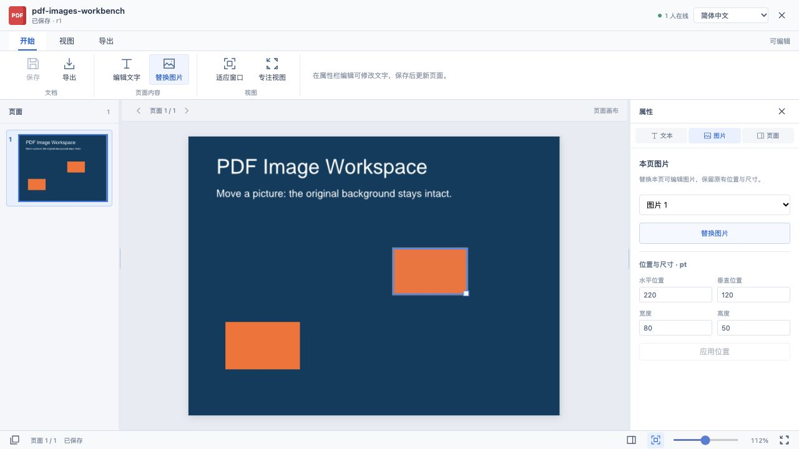

## PDF 裁剪和旋转坐标（2026-10-23）

- 修复页面底图已旋转、文字/图片命中区域未旋转的问题。新导入分片声明 `data-hcd-pdf-coordinates="viewport-v1"`，图片属性和文字外框均为裁剪旋转后的左上原点坐标，源矩形另存。文字 span 在外框内绕中心旋转，点击区域保持轴对齐，不重复旋转。
- 统一前后坐标转换；源 PDF 重建逆变换 UI 中的位置与宽高。继承的 MediaBox/CropBox/Rotate、CropBox 与 MediaBox 的交集一并处理。归一化负旋转和超过 360° 的整数旋转，仅修改临时渲染或候选副本，保留不可变源文件。
- 有经过 hash 校验的源文件时，文字保存改为 PDF 原生修改后重绘，与源导出使用同一路径，保留原背景、颜色及旋转；缺字仍使用已嵌入的字体回退。有源重建失败时不把它悄悄改成白底覆盖保存。无源文字仍保留明确近似的兼容路径。
- 旧非旋转 HCD 保持原坐标解释；旧旋转 HCD 的命中区域升级尚未实现。图片修改会明确要求保留历史的坐标升级，不建议覆盖或删除旧 bundle 重新导入。

验证：

```bash
cargo test -p hcd-formats --offline
cargo test -p officecli --offline --bin officecli hdoc_raster_pdf::tests
cargo test -p officecli --offline --test hdoc_multi_format
cargo clippy -p hcd-formats -p officecli --all-targets --offline -- -D warnings
```

- hcd-formats 40 项、当前页面图导出 1 项、多格式 CLI 17 项通过；原保存回归脚本 5 项通过。坐标往返及像素回归覆盖 0/90/180/270/-90/450°、继承裁剪框、图片原位置背景恢复、独立的目标源矩形、跨分片、旋转文字修改、源导出与预览一致。
- 本地浏览器 `pdf-rotation-workbench`：90° 页点击文字后选框覆盖实际文字；“旋转 PDF 保存”提交为 r1，图片垂直位置 30pt→180pt 提交为 r2，重开保留中文与图片位置。源 PDF 的文字提取保留中文，源导出报告 SEMANTIC，无源页面图导出报告 VISUAL；HCD 校验通过。仍未进行生产验收。

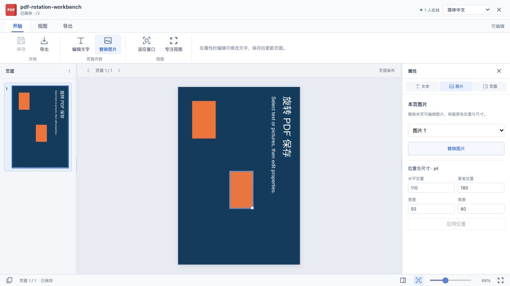

## 旧 PDF 的保留历史布局升级（2026-10-23）

- 已手动保存的图片位置/尺寸保持原数值；只有旧导入器生成且未改过位置的命中区域重新投影。核心提交和离线校验均拒绝布局升级改变已保存的图片位置。
- 提供 `视图 → 更新 PDF 布局`、`POST /v1/documents/{id}/pdf/layout` 和 CLI `hdoc upgrade-pdf-layout`。操作追加 revision，不覆盖旧 bundle，不要求重新导入；已有文字、图片资源、批注和源节点映射保留。文字草稿或待应用图片位置存在时，升级按钮不可用。
- 新 revision 使用 `layoutUpgrade: true` 声明纯展示升级，兼容读取缺少该字段的旧记录。该类型只能改变 HTML 坐标和页面重绘资产，源文本/图片修改的 dirty 集不被伪造，后续源导出继续重放原保存记录。旧坐标版本的历史 revision 也可按其旧坐标解释导出。
- 核心提交持有写锁并校验 base revision、body root 和各分片原 hash；检查所有 canonical 文本/节点 hash、图片资源和 source map；新图片、HTML、索引和 revision 就绪后再推进 head。并发保存导致 CAS 失败时不覆盖新内容。
- 离线校验器独立验证该类型：源映射与非布局 metadata 不变，canonical 文本和图片资源不变，原资产保留，批注 root 不变，dirty chunk 集与实际变化一致。伪造布局升级标记不能隐藏真实文字或图片替换。
- 规划过程按原页面处理，逐页解析/渲染、逐分片写入内容寻址对象；内存保留分片描述符，不保留全部升级 HTML。保持现有源文件、页面栅格、单分片和控制对象的资源上限。
- 修复无源 PDF 导出对属性/CSS 顺序的依赖：升级器重新排序属性后，导出按 XML 属性及 CSS 键读取尺寸和页面图，不再要求 `width` 紧邻 `height`。

验证方式：

```bash
cargo test -p hcd-core -p hcd-formats --offline --lib
cargo test -p officecli --offline --bin officecli hdoc_server::tests
cargo test -p officecli --offline --bin officecli hdoc_raster_pdf::tests
cargo test -p officecli --offline --test hdoc_multi_format --test hdoc_cli
npm --prefix examples/hdoc/editor test
npm --prefix examples/hdoc/editor run build

# 真实旧 bundle；--expected-revision 必须使用当前 head。
officecli hdoc upgrade-pdf-layout legacy.hcd --source immutable.pdf --expected-revision 4 --json
officecli hdoc validate legacy.hcd --json
officecli hdoc export legacy.hcd --source immutable.pdf --output native.pdf --json
officecli hdoc export legacy.hcd --output visual.pdf --json
```

本地证据：core 44 项、formats 42 项、API 11 项、页面图导出 2 项通过；前端 11 项以及独立版/嵌入版构建通过。新增持久化回归包括已保存中文、图片替换/位置、批注、完整历史、重复调用无新版本、陈旧版本拒绝、非法内容计划拒绝、伪造布局标记被离线校验发现，以及升级前历史源导出与升级后画面一致。

浏览器在上一轮实际旧样例 `pdf-workbench-verified` 上执行 r1→r2：临时文字草稿会禁用升级按钮；还原草稿后升级成功，165 个文字节点及其源地址完全一致、2 个图片资源保留、原 2 份 revision 文件逐字节 hash 不变、批注 root 不变，HCD 校验通过。升级后源导出 SEMANTIC、无源导出 VISUAL 均成功；界面中的 PDF 无源选项改为“当前文档内容”，按实际结果说明页面外观已保留、文字不可选，避免将页面图导出误写成重新排版。此轮仍是本地证据，没有进行远端 PostgreSQL/S3 或生产验收。

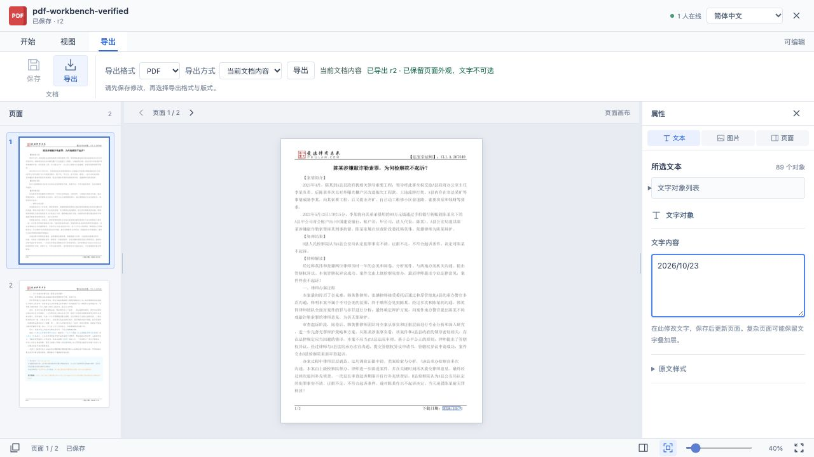

## 多标签连接与断线草稿保护（2026-10-23）

此前复验发现，同源 SSE 长连接达到 HTTP/1.1 连接池容量时，新增窗口停在正文加载；关闭重复窗口才恢复。本轮已把浏览器版本通知迁到 Rust 原生 WebSocket，保留 SSE 兼容调用方；Vite `/v1` 代理启用升级转发。该通知通道不依赖可选的 Hocuspocus 在线状态服务。

- 首帧认证，令牌不放在 URL；只读/可写身份均可订阅，文档不匹配拒绝、授权到期断开。前端停止对到期授权无限重试，并提示本页草稿保留。
- 每次连接携带最后收到的 revision；根据不可变历史和一个确定的 manifest 补齐改动，不再依赖短暂的内存消息。合并多个 revision 不伪装成单次本地 patch，避免跳过同批远端改动。
- 所有成功发布的修改共用通知入口，包括结构、历史恢复和批注等；hub 只存版本号、清理无订阅文档，不把全文反复排入广播队列。2 秒 head 检查补足本地 CLI 修改及丢失的通知。
- 有远端存储时先读取 PostgreSQL 已提交的版本和 root，再解析对应本地历史，防止 CAS 尚未成功的本地候选被广播。此处有本地模拟发布边界的回归，没有真实 PostgreSQL/S3 验收，也未扩展多实例缓存协议。
- 重连及草稿 ID 变化时检查全部待保存对象，包含当前 UI 已到同一 revision 的情况。正文超过 1 MiB、积压超过 256 个版本或发生结构/布局变化时要求刷新；仍返回草稿对象 hash 或删除标记，避免默默漏掉冲突。跟踪上限 10,000 个 ID。
- 固定版式与分段编辑保留离屏草稿；同节点远端修改必须明确选择。对象删除或需要刷新时禁用保存，并提供复制/丢弃草稿。结构刷新重新读取版本固定的索引，保留草稿 store。Univer 在已有保存完成后才执行远端重载，避免中途销毁保存对象。
- SSE 增加事件 revision ID，支持 `Last-Event-ID` / `afterRevision` 历史补发与广播 lag 恢复；浏览器不再为每个页面占用一条 SSE HTTP 长连接。

本地验证：API 19 项（含 WebSocket 真实握手、只读订阅、跨文档拒绝、到期断开、同版本草稿检查、丢失/滞后恢复、SSE 补发、远端未发布候选隔离）；前端 15 项；保存回归脚本 5 项。类型检查、独立版/嵌入版构建、clippy（全部 target、warnings 为 error）、fmt 和 diff 检查均通过。构建仍有现有大型 Univer bundle 及第三方 use-client 提示，本轮未处理体积拆分。

浏览器同时保留 8 个编辑窗口（7 个固定/分段工作区及 1 个完整 Word 工作区），新增 PPT 两位编辑者和一位只读用户均加载完成。独立样例 `revision-sync-workbench`：r0→r1 后只读用户收到中文/emoji，另一位的草稿保留并禁用保存；通过仅测试用页面开关暂停其更新，保留第一页草稿并切到第二页；远端连续保存 r2/r3 后恢复连接，离屏草稿被发现为冲突，“查看文字冲突”能定位并同时展示本地草稿和 r3 文字；明确选择保留本地后保存为 r4，只读窗口同步收到。随后在最终构建复验短文字冲突并保存 r5，选择远端内容后无残留草稿。r4 源 PPT 导出保留已保存中文/emoji，bundle 校验通过；其他样例仍为原 revision。测试开关只在忽略的本地 harness 中，不属于产品功能。

复验命令：

```bash
cargo test -p officecli --offline --bin officecli hdoc_server::
cargo clippy -p officecli --all-targets --offline -- -D warnings
cargo fmt -- --check
npm --prefix examples/hdoc/editor test
npm --prefix examples/hdoc/editor run build
python3 scripts/hcd-save-correctness.py --officecli target/debug/officecli
```

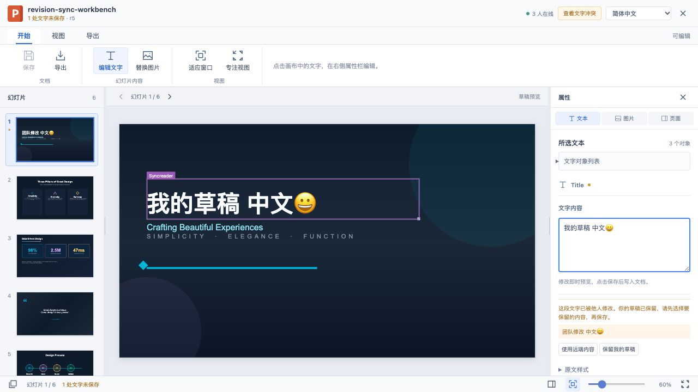

此轮未实现跨页面关闭/刷新后的草稿恢复、主动权限撤销、生产代理配置或多实例远端验收；仍不能宣称协同已经全部完成。


## 字体身份与 PDF 回退完整性（2026-10-23）

发现并修复两处无源 PDF 重绘问题：遇到缺字原来直接留空，遇到换行原来只绘制第一行；同时修复按“字符覆盖”复用其他字体、忽略指定字体文件的嵌入行为。

- 新增 `pdf-handler::fonts`：字体文件 SHA-256 + faceIndex 身份，默认实例的名称/样式/字重检查；内置静态 Regular Noto Sans SC / Noto Emoji catalog。不增加字体管理平台或上传入口。
- 无源单行重绘按完整字素簇选择内置 face，经 Rustybuzz 整形；中文、拉丁和单色 emoji 可混排，家庭/肤色/国旗等组合整体处理。按实际轮廓计算 mask 边界，保留 descender，不再用固定基线把字形裁掉。
- 缺字、没有实际映射的表意/数学变体、换行/布局控制、RTL/竖排需求、非法字号、区域溢出及资源超限都会停止该页的完整重绘。正文仍通过明确的叠加兼容路径完整保存；未合成的页面不能走 VISUAL 页面图捷径。多行语义 PDF 导出的真实 CLI 回归保留了 `FIRST` 和 `SECOND`。
- 绘制上限：4096 字符/16 KiB，字号 1–256px，mask 单边 8192px/总 4M 像素，并限制轮廓扫描工作。调用方还检查文字区域与页面边界。
- 页面图新增 `data-hcd-raster-font-ids`，由 revision 的 HTML hash 覆盖；复制旧背景重绘时保守继承其已知字体依赖。提交返回 `PDF_RASTER_FALLBACK_FONTS`。这不是原生 PDF 或全部文档的完整字体清单，字体文件本身尚未打包进 HCD。
- 修复嵌入字体的多对一字符映射：相同字形的不同 Unicode 字符现在使用独立 CID，通过 CIDToGIDMap 指向共享字形；ToUnicode 每个 CID 对应一个标量，避免把空格/NBSP 等别名串成重复文字。旧连字/簇映射不再被用于单个字母的反向编码；需要时使用可安全编码的回退字体。单字节字体保持 8-bit 编码，组合字体保持受支持的 16-bit 编码，超界报错而不截断。已有错误输出不作自动内容猜测或历史覆盖。
- PDF 强制嵌入复用同时匹配源字体文件 hash、faceIndex 和字符覆盖；记录源身份，使用真实 PostScript 名称，不再将自定义字体都标成 NotoSansSC。相同字体跨页复用，不同文件即使覆盖相同字符也保持各自身份。文件读取限制 64 MiB；无效文件不会被无关缓存字体掩盖。
- 固定版式属性栏根据当前页面的真实叠加标记显示本地化检查提示；新文字文案覆盖简体/繁体和英语 locale。该提示经过类型检查和构建，本轮未作浏览器视觉验收。

本地验证：core 45、formats 43、pdf-handler 45 项库测试；OfficeCLI 二进制单元测试 90 项，多格式原 17 项加新增字体导出 1 项，HTML 转换 3 项；前端 15 项及独立版/嵌入版构建；保存回归 5 项。clippy（相关四 crate 全部 target，warnings 为 error）、fmt 和 diff 检查通过。新增回归覆盖文件身份复用、无效/超大字体、共享字形的 Unicode 别名往返、连字反向编码回退、单/双字节编码边界、组合 emoji、轮廓边界、缺字/换行/溢出、有界绘制、历史不变、字体依赖继承和实际 PDF 文本提取。

实际 API 样例 `font-fallback-workbench`：缺少源 PDF 时保存中文/emoji 到 r1，记录两个内置字体身份，导出报告 VISUAL；随后保存多行文字到 r2，返回重绘跳过及近似叠加提示，导出实际报告 HIGH，PDF 文本提取含两段文字。r1 分片未变化，bundle 校验通过。[API 证据](assets/hcd-workbench-2026-10-23/font-api-evidence.json)。仍是本地服务证据，没有生产部署或远端数据库/对象存储验收。

复验命令：

```bash
cargo test -p pdf-handler -p hcd-core -p hcd-formats --offline --lib
cargo test -p officecli --offline --bin officecli --test html_convert --test hdoc_multi_format
cargo clippy -p pdf-handler -p hcd-core -p hcd-formats -p officecli --all-targets --offline -- -D warnings
npm --prefix examples/hdoc/editor test
npm --prefix examples/hdoc/editor run build
python3 scripts/hcd-save-correctness.py --officecli target/debug/officecli
```

实际 fallback painter 的输出（单色 emoji）：


字体/字号编辑、完整字体依赖打包、浏览器与各导出器统一解析、原生 PDF 组合 emoji 与 RTL、多语错误码仍未完成。下一步按 [字体与国际化接入设计](design/hcd-fonts-i18n.zh.md) 接通，管理平台继续后置。

## Word 属性读取与字体格式保存（2026-10-23）

本轮先完成属性区读取和字体格式的保存基础，尚未开放字体/字号修改。原先完整 Word 投影仅承接粗斜体等标记，继承的字体/字号未进入编辑模型；结构保存存在丢失这些信息的风险。

- `EditorInline.typography` 保留请求的 CSS 字体栈、pt 字号及 Latin / EastAsia / BiDi 字体槽；它不代表字体文件已安装或已打包。投影从分片祖先、命名样式、行内样式解析字体，支持受限 CSS 2.1 选择器优先级、important、继承和相对字号。字体名称保留大小写。不能安全展开的 font shorthand、字号表达式或超限解析会明确拒绝投影，避免生成有损数据。
- 结构 checkpoint 将这些字段安全编码到规范 HTML，重开时恢复；保留相邻段落及历史 revision。前端格式 mark、代码块及行内代码均承接字体信息，通过 Yjs 二进制存储后可恢复。
- 右侧文字属性显示当前选区的字体和字号；跨不同格式的选区显示“混合样式”，光标位置读取当前/待输入格式。属性仍按文字、图片、页面对象切换，保存/导出留在操作区。
- checkpoint 新增 `typographyVersion: 1`。带字体信息的文档拒绝旧客户端的无版本快照（HTTP 426），未知版本也拒绝。语义协同 room 改为 `documentId:epoch:typography1`，旧页面需重载；固定版式 room 不变。更新 sidecar 与浏览器需一起发布。
- 旧 Yjs 状态仅在规范文字能够逐一对应时补充格式，直接为原 CRDT 文字添加 mark，不重新建立文字身份。存在无法准确对应的未保存文字、换行等情况会保留旧状态并停止迁移；尚无面向用户的手动迁移恢复流程。不能宣称所有旧协同房间已自动迁移完毕。

本地真实 DOCX 样例 `word-typography-workbench`：命名段落样式 14pt + 行内 Arial/黑体 20pt。旧 API 快照被拒绝且 head 不变；新快照只修改正文，使用 `source-text` 保存到 r2，原 styles.xml、run properties、相邻段落和历史分片不变。浏览器再修改文字保存到 r3，刷新后属性仍为 Arial/黑体 20pt；r3 实际 DOCX 导出包含新正文，原字体样式及 run properties 均未改变。[API 与导出证据](assets/hcd-workbench-2026-10-23/word-typography-api-evidence.json)。

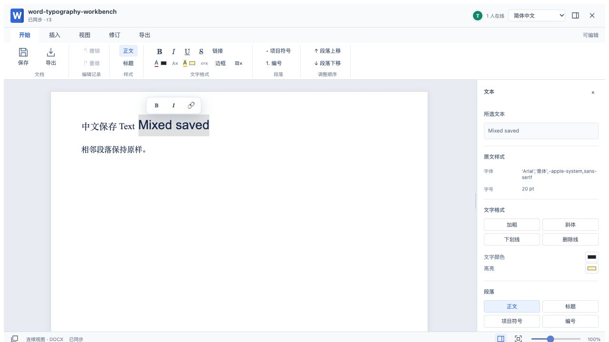

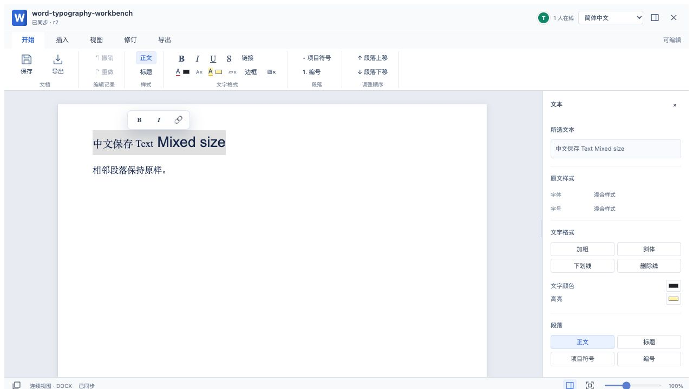

验证覆盖字体继承、样式优先级、相对字号、多语字体槽、CSS/属性安全、解析资源边界、结构保存/历史/相邻内容、代码格式、混合选区、Yjs 存储、旧状态迁移与失败时不变、离线文字身份合并、旧快照防丢失，以及真实本地 API / 浏览器 / DOCX 导出。

本地检查通过：hcd-core 50、hcd-docx 34、hcd-formats 43、OfficeCLI 二进制 91、多格式集成 18、HTML 转换 3、前端 20 项测试，以及保存脚本 5 项检查；前端独立版/嵌入版构建、相关 crate 全 target clippy、fmt 与 diff 检查通过。API 与 sidecar 已更新到本地验证版本，未进行生产发布。

复验：

```bash
cargo test -p hcd-core -p hcd-docx -p hcd-formats --offline --lib
cargo test -p officecli --offline --bin officecli --test hdoc_multi_format --test html_convert
cargo clippy -p hcd-core -p officecli --all-targets --offline -- -D warnings
npm --prefix examples/hdoc/editor test
npm --prefix examples/hdoc/editor run build
python3 scripts/hcd-save-correctness.py --officecli target/debug/officecli
```

边界：已验证的 DOCX 字体保持限于保留源结构的正文修改。结构重建后的语义 DOCX 导出仍未贯通全部字体格式；尚未开放字体/字号修改，也未完成字体依赖打包、跨导出器一致解析或生产协同迁移。管理平台继续后置。

## Word 选区字号修改与 DOCX runs 导出（2026-10-23）

本轮接通字号控件和实际导出，并继续保护保存过程。整体目标仍进行中，管理平台未开始。

- Word 文字属性新增字号输入、常用字号和应用操作，支持 1–1638 pt、半磅递增；混合选区保持各自字体与其他已建模的标记。空光标设置用于随后输入。只读、输入法组合中、部分代理对/emoji/组合字符的选区及非法字号不会被当成成功修改。
- 语义 DOCX 不再先将正文转成 Markdown，新增类型化 native runs / paragraphs / tables 批量写入。覆盖字体槽、字号、粗斜体、下划线、删除线、颜色、高亮及已识别文字边框；换行和 Tab 使用 Word 原生节点，保留规范文字空格。表格分片的文字样式和链接按明确的字节范围、行列偏移重组，不靠内容搜索匹配。半磅外的源字号会报告舍入，超出可往返范围会拒绝写入。
- 新导入 DOCX 的样式表包含受限语言字体元数据；命名样式中的 Latin / EastAsia / BiDi 不再只剩一个 CSS 字体栈。旧 API 文档可从经 SHA-256 核验的原 DOCX 补充字体槽，不修改历史对象、root hash 或 revision；CLI 的 `--typography-source` 提供同一能力。该补充不重放源正文。已缺失的旧原稿属性不能靠猜测恢复。
- 协同房间和 checkpoint 字体元数据协议升级为 2。v1 marks 的迁移直接补充原 CRDT item 的字体槽，保留已有字号修改、其他标记和硬换行；无法准确对应的旧文字仍保留状态并停止迁移。不能宣称全部旧待保存房间已迁移。
- 新增按 revision 查询的导出能力接口；字号等格式修改后，DOCX 导出自动使用当前文档内容，原文件重放选项禁用。导出前重新检查实际保存版本，明确显示可能重新排版/改变部分原稿样式。保存状态和结果文案改为用户可理解的文字，补充简体/繁体和英语文案。
- 首次协同同步完成前锁定编辑/保存；断开或未同步的写入者不能提交整份文档快照，避免未加载的空白视图覆盖正文。连接未就绪时不把本地 awareness 当成在线人员。手动保存返回期间若出现新文字/字号修改，会保持编辑状态并阻止此次关闭/导出，不用旧确认冒充全部已保存。

真实本地样例 `word-size-workbench`：先修改选区 `Text` 为 28.5 pt（r2），第二个编辑窗口同步显示，第三个只读窗口禁用格式控件；撤销保存为 r3，重做保存为 r4。刷新后字号仍为 28.5；从操作区实际导出 DOCX，按当前内容模式完成。API / Word XML 检查：三个相邻片段字号为 14 / 28.5 / 20，西文字体 Times New Roman / Arial 与宋体 / 黑体槽分别保留，正文、相邻段落和 r1–r4 历史均保留。旧协议快照 HTTP 426、只读提交 HTTP 403，head 不变。[验证记录](assets/hcd-workbench-2026-10-23/word-size-api-evidence.json)。

旧样例 `word-typography-workbench` 在 r3 上完成 v1→v2 协同加载：浏览器正文仍包含 `中文保存 Text` / `Mixed saved`；已渲染 DOM 分别记录 Times New Roman + 宋体 14 pt、Arial + 黑体 20 pt，HCD revision/root 不变。未加载连接的独立窗口即便已轮询到 r4，保存控件仍锁定。

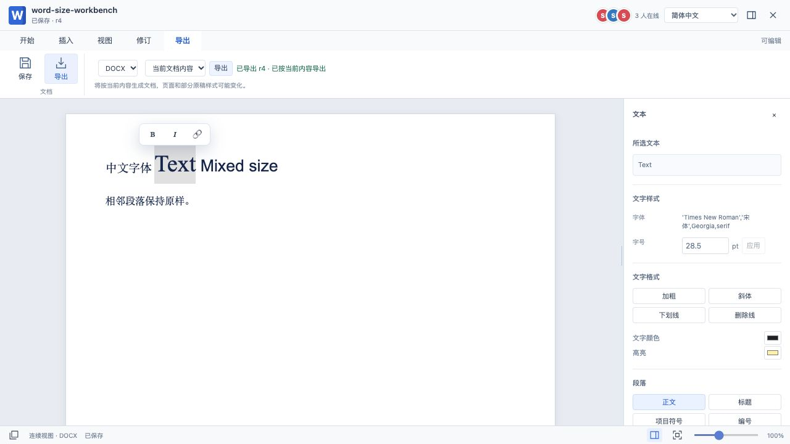

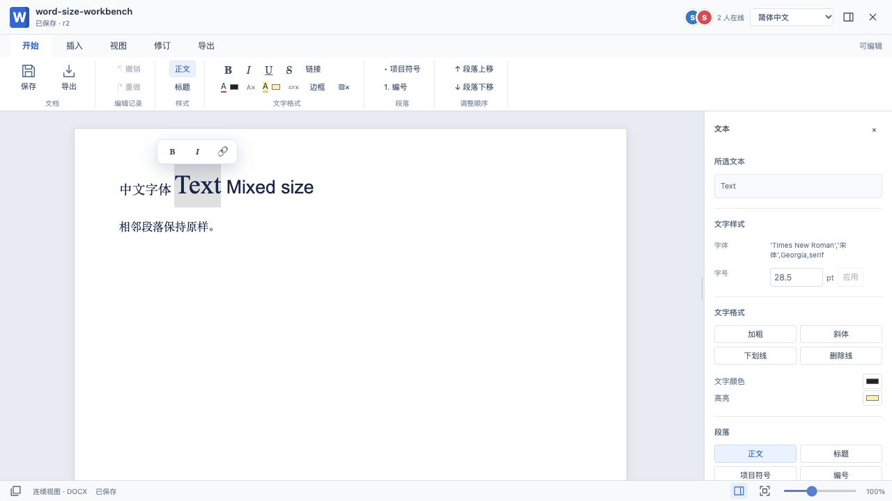

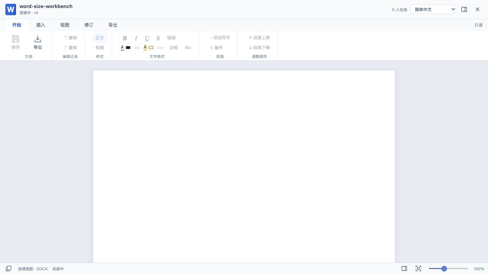

本地检查通过：hcd-core 52、docx-handler 39、hcd-docx 34、OfficeCLI 二进制 94、多格式集成 19、HTML 转换 3、前端 27 项测试；保存脚本 5 项检查、独立版/嵌入版构建、相关 crate 全 target clippy、fmt、diff 检查。回归包含命名样式多语字体、真实结构修改→DOCX→再次导入、旧样式补充不改历史、原文件 hash 不符拒绝、Unicode 边界和非法数据不产生部分输出。均为本地证据，未部署或进行生产验收。

仍需优先处理：结构 checkpoint 的原始块/样式类及未建模的段落/字符属性保留；手动保存、sidecar 自动保存和外部规范修改的统一协调；旧房间存在不匹配待保存文字时的恢复界面。当前语义重建不保证原稿全部样式、分页、批注/字段关联或高级排版；本轮验证不能证明这些要求完成。字体选择、字体文件依赖/预览解析、PPT/PDF 字体编辑、RTL 与多实例协同继续在原目标内推进。

## 属性区对齐分析（页面、文字与对象）

本节记录用户补充的 PS / Office 操作逻辑，属于设计与代码审查结论，尚未作为全部已实现功能验收。此次浏览器样例返回 401，未据此刷新凭证、重置文档或进行新的界面验收。

对照依据：[Adobe 字符格式](https://helpx.adobe.com/photoshop/desktop/text-typography/characters-glyphs/format-characters.html)区分选中字符与整个文字图层；[PowerPoint 文本框设置](https://support.microsoft.com/en-us/powerpoint/training/set-text-direction-and-position-in-a-shape-or-text-box-in-powerpoint)区分文本内容、文本框尺寸及内边距。HCD 采用同样的作用范围区分，三个编辑器共享属性面板结构，按格式能力提供实际操作。

### 选区与属性的对应关系

| 当前操作或选区 | 属性区内容 | 修改的作用范围 |
| --- | --- | --- |
| 打开文档、点击页内空白、选择页面缩略图 | 页面尺寸、方向、背景等页面属性 | 当前页或显式选择的页面；Word 排版设置按节处理，不能把任意正文分片当作物理页 |
| 单击文字对象边框 | 位置/尺寸、文本框内边距、垂直对齐、换行与溢出 | 当前文本框；对象格式与字符格式分组显示 |
| 双击进入文字、框选文字 | 字体、字号、颜色、强调；段落对齐、缩进、间距及列表 | 字符属性仅影响选区；段落属性影响选区覆盖的段落；空光标设置后续输入格式 |
| 选择图片 | 替换、位置/尺寸、比例锁定；具备能力后提供裁剪、旋转 | 当前图片；Word 需另区分行内图片和浮动图片 |
| 选择形状 | 位置/尺寸、填充、描边与排列 | 当前形状，内部文字编辑另有文字选区 |
| 多选对象或跨格式文字 | 共同可用的属性；不同值显示“混合” | 只修改用户明确操作的属性，其余属性保持各对象原值 |

以上是目标能力，不代表页面背景、文本框格式、形状或多选编辑已经接通。PDF 的扫描页面/不可解析区域不能伪装成可编辑文字；OCR 若引入，需要独立能力声明与识别结果确认。

### 当前代码差距

- 固定版式用 `selectedRun`、`selectedImage` 和 `inspector` 三组独立状态，加载页面时还会自动选择首个文字/图片。页面切换并不统一重置选区，属性标签可以与真实点击对象脱节。应由一个包含文档、页面、对象和选区类型的选择状态驱动面板与协同标记；浏览对象列表只作为辅助入口。
- 固定版式文字命中区域调用 `selectRun` 后直接聚焦侧栏 textarea。当前属于侧栏内容编辑，尚无 Office 式“选择文本框 → 进入框内文字 → 字符选区”的分层。一个视觉对象包含多个 run 时，点击只选择 `nodeIds[0]`，不能据此把首个 run 的样式展示成整个对象的统一样式。
- Word 完整模式的属性区固定为文字属性；字号和字体已读当前选区，颜色/高亮控件仍使用固定 `defaultValue`，不能准确表达当前或混合颜色。图片操作留在插入工具区，页面/节、图片与表格选区未统一接入属性面板。
- 当前“页面”属性主要显示只读尺寸，同时包含缩略图开关和重置布局。应把文档内容属性与工作区视图设置分开：缩放、面板显隐、宽度及重置留在“视图”。页面属性不应承担工作区布局调整。
- 分析时图片几何草稿仅存在于 `ImageGeometryPanel` 的本地 state，按图片 key 重建，切换对象/页面/属性类型可能丢失。此项已在下文“图片属性草稿与文字的统一保存”中修复并作本地验收；完整 Word 的统一快照协调仍未完成。
- PPT/PDF 字体和字号目前主要为原文信息，不能将展示信息换成可输入框就声称可修改。必须逐项接通持久化、重开、导出及历史保留后再开放。

### 面板与交互约定

1. 顶部显示选中类型、对象名称和必要的只读/冲突状态；下方按“文字、段落、变换、外观”等相关组折叠，优先展开常用项。沿用当前可拖宽的紧凑侧栏，不把全文或所有对象编辑框堆入面板。
2. 切换选区自动刷新属性值，保留用户对同类属性组的展开状态。点击属性控件不得丢失文字选区；输入法组合期间不强制变更格式。多值状态与未设置/继承状态分开表达。
3. Enter 或明确的应用操作确认输入，Escape 撤销本次字段输入；鼠标与键盘均可操作。单位转换只发生在展示边界，写回保留规范精度。修改能预览、撤销、重做。
4. 未支持的属性隐藏或说明限制；权限只读时保留准确属性值并禁用写入。协作者的选区单独显示，不改变本人的属性目标。远端更新与本地草稿相交时保留输入并提供冲突选择。
5. 页面、对象、文字属性读取只依赖当前加载页/分片及所需元数据。长文打开属性区不得隐式拉取完整正文；Word 完整模式当前仍有全文模型限制。
6. 保存与导出继续放在操作区；页面/对象属性的应用不等同于整篇已保存。所有新字段、混合状态、错误及单位文案纳入现有国际化机制。

### 实施与验收顺序

仍先修复保存正确性：统一手动/自动保存与外部修改的版本协调，保留未建模原稿样式，并保护图片等属性草稿。之后统一选区状态、属性值读取及面板分组，再按 Word、PPT、PDF 的能力开放可持久化属性；字体与协同同步验收。管理平台继续后置。

验收必须覆盖：页面→文字→图片→页面的连续切换；字符选区与文本框对象的作用范围；混合值；只读；撤销/重做；切页/收起面板不丢属性草稿；保存响应期间继续输入；两个协作者修改不同/相同属性；刷新重开及实际导出；长文属性读取不加载全文。当前仅完成此项分析，未将这些验收标为通过。

## 图片属性草稿与文字的统一保存（2026-10-23）

本轮继续保存正确性阶段，没有开始管理平台。修复属性区切换可能丢失图片位置/尺寸草稿，以及只检查文字就允许关闭/导出的问题。

- 新增由工作区持有的 `ImageDraftStore`，按稳定图片 nodeId 保留原始 visualHash、位置/尺寸、页面及冲突信息。切换图片、页面、文字/页面属性或收起面板不销毁草稿；空输入、非有限数值及非正尺寸保留为待修正草稿，不作为 JSON null 提交。保存期间的新输入、还原原值、较新远端更新及删除不会被迟到确认清除。
- 固定版式和长文分段的操作区保存新增 `POST /edits`，只接受 `hcd-patch/3` 的 `text.splice` 和 `image.geometry`，身份由 token 写入。跨页文字/图片用同一次 revision CAS 与各自原始 nodeHash / visualHash 校验提交，任一冲突或非法尺寸拒绝整批。单张图片的“应用位置”仍可独立提交，其余草稿保持待保存。
- 发现旧图片写接口按服务器最新图片生成 visualHash，旧客户端若已获知新 head，可能覆盖旧画面未呈现的图片修改。图片替换/位置接口现在要求 `expectedVisualHash`：缺少返回 HTTP 428，不匹配返回 409；前端替换传入实际展示图片的 hash。仅获取新 revision 不足以授权旧图片快照覆盖新内容。这是请求协议变化，客户端需随 API 更新。
- 新增单图片读取接口 `GET /images/{nodeId}`，返回同一不可变 manifest 上的 revision 与图片状态；删除返回 `image: null`。只刷新实际有草稿的图片，最多并发四个请求，不下载全文或依赖前 50 张图片列表判断删除。HCD 查询复用索引 bloom 与受校验的 source map / chunk。
- 保存回执的文字 hash 从实际保存 revision 的不可变 manifest 读取；图片回执基于请求所校验的 base 和本次几何修改生成。不会因读取时 head 已推进而将后续内容的 hash 标成旧请求确认。精确重放同一 patch 保持原 revision。
- 固定版式的标题、状态栏、缩略图标记、保存、关闭、导出、模式切换、PDF 布局升级及 beforeunload 都纳入图片草稿和正在提交的状态。删除图片的草稿可复制或丢弃；同图冲突显示远端矩形，支持显式采用远端或保留本地。控件和新增状态补充简体/繁体与英语文案。
- 完整 Word 的图片面板也使用工作区草稿，切离“插入”不会丢失；有图片草稿时阻止关闭/导出/切分段模式，并要求先在“插入”应用或丢弃。完整 Word 仍通过单独的语义 checkpoint / sidecar 保存正文，此处没有宣称它已与图片和自动保存合并为一个协调器。该分支本轮完成类型/构建检查，没有新的 Word 图片浏览器验收。

### 本地证据

浏览器新建独立样例 `geometry-drafts-workbench`，没有修改此前 PPT/Word/PDF 样例的 head：

1. 第一页两张图片水平位置分别 80→96、300→316 pt，第三页图片垂直位置 140→180 pt，另修改第一页中英文/emoji 文字。切换图片、文字属性和页面后全部草稿保留；未保存时关闭、导出均提示先保存。
2. 操作区保存一次提交 4 处修改为 r1。随后本地输入 100 pt，另一用户身份通过 API 改为 110 pt（r2）；页面保留本地输入并显示远端 110 pt，暂停保存。明确保留本地后提交 r3，刷新仍为 100 pt。只读浏览器窗口禁用替换、坐标/尺寸和提交，仍可读取属性。
3. 实际语义 PPTX 导出 r3：3 张幻灯片、6 张图片、所改文字及三处几何值均通过导出包的原生 XML 检查；历史 r0–r3 保留，HCD 校验通过。陈旧图片 hash、只读提交、缺失图片前置条件分别 409 / 403 / 428，拒绝后 root 不变。[PPT API 与导出证据](assets/hcd-workbench-2026-10-23/image-drafts-api-evidence.json)。
4. 独立 `geometry-pdf-workbench` 文字与图片水平位置 40→52 pt 同批保存 r1。原生 PDF 导出可提取新文字；重新导入后，两张图片的矩形均与保存值相同，未编辑文字/图片与原不可变源重新导入结果一致，HCD 校验通过。[PDF 原生导出/重导入证据](assets/hcd-workbench-2026-10-23/image-drafts-pdf-evidence.json)。

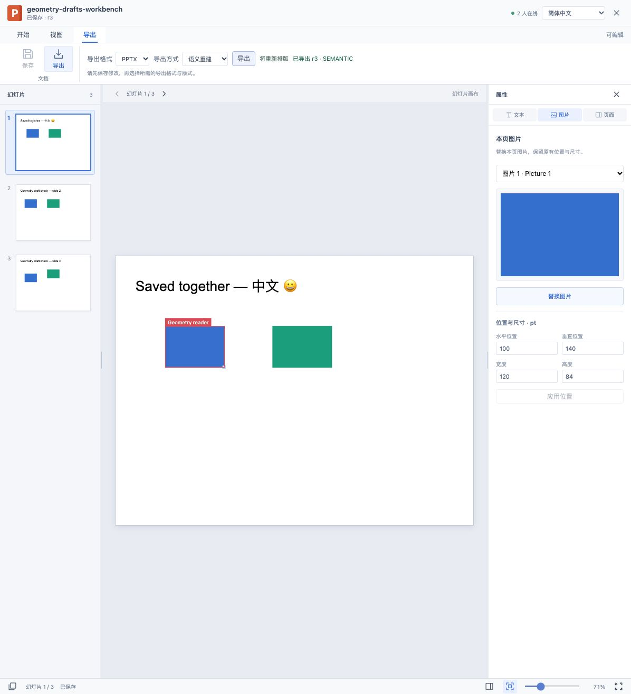

[未保存时导出拦截](assets/hcd-workbench-2026-10-23/image-drafts-export-guard.png) · [图片位置冲突](assets/hcd-workbench-2026-10-23/image-drafts-conflict.png)

本地检查：前端 35 项测试及独立版/嵌入版构建通过；hcd-core 52、hcd-docx 34、hcd-formats 43 项库测试，OfficeCLI 二进制 95 项测试通过；补强陈旧图片用新 head 提交的拒绝测试后，API 定向 13 项再次通过。相关 crate 全 target clippy、fmt、diff 检查和保存脚本 5 项通过。全部为本地证据，未部署或进行生产多实例验收。

边界：草稿仍仅在当前工作区内存中，不支持刷新/崩溃后的磁盘恢复。修改图片后的源文件重放 PPTX 导出仍明确拒绝；本轮浏览器实际使用语义重建导出，没有将其算作原稿全部样式、母版或动画保持。完整 Word 的自动/手动快照协调、外部规范修改同步、未建模原稿样式、PPT 原生图片回写和字体/协同的其他项目继续在原目标内，管理平台后置。

复验：

```bash
npm --prefix examples/hdoc/editor test
npm --prefix examples/hdoc/editor run build
cargo test -p hcd-core -p hcd-docx -p hcd-formats --offline --lib
cargo test -p officecli --offline --bin officecli
cargo clippy -p hcd-core -p officecli --all-targets --offline -- -D warnings
cargo fmt -- --check
python3 scripts/hcd-save-correctness.py --officecli target/debug/officecli
```

## 完整 Word 保存协调与草稿副本（2026-10-23）

继续保存正确性阶段。本轮针对旧快照配新 revision、手动与自动保存竞争、房间重置删除待保存状态三个问题，没有开始管理平台。

- 语义房间改为 `documentId:epoch:typography2:save1`。浏览器通过 stateless 请求发送 requestId 与当前内容摘要；不再直接向 `/checkpoints` 上传整篇正文。手动、导出前和自动保存由同一房间协调器串行执行，期望 revision 固定为草稿所对应的基础版本，不在提交前读取新 head 作为旧快照的授权依据。
- 确认包含保存内容摘要与 revision。保存期间继续输入、撤销到原值、跨窗口输入及尚未确认的修改不会被旧确认清除；协作者按捕获时的 generation 清理，新输入仍留待下一次保存。对象键顺序经过规范化，Rust 与 Yjs 的字体字段顺序差异不会被误判为旧草稿冲突。规范 blockId 只回填给请求时捕获且仍存在的 CRDT 对象，不按响应时的新数组位置赋值。
- 基础版本/root/digest/lineage 有服务端 HMAC 签名。提交前持久化完整 CRDT；提交后更新并持久化基础回执。revision 的 checkpoint ID 含提交身份、摘要、完整 HMAC，并限制在 256 字节内；同一提交重放可返回原保存版本的 root 和投影，不把后续 head 的内容冒充原回执。重启只在连续、受签名保护的同一 lineage 记录能证明已提交时推进基础版本，其他情况保留草稿并停止覆盖。扫描上限 256 个 revision，超出需要恢复处理。
- `/checkpoints` 及当前协同状态的写入要求服务协调器协议；普通旧浏览器或旧 sidecar 不能继续走整篇快照路径（HTTP 426）。只读仍为 403。当前二进制状态写入同时校验 `X-HCD-Coordinator-Version: 1`、epoch 和前一状态 hash；不同持有者的陈旧二进制返回 412，保留恢复副本并停止规范提交。相同字节的重试允许幂等确认。API、sidecar、浏览器需一起更新。
- 本地状态按 epoch 分文件，旧无代次文件在受锁保护的访问中迁移。重置先保留恢复副本，再推进代次；旧文件不会作为新房间初始状态。文件内容与目录在 Unix 下同步后确认。PostgreSQL 新增恢复表，代次推进、旧状态归档/删除在同一事务内；当前状态的 hash 校验在锁定元数据行的事务内进行。此远端分支已编译和静态检查，本轮没有真实 PostgreSQL/S3 验收。
- 发现外部版本或旧待保存内容时保留现有编辑模型，进入只读对比状态，不由轮询直接卸载草稿。可下载 `.hcd-draft` 协同备份、按 50 块查看最新正文，或选择“保留备份并打开最新版本”。该操作先通过 HTTP 保留本地完整 CRDT，旧 WebSocket 无法连接时也能执行，再显式切换房间；操作期间有新内容则保留当前页面。恢复 API 接受旧 epoch 的副本，但不能借此写当前房间或规范正文。
- “修订 → 草稿恢复副本”可再次下载最近 50 份服务端副本。副本仍引用原文档资源，不是打包字体/图片的独立 Office 文件；目前没有选择性合并或备份文件导入界面。页面关闭前检查文字/图片草稿和进行中的提交。房间卸载分为持久化准备和真正卸载后释放，避免新连接取消卸载时协调器已被销毁。

### 实际本地流程

独立样例 `coordinator-word-workbench`，原稿含 14/20 pt 字体片段及相邻段落：

1. 首次建立投影 r1，writer 修改 `Text → Manual saved`，通过协调器手动保存为 r2；peer 修改 `Mixed size → Auto saved`，实际闲置自动保存为 r3。writer、peer、reader 三个窗口显示相同正文及已保存版本，只读控件不可写。原文件 DOCX 导出包含两处新文字，`word/styles.xml` 与原稿逐字节相同；浏览器实际导出 r3，报告 HIGH。
2. writer 输入未保存的 `Local draft survives`，另一用户身份用外部文本 API 提交 `External canonical` 为 r4，并将 epoch 0→1。旧窗口保留本地文字，显示 r3 草稿与 r4 最新正文，暂停覆盖。明确选择保留副本并打开最新版本后，加载 r4；从 API 下载并解码的三份 CRDT 副本仍含该本地草稿。侧车普通停止/重启后仍加载 r4，没有生成重复保存版本。
3. 停止侧车，浏览器离线输入 `Offline draft survives`；API 仍可访问，外部文本 API 推进为 r5、epoch 1→2。旧窗口保留离线文字并可对比最新 r5。侧车仍离线时选择保留备份并打开最新版本，HTTP 副本已存入服务器；随后恢复侧车，成功加载 r5，并实际导出 DOCX（HIGH）。从服务端副本解码读回离线文字，规范 r5 仍为 `External latest five`，没有被草稿覆盖。
4. 普通旧快照、旧 sidecar 快照、只读快照、旧二进制持久化、陈旧二进制 hash 分别按 426 / 426 / 403 / 426 / 412 拒绝，拒绝后 root 保持。Rust 生成的签名 checkpoint ID 已用同一私有 secret 重新校验；HCD 完整历史和校验通过。[API、导出与恢复副本证据](assets/hcd-workbench-2026-10-23/word-coordinator-evidence.json)。

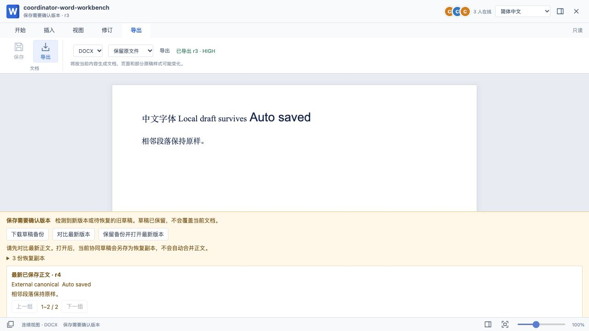

[手动/自动保存后的导出](assets/hcd-workbench-2026-10-23/word-coordinator-saved.png) · [侧车离线时的草稿](assets/hcd-workbench-2026-10-23/word-coordinator-offline-draft.png) · [恢复后最新版本与导出](assets/hcd-workbench-2026-10-23/word-coordinator-latest-export.png)

本地检查：前端 48 项测试及独立版/嵌入版构建；OfficeCLI 二进制 97 项、API 定向 15 项、多格式集成 19 项、HTML 转换 3 项；相关 crate 全 target clippy、fmt、diff 和保存脚本 5 项通过。新增测试覆盖重叠提交、迟到响应、更新途中输入、重启时已提交但回执未确认、规范版本变化、被替换的 CRDT 对象、旧待保存内容、二进制竞争、卸载取消及字体对象键顺序。提交后丢响应再重启的故障点属于隔离单元测试；真实服务验证了普通重启和侧车离线恢复，不能将两者混为同一证据。

仍未完成：未建模原稿样式/段落/字符属性的结构保存保留，完整 Word 图片属性与正文的同批事务，草稿选择性合并及导入，浏览器磁盘自动恢复，权限主动撤销与生产多实例容量/远端存储验收。保存确认前所有副本同时终止仍可能丢失最近输入。字体选择、PPT/PDF 同等字体编辑和其他协同能力继续在原目标内；管理平台后置。

复验：

```bash
npm --prefix examples/hdoc/editor test
npm --prefix examples/hdoc/editor run build
cargo test -p officecli --offline --bin officecli
cargo test -p officecli --offline --test hdoc_multi_format --test html_convert
cargo clippy -p hcd-core -p officecli --all-targets --offline -- -D warnings
cargo fmt -- --check
python3 scripts/hcd-save-correctness.py --officecli target/debug/officecli
```

## 局部字号的原稿保存与导出（2026-10-23）

新增 `hcd-patch/5` 的 `text.runs`：同一个 canonical 节点内记录 Unicode scalar 数量及字号分段，正文仍只存 HTML。保留原节点 ID、source anchor、外层 run/段落样式和未编辑属性；字号分段不制造新的来源 ordinal。省略 `sizePt` 表示沿用原始 run，包括未建模的复杂文字字号。字号为 1–1638 pt、半磅步长，不能在组合附加符或 emoji ZWJ 字素簇内部切分。

- 补丁同时检查 `nodeHash` 与 `formatHash`；纯字号变化不会改变纯文字 hash，但会改变格式 hash。失败不推进 head。格式修改不清掉原批注；正文变化沿用范围重定位与失效规则。后续 CLI `text.splice` 会重定位已有字号分段。
- 编辑投影将格式分段展示为多个 inline，但保留它们的同一个来源 nodeId。协调 checkpoint 可按未变正文的字符范围识别局部字号变化；可逐段对应的后续改字也可归并回原节点，保存模式为 `source-runs`。这些版本标记为非结构修改。
- 原生 DOCX 回写按字号边界拆原 run，复制其原 `rPr`，只覆盖选中范围的 `sz`/`szCs`。保留未知属性、字符样式、段落属性、主题引用；制表符、换行、域和绘图等非文字子节点各保留一次。重复 run 的 Word `textId` 只保留在首个输出 run；其他命名空间的同名未知属性仍保留。支持命名空间前缀别名和 Strict Word 命名空间。未修改 ZIP 条目继续复制原压缩内容。
- 导入时，同段落内重复的原文字身份现在按 occurrence 生成稳定编号，避免同 run 多个 `w:t` 共用 `textId` 时导入失败；原来唯一身份的编号规则保持。
- 修复 canonical 文字提取遇到内层同名 `span` 提前结束的问题。持久化字号元数据必须与真实 HTML 文字、分段覆盖和字号 wrapper 一致，离线校验可独立发现不一致。
- 修复语义保存摘要将 Yjs 合并的同样式相邻文字与原始分段视为不同草稿的问题。摘要递归合并属性完全相同的相邻文本，保留不同来源 ID、不同格式、换行和块边界；不会用这种归一化忽略真实文字/格式编辑。

接口：`GET /v1/documents/{id}/text/{nodeId}?revision=N` 返回所选不可变版本的正文、格式 hash 和可选字号分段；写入复用鉴权 `/edits`，版本 5 支持 `text.runs`，回执带保存版本的 `formatHashes`。CLI `hdoc get-node` 同样提供格式前置条件。版本 4 的结构补丁仍独立，不被版本 5 替代。

本地验收样例 `source-size-workbench`：原稿包含命名段落/字符样式、字号 14 pt、复杂文字字号 16 pt、字符间距、书签、制表符和相邻 `w:t`。创建投影 r1 后，在浏览器选中 `中😀` 设置 28.5 pt，协调保存为 r2；两个窗口同步，peer 重开仍显示 r2。浏览器实际“保留原文件”导出 HIGH。API 读回仍为原 nodeId、原 part/ordinal；源 DOCX 导出中只有选中的 `中😀` 使用 57 half-points，源样式文件及其他未改 ZIP 条目逐字节相同。该证据只覆盖本地样例。

[结构化证据](assets/hcd-workbench-2026-10-23/word-source-size-evidence.json)

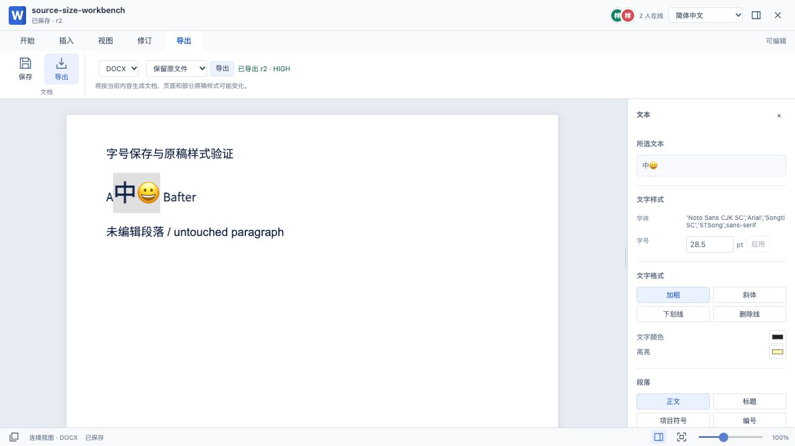

新增公开 CLI 回归覆盖 9 类检查：局部中文/emoji 字号、格式 CAS、字号后的文字修改、校验、原生与语义 DOCX 字号、未改 ZIP 条目、命名样式/间距、非文字子节点、不可变历史。隔离 API 测试覆盖只读拒绝、旧补丁版本拒绝、格式前置条件失败、精确重放、局部字号二次拆分和随后改字。

```bash
cargo build -p officecli --offline
python3 scripts/hcd-font-size-preservation.py --officecli target/debug/officecli
cargo test -p hcd-core -p hcd-docx -p hcd-formats --offline
cargo test -p officecli --offline --bin officecli --test hdoc_cli --test hdoc_multi_format --test html_convert
npm --prefix examples/hdoc/editor test
npm --prefix examples/hdoc/editor run build
cargo clippy -p hcd-core -p hcd-docx -p hcd-formats -p officecli --all-targets --offline -- -D warnings
cargo fmt -- --check
```

本地结果：核心 54、DOCX 37、其他格式 43、OfficeCLI 二进制 98（含 API 16）、CLI 集成 4、多格式集成 19、HTML 转换 3、前端 50 项通过；独立版/嵌入版构建、clippy、fmt、diff、原保存脚本 5 类检查及新增 CLI 9 类检查通过。

当时未完成的稳定字符来源 mark 和文字/字号联合保存，已在下节继续修复；粗斜体、颜色、字体族等其他格式及结构仍可能触发重建，不能据此宣称完整原稿保真已完成。原始嵌套字段/链接标记的字号修改、含 `rPrChange` 的源 run 拆分会明确拒绝或需要后续专门支持，不能静默展开。当前语义编辑视图也未完整表达命名样式中的颜色、间距等全部属性，源文件保留与视图完整还原需要分别验证。Word 图片/正文事务、字体选择、PPT/PDF 字体编辑及协同/国际化剩余项继续推进，管理平台仍后置。

## 字符来源与联合修改保存（2026-10-23）

本轮仍在保存正确性阶段。来源身份独立于可见格式：Tiptap/Yjs 的 `hcdSource` mark 贯通投影、中文/emoji 输入、代码块、字号分段及 checkpoint；相邻同样式的多个原 `w:t` 不再依赖改字前后的字符偏移猜测对应关系。字号额外记录继承/显式状态；点击设置为基础字号也属于明确修改，不改字号时保留源复杂文字字号。

- API 按原块校验来源成员和顺序，来源缺失或未知明确拒绝。文字/字号联合变化按原节点生成非结构 `text.runs`，DOCX 源样式不被整块重建覆盖。其他字符格式或结构变化仍有语义重建路径。
- 普通文字修改使用 Unicode scalar 的最小差异范围，避免整节点 splice 使未编辑范围的批注无必要失效。HTML/Markdown/TXT 的同格式文字修改继续保留原来源结构；字号持久化的原稿精确链路目前针对 DOCX。
- 粘贴清除外部来源身份；行内粘贴继承实际插入位置，跨块粘贴不复制源 ID。显式粘贴字号保留。空段落及嵌套文本块输入使用各自的来源/字号默认值。
- 保存摘要只描述可见内容与格式，内部来源/规范 ID 回填不会生成虚假的未保存状态。原始请求仍由精确 body hash、签名和来源校验绑定。迟到回执仅更新仍存在的捕获对象，保留较新的文字和结构编辑。
- 保存协议升级为 2，房间后缀 `:typography2:save2`；binary 写入头及 checkpoint 同步使用版本 2，旧写入返回 426。API、sidecar、浏览器须一起更新。历史版本 1 回执仍可验证；先核对签名和不可变基线，再原子迁移来源，不改 revision/epoch。可确定的格式和单一来源待保存文字被保留；多个来源文字对应不明确时，原状态进入恢复副本流程。

本地浏览器样例 `source-size-workbench` 从旧签名回执 1、r2/epoch0 原位迁移。窗口 A 同时将 `中😀` 改为 `中文😀`、字号 28.5→32 pt，保存 r3；窗口 B 将紧邻的同样式来源 `after` 改为 `after edited` 并设置 18 pt，保存 r4。两窗口刷新均为 r4；选区回显 32 pt，实际操作区“保留原文件”导出 HIGH。CLI 源文件导出验证了两个原 source ordinal 保留，未编辑文字仍为原 14/16 pt，命名样式、字距、书签、制表符与换行各自保留，其他 4 个 ZIP 条目逐字节不变。证据为本地样例，不代表生产验收。

[结构化证据](assets/hcd-workbench-2026-10-23/word-source-identity-evidence.json)

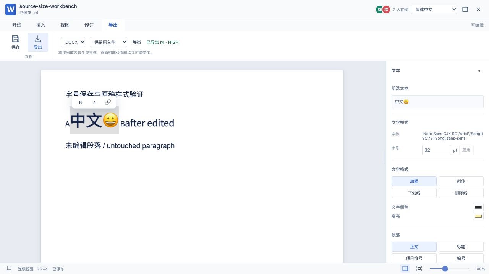

检查结果：前端 64 项、核心 54、DOCX 37、格式 43、OfficeCLI 二进制 99（含 API 17）、CLI 集成 4、多格式集成 19、HTML 转换 3 项通过；独立/嵌入构建、TypeScript、相关 crate 全 target clippy、fmt、diff、保存脚本 5 类及字号 CLI 9 类检查通过。针对旧草稿不明确归属、UTF-16/Unicode 边界、1200 个相邻来源、过期回执及并发编辑的覆盖属于隔离测试，不能等同于生产容量证明。

属性设计下一步仍按 [上下文属性侧栏分析](design/hcd-context-properties.zh.md) 推进：统一页面/对象/字符选择，分开工作区设置，准确回显混合值，再逐项贯通保存和导出。完整 Word 图片/正文事务、其他格式的原稿保留、字体选择、国际化与协同余项仍在目标内；管理平台后置。

## 完整 Word 正文与图片几何的原子提交基础（2026-10-23）

本节当时完成服务端和核心事务能力，前端尚未接入。下节已继续完成完整 Word 的正文与图片位置/尺寸统一协调保存；图片替换仍独立提交，不能据此宣称全部图片操作已经合并。

- 协调 `/checkpoints` 增加可选 `images`，每项为 `nodeId`、原坐标单位下的 `geometry` 和 `precondition.visualHash`。文字/字号、颜色、段落结构均可与图片几何在同一个文档写锁和 revision CAS 下提交。图片单独变化也不会因正文无变化被忽略；重复图片、过期视觉 hash、缺失图片、单位变化及非法尺寸均拒绝整批。
- `hcd-patch/4` 的语义事务增加 `image.geometry` 操作，支持与块插入/删除/移动/替换一起提交。图片操作在块操作之后校验和应用，块的原 hash 不受图片输入顺序影响；图片失效时，之前内存中修改的块不会写入 revision/manifest。重复图片操作拒绝，不以后一个值覆盖前一个值。纯图片批次不标成结构变化。
- 联合请求的签名 body hash 同时绑定正文和图片，空图片请求保持原文本协议签名兼容。回执包含该保存版本的图片状态；重放在更晚图片修改之后仍返回原 revision 的图片，不能把最新 head 的图片冒充原请求结果。
- 修复未改动的只读图片块使颜色修改误走结构重建的问题；保留原图块时，颜色可走已有 `node.style` 路径。此项不扩展源 DOCX 的颜色或图片原生回写能力。

真实 loopback HTTP 回归使用 4 份独立 Word 样例，覆盖文字/字号＋图片、颜色＋图片、段落转标题＋图片及仅图片变化。各自 r1→r2 一次提交，故意构造的图片冲突不改变正文、图片和 revision；之后图片独立修改为 r3，再重放旧请求仍返回 r2 的原图片回执，head 保持 r3。只读请求返回 403；源 DOCX 图片回写仍在输出文件创建前明确拒绝。

[HTTP 验收证据](assets/hcd-workbench-2026-10-23/word-image-transaction-evidence.json)

```bash
cargo build -p officecli --offline
python3 scripts/hcd-word-image-transaction.py --officecli target/debug/officecli
cargo test -p hcd-core -p officecli --offline --lib --bin officecli
cargo test -p officecli --offline --test hdoc_cli --test hdoc_multi_format --test html_convert
cargo clippy -p hcd-core -p officecli --all-targets --offline -- -D warnings
cargo fmt -- --check
```

本地核心 54、OfficeCLI 101、CLI 集成 4、多格式集成 19、HTML 转换 3 项通过；四路径定向测试、真实 HTTP 回归、fmt、diff 和相关全 target clippy 通过。结构操作执行到后置图片校验才失败的回滚、输入顺序与重复图片拒绝另有隔离测试。

下一步必须把完整 Word 图片草稿放入与正文相同的协同模型和协调器：保存前持久化、自动/手动提交统一、迟到回执只确认捕获值、重启恢复已提交但未确认的图片，并让保存摘要、导出和关闭覆盖图片。共享草稿需按 nodeId 和捕获 generation 更新，不能整张 Map 回填覆盖其他窗口的新草稿；未编辑图片不装载到草稿正文，缩略预览与资源内容也不应重复写入 CRDT。图片替换目前也仍是独立写入，需要一起继续收敛。旧客户端兼容、图片选区/草稿冲突、撤销重做、实际导出和双窗口浏览器验收未完成。原生 Word 图片几何回写及完整布局保真仍未实现；管理平台后置。

## 完整 Word 的正文与图片属性统一协同保存（协议 3，2026-10-23）

完整 Word 的操作区“保存”现已同时覆盖正文和图片位置/尺寸；图片详细属性从紧凑操作栏移至“插入 → 图片属性”的右侧可滚动面板，复用可调宽度、只读控制及同一个协调保存入口。页面/节属性与跨对象选择逻辑仍需后续统一，不能把这一图片侧栏视为整个属性 redesign 完成。

- 图片草稿与正文处于同一 Y.Doc。每次图片编辑使用独立意图 ID，按实际改动的字段合并；过期渲染闭包不能把其他字段回填为旧值。不同字段可以合并，同字段不同值保留全部候选，按 20 项展开审阅，明确选择后才提交。此模型最多处理 1000 张待保存图片和 4000 个意图；它不把预览图或资源字节复制进 CRDT。
- 一间房由同一协调器串行执行手动和自动保存。请求同时核对正文和图片意图摘要；关闭、切换分段模式及导出需要覆盖当前两部分的确认。非法坐标/尺寸和未解决的图片分歧阻止整批规范提交；只读窗口可查看，但不能修改、采用冲突候选或丢弃共享草稿，也不因别人的待保存内容阻止自身离开。
- 提交前保存 CRDT 和签名待提交记录。记录包含捕获图片意图及正文块的 Yjs 相对位置，不重复存一份正文。迟到确认仅删除捕获的意图；可证明是后续输入/回撤的值继续保留，未见过的新同字段意图则与已提交值并列为冲突。祖先线索有界为 64 步，无法证明顺序时保留冲突，不猜测覆盖。
- 迟到或重启后的图片基线来自鉴权 API 的不可变 `GET /images/{nodeId}?revision=N`，不信任可写 CRDT 内的预览回执。协调器按原始和当前版本比较实际字段：不相交的字段可重定位；重叠不同值需确认。请求并行上限 4，缓存最多 2048 个不可变查询，不读取全篇图片来打开属性栏。
- 保存协议升级为 3，语义房间后缀 `:typography2:save3`，checkpoint 和 binary 写入均要求版本 3。API、sidecar、浏览器须一同更新；旧写入返回 426。版本 1/2 签名回执仍可核对迁移，不新增内容 revision、不重置 epoch。历史 `hcdsave1/2` 与当前 `hcdsave3` 按各自签名验证。服务端恢复有效基线后，客户端可解除旧的缓存冲突状态，待保存内容仍须另行确认。

本地浏览器样例 `atomic-word-workbench`：

1. 窗口 A 改正文、图片横坐标 10→12 pt；窗口 B 改宽度 100→110 pt。一次操作区保存生成 r2，规范记录只含一条联合提交，保留两位协作者，两个窗口刷新值一致。
2. 将宽度设为 0，同时修改相邻段落，保存失败后 head 仍为 r2；规范正文仍是 `Neighbor`、宽度仍 110 pt。修正为 120 pt 后，正文和图片一起保存 r3。只读窗口的修改和丢弃控件均禁用。普通侧车重启后仍可恢复 r3。
3. 侧车断开时，两窗口分别输入横坐标 13 和 14 pt。先重连的窗口保存 13 为 r4；14 pt 草稿稍后到达时，右侧完整保留两个值，head 保持 r4。重启并从已持久化草稿审阅仍可选择；明确采用 14 pt 后才生成 r5，宽度仍 120 pt，正文不变。此项覆盖实际迟到重连；未模拟所有浏览器副本在确认前同时终止。
4. `source-size-workbench` 的签名回执 2→3 原位迁移后仍为 r4/epoch0，规范 rootHash 完全相同。联合保存样例 r5 的协同二进制确认没有残留图片意图或待确认提交。

[联合保存、迁移及导出证据](assets/hcd-workbench-2026-10-23/word-image-coordinated-evidence.json)

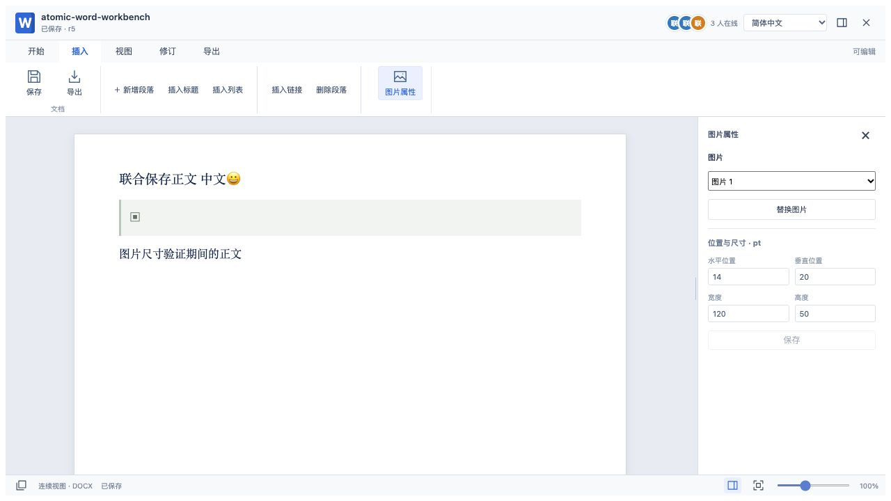

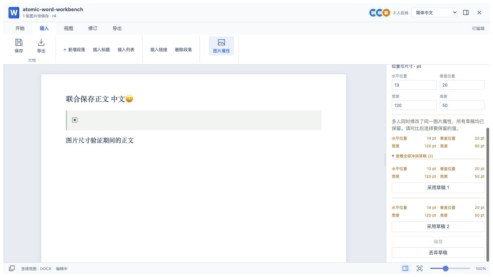

浏览器实际语义 DOCX 导出验证 r3；CLI 在不可变 r5 验证新正文和图片 120×50 pt 尺寸。此证据不覆盖 Word 浮动 x/y 的完整导出保真，源 DOCX 图片增量回写仍不支持，界面选择当前内容导出并明确标示语义重建。

本地前端 81、OfficeCLI 101、CLI 集成 4、多格式集成 19、HTML 转换 3 项通过；四路径真实 HTTP 回归使用协议 3，覆盖旧客户端拒绝、不可变图片读取与重放；独立/嵌入构建、相关全 target clippy、fmt 和 diff 检查通过。提交后丢响应的重启恢复、保存期间新输入/回撤、三个同时写入者的全部候选、离线不相交字段重定位属于隔离测试；不能扩展为生产容量证明。

仍未完成：图片替换与正文/几何的同批提交，图片属性与正文统一撤销重做，原生 Word 图片回写/浮动布局，浏览器磁盘自动恢复、正文选择性合并/备份导入、权限主动撤销和生产多实例/远端存储验收。完整 Word 仍是全文 Yjs 模型，分段模式才有正文按需加载。字体选择、其他格式同等字体编辑、国际化/RTL 与页面/文字对象属性余项继续在原目标内；管理平台后置。

## 图片替换的联合事务服务端基础（2026-10-23）

本阶段继续处理保存正确性。完整 Word 的替换按钮原先直接写入独立图片版本，尚不能与正文、位置和尺寸作为同一待保存内容。当前先补齐规范服务端事务，前端入口仍待接入，不能将此阶段解释为用户侧联合替换已经完成。

- `POST /checkpoints` 的图片项新增可选 `assetHash`。省略时保留原几何请求的序列化和签名形式；传入时精确请求签名同时绑定资源身份、几何和正文。源文字/字号、表现样式、语义结构和仅图片四条路径都可一次提交替换与几何，沿用服务协议 3。
- `hcd-patch/4` 新增 `image.replace`，可在同一操作携带可选 `geometry`。图片操作在块操作之后应用，仍使用原始视觉前置条件；同一图片重复目标拒绝，被删除的图片目标使整批失败。仅替换图片不被错误标记为正文结构重建。
- 替换引用的资源须先通过 SHA-256 和长度验证，包含复用已索引资源的情形；同批次相同资源只检查一次，避免多张图片复用时重复读取字节。只有全部正文和图片操作通过后，新资源才进入该不可变版本的资源索引。历史版本沿用原资源索引；无新资源的结构修改保留原索引对象。失败不能发布新的 head、正文或资源索引。
- 回执与重试使用已保存的不可变图片。即使后来又调整图片位置，旧请求重放仍返回原资源和几何；同一请求标识换资源会冲突。
- 修正了 patch/4 JSON Schema 的视觉哈希引用：使用已定义的 `hash`，避免原 `sha256` 悬空引用。

复现命令（先构建，脚本运行期间不要重编译同一二进制）：

```sh
cargo build -p officecli
python3 scripts/hcd-word-image-transaction.py
```

脚本使用独立临时目录、临时签名密钥和随机 loopback 端口，不修改已有工作台文档。覆盖四种保存路径各自含/不含替换，共八组真实 HTTP 场景；解包固定 r2 的语义 DOCX，检查实际图片字节、尺寸以及变更正文。源 DOCX 图片增量回写仍明确拒绝，不能以语义导出代替原生版式保真证明。

本地验证通过：完整 Rust 回归 397 项（核心 54、OfficeCLI 102、命令 215、HCD CLI 4、多格式 19、HTML 转换 3）；最终资源重复读取优化后再次通过核心/OfficeCLI 156 项。构建、`cargo clippy -p hcd-core -p officecli --all-targets -- -D warnings`、fmt 和 diff 检查通过。八组真实 HTTP 回归已解包 r2 语义 DOCX，沿 `a:blip` → relationship → media 文件验证实际引用的新图片字节；后续 r3 再替换为原图并改几何，r2 重放仍返回原来已保存的新图。证据范围为本地 HTTP、文件系统和 CLI，不包含浏览器替换入口、生产部署或原生 Word 浮动布局验收。

[八组联合事务和 DOCX 字节验证证据](assets/hcd-workbench-2026-10-23/word-image-replacement-api-evidence.json)

待继续：把上传后的资源身份作为共享替换意图，与正文及几何一起等待同一保存回执；补齐并发替换候选、上传期间关闭/导出约束、迟到确认、断线重开与协议迁移验证。此阶段没有修改浏览器界面，没有重置现有工作台或协同房间；管理平台仍后置。

## 完整 Word 换图的共享草稿与联合保存（协议 4，2026-10-23）

接续上一阶段的服务端事务，完整 Word 的“替换图片”现已不再直接发布单独版本。上传完成后形成共享资源意图，与正文、位置和尺寸一起等待同一保存确认。管理平台仍后置。

- 图片资源身份是独立可合并字段；换图和另一人的宽高修改可以合并，多个相同资源选择可以收敛。不同替换保留全部候选，明确采用其中一个后才提交。确认不仅核对坐标，还核对实际资产哈希；错误回执不能清除图片草稿。
- 异步上传前捕获基线与已见意图。上传后只替代当时已见且仍相同的资源意图，保留几何及后来到达的输入。共享模型只存资源身份，图片字节仍留在鉴权资源存储。尚未上传完成时，本窗口保存、导出、关闭和“保留副本后打开最新版本”受保护；这些入口不能把未注册完的换图算作已经保存。
- 新增 `GET /staged-assets/{hash}`，要求同一文档读权限，核对哈希及长度，不增加内容版本。图片预览使用鉴权请求和可回收的 Blob URL；候选预览点击后才加载，卸载/切换时取消请求并回收 URL。仅换图冲突省略重复的几何对照，位置尺寸仍显示在属性输入区。
- 进一步修复暂存资源的 GC 丢失风险：暂存描述符作为资源保留根，未提交的换图不会因不在规范资源索引中而被清理。上传在同一 bundle 写锁内发布资源和描述符，避免 GC 观察到半次暂存。损坏描述符使清理失败，不能将不确定资源当作孤儿删除；暂存字节不计入最新规范 revision 的新增字节。当前保守保留全部暂存资源，尚未实现安全的暂存租约/取消清理；并发本地写锁冲突可返回 409，草稿不会被误记为保存成功。
- API、sidecar 与浏览器保存协议同时升级为 4，房间 `:typography2:save4`，图片意图元数据 2。旧协议 3 的 checkpoint/binary 写入返回 426，防止旧协调器忽略资源字段。版本 1/2/3 的有效签名回执在不可变基线验证后原位迁移，保留 Yjs 对象、待保存内容及 epoch；提交后丢响应仍从已签名尝试及不可变图片恢复。

真实浏览器验证使用独立样例 `replacement-word-workbench`：

1. 构造有效协议 3 的 r1/epoch0 待保存正文与 110 pt 图片宽度。协议 4 工作台以原稿基线恢复两份草稿，之后自动保存为 r2；旧 r1 root 保持不变，epoch 仍为 0。此为本地构造的旧协议迁移夹具，不是生产旧数据验收。
2. 红色替换草稿在上传后显示“待保存”，之后自动保存 r3。浏览器再修改正文为 `联合换图正文 中文😀`、选择蓝图并将高度设为 55 pt，一次操作区保存生成 r4。r3→r4 的不可变记录同时包含正文与图片两节点变化，资源和高度随正文一起更新，没有残留意图。
3. 两窗口已同步 r4 后停止本地侧车，分别上传红图和绿图。重连后两份资源意图均已落盘，规范 head 保持 r4；只读第三窗口可查看冲突，采用和丢弃按钮禁用。明确选择绿色候选后才保存 r5，正文与 110×55 pt 尺寸不变。
4. 重新打开仍为 r5，图片属性预览为绿色。从操作区实际下载 r5 DOCX，沿 `a:blip` → relationship → media 核对引用的确为绿色图片原始字节，同时检查宽高与 Unicode 正文。规范 binary 的签名版本为 4、epoch0，正文摘要一致，没有剩余图片意图或待确认尝试。

[浏览器、不可变版本和实际下载证据](assets/hcd-workbench-2026-10-23/word-replacement-browser-evidence.json) · [协议 4 八组 HTTP/CLI 回归](assets/hcd-workbench-2026-10-23/word-image-replacement-v4-evidence.json)

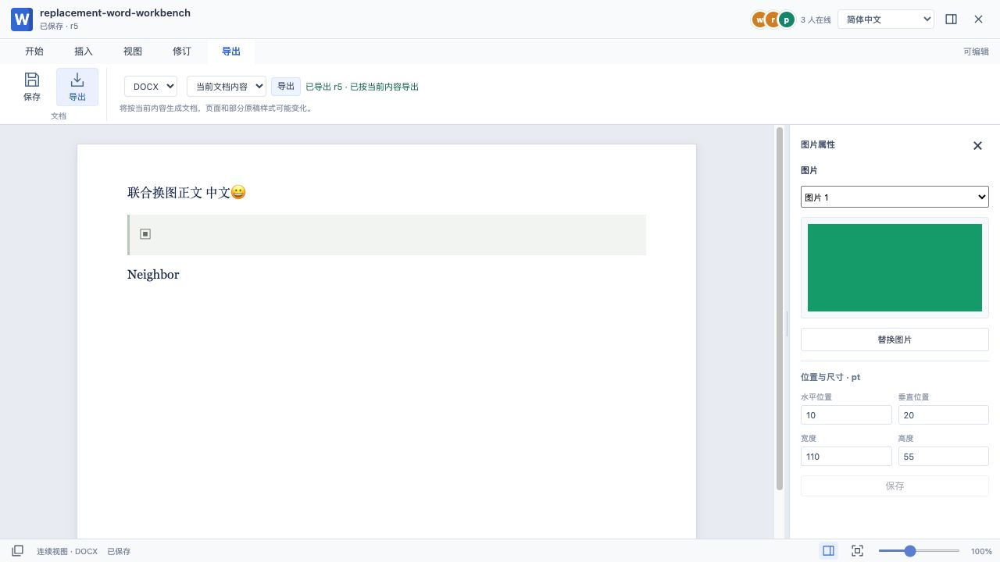

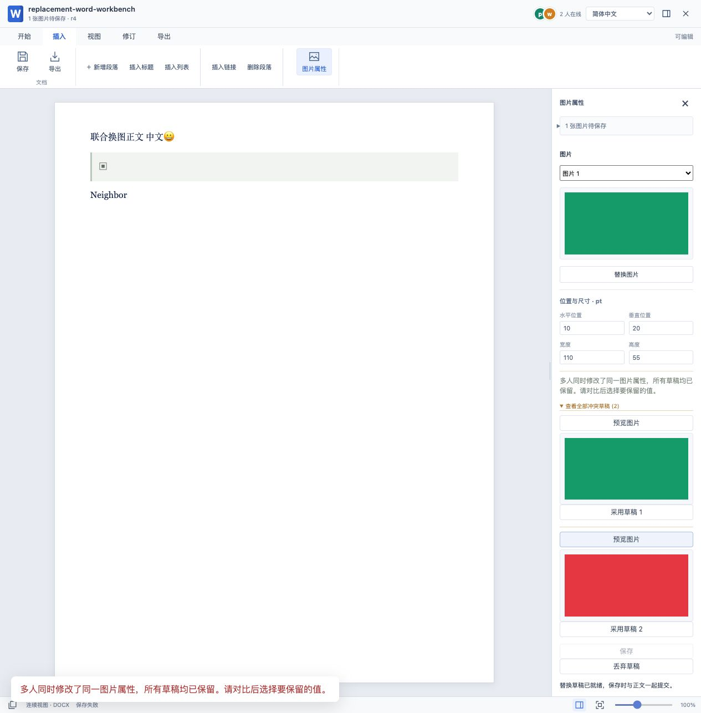

验证通过：前端 89 项；补强 v2/v3 迁移后相关协调器 27 项；API/修订通知 29 项；暂存资源 GC 修复后的核心 55 项、格式 43 项（含 PDF 图片保存/原生导出）；独立和嵌入构建；协议 4 的八组真实 HTTP/CLI/DOCX 字节验证；相关全 target clippy、fmt、diff 与新增源码空白检查。一次既有修订通知测试在构建负载下暴露固定 10 ms 等待竞态，改为等待第二个连接事件，并在测试结束时中止监听；原挂起进程已停止，修正后完整前端测试通过。提交后丢响应恢复与上传期间新输入/撤回属于隔离测试；未进行浏览器慢网上传中途终止或生产多实例验收。

额外的 GC 端到端回归先在修复前二进制复现：暂存后执行 `hdoc gc --delete`，预览返回 500，资源文件丢失。修复后八组场景都在暂存后实际执行清理，仍可读取暂存预览、联合保存并导出正确图片。已更新本地 API 运行时，原工作台保持 r5。

仍未完成：固定/分段工作区换图与正文/几何的联合事务，图片与正文统一撤销重做，权限主动撤销，生产远端存储/多实例验收。浏览器磁盘恢复的后续进展见下一节。完整 Word 正文中的图片仍是受保护占位，图片预览在属性栏，尚非完整所见即所得排版；图片列表分页与正文对象选择也需完善；源 Word 图片增量回写与浮动 x/y 保真未实现。国际化、字体选择、统一页面/文字对象属性和长文全文协同分段模型继续属于原目标。

## 完整 Word 的本机草稿日志与恢复选择（2026-10-23）

继续优先处理保存正确性。新增原生 IndexedDB 的 Yjs 追加日志，按 API/协作服务、文档、用户和 epoch 隔离，键不含 token。每次更新事务完成才显示“本机备份已记录”，配额/写入失败有独立告警；不能把本机备份当作规范服务端保存。日志限制为单条 8 MiB、总量 64 MiB / 100000 条，累计 128 条后在同一读写事务中合并所有窗口的日志，避免旧窗口快照覆盖其他窗口的输入。未自动删除历史副本。

启动时先读取本机日志、鉴权协作 binary 并比较，再创建协作 provider。发现当前 epoch 未同步草稿时，展示文字与图片意图对照，允许恢复、下载 `.hcd-draft`，或打开服务端版本并保留本机副本。恢复动作重新取得当前服务端内容，以 CRDT 合并正文和图片意图；签名回执、schema 和图片确认元数据仍以鉴权服务端为准。协调器同时修复来自旧磁盘重放的回执/schema/尝试元数据，私有签名中的有效基线和在途尝试不能被客户端 map 回放取代。旧 epoch 或归档副本仅供下载，不自动进入新房间；选择保留副本后创建独立日志分支。

正常保存后等待本机写入屏障，并再次核对新输入；磁盘故障不阻止有效的服务端保存，但持续显示本机备份不可用。浏览器不支持数据库枚举、存储不可用或载荷损坏时明确提示并提供重试/显式继续，缓存不会被故障处理清空。完整 Word 的离线恢复仍需当前服务鉴权和协作状态可读取，尚非整个应用断网冷启动。

真实浏览器隔离样例 `offline-word-workbench`：

1. r1 同步后停止该样例专用 sidecar，输入 `断线后保留的正文 中文😀`，上传红图、宽度改为 125 pt。确认本机事务完成；真实 API 此时仍为 r1 原文。
2. 关闭整个样例页，再新开相同 URL。页面从真实 IndexedDB 读出正文与一张换图草稿，进入恢复选择，尚未加入房间。已取得恢复对照截图。
3. 另一个用户窗口只看到服务端原文，将第二段改为 `另一位协作者的新内容` 并保存 r2。原恢复页选择恢复时重新获取 r2，保留两个不同段落的修改和红图/125×50 pt 尺寸，联合保存为 r3。
4. 再次重载直接打开已保存 r3，不重复要求恢复；实际 API 导出的固定 r3 DOCX 解包回读，两段 Unicode 正文正确，沿实际 blip/relationship 引用的媒体文件与红图原始字节一致，宽高 125×50 pt。规范协作 binary 无剩余图片意图或待确认尝试。

[浏览器/HTTP/DOCX 证据](assets/hcd-workbench-2026-10-23/word-local-draft-browser-evidence.json) · [恢复对照](assets/hcd-workbench-2026-10-23/word-local-draft-review.png)

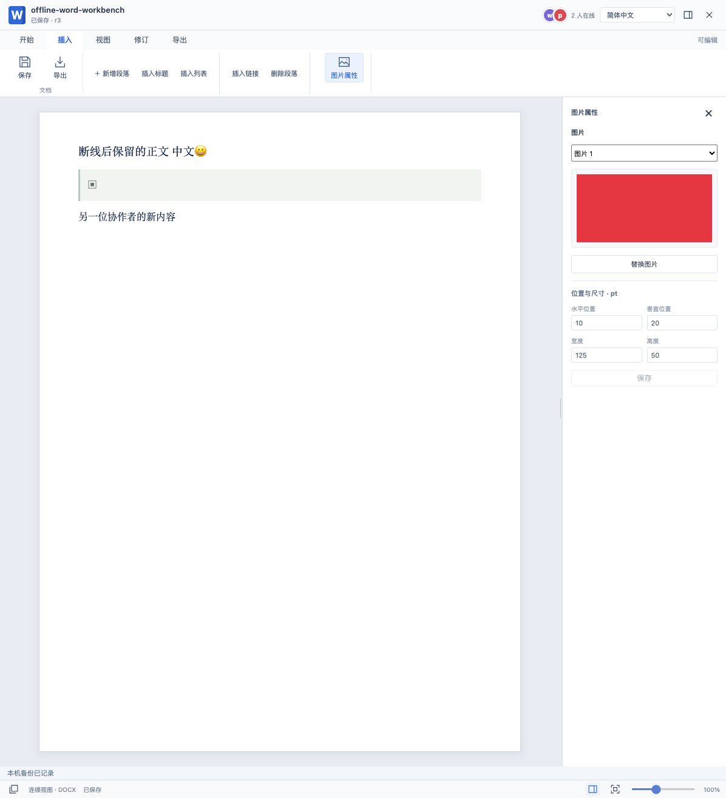

验证：前端 96 项通过，包含 6 项 IndexedDB 日志/配额/多窗口合并/旧版副本测试和 1 项协调器元数据重放测试；独立与嵌入生产构建通过。真实验证范围为本地浏览器关页重开、IndexedDB、鉴权 HTTP 和实际 DOCX；浏览器不支持所尝试的 renderer crash 方法，未执行强杀/系统崩溃测试，不能用关页验证替代系统掉电、磁盘驱逐或隐私模式验收。事务尚未完成的输入仍可能丢失。图片缓存只有资源身份，恢复预览依赖服务端暂存资源，并非自包含离线图片包。

待继续：旧版/多分支副本的安全清理、备份导入和正文选择性合并、完全离线应用启动与资源包、固定/分段编辑器等效保护、统一撤销、权限撤销及生产多实例。现有原工作台保持 r5；测试使用独立文档和独立 sidecar。

## Notion 式交互、可扩展内容与 AI 的分析

新增 [扩展与 AI 设计](design/hcd-editor-extensions-and-ai.zh.md)，覆盖菜单/快捷键统一注册、块与行内扩展、schema 与协作版本协商、逐格式降级报告、私有 AI 建议与接受事务。现有 Tiptap 已提供基础浮层/右键/格式，但公开扩展 SDK、slash 菜单、自定义节点协议和 AI 尚未实现。先完成保存基础，接着抽取现有命令，再扩展内容协议及 AI；管理平台继续后置。

用户确认继续后，新增 [分阶段实施清单与人员提及服务](design/hcd-editor-delivery-plan.zh.md)：覆盖保存/协同、统一命令、Notion 式交互、默认 `@`、人员目录与文档关联、提醒事件接口、自定义节点、通用 AI 及导出验收。当前服务的 doc/scope/sub/name/exp token 尚不构成完整组织人员目录；提及候选将由受文档权限约束的服务端目录适配器供给，不能用 awareness 在线头像代替，也不能通过提及自动授予访问权限。实际提醒不发送；人员节点、引用查询与提醒契约仍为待实施项。

保存优先的补强：增加回归复现 IndexedDB 日志一次写入失败后，下一次 delta 成功会把状态改回“已记录”的问题。此时中间 CRDT 更新可能未落盘，后续写入不能证明日志完整。现改为保留首次失败状态与错误；只有用完整当前文档初始化独立新日志才重新取得可靠的备份状态。完整前端 97 项通过（新增失败后继续输入用例），没有用隔离 IndexedDB 回归代替浏览器真实配额耗尽或系统崩溃验收。

## 固定布局与分段编辑的换图联合保存（2026-10-23）

继续执行保存优先。固定/分段模式此前把替换图片直接发布为独立版本；现在与正文、图片几何共用待保存集合。上传只产生已暂存资源和内存草稿，不提前发布内容版本。图片属性栏的“保存”也提交全部待保存文字与图片，避免只保存选中图片而留下正文。

- `/edits` 在既有 `hcd-patch/3`、`hcd-patch/5` 中开放 `image.replace`，同一图片的替换和几何使用相同 visualHash 前置条件。核心仍在单一写锁下校验资源、正文及图片并发布不可变 revision；错误资源使整批失败。
- 服务端回执从实际保存的不可变 manifest 读取图片资源、尺寸和 visualHash，按图片去重，而非从几何请求推测资源身份。后来再换图，旧请求重放仍确认原图片。旧 base 的 PDF 请求先交给核心判断重放或 CAS 失败，不再提前拿旧正文前置条件规划当前 PDF 页面。
- 工作区图片草稿包含 assetHash；调整尺寸回到原值不会丢掉待换图。匹配尺寸但资源不同不能自动确认；并发远端资源变化保留冲突，明确保留本地后重建前置条件。保存期间再次换图或修改尺寸仍留为新草稿。整批回执不完整或资源错误时，不能仅清掉正文子集。
- 上传状态提升到工作区，切换页/卸载属性栏仍受保存、关闭、导出、布局升级和切换完整编辑器保护；上传中头部不显示“已保存”。预览使用鉴权资源/暂存读取和可回收 Blob URL。

本地验证：前端 101 项，API 模块 22 项，相关全 target clippy、fmt/diff、Rust 构建、独立与嵌入前端构建通过。新增独立复现脚本：

```sh
cargo build -p officecli
python3 scripts/hcd-fixed-image-transaction.py
```

脚本为 Word/PPT/PDF 创建独立夹具和临时端口，核对错误资源不发布 revision、r1 同时保存文字/换图/宽度、r2 再替换后 r1 重放仍返回原资源。实际 DOCX/PPTX 沿 blip/relationship 读取引用媒体并核对尺寸；原生 PDF 导出用独立 `pypdf` 验证可选文字、实际 Do 引用的红色 XObject 和宽度缩放矩阵，未把仍保留的未使用原始蓝图当作错误。

真实 PPT 浏览器在独立工作台输入 `浏览器联合保存 中文😀`、上传红图、将宽度设为 130 pt，暂存时规范 head 仍为 r2；从图片属性保存一次生成 r3，正文和图片草稿全部清空。重载仍为 r3；从操作区实际下载语义 PPTX，回读文字、活动图片引用字节和 130 pt 宽度均正确。Word 分段与 PDF 本轮为真实 HTTP/文件验收，未声称三种格式都完成同样的浏览器操作。

[HTTP、实际文件与浏览器证据](assets/hcd-workbench-2026-10-23/fixed-image-transaction-evidence.json)

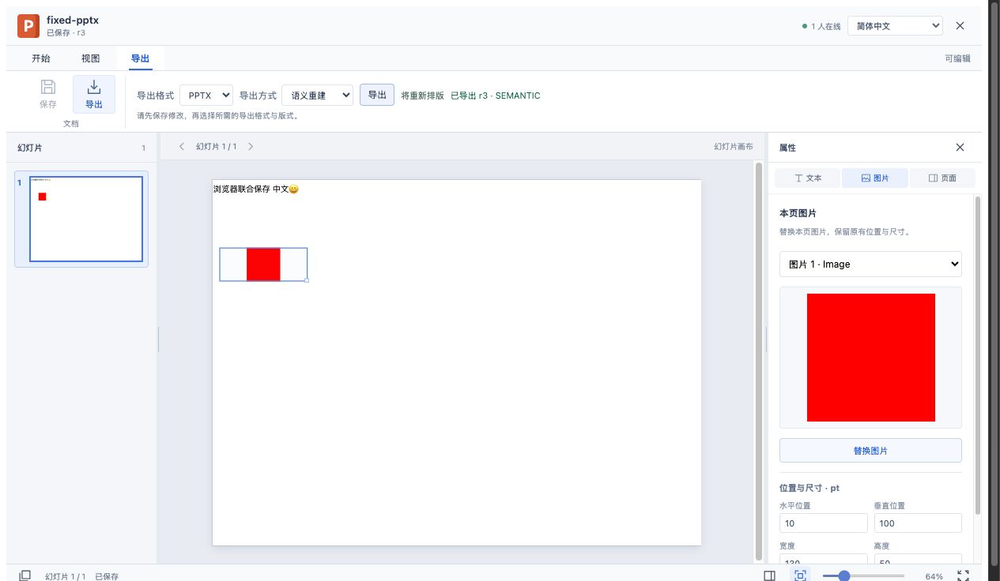

仍需继续：固定/分段本机持久草稿与未知请求结果恢复、统一图片/文字撤销重做、字段级并发合并、权限主动撤销、完整 Word 数据分段和生产多实例验收。当前固定/分段草稿在内存中，页面刷新前仍有离开保护，尚不具备完整 Word 的 IndexedDB 恢复。Office 源图片增量回写和浮动布局保真仍未完成；本次 Office 导出为语义重建。上述均为本地证据，原 Word 工作台核查时已为此前 10:38 自动保存的 r6（含新增空段落），本阶段未回退或再新增该文档版本，仅刷新了同权限的到期验收令牌；其正文、绿色图片与尺寸保持。空段落来源需另行核查，不能依照旧记录把当前 head 写成 r5。统一命令、Notion 菜单、人员引用、自定义节点、AI 和管理平台尚未在本阶段实现；管理平台继续后置。

## 固定/分段的持久草稿与未知保存结果恢复（2026-10-23）

接续联合保存，新增每窗口 `FixedSaveController` 和 IndexedDB 完整快照日志。普通固定/分段编辑不属于全文 Yjs 房间，因此以鉴权用户、API/协作地址、文档 ID 和不可变源文件 SHA-256 隔离；不随 Word 分段提交触发的语义 epoch 重置而丢掉后续输入。每个窗口拥有独立分支，恢复时另建分支，其他窗口和显式保留的副本不被旧快照覆盖。

- 新请求先把原 patchId、baseRevision、捕获正文/图片/资源和当前后续输入持久写入，再发 `/edits`。超时、网络错误或不完整回执保留原身份和捕获对象。未确认时不允许丢弃/解决被捕获的草稿，但仍可继续输入；关闭、切换完整编辑和导出继续受保护。服务端已确认后，本机确认写入失败不否定规范保存；旧磁盘请求下次仍解析为相同回执。正常备份模式下，配置日志无法记录新请求时不提交，保留草稿和下载入口；可重试备份，或明确选择暂停本机备份继续联网保存，后者持续告警且不承诺跨关页恢复。
- 新增只读 `POST /edits/receipt`：提交相同 patch 内容，按不可变记录和鉴权作者核对完整哈希，返回 `missing` 或 `committed`。人员显示名变更使用记录中的原署名还原哈希；同作者读令牌可查，异作者、同 ID 不同内容均拒绝。查询不写版本、不改变规范 head，不触发协作 reset。仅确认尚未提交时才可重发原请求；不会换一个新 patchId 盲重试。
- 保存回执现在还须匹配捕获正文的实际 SHA-256，和图片资源/几何一起验证后才清除任何子集。后来的输入重定位到已确认基线；更晚的远端文字、删除和资源冲突仍保留。恢复后刷新含屏外草稿在内的目标，不只依赖当前已加载页。
- 本机快照每份最多 8 MiB，最多 64 个非空窗口副本，加载副本累计限制 64 MiB；用有界 cursor 读取。只有自己的空确认状态可删除自己的分支；保留副本不自动清理，也不再次自动套用。存储故障保留之前已提交副本；完整新快照成功后可恢复备份状态，区别于 Yjs 增量日志的缺口不能靠后续 delta 掩盖。
- `.hcd-draft` 下载采用 `hcd-fixed-recovery/1`，包含不可变源身份、正文、几何、资源引用和原请求，不含 token、预览 URL 或目录凭证。未完成上传的文件记录中断状态并提示重新选择，尚未缓存上传中的完整文件字节。

本地验证通过：前端 110 项（新增 9 项固定恢复/隔离/并发分支/限额/丢响应/错误摘要验证）；API 模块 22 项（扩展联合事务测试，覆盖只读回执、异作者拒绝、改名、错误载荷和不变 head）；Rust 构建、相关全 target clippy、fmt/diff、独立与嵌入前端构建。Word 分段清空全部文字额外通过真实 HTTP 保存与空字符串摘要回执验证。复现脚本 `scripts/hcd-fixed-image-transaction.py` 已对三种格式增加真实回执查询、旧版本图片/正文确认和错误载荷拒绝；实际 DOCX/PPTX/PDF 文件验证仍通过。

真实 PPT 浏览器故障链路使用独立本地代理，规范 API 运行在独立 8770 端口：

1. r3 输入 `提交后丢响应 中文😀`、上传绿图并设宽度 135 pt。代理在规范提交 r4 并读完响应后断开浏览器连接，同时让回执查询暂时 503。独立 API 确认 head 已是 r4；页面显示结果未确认，原尝试与草稿已写入真实 IndexedDB。
2. 继续输入 `丢响应后继续输入 中文😀`，确认本机备份完成，关闭整个页面再重开。恢复页同时显示本机新文字、服务端 r4 原文字和待核对请求；明确恢复后移除故障，核对原请求，head 保持 r4，后续输入仍为未保存草稿。
3. 再保存后续输入生成 r5。实际从操作区下载 r5 语义 PPTX，回读正文、blip/relationship 活动绿图字节和 135 pt 宽度正确。
4. 再建未提交的黄图、140 pt 与新文字草稿，关页重开后仍能预览暂存黄图。下载草稿并选择“打开服务端版本，保留本机副本”，规范仍为 r5 绿图，两个本机副本保留，重载不反复恢复旧内容。
5. 通过正常界面下载此前未确认的副本，验证其中原请求仍指向 r3 基线，捕获正文与后续正文分开；从文件重建完整请求，真实 `/edits/receipt` 返回 r4，和 r4 不可变记录 ID 一致。两份备份都含原始 source hash，不含令牌。未将浏览器内存/隐藏状态读取当作磁盘恢复证据。

[真实浏览器、下载备份和实际 PPTX 证据](assets/hcd-workbench-2026-10-23/fixed-recovery-browser-evidence.json) · [三格式 HTTP/文件证据](assets/hcd-workbench-2026-10-23/fixed-recovery-api-evidence.json)

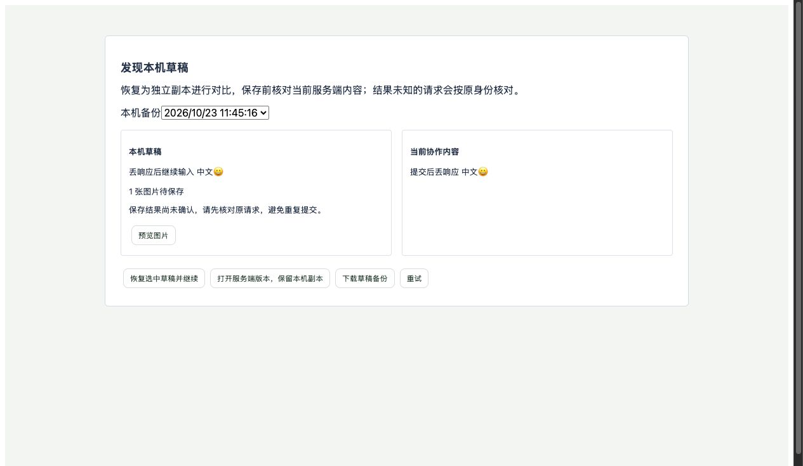

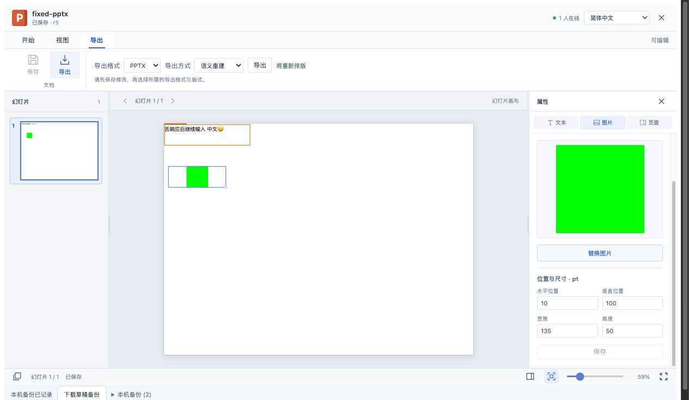

本地默认 API 8766 已更新为同版二进制，保留原文档目录、签名密钥和不可变历史，全文 Word 仍沿协议 4。恢复的完整浏览器链路本轮验证了 PPT，Word/PDF 为真实 HTTP/文件与共享恢复模型验证；未宣称各格式所有浏览器行为或生产多实例均已验收。仍需服务端鉴权和当前源身份才能冷启动，图片依赖服务器已暂存/已索引字节，备份导入、跨源副本迁移、安全清理、浏览器驱逐/隐私模式、renderer/系统崩溃与生产部署仍未验证。图片/文字统一撤销重做、权限主动撤销、长文全文数据分段和其他协同剩余项继续优先；Notion 菜单、人员提及、自定义节点、AI 仍待后续实现；管理平台与实际提醒继续不做。

## 后续工作

1. 编辑能力：PPT 新建/删除/重排幻灯片、形状拖动与格式、母版/动画/备注；PDF 内联图片流、复杂裁剪及内容处理；完整 Word/Yjs 的数据分段模型。当前不宣称达到 Office 全功能。
2. 国际化：已去掉 Word 边栏区域标签对浏览器全局语言的读取，改为当前编辑器语言；继续统一服务端错误码、名称长度、正文语言、RTL、输入法与 Unicode 边界。
3. 字体：已增加内置字体身份、无源 PDF 簇级回退、嵌入身份复用校验，以及 Word 原字体/字号读取与保存；已接通 Word 选区字号与 native DOCX runs；继续保留完整原稿属性、接通字体选择、文档依赖、预览与各格式导出。字体上传/管理平台后置。
4. 协同：本地已修复多标签连接排队及历史补发，并接入语义保存协调与恢复副本；继续处理正文选择性恢复/合并、离线资源完整打包、磁盘副本生命周期、主动权限撤销、审阅线程与多实例验收。完整 Word 的本机 CRDT 日志及恢复选择、固定/分段完整快照和原请求结果核对均已接通。
5. 管理平台：在以上基础稳定后再做 WPS 云服务式的文档、成员、权限、模板、字体与常用管理；本轮没有开始管理平台。

整体目标仍进行中。以上均为本地样例与本地构建/测试证据，未部署或进行生产验收。

本轮界面截图：

- [PPT 对象属性](assets/hcd-workbench-2026-10-23/ppt-properties.jpg)
- [Word 文字属性](assets/hcd-workbench-2026-10-23/word-properties.jpg)
- [PDF 点击区域与保存位置](assets/hcd-workbench-2026-10-23/pdf-properties.jpg)
- [长文分段](assets/hcd-workbench-2026-10-23/long-text-sections.jpg)
- [图片位置与尺寸属性](assets/hcd-workbench-2026-10-23/image-properties.jpg)

## 固定/分段的按字段撤销与 PDF 源图恢复（2026-10-23）

固定布局 PPT、PDF 和 Word 分段页新增 `FixedHistory`，按当前窗口的用户动作记录正文、图片资源和几何字段。连续输入可合并为一条记录；切换控件、保存和显式边界结束合并。保存回执、远端刷新与本机草稿恢复不产生用户撤销项。保存后记录继续有效，撤销先读取鉴权后的当前对象，只生成待保存反向草稿，再走原有联合事务和原请求回执流程。

- 撤销图片宽度时，仅逆转宽度，保留同事改变的高度等字段；生成的新反向草稿不重复提交未改变的图片资源，只有真实换图/源图恢复才写资源操作。已有本机其他字段也先按当前规范对象核查、保留；相同字段已发生不同修改、对象删除或请求失败时不改草稿、不发布版本。不会调用整文档历史版本回退来实现个人撤销。
- 正文与图片共用一条时间顺序记录；`Mod+Z`、`Mod+Shift+Z` / Windows `Ctrl+Y` 与操作区按钮一致。搜索框保留自身输入撤销，组合输入期间不接管按键。新输入会清除当前分支的重做记录。
- 核查期间出现输入或刷新时，旧核查结果不能覆盖新草稿；关闭时取消请求。上传、保存和结果未知期间暂停撤销/重做，原请求身份和捕获内容保持不变。核查冲突后可明确选择“保留当前内容并跳过此记录”，只处理历史栈，不修改当前正文或草稿；过期的核查不能跳过后来新增的操作。
- 原生 PDF 有些图片/图形直接来自源 XObject，没有独立资源哈希。新增 `image.restoreSource`：仅允许已验证的原始 source-only PDF 位置，移除其替换覆盖，保留当前几何，原始源对象继续提供内容。它与 `image.replace` 在同一对象内互斥，使用相同 visualHash/CAS、联合保存和不可变回执；非 PDF、无对应原始来源或缺少可验证源文件时失败并保留草稿。保存前明确显示源图预览将在保存后更新。操作定义已加入 patch/3 和 patch/5 的 JSON Schema，需配套新版 API；旧 API 拒绝时不得降级为只保存几何。
- 固定草稿状态升级为 version 2，保存和恢复“恢复源图”意图及其未知请求；普通 version 1 副本可读取并规范化，未来未知版本和不合法组合继续保留而不静默导入。数据库作用域与各窗口副本隔离规则不变。

浏览器已验证 PPT：正文保存 r9 后撤销并保存 r10；文本框快捷键撤销/重做后保存 r11；自己的宽度 150 pt 保存 r12，另一身份的高度 90 pt 保存 r13；撤销自己的宽度并保存 r14，结果 125 × 90 pt。实际从界面下载的 r14 语义 PPTX 已核查 Unicode 正文、活动 blip 引用的红色资源和两个尺寸。见 [浏览器证据](assets/hcd-workbench-2026-10-23/fixed-history-browser-evidence.json)。

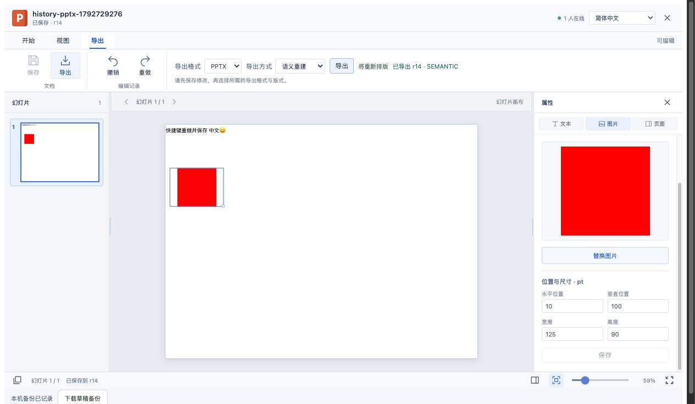

复现原生服务与实际导出文件回归：

```sh
cargo build -p officecli
python3 scripts/hcd-fixed-history.py
```

脚本使用临时源文件、独立回环 API 和两个鉴权身份，驱动与界面相同的 `FixedSaveController` / `FixedHistory`。已通过 DOCX、PPTX、原生 PDF 的保存后正文/换图/宽度撤销重做、同事高度保留、无效源图恢复整批拒绝、源图恢复回执，以及 r5/r8 实际文件中的活动资源、尺寸和正文。Office 验证属于语义重建；PDF 验证使用独立 pypdf 读取活动 XObject、图形状态矩阵、原始对象身份和可选中文字。见 [实际 API/文件证据](assets/hcd-workbench-2026-10-23/fixed-history-api-evidence.json)。验证终态：前端 123 项测试、服务端 22 项 API 回归、新增核心源图恢复局部测试均通过；Rust 构建、格式检查、Clippy 全目标检查和最后源码的独立/嵌入前端构建通过。三格式实际文件回归在去掉多余资源写入后重新通过，并检查几何撤销/重做请求只含 `image.geometry`。前端依赖仍有既有 `use client` 忽略和大分块告警，不将其记作无告警构建。

补充浏览器验收：同字段冲突保持 r16 和同事宽度 175 pt；明确跳过这条图片历史后，仍可撤销更早的正文并保存为 r17，图片保持 175 × 90 pt，实际导出正文和尺寸再次核查。PDF 另用干净源文件从界面换图保存 r1、撤销保存 r2 并下载；独立 pypdf 确认活动 `/Im1`、蓝色原始像素和可选中文字。导出界面仍报告其既有 `SEMANTIC` 级别，不据此提升保真等级。见 [PDF 浏览器证据](assets/hcd-workbench-2026-10-23/fixed-history-pdf-browser-evidence.json)。

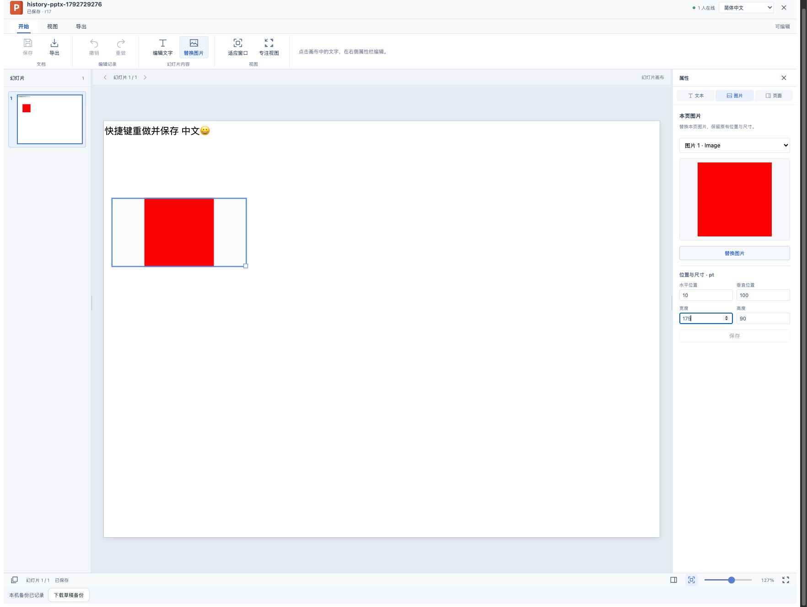

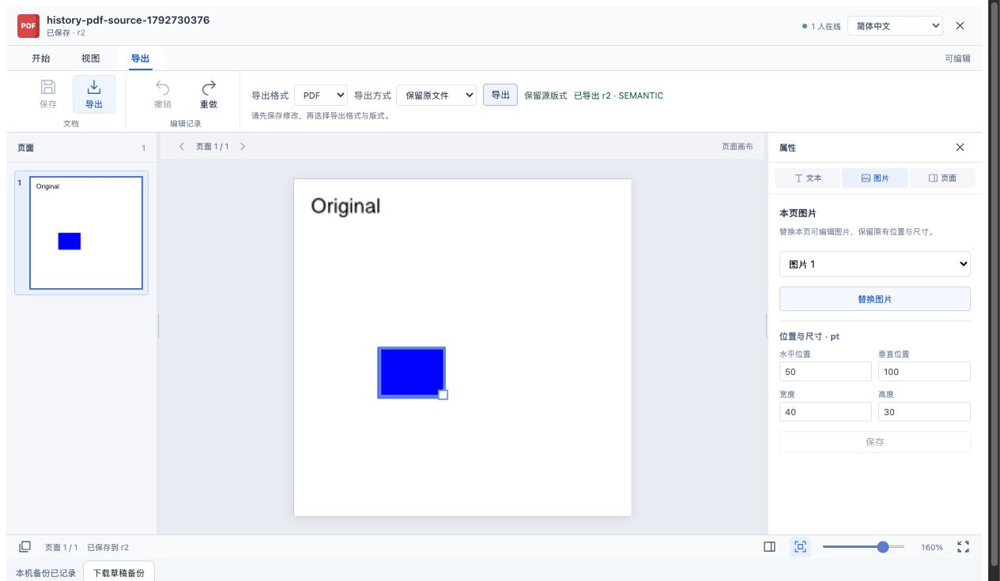

同时修复后台标签页/不可见宿主的零宽快照被当作窄屏、自动折叠侧栏的问题。只对实际可见宽度执行紧凑规则；PPT/PDF 来回选择对象后，两侧栏和最终图片数值仍保留。

边界：当前操作栈仅限当前窗口，会话刷新后不恢复撤销栈，待保存反向草稿和未知请求仍按 version 2 持久恢复；显式丢弃/解决冲突会清除此目标的旧历史，其他目标保留。撤销需要联网核查对象，不承诺离线撤销服务已确认的修改。此阶段的反向历史先于下节普通字段协同，持久状态和普通字段合并的后续升级见下节；完整 Word 的 Yjs 正文与共享图片统一历史、主动撤权、跨窗口历史、Notion 菜单、服务端人员 `@`、自定义节点和 AI 接口仍按实施清单继续，A05 不标全部完成。管理平台和实际提醒不在本阶段。

## 普通图片草稿的字段协同与持久意图（2026-10-23）

接续前一阶段的反向历史，普通固定布局和分段编辑现在也按 `x/y/width/height/assetHash` 跟踪用户意图。图片内容包括显式的 PDF 源图恢复状态。远端已提交的其他字段进入最新基线，本地只保留自己改过的字段；相同字段的不同值才进入冲突选择。

- 冲突栏列出具体字段。“使用远端内容”只采用冲突字段，保留本地其他字段；“保留我的草稿”也不会恢复已过期的远端高度/位置。后续输入、更多远端版本、已相同的字段逐项确认和旧响应乱序均有回归。未解决的同字段冲突不能通过撤销绕过，避免反向草稿清掉冲突保护。
- 保存结果未知时，捕获请求的 patchId、baseRevision、几何与资源仍保持原样。当前可变草稿单独记录 authored fields；迟到回执只确认被捕获的值，保留后续输入和之后的远端字段。即使自己的提交没有被客户端观察到，晚到的回执仍能识别提交后他人将同字段改回原值的冲突。
- 上传开始后即把目标加入刷新集合，无需先有几何草稿。上传期间可跟随远端几何；另一个人改了图片内容或删除对象时保留资源冲突/删除状态，不能把上传当作隐式覆盖。已确认/删除对象的缓存保留有界元数据，排除预览字节；活跃草稿、上传和请求目标不因缓存裁剪而丢失。
- 固定草稿状态升级为 version 3，持久化 `touched` 和 `conflictingFields`，读取旧 version 1/2 副本；旧请求仍按原内容核对。旧副本的显式回退可结合捕获请求恢复意图。未知版本、非法字段和重复字段不静默导入。数据库作用域、每窗口分支和原请求回执协议保持不变。

验证终态：138 项前端测试、TypeScript 检查、独立与嵌入前端构建通过。本阶段未更改 Rust 服务端。自包含脚本仍可运行：

```sh
python3 scripts/hcd-fixed-history.py
```

脚本在原保存后撤销/重做回归之外，增加两个真实鉴权身份的普通编辑：上传期间先提交远端几何，合并本地图片资源/宽度和正文到 r10；随后制造宽度和资源冲突，采用远端冲突字段而保留本地 X，保存为 r12。DOCX/PPTX 核查活动媒体引用、正文和尺寸；PPTX 另核查 X/Y，原生 PDF 独立核查活动像素、可选中文字和完整 CTM。Office 验证属于语义重建，DOCX 的浮动坐标保真仍未实现，不将规范模型中的 X/Y 当作实际 Word 浮动布局验收。见 [实际服务与文件证据](assets/hcd-workbench-2026-10-23/field-merge-api-evidence.json)。

浏览器单独验证：本地宽度 130、X=20 未保存时，另一身份将高度改为 75，合并保存到 r2；再编辑宽度 150、X=30，另一身份将宽度改为 180、Y=120、高度=80。界面只报告宽度冲突，选择远端后保留本地 X=30，保存 r4，实际从界面下载的 PPTX 核查为 X=30、Y=120、180 × 80 pt，活动图片仍为原始蓝图。见 [浏览器证据](assets/hcd-workbench-2026-10-23/field-merge-browser-evidence.json)。

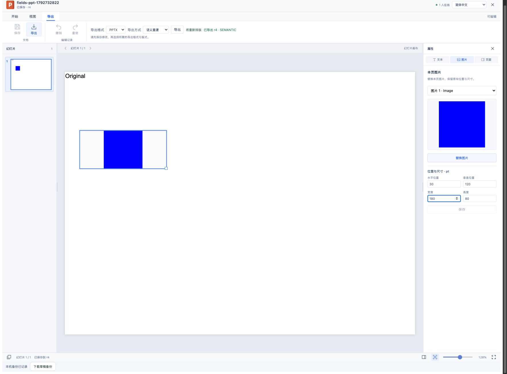

边界：固定布局正文仍以文本对象处理冲突，不能将图片字段合并称为 PPT/PDF 逐字 CRDT 协同。显式冲突选择仍清除此图片目标的旧本机历史；候选选择自身的安全撤销、完整 Word 正文/共享图片统一历史、主动撤权及后续命令/Notion/人员/扩展/AI 工作继续按实施清单推进。实际提醒和管理平台保持暂缓。
