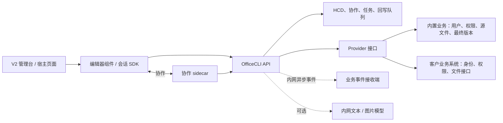
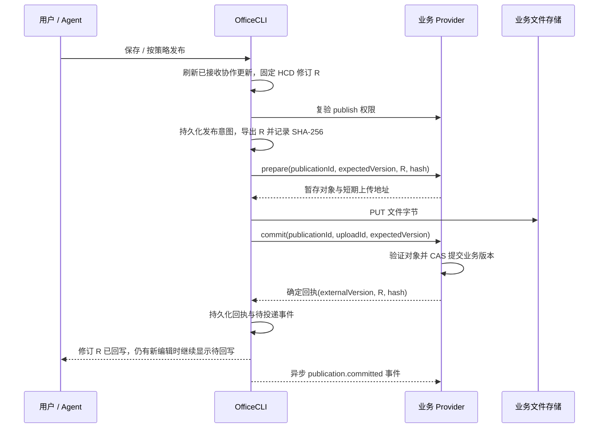

# OfficeCLI Workspace：宿主接入与离线部署 V1

状态：**设计基线 / 接口草案；阶段 A 宿主接入与阶段 B 默认应用已落地，阶段 C 离线发行待完成**。核查日期：2026-11-15。

本文保留完整产品目标；当前已实现范围见[宿主接入运行时验收](acceptance/hcd-provider-integration-v1.zh.md)与[默认 Workspace 验收](acceptance/hcd-default-workspace-v1.zh.md)。默认业务应用位于 `apps/workspace`，完全断网发行包尚未交付。配套[Provider OpenAPI 草案](contracts/officecli-provider-v1.openapi.yaml)描述由宿主实现的回调，OfficeCLI 自身会话与发布入口另见运行时验收。

## 1. 已确定的边界

用户已选择以下两项：

- **使用方保管源文档与最终版本；OfficeCLI 持久化 HCD 和协作数据。**用户、组织和文档权限由使用方决定。
- **完全断网可用**，包含前端、编辑器、字体和本地校验；AI 可接内网模型，未配置时隐藏相应入口。

默认交付是一套能完成当前文档业务的正式 **OfficeCLI Workspace**，包含 V2 管理台、编辑器、协作服务、Rust 引擎和内置业务 Provider。接入客户 OA、知识库、档案或其他业务系统时替换 Provider，继续使用相同的编辑器和保存链路。现有目录仍在 `examples/hdoc/`，本轮不搬迁或改包名，也不把现有验收图库当作正式账户系统。

“最终版本”指业务系统确认收妥的文件版本，可以有多次保存形成的历史版本；不等于每次按键或每个 HCD 修订。OfficeCLI 的 HCD 历史继续保留用于编辑、协作和恢复。两类版本独立编号，并保存可追溯映射。

## 2. WPS 官方文档提供的参考

以下为 2026-11-15 实际核查的 WPS WebOffice 文档，参考其**接入边界与粒度**，不表示 OfficeCLI 兼容 WPS 协议，也不代表具备 WPS 全部编辑能力。

| 官方资料 | 核查到的接入能力 | OfficeCLI 的取舍 |
| --- | --- | --- |
| [回调概述](https://solution.wps.cn/docs/callback/summary.html) | 回调抽象文件元信息、下载、权限和保存；业务凭证随回调传递，回调有请求签名 | 采用版本化 Provider；业务凭证换取短期编辑会话，不把宿主登录 Cookie、AppSecret 或签名密钥交给浏览器编辑器 |
| [文档预览](https://solution.wps.cn/docs/callback/preview.html) | 文件信息、下载地址、用户权限；权限包含 read/update/download/rename/history/copy/print/comment 等 | 查看、修改、下载、转换导出、历史、复制、打印分开；权限返回不等于对应格式已经能执行 |
| [用户信息](https://solution.wps.cn/docs/callback/user.html) | 按多个用户 ID 获取昵称、头像，用于协作及历史归属 | 宿主是用户身份权威；OfficeCLI 只保存稳定 ID、必要显示快照和操作归属，不复制密码或完整组织架构 |
| [文档编辑](https://solution.wps.cn/docs/callback/save.html) | 区分编辑同步与文件存盘；提供三阶段保存；文档注明单阶段提交暂停后续接入与维护 | 使用“准备上传→传输文件→确认提交”，加入 expectedVersion、幂等 ID 和不确定结果查询；HCD 保存与业务回写明确分开 |
| [扩展能力](https://solution.wps.cn/docs/callback/extend.html) | 重命名、历史列表/指定版本/下载、水印、事件通知、部分组件附件接口 | 历史与重命名按业务需求接入；水印、评论、分享、附件独立托管另列能力状态，不能因为定义了权限就显示可用 |
| [快速开始](https://solution.wps.cn/docs/web/quick-start.html)、[实例方法](https://solution.wps.cn/docs/web/instance.html) | SDK 初始化、ready、save、destroy、界面命令配置 | 补齐编辑会话生命周期、保存结果、令牌续期和销毁；保留 React 嵌入，后续提供框架无关嵌入包装 |
| [事件机制](https://solution.wps.cn/docs/web/events.html)、[个性化配置](https://solution.wps.cn/docs/product/custom.html) | 公共及组件事件、保存状态、界面配置、组件定制 | 浏览器交互事件与服务端 Webhook 分开；结合 V2 主题、语言、工具栏、历史和 AI 能力控制 |

WPS 上述公有服务文档要求回调及下载地址可被其公网服务访问。OfficeCLI 的目标是部署网内互通，**不引入公网地址、WPS 账号、云端控制台或外部授权服务依赖**。本次未核验 WPS 私有化产品的部署细节，不据此承诺任何 WPS 私有化能力。

## 3. 两种运行形态，同一条编辑链路

两种 Provider 按应用配置选用，不能让浏览器通过任意 callback URL 临时切换。内置实现也必须走同一接口与验收用例，避免内置模式可用、客户模式绕不过去的专有路径。

| 组件 | 内置 Workspace | 客户嵌入 |
| --- | --- | --- |
| 用户登录、组织和角色 | 内置业务 Provider 已实现账号登录、管理员/成员角色和文件 ACL | 继续使用客户已有登录和目录 |
| 文件列表、上传、新建、源文件及最终版本 | 内置业务库与文件存储，持久化、可备份 | 由客户提供；OfficeCLI 不自行接管文件归属 |
| 文档正文、HCD 修订、协作与引擎任务 | OfficeCLI 持久化 | OfficeCLI 持久化，部署于客户内网 |
| V2 管理台与编辑器 | 完整应用入口 | 按授权嵌入编辑器，可选管理入口 |
| 字体、主题、AI 与 MCP | 部署策略和业务授权共同决定 | 同样受业务授权约束，不因接入 MCP 获得额外权限 |

正式工程以当前 `admin-app`、`editor`、`sidecar.ts` 和 Rust 服务为基础逐步提取。目标交付包括固定版本镜像/二进制、静态资源、配置模板、数据库迁移、初始化流程、备份恢复及升级回滚工具。`embed-host` 保留为 SDK 教程，不承担默认业务应用职责。

## 4. 数据归属与持久化责任

| 数据 | 权威来源 / 持久化方 | 约束 |
| --- | --- | --- |
| 用户、组织、角色、文件 ACL | 使用方；内置模式由内置 Provider 实现 | OfficeCLI 记录稳定主体 ID 和审计显示快照；权限变化由宿主决定 |
| 源文件、已确认的最终文件及其业务历史 | 使用方 | 源文件以不可变版本读取；最终文件提交成功后才推进业务版本 |
| HCD manifest、不可变对象、所有编辑修订、资产 | OfficeCLI | 是正式编辑数据，**不是可随意删除的缓存**；HCD 内引用的图片、附件随其备份 |
| CRDT 状态、epoch/generation、未完成检查点 | OfficeCLI | 保留协作身份和恢复边界；不得只备份最终导出文件 |
| 导入导出任务、Agent 记录/提交回执、租约 | OfficeCLI | 恢复时重验授权；中断记录恢复不等于自动续跑 |
| 回写任务、待提交文件、宿主提交回执、Webhook outbox/死信 | OfficeCLI | 在宿主确认前不可清理；回执与目标 HCD 修订绑定 |
| 源文件本地副本、预览/计算派生缓存 | OfficeCLI 的受控副本 | 源副本仅在 Provider 可重新取到**同一版本及 hash**时可重建；源格式导出仍需原件 |
| 字体二进制、字体许可证、主题固定版本 | OfficeCLI 品牌资源库 | 本地提供；预览、OOXML/PDF 嵌入授权分开，不因离线而忽略许可证 |
| 审计 | OfficeCLI 保存引擎操作，使用方保存业务操作 | 用 requestId / publicationId / eventId 串联；账号删除后仍可追溯主体 ID |

用户本次没有要求将 HCD 资产另交宿主对象接口托管。V1 先由 OfficeCLI 持久化 HCD 资产；以后如提供独立附件 Provider，再增加 prepare/commit/download 能力，不把尚未实现的附件托管作为默认要求。

映射记录至少区分 `importBaseVersion/sourceSha256`、当前 HCD `revision` 和 `lastPublishedRevision/externalVersion/outputSha256`。自己的回写推进业务版本后，HCD 的源文件基线仍是原导入字节，不能把 manifest.source 悄悄指向新文件；source-backed 导出需要继续取得该原始版本。宿主必须保留仍被 HCD 引用的源版本，删除前先完成显式迁移。判断宿主是否被其他业务更新，要对比最近确认的业务 head，不能把自己的每次回写都当作外部冲突。

每份业务文档以 `(tenantId, appId, externalFileId)` 唯一映射到内部 `documentId`。文件 ID、用户 ID、任务、资产、主题、队列、下载票据和日志查询都要有对应租户/应用边界。默认 Workspace 可在一个入口按客户域名路由到独立的业务库、HCD 引擎、协作进程与存储目录。宿主把文件和用户绑定到对应租户的编辑会话。多租户共用同一引擎或数据库、同租户多副本写入仍需要单独验收。[部署与双租户验收](../apps/workspace/README.zh.md#用一个入口承载多个工作区)

## 5. 同步 Provider 与异步 Webhook

**Webhook 适合通知，不足以承担登录鉴权和文件提交。**接入方可把同步接口称为 callback，但它必须返回明确业务结果。

### 5.1 最小同步契约

机器可读定义见 [OpenAPI](contracts/officecli-provider-v1.openapi.yaml)。以下路径均由 **Provider 端实现**，不是现有 Rust 路由。

| 能力 | Provider 路径 | 要求 |
| --- | --- | --- |
| 解析宿主一次性打开/续期凭据 | `POST /officecli-provider/v1/sessions/resolve` | 绑定租户、应用、业务文档、真实主体、用途和有效期；一次兑换；续期需新凭据 |
| 实时文档授权 | `POST /officecli-provider/v1/permissions/resolve` | 返回允许操作、权限版本、有效期与格式/模型限制；缺省拒绝 |
| 批量用户显示资料 | `POST /officecli-provider/v1/users/resolve` | 返回请求范围内资料；已注销用户可用最小墓碑资料，不改写历史归属 |
| 精确版本文件描述 | `POST /officecli-provider/v1/files/{fileId}/describe` | 最新或指定不可变版本的文件名、MIME、大小、SHA-256 等；请求/响应文件 ID 一致 |
| 精确版本下载 | `POST /officecli-provider/v1/files/{fileId}/download` | 返回短期内网 URL、有效期与必要请求头；仅供引擎读取，不能直接暴露宿主存储凭据 |
| 准备最终版本上传 | `POST /officecli-provider/v1/files/{fileId}/publications/prepare` | 绑定 publicationId、expectedVersion、HCD 修订、文件 hash/长度和发起主体；返回暂存上传地址 |
| 确认最终版本 | `POST /officecli-provider/v1/files/{fileId}/publications/commit` | 宿主验证暂存对象并 CAS 更新业务 head；返回确定的版本回执 |
| 查询不确定提交结果 | `POST /officecli-provider/v1/files/{fileId}/publications/status` | commit 超时/进程重启后查询同一 publicationId，避免重复生成业务版本 |

首次接入必需上述能力；只读应用可声明不支持 publication 组，权限中不得授予 publish。历史列表、重命名、宿主创建/删除/分享放到后续可选组，接口未实现时不得显示操作成功。业务文件删除需协调 HCD 保留策略，不能直接删掉仍有待回写内容的 HCD。

### 5.2 打开与续期

1. 宿主页面使用已有登录访问自己的后端，后端生成绑定文档与主体的一次性 launchCode；该凭据不能通过 URL 查询参数传播。
2. 宿主后端使用应用级服务凭据调用未来的 OfficeCLI `POST /integration/v1/sessions`。引擎向已注册 Provider 兑换 launchCode，再取文件信息和实时权限。
3. 未导入时下载精确源版本并校验；已有 HCD 时核对源版本映射，不能因宿主更新了源文件就覆盖未回写的 HCD。需要分支/冲突处理或显式重新导入并切换协作 epoch。
4. 返回绑定真实主体、文档、用途、权限版本及短时有效期的会话。宿主后端将会话交给页面，SDK 初始化编辑器；会话包含 API/协作地址、有效操作、实际格式能力和到期时间。
5. 续期通过宿主现有登录取得**新的**一次性凭据；未来 `POST /integration/v1/sessions/{sessionId}/refresh` 再向 Provider 兑换，不能无限续用旧 launchCode 或仅靠过期编辑 token。
6. 到期、撤权或 Provider 无法确认权限时停止新远端写入/Agent 工具操作，保留已接收内容的持久化及本地草稿。协作服务与 API 使用同一会话判定，不能继续用无限制的服务 write token 代写新操作。

目标编辑 token 最长 5 分钟，权限缓存最长 60 秒且不超过宿主有效期；修改、导出、恢复、发布、AI 和 MCP 操作在执行前同步授权。只读界面和长连接周期复验，最迟 60 秒响应撤权；宿主主动撤会话可缩短这个窗口。这些时限是 V1 设计目标，当前一小时粗粒度 JWT 尚不具备上述撤权机制。

### 5.3 保存与回写

需要维护三种不同状态：

- **协作同步状态**：浏览器内容是否已被协作服务接收。
- **HCD 保存状态**：当前内容是否已形成 OfficeCLI 的持久修订。
- **业务回写状态**：哪个 HCD 修订对应哪个宿主已确认版本。

`publicationId` 贯穿准备、上传、提交、查询和重试；相同 ID 绑定同一发布意图和终局回执，相同 ID 更换内容拒绝。prepare 可为未提交的同一动作续签暂存上传地址；已提交时返回已提交冲突码，由 status 取原回执。prepare 只预留暂存对象；只有 commit 验证完整字节、复验授权且 expectedVersion 仍匹配时才能推进版本。上传成功、异步事件被接收、HTTP 202 均不等于业务文件已提交。

发布状态为 `queued → exporting → preparing → uploading → committing → committed`，可进入 `retrying / conflict / rejected / failed`；提交响应丢失时先 `status` 查询再决定后续动作。OfficeCLI 本地状态和宿主状态分别记录；Provider status 返回 `unknown / prepared / committed / conflict / rejected / expired`，`unknown` 不是失败或成功的证明。重复 commit 必须返回原回执，即使当前业务 head 已继续前进。

恢复查询用应用服务身份与原发布归属核对，允许按已登记策略找回本应用的历史回执，不因为用户会话过期就丢弃不确定结果；它不授予该用户新的读取或写入权。继续上传或新提交仍须重新授权。接收端和引擎要校验响应中 tenant/app/file、publicationId、revision、hash 等与原动作一致；schema 校验不能代替这些跨字段、跨请求的约束。

源格式保存用明确的源格式导出模式；跨格式导出通常是下载或另存新文件，不默认覆盖原文件。源格式不支持安全导出时回写失败并保留 HCD，不偷偷替换为其他格式。PDF 视觉导出、DOCX 结构重建等限制必须随发布记录展示，不能把回写成功等同于无损。

自动 HCD 保存继续沿用编辑链路；业务自动回写由应用策略选择“仅手动”或“空闲合并后自动”，不能把每次协作检查点都变成业务历史。关闭页面只做最佳努力触发，不能依赖 beforeunload；已进入持久队列的任务由服务继续处理。自动回写也必须有宿主授权的委托策略，不能在用户撤权后沿用旧身份提交。

如果 R 导出期间产生 R+1，回执只确认 R，页面继续显示 R+1 待回写。同一业务文件串行发布，多个实例仍必须依赖宿主 CAS；冲突时保留两边版本并提示处理，不自动覆盖。回执保存失败时用同一 publicationId 查询修复，不重新创建版本。

### 5.4 异步事件

第一组事件：`document.imported`、`revision.committed`、`publication.committed`、`publication.failed`、`export.completed`、`agent.run.changed`、`session.closed`。临时光标、每次按键和高频选区不进入 Webhook。

事件包含 schemaVersion、eventId、tenantId、appId、externalFileId、documentId、每文档单调递增 sequence、occurredAt、type、payload。payload 可含 revision、publicationId 和业务版本，不包含 token、密钥、完整正文或暂存 URL。接收端必须先持久化 eventId 去重，再返回 2xx；可返回 202 表示已可靠入队。业务消费者自行处理乱序和缺口，不能靠通知到达顺序推进文件版本。

交付语义为**至少一次**。引擎的持久 outbox 在状态提交后可恢复地产生事件，不能先通知再落盘；本地文件后端需恢复日志保证崩溃不会漏事件，数据库后端用事务 outbox。建议重试 5 秒起指数退避并抖动、上限 1 小时，24 小时后转死信；429 尊重 Retry-After，408/5xx/网络失败重试，其他 4xx 转可诊断失败。401/403 暂停该目的端并告警，修复密钥后可人工重放。重放保留 eventId、更新投递签名与 attempt。事件不可被用作文件提交回执。

### 5.5 服务通信约束

- 内网 TLS/mTLS 或部署网络策略保护传输；应用密钥与用户编辑 token 分开，Provider 和 Webhook 按方向使用独立密钥，可按 keyId 轮换。
- 请求签名覆盖 method、原始 path/query、时间戳、nonce、原始 body 的 SHA-256；具体字节规范见 OpenAPI。接收端验证时间偏差、nonce 去重及 app/tenant 绑定，常量时间比对签名。
- 同一个业务动作重试保留幂等 ID，但使用新时间戳、nonce 和请求 ID。签名 nonce 不能代替 publicationId/eventId。
- Provider、下载、上传与 Webhook 地址由服务端登记；短期对象 URL 的 scheme/host/port 受部署允许列表约束，重定向同样复验；不接收浏览器指定的任意内网地址。
- 日志屏蔽凭证、签名、对象 URL 查询参数和正文。Provider 不可用时不默认放权；已确认的文件提交不因事件投递失败而回滚。

## 6. 权限粒度结合当前业务

最终操作集合为 **宿主授权 ∩ 实际引擎/对象能力 ∩ 部署策略**。在服务端执行，UI 只投影结果；嵌入参数、隐藏按钮、旧 read/write scope 均不能取代授权。

| 操作 | V1 权限键 | 还需满足 |
| --- | --- | --- |
| 查看正文与预览 | `document.view` | 文档和资产读取均受同一会话约束 |
| 修改正文、表格、页面或图片 | `document.edit` | 目标节点、格式能力与 revision/hash/epoch 守卫 |
| 回写业务文件 | `document.publish` | 同时具有 view/edit；宿主 CAS 与导出模式有效 |
| 下载当前原格式文件 | `document.download` | view；原格式可导出；不隐含 HCD 全历史导出 |
| 转换或导出其他格式 | `document.export` | view、应用允许的格式和导出模式 |
| 打印、编辑器复制 | `document.print`、`document.copy` | view；服务端数据提取/API/MCP另行授权；不声称能阻止浏览器截图 |
| 重命名业务文件 | `document.rename` | view；宿主 rename 接口可用，V1 最小契约暂未包含 |
| 查看历史、恢复历史 | `history.view`、`history.restore` | 恢复还需 view/edit/history.view，创建新 HCD 修订；回写仍需 publish |
| 下载 HCD 包 | `document.export` + `history.view` | 允许 `hcd` 格式；当前 HCD 打包含全部历史，不能按单修订下载理解 |
| 指定文档字体主题 | `theme.assign` | view；可见主题范围及字体许可证；不授予主题库管理权 |
| AI 读取 / 修改 / 生图 | `ai.read`、`ai.write`、`ai.image.generate` | view；写入/插图另需 edit 与 ai.read；模型在允许列表且内网可用 |
| MCP 读取 / 修改 | `mcp.read`、`mcp.write` | view；写入另需 edit 与 mcp.read；Agent 身份只能继承权限子集 |
| 评论、分享 | 保留 `document.comment`、`document.share` | 尚无完整运行时能力，协商时不得返回为可执行 |

服务运维、租户业务管理、字体主题库管理、应用注册和事件重放使用独立管理授权。它们不自动包含文档正文读取/修改权限。当前 `admin` 可指定主题的行为属于现有粗粒度模式，迁移时需明确映射，不能让客户租户管理员获得全实例 `*` token。

Agent 每次读/写/导出/生图都用发起者委托的权限交集；后台任务恢复不能绕过再次授权。终端 CLI 是部署者可直接操作本地文件的管理能力，API/MCP 权限不限制已拥有服务器文件系统权限的人；客户用户不能获得存储根目录或宿主级 CLI 密钥。

## 7. V2 后台与编辑器页面调整要求

当前 Workspace 已提供单文件 React 嵌入和限定选区的外部 MCP 委托。业务成员在宿主内选中文字或白板对象后，宿主可签发绑定该文件、选区和修订的短期凭据。聊天栏可独立开关。该入口使用工作区策略与成员现有文件权限；表中的通用 `mcp.read`、`mcp.write` 仍为更广范围的权限设计。[可运行的业务系统接入示例](../examples/hdoc/embed-host/README.md)

继续沿用 `docs/design/officecli-workspace-v2.pen` 的 Soft Canvas、浅/深色和移动端布局，不另起视觉系统。以下为完整页面要求；默认账号/文件/权限/版本/已收事件/部署设置已接入现有 V2 页面，其余项按实际能力继续建设：

| 页面 | 增量内容 | 面向对象 |
| --- | --- | --- |
| 文档列表 / 详情 | 业务文件归属、源版本、当前 HCD 修订、最近回写版本/时间；区分待回写、回写中、冲突、失败 | 默认用户和业务管理员，按文档权限 |
| 编辑器保存区 | “已同步”“已保存到工作区”“已回写业务系统”；回写失败入口、具体修订与导出限制 | 编辑用户 |
| 历史 | HCD 编辑历史与宿主已交付版本分别展示，并可跳转对应关系；恢复创建新修订 | 获得 history 权限者 |
| 接入应用 | 内置/外部 Provider、应用/租户、允许来源、接口能力、签名密钥轮换、连接诊断 | 接入管理员 |
| 用户与权限 | 内置模式提供正式用户/角色管理；外部模式显示身份来源和有效操作，链接宿主管理入口 | 业务管理员；不在外部模式复制 ACL |
| 回写与事件 | 发布任务、expected/currentVersion 冲突、回执、Webhook 投递/重试/死信/人工重放 | 相应业务或接入管理员 |
| 部署设置 | 离线模式、本地资源完整性、备份、存储职责、内网模型实际启用状态 | 服务运维 |
| 审计 | 操作主体/委托人、应用、业务文件、HCD 修订、发布与事件 ID、授权拒绝原因 | 已授权审计角色 |

部署拓扑、密钥、存储根路径等只出现在运维入口；普通文档用户只看到保存结果、可执行操作和可处理的问题。未配置文本模型时隐藏对话/Agent 入口，未配置图片模型时隐藏生图入口，图片裁剪等本地功能继续可用。模型端点不可达时给出可处理状态，不能悄悄降级调用公网服务。

嵌入 SDK 目标增加 `ready`、`save({target: 'workspace' | 'host'})`、`refreshSession`、`destroy` 和 `onSaveState/onPermissionChange/onConnectionChange/onError`；`save(host)` 返回目标修订及 publicationId，必须等待 committed 才报告回写成功。浏览器生命周期事件只用于界面联动，不作为财务/档案等业务完成凭据。现有 React props 保持兼容，通过新会话适配层逐步迁移。

## 8. 完全离线交付

“离线部署”指服务和用户浏览器能访问部署内网、不能访问互联网。浏览器连内网也断开时的离线草稿是另一项可靠性能力；当前只覆盖部分语义编辑，不因离线部署目标而宣称全格式断连编辑完成。

| 交付项 | 要求 |
| --- | --- |
| 安装包 | 在联网构建区固定依赖并构建；交付镜像归档/二进制、静态资源、迁移、版本清单、hash 与必要许可证。目标网不执行 npm/cargo 在线安装、npx 下载或拉公网镜像 |
| 静态内容 | JS/CSS、PDF worker、Univer 资源、图标、字体、内嵌预览资源均本地提供；首次打开也不依赖 CDN/远程字体或浏览器缓存 |
| 身份与授权 | 访问内置 Provider 或客户内网；本地验证签名与有效期。字体许可证本地校验；如未来引入产品授权，采用可导入的离线签名文件，不能要求启动时连云 |
| AI | 显式关闭或配置内网文本/图片端点；不读取开发者个人目录的隐式配置，不使用默认公网 URL，不在内网失败时外部回退 |
| 网络 | 一个内网站点提供管理台、编辑器、API 和协作入口；代理 WebSocket、超时和请求大小；宿主 Provider/对象存储/数据库/模型仅允许已配置的内网目的端 |
| 存储 | 内置业务文件区与 OfficeCLI 编辑数据区分别持久挂载；本地模式先保证单实例，同一根目录不能由多个活动进程写入 |
| 恢复 | 备份业务版本映射、HCD 全历史/资产、CRDT、任务、回写/outbox、字体主题、服务身份和配置；密钥单独备份；恢复演练包含未完成回写 |
| 升级 | 展示工作区/引擎协议指纹；迁移先备份并可核对。回滚不能用旧二进制直接写新 schema；按记录恢复兼容的数据与版本 |

当前 PostgreSQL/S3 模式是 OfficeCLI 编辑数据的具体后端，**不是宿主 Provider**；仅配置它不等于用户、权限和最终版本已交还客户。Agent 任务等仍有本地持久数据，不能只备份 PostgreSQL/S3 就删除 root。共享多实例还缺分布式 fencing，第一版不提供任意副本水平扩容保证。

## 9. 当前差距与实施顺序

| 阶段 | 工作 | 可验证完成条件 | 本次状态 |
| --- | --- | --- | --- |
| 接入基线 | 固定数据职责、同步/异步边界、权限模型、Provider 草案、离线交付要求 | 文档与契约一致、示例通过 schema/OpenAPI 验证 | 已定义并通过契约核查 |
| A：宿主闭环 | 接入配置与会话、身份兑换、精确源版本导入、权限中间层、prepare/commit/status、持久回写/outbox | 使用真实本地 Provider 完成打开→编辑→回写；拒绝越权、版本冲突不覆盖、超时不重复提交 | 已实测手动回写闭环；仅 publication.committed 事件，限制见运行时验收 |
| B：默认正式应用 | 内置 Provider、账号/角色/业务文件、统一会话入口、V2 新保存状态和事件管理 | 不手填 token 完成当前导入、编辑、历史、恢复、字体主题与回写；内置/外部共用契约回归 | 已实现内置 Provider 与默认后台；真实验收见默认 Workspace 记录，完整事件运维仍待补齐 |
| C：离线发行包 | 生产静态服务/反代、协作打包、配置、初始化、备份迁移、显式 AI 策略 | 全新断网环境仅导入发行包即可启动；首开无外部请求；重启/恢复与升级可核查 | 待实现 |
| D：可选扩展 | 宿主历史/重命名、水印、评论、分享、附件独立 Provider、多租户与多实例 | 每项单独声明能力、授权范围、支持格式与故障用例 | 不纳入最小闭环承诺 |

当前已具备的基础：HCD 不可变修订及导出、JWT 粗粒度 read/write/upload/admin、API/协作、V2 管理台与 React 嵌入、能力清单及协议指纹、语义草稿和部分任务恢复。本轮已加入外部 Provider 接入、宿主会话兑换/撤权、细粒度鉴权、手动最终版本回写和 publication.committed 持久事件。本轮已加入正式内置账号文件版本库、逐文件授权、免手填 token 的默认应用和已收事件页面。外部 Agent 已可使用宿主签发的文档或白板选区凭据。后续工作包括自动回写恢复、完整事件管理、更广范围的 Agent 委托和可验证离线发行包。

`admin.rs` 仍把 Agent 历史标成 process，而新 RunStore 已写本地检查点；产品化时需要连同后台文案一起核对，不能继续把所有任务都标成内存，也不能把图片任务一并宣传成已持久化。本轮不修改正在演进的任务实现。

## 10. 后续验收矩阵

下列是**运行时待验收要求**，不是本轮已通过结果。

| 场景 | 必须观察到的结果 |
| --- | --- |
| 内置与外部 Provider | 相同的文档 fixture/操作序列，经相同编辑链路得到相同的 HCD 与发布回执 |
| 身份与隔离 | A 用户/A 应用不能读取 B 的文件、历史、图片、任务或下载票据；伪造主体、复用 launchCode 被拒绝 |
| 权限独立性 | 只读可预览但不能写；能编辑但不能下载/生图/回写时，相应 UI、API、协作和 MCP 都拒绝 |
| 撤权与长任务 | 持有旧会话的浏览器、sidecar 和 Agent 在规定窗口内停止新增操作；已接收内容安全落盘 |
| 上传完成但未提交 | UI 保留待回写；业务 head 未推进；暂存文件不会被当成最终版本 |
| commit 成功但回包丢失 | 重启后查询同一 publicationId，恢复原业务版本，不多建一个版本 |
| 宿主并发修改 | expectedVersion 冲突，保留双方版本；不覆盖客户原文件 |
| 导出期间继续编辑 | 回执只确认固定修订 R，R+1 继续待回写，不误报“全部已回写” |
| 进程强杀与重复事件 | 回写意图/回执/outbox 可恢复；重复事件只执行业务动作一次；死信可重放 |
| 格式不支持或保真降级 | 不假报支持，不用错误扩展名覆盖业务文件；保留失败原因与原 HCD |
| 无模型 / 内网模型 | 关闭 AI 时无入口和网络调用；内网调用可用；故障不回退公网 |
| 首次完全断网启动 | 使用干净浏览器、清空缓存、默认拒绝互联网出口，记录 HTTP/WebSocket/DNS；打开/编辑/保存/导出/历史/字体均成功 |
| 双方备份恢复 | 新实例恢复源版本、HCD/CRDT/资产和映射；未完成发布能查询/续接；过期身份与 worker 不能继续写 |

设计契约验证见[契约核查](acceptance/hcd-provider-contract-v1.zh.md)；新增实现、启动配置、真实浏览器截图和故障注入见[宿主接入运行时验收](acceptance/hcd-provider-integration-v1.zh.md)。阶段 B 默认应用的实际命令与截图见[默认 Workspace 验收](acceptance/hcd-default-workspace-v1.zh.md)；阶段 C 仍需独立的完整离线发行证据后才标记支持。
